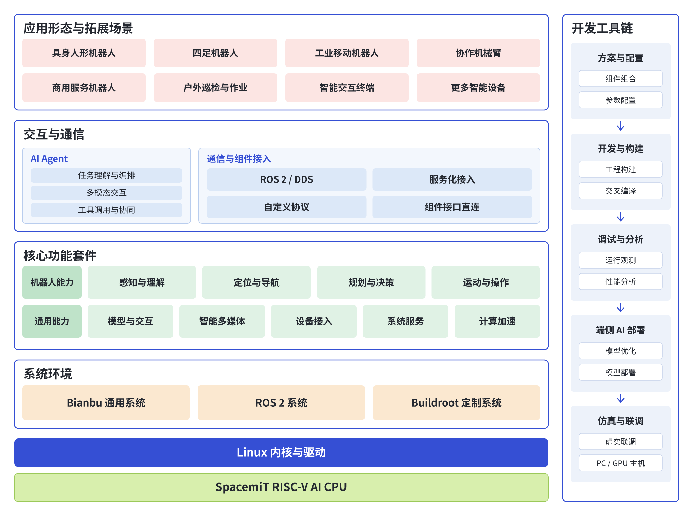

# 平台概览

## 1. 平台简介

SpacemiT Robot SDK 面向机器人与智能设备开发，将 RISC-V 端侧计算、AI 推理与机器人软件整合为一套开发平台。开发者可围绕环境感知、人机交互和自主行动设计应用，将各项基础能力组合为适配不同机器人形态与使用场景的产品功能。

SDK 采用组件化的开发方式，支持通过原生接口或 ROS 2 组织应用。开发者可按需选择组件，从基础功能逐步扩展到完整应用，也可接入自己的算法、设备和服务。

## 2. 架构与分层



SDK 主要目录与图中各层的对应关系如下：

```text
spacemit_robot/
├── application/                  # 应用与参考方案
│   ├── native/                   # 原生应用
│   │   └── omni_agent/           # 多模态 Agent
│   └── ros2/                     # ROS 2 应用
├── components/                   # 通信接入与核心功能组件
│   ├── ai-gateway/               # AI 服务接入
│   ├── agent_tools/              # 工具调用与设备通信
│   │   ├── mcp/
│   │   ├── mlink_device/
│   │   └── mlink_gateway/
│   ├── perception/               # 感知
│   ├── model_zoo/                # 模型推理与交互
│   ├── control/                  # 运动控制
│   ├── multimedia/               # 智能多媒体
│   │   ├── audio/
│   │   ├── audio_process/
│   │   └── mpp/
│   ├── peripherals/              # 设备接入
│   ├── system/sys/               # 系统服务
│   └── simulation/mujoco/        # MuJoCo 仿真
├── middleware/ros2/              # ROS 2 功能包与集成
│   ├── perception/               # 感知
│   ├── slam/                     # 定位与建图
│   ├── planning/                 # 导航与规划
│   ├── control/                  # 运动控制
│   ├── peripherals/              # 设备接入
│   ├── simulation/               # 仿真
│   └── tools/                    # 可视化与调试
├── target/                       # 产品方案与组件配置
├── build/                        # 构建工具
└── scripts/                      # 开发脚本
```

Bianbu、ROS 2 运行环境、Buildroot 及 Linux 内核由配套系统和 BSP 提供；计算加速库通过系统依赖安装。

## 3. 快速开始

首次使用时，按以下顺序准备开发环境并运行示例：

1. **准备开发板**：了解[硬件介绍](02-快速入门/2.1-硬件介绍/index.md)，再按[镜像烧录](02-快速入门/2.2-镜像烧录/index.md)或[系统升级](02-快速入门/2.3-系统升级.md)准备开发环境。
2. **获取并构建 SDK**：按[构建编译](02-快速入门/2.4-构建编译.md)获取源码，选择产品方案与编译方式。
3. **运行基础示例**：通过[示例运行](02-快速入门/2.5-示例运行.md)体验视觉检测与语音交互。
4. **组合应用功能**：从[参考方案](03-参考方案/index.md)选择应用场景，或进入 [AI 与算法](04-AI与算法/index.md)、[机器人开发](05-机器人开发/index.md)、[系统与平台](06-系统与平台/index.md)查阅组件用法。

网络配置、远程连接、资源下载和硬件选型见[快速入门](02-快速入门/index.md)。

## 4. 版本变更

[版本说明](07-版本说明/index.md)记录 SDK 基线、系统要求、功能变更与升级建议。当前文档版本为 [K1-V20261109](07-版本说明/7.1-发行与维护/7.1.1-K1-V20261109.md)，升级前可据此了解对应版本的使用要求。

## 5. 社区与反馈

- **源码与贡献**：访问 [SpacemiT Robot GitHub](https://github.com/spacemit-robotics)，查看组件源码、提交 Issue 或参与代码贡献。
- **交流与分享**：在[进迭时空开发者论坛](https://forum.spacemit.com/)讨论开发问题，分享应用案例与使用经验。
- **常见问题**：查阅[FAQ](FAQ.md)及各功能章节的调试指南。

反馈问题时，请注明开发板型号、系统与 SDK 版本，并附上操作步骤与相关日志。组件问题可提交到对应源码仓库；文档问题请同时提供页面链接。
