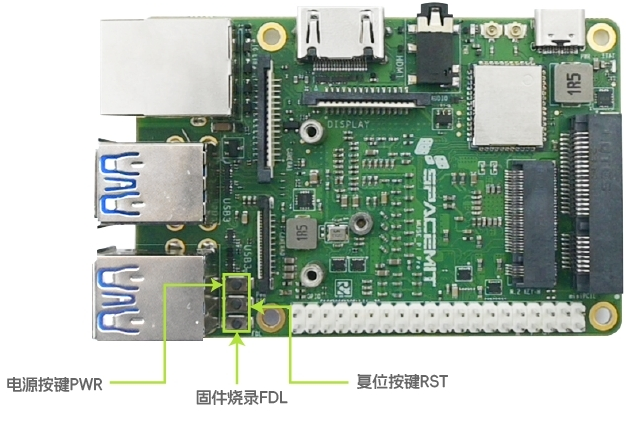

# 1.2 系统烧录

## 按键说明

Muse Pi Pro 开发板配备多个按键，其中固件烧录时主要使用 **FDL（固件下载）按键** 和 **RST（复位）按键**。各按键在板上的具体位置如下图所示：



## Type-C 数据线烧录

本节介绍如何通过 Type-C 数据线将 PC 上已下载的固件烧录至 Muse Pi Pro 开发板。

### 固件下载

K1 可以使用以下两类固件，二者的区别见下文 [ROS2_LXQT 与 Bianbu 通用固件](#ros2_lxqt-与-bianbu-通用固件)：

- **ROS2_LXQT 固件**（预装 ROS 2 与 BRDK，开箱即用）：[ROS2_LXQT v1.5 固件下载](https://archive.spacemit.com/ros2/bianbu-ros-images/v1.5/ROS2_LXQT-v1.5-20251216.zip)
- **Bianbu 通用固件**（更轻量，按需安装软件包）：[Bianbu v2.3.5 下载目录](https://archive.spacemit.com/image/k1/version/bianbu/v2.3.5/)、[Bianbu v2.2 下载目录](https://archive.spacemit.com/image/k1/version/bianbu/v2.2/)

本文档的 K1 验证环境主要为 Bianbu 2.3.5（Linux 6.6.63）。

### 刷机模式设置

请按照以下步骤将开发板切换至刷机模式：

1. 准备一根 Type-C 数据线，一端连接至上位机 PC，另一端连接至 Muse Pi Pro 的 Type-C 接口；
2. 长按 FDL 按键不松手；
3. 短按一次 RST 按键；
4. 松开 FDL 按键。

设备将进入刷机模式。

### 固件烧录工具

开发板进入刷机模式之后，请参考 [进迭时空官方刷机工具使用手册](https://developer.spacemit.com/documentation?token=O6wlwlXcoiBZUikVNh2cczhin5d) 使用刷机工具完成固件烧录。

刷机完成后，按下 RST 按键重启设备，即可启动系统。

## ROS2_LXQT 与 Bianbu 通用固件

### ROS2_LXQT 是什么

ROS2_LXQT 不是独立的发行版，而是在 **Bianbu 2.2 LXQt 通用固件**（Bianbu Desktop Lite）基础上做了 rootfs 客制化的固件，主要面向开箱演示和教学场景。相对 Bianbu 2.2 LXQt 通用固件，ROS2_LXQT 的客制化内容如下：

| 类别 | 客制化内容 |
| :--- | :--- |
| ROS 2 与 BRDK | 预装 ROS 2 Humble；预装 BRDK（`bros.tar.gz` 解压到 `/opt/bros`）；`~/.bashrc` 末尾加入 `source /opt/bros/humble/setup.bash` |
| 软件源优先级 | `/etc/apt/preferences.d/` 中将 `noble-ros` 源（`o=Spacemit, n=noble-ros`）设为 `Pin-Priority: 1100`；将当前内核包 `linux-image-6.6.63` 锁定为指定版本，避免安装软件包时被降级 |
| 桌面与工具 | 桌面增加“开发环境安装”图标（一键安装 RDK、MediaEngine、ROS 2 依赖，见 [2.3 系统依赖安装](../02-ROS2_LXQT基础使用/2.3-系统依赖安装.md)）；内置 FeatherPad 文本编辑器和 `ddr_bw` 内存带宽测试工具；默认提供 Wi-Fi 连接图标；关闭自动锁屏 |
| 权限与系统 | 调整 `/opt` 下目录的用户组，普通用户可直接在其中编译示例；登录界面版本号更新为 2.2；移除 GCC |
| 网络 | MUSE Pi 上将 `eth0` 用于 EtherCAT（MUSE Pi Pro 等其他板型不受影响） |

> **注意**：ROS2_LXQT 移除了 GCC。需要编译 K3 SDK 或 C/C++ 示例时，先执行 `sudo apt install build-essential`。

### 推荐：使用轻量 Bianbu 固件按需安装

如果不需要 ROS2_LXQT 预置的桌面和演示内容，可以直接烧录更轻量的 Bianbu 通用固件，再只安装自己需要的软件包。这样镜像更小、系统更干净，也便于与 K3 SDK 的构建流程保持一致。

| 固件 | 适用场景 | v2.3.5 镜像 |
| :--- | :--- | :--- |
| Bianbu Minimal（命令行） | 无屏设备、远程开发、最小系统 | `Bianbu-Minimal-K1-V2.3.5-20260601180942.zip` |
| Bianbu LXQt（Desktop Lite） | 需要轻量桌面；ROS2_LXQT 的基础系统 | `Bianbu-LXQt-K1-V2.3.5-20260602111447.zip` |
| Bianbu GNOME（Desktop） | 需要完整桌面 | `Bianbu-GNOME-K1-V2.3.5-20260601190226.zip` |

以上镜像位于 [Bianbu v2.3.5 下载目录](https://archive.spacemit.com/image/k1/version/bianbu/v2.3.5/)。如需与 ROS2_LXQT 保持同一基础版本，可从 [Bianbu v2.2 下载目录](https://archive.spacemit.com/image/k1/version/bianbu/v2.2/) 选择 `bianbu-24.04-minimal-k1-v2.2-*` 或 `bianbu-24.04-desktop-lite-k1-v2.2-*`。烧录方法与 ROS2_LXQT 相同。

烧录后按需安装，各步骤相互独立，只做需要的部分：

| 需求 | 安装方式 |
| :--- | :--- |
| 编译工具 | `sudo apt update && sudo apt install build-essential git` |
| 使用 K3 SDK（Robot SDK） | 按 [1.6 构建编译](1.6-构建编译.md) 获取并编译 SDK，SDK 会按方案自动安装所需依赖 |
| 只需要 ROS 2 | 按 [5.1.2 ROS2 安装](../05-机器人开发/5.1-ROS2环境与工具/5.1.2-ROS2安装.md) 启用 `noble-ros` 源并安装 `ros-humble-ros-base`，或参考 [1.6 构建编译](1.6-构建编译.md) 的“不使用 SDK 时安装 ROS 2 与基础依赖” |
| 使用 BRDK（`/opt/bros` 下的 RDK 功能包） | 先安装 ROS 2，再按 [5.1.1 AI Robot 安装](../05-机器人开发/5.1-ROS2环境与工具/5.1.1-AI-Robot安装.md) 下载 `bros.tar.gz` 解压到 `/opt` |

可选：如果希望与 ROS2_LXQT 一样优先使用 `noble-ros` 源中的软件包版本，可添加以下 APT 优先级配置。该配置会让 `noble-ros` 中的同名包覆盖系统源版本，仅在确有需要时添加：

```bash
sudo tee /etc/apt/preferences.d/noble-ros-priority > /dev/null <<'PREF'
Package: *
Pin: release o=Spacemit, n=noble-ros
Pin-Priority: 1100
PREF
sudo apt update
```

> **说明**：本文档中写有“已烧录 ROS2_LXQT 系统镜像”的章节，在 Bianbu 通用固件上按上表安装 ROS 2 和 BRDK 后同样适用；新终端需先执行 `source /opt/ros/humble/setup.bash`，使用 BRDK 时再执行 `source /opt/bros/humble/setup.bash`。
