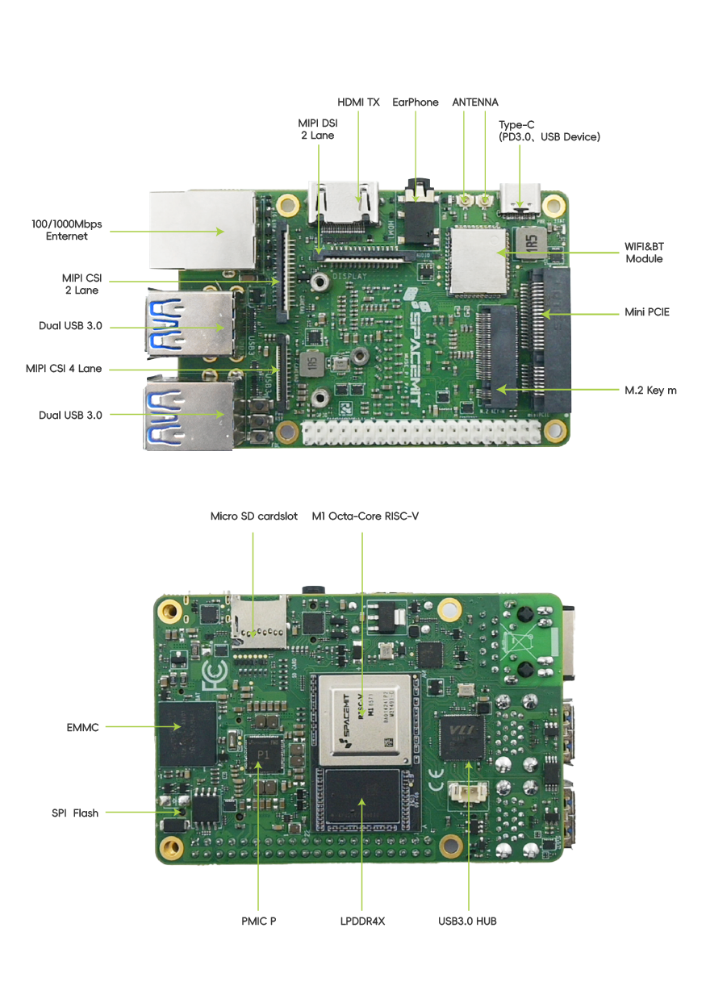

# 2.1 上电开机

本节介绍 MUSE Pi Pro（K1）开发板的硬件组成，以及接线、上电和首次登录的方法。

## 1. 硬件介绍

MUSE Pi Pro 单板计算机将 RISC-V 八核处理器、存储硬盘、通用接口部件和扩展接口布置在同一块电路板上，支持 UEFI 启动以及多种操作系统和应用的运行，是一款完整的计算机系统产品。MUSE Pi Pro 为 1.8 寸单板，能够满足大语言模型应用、机器人、教育科研和物联网等场景中低功耗、空间紧凑情况下的算力需求，为 AI 新时代提供计算能力和丰富的接口扩展。

详细说明参考：[MUSE Pi Pro 用户使用指南](https://developer.spacemit.com/documentation?token=EIk1wVY9NinD95kMsw0cFM89npd#muse-pi-pro-%E7%94%A8%E6%88%B7%E4%BD%BF%E7%94%A8%E6%8C%87%E5%8D%97)

## 2. 物品清单

| 类型 | 说明 |
| --- | --- |
| 开发板 | MUSE Pi Pro（SpacemiT K1） |
| 供电 | 符合 MUSE Pi Pro 规格的电源适配器，规格见上方用户使用指南 |
| 显示器 | HDMI 显示器（可选，使用桌面时需要） |
| 键盘、鼠标 | USB 键盘、鼠标（可选） |
| 串口调试 | USB 转 TTL 串口线（可选，没有显示器时使用） |
| 数据线 | Type-C 数据线（烧录镜像时使用） |

串口和显示器二选一即可，新手推荐使用显示器。

## 3. 操作步骤

1. 如果板上还没有系统，先按 [2.2 镜像烧录](2.2-镜像烧录.md) 烧录 Bianbu 固件。
2. 接入显示器、键盘和鼠标，或接入串口线。
3. 接入电源，开发板自动启动。首次启动按向导创建用户名和密码，请记住它们。
4. 按 [2.5 入门配置](2.5-入门配置.md) 联网，并启用 SSH、VNC 服务。
5. 需要远程操作时，按 [2.6 远程连接](2.6-远程连接.md) 使用串口、SSH 或 VNC 登录。

完成以上步骤后，按 [2.3 构建编译](2.3-构建编译.md) 获取并编译 SDK。
