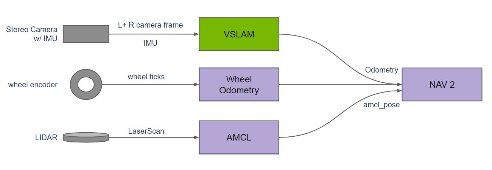
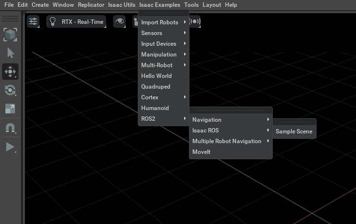
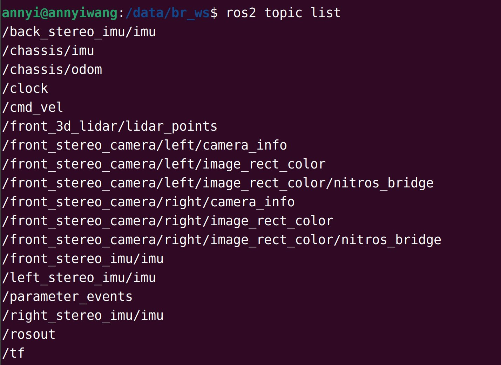
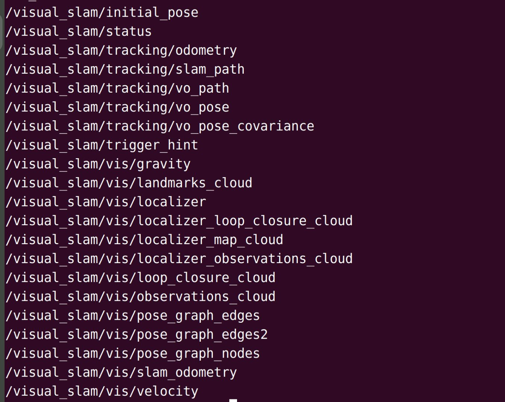
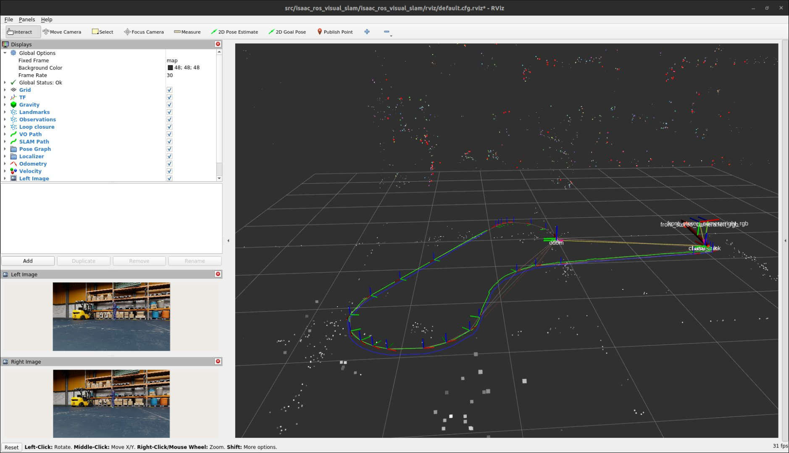
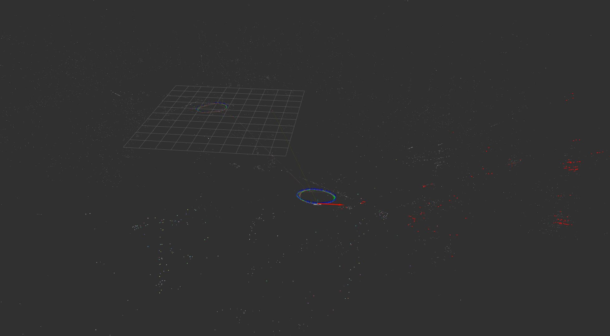
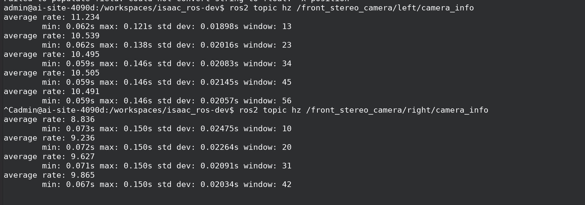

# 3.6.1 Isaac-Sim仿真建图

> ⚠️运行环境说明：
>
> - Isaac Sim运行在 GPU 服务器，Isaac ROS 运行在部署于 GPU 服务器的 Docker 容器（[isaac-ros-dev](https://nvidia-isaac-ros.github.io/v/release-3.2/concepts/docker_devenv/index.html#development-environment)）。
>
> - 官方教程：[Isaac ROS 官方示例](https://nvidia-isaac-ros.github.io/v/release-3.2/concepts/visual_slam/cuvslam/tutorial_isaac_sim.html)

## 简介



Isaac ROS 的 VSLAM 方案通过融合多传感器数据（Stereo Camera、IMU、编码器、LiDAR）提供导航所需的定位和里程计信息，用于驱动 ROS2 的导航栈（Nav2）。该系统的核心目标是生成精确的 `/odom` 和 `/amcl_pose` 消息。

- Stereo Camera + IMU：通过双目视觉 + 惯性测量，实现视觉里程计 + 重定位（定位）
- Wheel Encoder：通过车轮编码器计算的里程信息（增量位置）用于辅助定位
- LiDAR：自适应蒙特卡洛定位（粒子滤波法）使用 LaserScan + 地图进行全局定位

## 准备工作

### 下载离线资源

在 GPU 服务器上完成 [Isaac ROS 3.2 工作空间准备](https://nvidia-isaac-ros.github.io/v/release-3.2/getting_started/dev_env_setup.html)，并设置 `ISAAC_ROS_WS`。以下命令在 Bash 终端执行，下载与 Isaac ROS 3.2 配套的 Isaac ROS Visual SLAM 离线资源。

```bash
sudo apt-get update
sudo apt-get install -y curl jq tar
```

```bash
(
set -euo pipefail
: "${ISAAC_ROS_WS:?请先设置 ISAAC_ROS_WS 为 Isaac ROS 工作空间路径}"
NGC_RESOURCE="isaac_ros_visual_slam_assets"
VERSION_REQ_URL="https://api.ngc.nvidia.com/v2/resources/nvidia/isaac/${NGC_RESOURCE}/versions"
ASSET_VERSION=$(curl -fsSL "$VERSION_REQ_URL" | jq -r '
    .recipeVersions[].versionId
    | select(test("^3\\.[0-9]+\\.[0-9]+$"))
    | select((split(".")[1] | tonumber) <= 2)
    ' | sort -V | tail -n 1)

if [ -z "$ASSET_VERSION" ]; then
    echo "未找到适用于 Isaac ROS 3.2 的资源版本" >&2
    exit 1
fi

ASSET_DIR="${ISAAC_ROS_WS}/isaac_ros_assets"
mkdir -p "$ASSET_DIR"
ARCHIVE_PATH=$(mktemp "${TMPDIR:-/tmp}/isaac-assets.XXXXXX.tar.gz")
trap 'rm -f "$ARCHIVE_PATH"' EXIT
FILE_REQ_URL="https://api.ngc.nvidia.com/v2/resources/nvidia/isaac/${NGC_RESOURCE}/versions/${ASSET_VERSION}/files/quickstart.tar.gz"
curl -fL --retry 3 "$FILE_REQ_URL" -o "$ARCHIVE_PATH"
tar -xzf "$ARCHIVE_PATH" -C "$ASSET_DIR"
)
```

### 安装/编译 Isaac ROS Visual SLAM

进入 `isaac-ros-dev` 容器，安装或编译 `isaac_ros_visual_slam` 包。

- 安装预编译包：

```Plain
sudo apt-get update
sudo apt-get install -y ros-humble-isaac-ros-visual-slam
```

- 源码编译：

```Plain
cd ${ISAAC_ROS_WS}/src
git clone -b release-3.2 https://github.com/NVIDIA-ISAAC-ROS/isaac_ros_visual_slam.git isaac_ros_visual_slam

sudo apt-get update
rosdep update && rosdep install --from-paths ${ISAAC_ROS_WS}/src/isaac_ros_visual_slam/isaac_ros_visual_slam --ignore-src -y

cd ${ISAAC_ROS_WS}/
colcon build --symlink-install --packages-up-to isaac_ros_visual_slam --base-paths ${ISAAC_ROS_WS}/src/isaac_ros_visual_slam/isaac_ros_visual_slam

source install/setup.bash
```

## 启动仿真

在 GPU 服务器上启动仿真。

### 启动 IsaacSim

```Plain
cd issacsim
./isaac-sim.sh
```

### 加载场景和小车模型

参考：[https://nvidia-isaac-ros.github.io/v/release-3.2/getting_started/isaac_sim/index.html](https://nvidia-isaac-ros.github.io/v/release-3.2/getting_started/isaac_sim/index.html)



### 启动仿真过程

点击视图左边的 **PLAY** 按钮启动场景，传感器开始发布数据话题，控制器开始接收速度等指令。



## 启动 Issac ROS VSLAM

在 isaac-ros-dev 中启动 issac ros vslam。

### 启动 VSLAM 系统

```Plain
 ros2 launch isaac_ros_visual_slam isaac_ros_visual_slam_isaac_sim.launch.py
```

该命令启动 VSLAM 算法节点，自动订阅来自 Isaac Sim 的相机传感器数据和 TF 坐标变换信息，进行视觉里程计算与地图构建，并发布包括 odometry 里程计信息、点云地图等在内的定位与感知信息供后续模块使用。



### 发布 `/cmd_vel` 话题

启动一个 ROS2 窗口（可以是 issac-ros-dev/PC/K1，在同一个 ROS2 域即可），发送速度给小车：

```Plain
ros2 topic pub --once /cmd_vel geometry_msgs/msg/Twist "{linear: {x: 0.2, y: 0.0, z: 0.0}, angular: {x: 0.0, y: 0.0, z: 0.2}}"
```

上述命令发布 `/cmd_vel` 话题，Isaac Sim 的差分控制器订阅该话题驱动小车运动。具体地，给小车一个 0.2m/s 的线速度和 0.2rad/s 的角速度。使得小车原地绕半径为 1m 的圆逆时针匀速运动。

也可以启动 `teleop_twist_keyboard` 节点去控制小车运动：

```Plain
ros2 run teleop_twist_keyboard teleop_twist_keyboard
```

### RVIZ 可视化

重启一个 isaac-ros-dev 窗口，在 rviz2 中加载可视化配置文件：

```Plain
rviz2 -d $(ros2 pkg prefix isaac_ros_visual_slam --share)/rviz/isaac_sim.cfg.rviz
```

### 查看里程计信息

启动一个 ROS2 窗口（可以是 issac-ros-dev/PC/K1，同一个 ROS2 域即可），查看小车的里程计信息：

```Plain
ros2 topic echo /visual_slam/tracking/odometry
```

## 保存地图

### 判断地图是否建好



保存地图前，检查以下状态：

- 定位稳定，无跟丢/漂移。可通过查看 `/visual_slam/status` 话题，没有报告 TRACK_LOST 或 TRACKING_WEAK 状态。
- 地图收敛，点云/关键帧稳定。实时监控 `/visual_slam/vis/landmarks_cloud` 的点云数量，建图后期新增特征点速率应显著下降。

### 保存地图到本地

Isaac ROS 调用自定义的 `save_map` 服务来保存地图：

```Plain
ros2 service call /visual_slam/save_map isaac_ros_visual_slam_interfaces/srv/FilePath "{file_path: /path/to/save/the/map}"
```

⚠️注意：/path/to/save/the/map 需要为空路径，因为它会覆盖该路径内容

生成的地图为 .mdb 格式，是 Isaac ROS 独有的地图数据格式：

```Plain
admin@ai-site-4090d:/workspaces/isaac_ros-dev$ ros2 service call /visual_slam/save_map isaac_ros_visual_slam_interfaces/srv/FilePath "{file_path: /tmp/map}"
requester: making request: isaac_ros_visual_slam_interfaces.srv.FilePath_Request(file_path='/tmp/map')

response:
isaac_ros_visual_slam_interfaces.srv.FilePath_Response(success=True)

admin@ai-site-4090d:/workspaces/isaac_ros-dev$ ls -al /tmp/map
total 26436
drwxr-xr-x 2 admin admin     4096 May 29 11:22 .
drwxrwxrwt 1 root  root      4096 May 29 11:22 ..
-rw-r--r-- 1 admin admin 27062272 May 29 11:22 data.mdb
```

## 使用地图

关闭 vslam节点并重启：

```Plain
 ros2 launch isaac_ros_visual_slam isaac_ros_visual_slam_isaac_sim.launch.py
```

加载地图并本地化（给一个初始位置）：

```Plain
ros2 service call /visual_slam/localize_in_map isaac_ros_visual_slam_interfaces/srv/LocalizeInMap "
  map_folder_path: '/path/to/save/the/map'
  pose_hint:
    position:
      x: x-position
      y: y-position
      z: z-position
    orientation:
      x: 0.0
      y: 0.0
      z: 0.0
      w: 1.0"
```

如果失败，则可能是由于该位置与地图其他位置相似，导致 VSLAM 判断失误，需换一个位置本地化。

## <!--问题-->

### <!--1. 跟丢/漂移-->

<!---->

<!--具体原因还未知。-->

### <!--2. 相机帧率较低-->

<!---->

<!--配的应该是60帧的相机。-->
