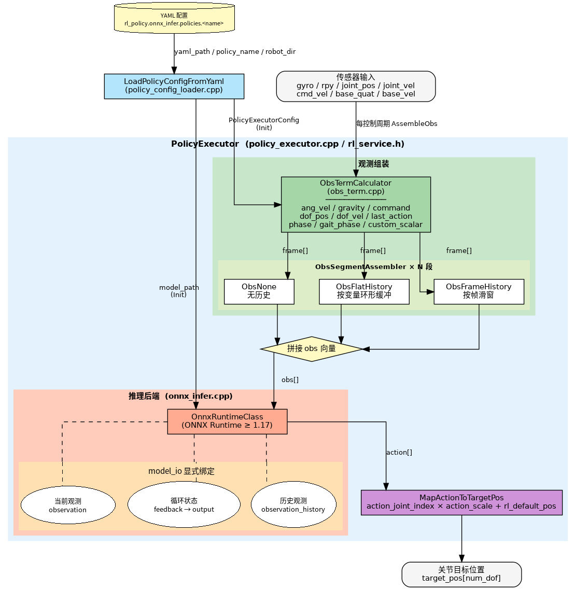

# 4.3 强化学习

> **文档类型**：算法与模型能力
> **说明**：基于 ONNX Runtime 的 RL 强化学习策略推理执行器，支持 MLP、LSTM 及带历史观测输入等模型结构，提供段式观测组装功能。本文档涵盖模块概述、环境搭建、示例运行、API 调用、调试和常见问题。

## 1. 模块概述

- **主要功能**：基于 ONNX Runtime 的机器人 RL 策略推理执行器。负责从 YAML 配置文件加载策略模型，按配置组装观测向量（obs），执行推理，并将策略输出映射为关节目标位置。模块与机器人型号完全解耦，所有参数由 YAML 驱动。
- **核心特性**：
  - 支持 MLP、LSTM 及带历史观测输入的策略，通过 `model_io` 显式声明输入输出及状态反馈关系
  - 段式观测组装：每个观测段独立配置 terms 和历史模式（无历史 / flat_history / frame_history）
  - 多策略切换：同一配置文件可定义多个策略，运行时按名切换
  - 推理后端：当前为 ONNX Runtime，接口与后端解耦
- **软件框图**：

  

- **相关目录**：

  ```
  components/model_zoo/rl/
  ├── include/
  │   └── rl_service.h                      # 对外唯一头文件：PolicyExecutor、LoadedPolicyConfig 等
  ├── src/
  │   ├── policy_executor.cpp               # 编排层：Init/AssembleObs/Infer/MapAction 实现（接口声明在 rl_service.h）
  │   ├── policy_config_loader.cpp          # YAML 解析：加载策略配置到 PolicyExecutorConfig（接口声明在 rl_service.h）
  │   ├── obs_assembler.h                   # 观测段组装器抽象基类（纯虚接口，仅头文件）
  │   ├── obs_term.h / obs_term.cpp         # 观测项计算器：各 term（gyro/dof_pos/phase 等）的数值计算
  │   ├── obs_none.h / obs_none.cpp         # 无历史模式组装器（mode 为空）
  │   ├── obs_flat_history.h / .cpp         # 按变量分组的环形历史缓冲组装器（mode: flat_history）
  │   ├── obs_frame_history.h / .cpp        # 按帧滑窗历史缓冲组装器（mode: frame_history）
  │   └── backends/
  │       ├── onnx_infer.h                  # ONNX Runtime 推理封装：模型加载、维度推断、Run
  │       └── onnx_infer.cpp
  ├── cmake/
  │   └── FindONNXRuntime.cmake             # ONNX Runtime 查找脚本
  ├── example/
  │   ├── test_policy_executor.cpp          # 功能测试：验证配置加载、推理链路、维度正确性
  │   ├── test_onnx_infer.cpp               # 功能测试：验证 ONNX Runtime 后端安装与模型可推理
  │   ├── benchmark_onnx_infer.cpp          # 性能基准：隔离测试 ORT 推理延迟（排除 obs 组装干扰）
  │   └── benchmark_policy_executor.cpp     # 性能基准：AssembleObs→Infer→MapAction 端到端分段计时
  └── scripts/
      ├── run_benchmark_onnx.sh             # 封装 benchmark_onnx_infer，自动定位 SDK_ROOT
      ├── run_benchmark_policy.sh           # 封装 benchmark_policy_executor，自动定位 SDK_ROOT
      └── pt2onnx.py                        # PyTorch→ONNX 转换脚本，自动检测 MLP/LSTM/GRU 并外置状态
  ```

## 2. 环境准备

### 前置条件

后续命令默认在 K1 设备的 `spacemit_robot` SDK 根目录执行。SDK 源码获取与基础环境配置参考 [构建编译](../01-快速开始/1.6-构建编译.md)。

- **运行环境**：C++17，CMake ≥ 3.16
- **ONNX Runtime**：
  - x86_64 开发机：首次 `mm` 编译 `model_zoo/rl` 时 CMake 自动拉取 `onnxruntime-linux-x64-1.21.0.tgz`
    到 `~/.cache/thirdparty/onnxruntime/onnxruntime-linux-x64-1.21.0/`。已预装到 `/usr/local` 或
    通过 `ONNXRUNTIME_DIR` 指定路径时优先使用。
  - K1 板卡（rv64）：安装 SpacemiT 定制版 onnxruntime

    ```bash
    # 安装适用于 K1 的 SpacemiT ONNX Runtime 和模型检查工具
    apt install -y spacemit-onnxruntime python3-onnx
    
    # 仅当已安装以下普通版包并与厂商运行库冲突时，按实际包名移除
    sudo apt remove libonnxruntime-dev libonnxruntime1.23 python3-onnxruntime
    ```

- **其他依赖**：Eigen3、yaml-cpp（均可通过 apt 安装）

    ```bash
    sudo apt install -y libeigen3-dev libyaml-cpp-dev
    ```

- **环境变量**：

    ```bash
    cd ~/spacemit_robot
    source build/envsetup.sh
    ```

### 构建编译

- **获取代码**：

  已有 SDK 且相关目录齐全时，可直接执行模型下载和编译；以下 `repo init`、`repo sync` 用于初始化新的 SDK 工作目录。

  RL 组件路径为 `components/model_zoo/rl`。运行示例和基准测试还需要对应机型的仓库（包含策略下载脚本和 YAML 配置），按需选择以下拉取方式：

  1. **拉取指定机型**（以 g1 为例）：

  ```bash
  repo init -u https://github.com/spacemit-robotics/manifest.git -b main -m default.xml \
    --repo-url=https://gitee.com/spacemit-robotics/git-repo \
    -g core,model_zoo_rl,humanoid_unitree_g1
  repo sync -j4
  repo start robot-dev --all
  ```

  拉取后，运行该机型的下载脚本获取 ONNX 策略模型：

  ```bash
  SDK_ROOT=$(pwd) application/native/humanoid_unitree_g1/scripts/download_models_g1.sh
  ```

  2. **一次拉取所有机型**（获取全部机型的下载脚本，按需运行各机型策略下载）：

  ```bash
  repo init -u https://github.com/spacemit-robotics/manifest.git -b main -m default.xml \
    --repo-url=https://gitee.com/spacemit-robotics/git-repo \
    -g core,model_zoo_rl,humanoid
  repo sync -j4
  repo start robot-dev --all
  ```

  拉取完成后，按需运行各机型 RL 策略的下载脚本（以 g1 和 tiangong 为例）：

  ```bash
  SDK_ROOT=$(pwd) application/native/humanoid_unitree_g1/scripts/download_models_g1.sh
  SDK_ROOT=$(pwd) application/native/humanoid_tiangong/scripts/download_models_tiangong.sh
  ```

  > 各机型 group 名：`humanoid_unitree_g1`、`humanoid_unitree_h1_2`、`humanoid_unitree_r1`、`humanoid_unitree_go1`、`humanoid_qinglong`、`humanoid_tiangong`。

- **编译**：

    ```bash
    cd ~/spacemit_robot
    source build/envsetup.sh
    lunch k1-muse-pipro-ai-cubpet
    cd components/model_zoo/rl
    mm
    ```

- **产物**：
  - `output/staging/lib/librl.so` — 推理库
  - `output/staging/bin/test_policy_executor` — 完整接口功能测试
  - `output/staging/bin/test_onnx_infer` — ONNX 后端功能测试
  - `output/staging/bin/benchmark_onnx_infer` — 纯推理性能基准
  - `output/staging/bin/benchmark_policy_executor` — 完整链路性能基准
  - `output/staging/bin/run_benchmark_onnx.sh` — 纯推理基准启动脚本
  - `output/staging/bin/run_benchmark_policy.sh` — 完整链路基准启动脚本

## 3. 示例使用（从 0 跑通）

### 3.1 策略推理全链路测试

验证配置加载、obs 组装、推理、动作映射全流程。

**前置条件**：

1. rl组件`mm`编译完成，`output/staging/bin/test_policy_executor` 已生成；

2. 检查具体机型案例的仓库源码是否就位，对应机型的 YAML 在源码中提供（如 `application/native/humanoid_unitree_g1/config/g1.yaml`）；

3. 策略模型（.onnx）需通过以下命令运行下载脚本获取，在仓库根目录执行（以 g1 为例，其他机型使用对应仓库的下载脚本）：

```bash
SDK_ROOT=$(pwd) application/native/humanoid_unitree_g1/scripts/download_models_g1.sh
```

上述命令会将 g1 的 RL 策略模型下载至 `application/native/humanoid_unitree_g1/policy/` 下各子目录。

**步骤 1**：进入 spacemit_robot 根目录

```bash
cd ~/spacemit_robot
```

**步骤 2**：运行测试（以 g1 的 walk_rlgym 策略为例）

```bash
./output/staging/bin/test_policy_executor \
  application/native/humanoid_unitree_g1/config/g1.yaml \
  walk_rlgym \
  application/native/humanoid_unitree_g1
```

参数说明：`<yaml路径> <policy_name> <robot_dir>`，`robot_dir` 用于解析 YAML 中的模型相对路径。

当前 G1 配置中，该 LSTM 行走策略名为 `walk_rlgym`，模型路径仍为 `policy/motion/motion.onnx`。旧版本配置若使用 `motion`，应按实际 YAML 中的策略名传参，无需重命名模型或修改 SDK 源码。

**预期输出**（关键信息摘录）：

```text
[PolicyExecutor] model_io: 严格声明, obs_dim=47, action_dim=12, feedback=2, history=no, external=0, expose=0
[PolicyExecutor] 段式观测: 1 段, 计算维度=47, 模型输入维度=47
  段[0] mode=(none), frame_dim=47, output_dim=47, terms=[ang_vel,gravity,command,dof_pos,dof_vel,last_action,phase]

  观测维度: 47
  动作维度: 12
  feedback 状态对: 2
  是否使用 observation_history 输入: 否

  执行 5 帧推理循环...
    Frame 0: obs_dim=47 action_dim=12 target_pos_dim=29
    Frame 1: obs_dim=47 action_dim=12 target_pos_dim=29
    Frame 2: obs_dim=47 action_dim=12 target_pos_dim=29
    Frame 3: obs_dim=47 action_dim=12 target_pos_dim=29
    Frame 4: obs_dim=47 action_dim=12 target_pos_dim=29

  ✓ 观测维度正确
  ✓ 动作维度正确
  ✓ 关节维度正确
✓ 所有测试成功！
```

### 3.2 ONNX 后端单独测试

直接向推理引擎输入随机张量，验证 ONNX Runtime 的推理能力。支持单模型测试和批量扫描两种模式。

**前置条件**：需已下载策略模型，参考 [§3.1 前置条件](#31-策略推理全链路测试) 中的下载步骤。

**单模型测试**：

```bash
./output/staging/bin/test_onnx_infer \
  application/native/humanoid_unitree_g1/policy/motion/motion.onnx --random
```

**预期输出**（关键信息摘录）：

```
========== ONNX 模型信息 ==========
输入数量: 3
  [0] obs: [1, 47] (total: 47)
  [1] h_in: [1, 1, 64] (total: 64)
  [2] c_in: [1, 1, 64] (total: 64)
输出数量: 3
  [0] action: [1, 12] (total: 12)
  [1] h_out: [1, 1, 64] (total: 64)
  [2] c_out: [1, 1, 64] (total: 64)
===================================

[test] 执行推理 (50 次迭代)...
[test] 推理完成. 平均耗时: 0.682612 ms, Min: 0.507929 ms, Max: 2.82324 ms

[test] 测试成功
```

**批量扫描**（扫描指定目录下所有 .onnx 文件，fork 子进程防止崩溃影响主进程）：

```bash
./output/staging/bin/test_onnx_infer --scan application/native/humanoid_unitree_g1
```

**预期输出**（关键信息摘录，模型数量随模型库更新变化）：

```text
  ONNX 推理批量测试报告

  [ PASS ] .../policy/motion/motion.onnx
  ├─ 输入(3): obs[1,47]  h_in[1,1,64]  c_in[1,1,64]
  └─ 输出(3): action[1,12]  h_out[1,1,64]  c_out[1,1,64]

  [ PASS ] .../policy/tracking/policy.onnx
  ├─ 输入(1): obs[1,160]
  └─ 输出(1): actions[1,29]

  共 10 个模型    通过: 10    失败: 0
```

批量测试使用合成输入验证模型加载和执行能力。检查报告中的通过、失败数量；它不验证真实机器人状态下的动作效果。单模型功能测试中的耗时包含冷启动影响，正式性能对比应使用带预热的基准工具。

### 3.3 性能基准测试

评估 K1 板卡上的 RL 策略执行延迟，分为纯推理和 RL 组件完整链路两个基准。

**前置条件**：需已下载策略模型，参考 [§3.1 前置条件](#31-策略推理全链路测试) 中的下载步骤。

**纯推理基准**（隔离 ONNX Runtime 性能，排除 obs 组装和动作映射干扰）：

```bash
run_benchmark_onnx.sh g1 walk_rlgym
```

**完整链路基准**（AssembleObs → Infer → MapActionToTargetPos 分段计时）：

```bash
run_benchmark_policy.sh g1 walk_rlgym
```

安装后的脚本从任意目录调用均可，自动推算 SDK 根目录；`robot` 和 `policy` 两个参数必填。默认采用连续推理（`throughput`）模式，周期调度和超时统计使用 `--mode periodic --hz 50`。详见 [§附录：性能基准测试](#附录性能基准测试)。

## 4. 应用开发

本章介绍 RL 模块的核心接口和集成方法。

**完整示例代码**：[components/model_zoo/rl/example/test_policy_executor.cpp](https://github.com/spacemit-com/model_zoo_rl/blob/63eb3831d407ae5352dce2222976f75c2d74acd5/example/test_policy_executor.cpp)

**详细接口文档**：[components/model_zoo/rl/README.md](https://github.com/spacemit-com/model_zoo_rl/blob/63eb3831d407ae5352dce2222976f75c2d74acd5/README.md)

### 对外接口

头文件：`include/rl_service.h`，链接库：`librl.so`

### 调用流程

以下代码为集成到控制程序的调用片段，传感器状态、速度指令、关节数量及 `ctrl_cmd` 由上层应用提供。独立编译运行可参考上述完整示例。

```cpp
#include "rl_service.h"
using namespace rl_policy;

// 1. 从 YAML 加载策略配置
LoadedPolicyConfig cfg = LoadPolicyConfigFromYaml(yaml_path, policy_name, robot_dir);

// 2. 初始化执行器（仅推理相关配置）
PolicyExecutor policy;
policy.Init(cfg.exec_cfg);

// 3. 每控制周期：组装观测 → 推理 → 映射动作
Eigen::VectorXf obs;
policy.AssembleObs(gyro, rpy, cmd_vx, cmd_vy, cmd_wz,
                   joint_pos, joint_vel, base_quat, base_vel, dt, obs);

std::vector<double> action;
policy.Infer(obs, action);

std::vector<double> target_pos(num_dof, 0.0);
policy.MapActionToTargetPos(action, target_pos);

// 4. 上层将策略训练增益填入控制命令下发（PolicyExecutor 不使用 kp/kd）
ctrl_cmd.kp = cfg.kp;
ctrl_cmd.kd = cfg.kd;
```

应用程序可使用以下 CMake 模板链接 SDK 已安装的 RL 库。`SDK_PREFIX` 必须显式指向 SDK 的安装前缀；不要依赖 `SDK_ROOT` 是否被环境脚本导出。

```cmake
cmake_minimum_required(VERSION 3.16)
project(rl_application LANGUAGES CXX)
set(CMAKE_CXX_STANDARD 17)
set(CMAKE_CXX_STANDARD_REQUIRED ON)

find_package(Eigen3 REQUIRED)
set(SDK_PREFIX "/root/spacemit_robot/output/staging" CACHE PATH "SDK staging prefix")
find_path(RL_INCLUDE_DIR rl_service.h HINTS "${SDK_PREFIX}/include" REQUIRED NO_DEFAULT_PATH)
find_library(RL_LIBRARY rl HINTS "${SDK_PREFIX}/lib" REQUIRED NO_DEFAULT_PATH)

add_executable(rl_application main.cpp)
target_include_directories(rl_application PRIVATE "${RL_INCLUDE_DIR}")
target_link_libraries(rl_application PRIVATE "${RL_LIBRARY}" Eigen3::Eigen)
set_target_properties(rl_application PROPERTIES BUILD_RPATH "${SDK_PREFIX}/lib")
```

构建应用：

```bash
cmake -S . -B build -DSDK_PREFIX=/root/spacemit_robot/output/staging
cmake --build build -j4
```

> `cfg.exec_cfg` 给 `PolicyExecutor.Init` 用，承载推理所需的全部配置（模型路径、obs 分段、scale 等）。
> `cfg.kp / cfg.kd` 不进入 `PolicyExecutor`，由调用方（如 `behavior_manager` / `control_sim2sim_runtime`）在每帧组装 `ControlCmd` 时填入，随控制命令下发给驱动层；切策略时由调用方负责切换对应的 kp/kd 一起下发。这样策略与其训练时的 PD 增益一一绑定，避免不同策略共用同一组 PD 增益导致动力学不匹配。

### 关键接口说明

| 接口 | 说明 |
| --- | --- |
| `LoadPolicyConfigFromYaml(yaml, name, robot_dir)` | 解析 YAML 中 `rl_policy.onnx_infer.policies.<name>` 节点，返回 `LoadedPolicyConfig`：包含推理用的 `exec_cfg`、策略训练时的 PD 增益 `kp / kd`，以及指令初值 `command_init` 等 |
| `Init(cfg)` | 加载 ONNX 模型，初始化观测组装器及 `model_io` 状态反馈 |
| `ObsDim()` / `ActionDim()` | 查询观测/动作向量维度 |
| `FeedbackStateCount()` / `HasObsHist()` | 查询反馈状态张量对数，以及是否声明 `observation_history` 输入 |
| `PrintModelInfo()` | 打印模型输入输出维度、反馈状态与历史输入信息 |
| `AssembleObs(...)` | 按段配置组装观测向量，内部维护历史缓冲 |
| `Infer(obs, action)` | 按 `model_io` 绑定输入输出并执行推理，自动回灌声明的反馈状态 |
| `MapActionToTargetPos(action, target_pos)` | 按 `action_joint_index` 将策略输出映射到全身关节位置 |
| `GetRuntimeInfo()` | 查询实际初始化的推理后端及线程配置信息 |
| `SetCustomScalar(name, val)` / `GetCustomScalar(name)` | 设置/获取自定义标量（如 `"z"` 相位、`"stand_flag"` 标志）。需在 AssembleObs 前调用，初始值由 YAML `observation.custom_scalar_keys` / `custom_scalar_values` 配置 |

### YAML 配置结构（关键字段）

策略配置使用统一的 `rl_policy.onnx_infer.policies.<policy_name>` 结构。以下以 G1 的 LSTM 行走策略展示完整配置，可保存为独立 YAML；模型下载完成后，将该文件路径、策略名 `walk_rlgym` 和 G1 资源目录传给 `test_policy_executor` 即可运行。

```yaml
rl_policy:
  type: onnx_infer
  rl_dt: 0.02
  onnx_infer:
    policy_names: [walk_rlgym]
    default_policy: walk_rlgym
    policies:
      walk_rlgym:
        model_path: policy/motion/motion.onnx
        model_io:
          inputs:
          - name: obs
            source: observation
          - name: h_in
            source: feedback
            output: h_out
          - name: c_in
            source: feedback
            output: c_out
          outputs:
          - name: action
            target: action
        action_scale: 0.25
        action_blend_ratio: 0.8
        action_joint_index: [0, 1, 2, 3, 4, 5, 6, 7, 8, 9, 10, 11]
        rl_default_pos: [-0.1, 0.0, 0.0, 0.3, -0.2, 0.0, -0.1, 0.0, 0.0, 0.3, -0.2, 0.0, 0.0, 0.0, 0.0, 0.0, 0.0,
          0.0, 0.0, 0.0, 0.0, 0.0, 0.0, 0.0, 0.0, 0.0, 0.0, 0.0, 0.0]
        kp: [100, 100, 100, 150, 40, 40, 100, 100, 100, 150, 40, 40, 600, 500, 500, 40, 40, 40, 40, 20, 10, 10,
          40, 40, 40, 40, 20, 10, 10]
        kd: [2, 2, 2, 4, 2, 2, 2, 2, 2, 4, 2, 2, 15, 12, 12, 1, 1, 1, 1, 0.5, 0.2, 0.2, 1, 1, 1, 1, 0.5, 0.2, 0.2]
        observation:
          segment_0_terms: [ang_vel, gravity, command, dof_pos, dof_vel, last_action, phase]
          phase_period: 0.8
          strict_dim_check: true
          ang_vel_scale: 0.25
          dof_pos_scale: 1.0
          dof_vel_scale: 0.05
        command:
          scale: [2.0, 2.0, 0.25]
          init: [0.0, 0.0, 0.0]
        infer_decimation: 1
```

配置说明：

- `model_path` 相对 `robot_dir` 解析；`model_io` 中的张量名必须与 ONNX 模型一致。`observation` 表示当前观测，`feedback` 表示上一帧输出回灌到下一帧输入。MLP、LSTM 或历史输入模型都通过显式绑定描述。
- `observation.segment_0_terms` 定义第 0 段观测。需要历史输入时，依次增加 `segment_1_terms`、`segment_1_mode`、`segment_1_length` 等字段；模式支持空字符串、`flat_history` 和 `frame_history`，维度必须与模型训练配置一致。
- `rl_default_pos`、`kp`、`kd` 的长度应与全身关节数量一致；`action_joint_index` 决定模型输出对应的关节，`action_scale` 使用训练配置中的值。
- `kp / kd` 随 `LoadedPolicyConfig` 返回，由上层每帧填入控制命令；切换策略时同步切换对应增益。`infer_decimation` 等调度参数也由上层使用。

K1 使用相同的 YAML 结构和 C++ 调用流程。当前组件默认采用 `auto` 后端、1 个推理线程，在 K1 上注册 SpaceMIT EP；本节示例无需套用视觉模块的 8→4 线程调整。后端可在策略节点下通过 `runtime: {provider: cpu}` 显式选择 CPU。程序中的线程数可通过 `cfg.exec_cfg.runtime.threads` 设置，基准工具则使用 `--threads` 参数。

旧版文档中的 `HasLstm()`、策略下直接填写的 `obs_segments` / `strict_obs_dim_check` 与当前接口不一致，应使用上述接口和 `observation.segment_*` 配置。该差异来自 SDK 接口版本，与硬件型号无关。

## 5. 调试指南

- **查看模型结构**：使用 `test_onnx_infer <model.onnx>` 查看模型输入/输出维度和类型
- **验证推理链路**：使用 `test_policy_executor` 验证配置加载、obs 组装、推理、动作映射全流程
- **性能分析**：使用 `run_benchmark_policy.sh` 查看各环节耗时，识别性能瓶颈
- **观测维度调试**：
  - 运行 `test_policy_executor` 查看实际组装的 obs 维度
  - 对比 `ObsDim()` 返回的期望维度
  - 检查 YAML 中 `observation.segment_*` 配置是否与训练时一致

## 6. 常见问题

| 现象 | 可能原因 | 处理 |
| --- | --- | --- |
| `[PolicyConfigLoader] 策略 'xxx' 的配置不存在` | YAML 中 `rl_policy.onnx_infer.policies` 下无该策略名 | 检查 YAML 配置，确认策略名拼写正确；查看 `policy_names` 列表 |
| `[PolicyConfigLoader] ONNX 模型文件不存在` | `model_path` 路径错误或文件缺失 | 检查 `robot_dir/policy/<policy_name>/<model>.onnx` 是否存在；确认 `model_path` 配置正确 |
| `[PolicyExecutor] 观测维度不匹配` | `observation.strict_dim_check: true` 时，YAML 配置的 obs 维度与模型输入不一致 | 运行 `test_policy_executor` 查看实际维度；对比训练时的 obs 配置；调整 `observation.segment_N_terms` |
| `[PolicyExecutor] 观测维度错误: 实际=X, 期望=Y` | `Infer()` 时传入的 obs 维度与 `ObsDim()` 不匹配 | 检查 `AssembleObs()` 输出；确保 obs 向量未被意外修改 |
| `[PolicyExecutor] 未知段模式: xxx` | YAML 中 `observation.segment_N_mode` 配置了不支持的值 | 只支持 `""` (无历史) / `"flat_history"` / `"frame_history"`，检查拼写 |
| 缺少 `model_io` 或输入输出绑定不匹配 | 策略未声明完整的模型张量映射 | 使用 `test_onnx_infer` 查看张量名称与维度，补齐 `model_io.inputs` / `model_io.outputs` |
| 机器人抖动或动作异常 | 归一化参数与训练不一致；或 `action_scale` 过大 | 对比训练配置检查 `ang_vel_scale` / `dof_pos_scale` / `dof_vel_scale`；降低 `action_scale` 测试 |

## 附录：性能基准测试

### 工具说明

| 脚本 | 测试内容 | 适用场景 |
| --- | --- | --- |
| `run_benchmark_onnx.sh` | 纯 ONNX 推理延迟 | 对比不同硬件 / 模型结构的推理引擎性能 |
| `run_benchmark_policy.sh` | AssembleObs + Infer + MapActionToTargetPos 分段延迟 | 评估 RL 组件链路，识别耗时环节 |

**参数说明**：

| 参数 | 说明 | 默认值 |
| --- | --- | --- |
| `robot` | 机型名称 | 必填，例如 `g1` |
| `policy` | YAML 中的策略名称 | 必填，例如 `walk_rlgym` |
| `--warmup N` | 预热轮数，消除首次加载开销 | `100` |
| `--rounds N` | 正式统计轮数 | `1000` |
| `--mode throughput/periodic` | 连续推理或按周期释放任务 | `throughput` |
| `--hz N` | 周期模式的目标频率 | 读取 YAML `rl_policy.rl_dt`，G1 为 50 Hz |
| `--provider auto/cpu/spacemit` | 推理后端选择 | `auto` |
| `--threads N` | CPU intra-op 或 SpaceMIT EP 请求线程数 | `1` |
| `--csv PATH` | 保存逐轮原始数据 | 不保存 |
| `--verbose` | 逐帧输出延迟，用于排查尖刺 | 关闭 |

**输出指标说明**：

| 指标 | 含义 |
| --- | --- |
| Avg | 平均延迟 |
| Std | 标准差，反映延迟的离散程度 |
| P50 | 中位数，50% 的推理比它快 |
| P95 | 95% 的推理比它快，代表典型最坏情况 |
| P99 | 99% 的推理比它快，代表极端尾延迟 |
| Max | 单次最坏情况 |
| Miss | 周期模式下，从计划释放时刻到完成的时间超过 deadline（1000 / hz ms）的次数 |
| Release-to-done | 从计划释放时刻到任务完成的响应时间，包含调度唤醒延迟 |

> 控制任务需要同时关注平均延迟、尾延迟和周期超时。组件基准使用合成输入，不包含传感器采集、驱动通信和电机响应；基准通过不能替代整机闭环验证。

### 测试命令

```bash
cd ~/spacemit_robot
source build/envsetup.sh

# 连续推理：预热 100 次，统计 1000 次
run_benchmark_onnx.sh g1 walk_rlgym
run_benchmark_policy.sh g1 walk_rlgym

# 自定义参数
run_benchmark_policy.sh g1 walk_rlgym --rounds 2000
run_benchmark_policy.sh g1 walk_rlgym --warmup 200
run_benchmark_policy.sh tiangong walk  # 需先下载天工策略模型

# 周期测试：50 Hz，预热 100 次，统计 1000 次，并保存逐轮数据
mkdir -p repro/rl_repro/results
run_benchmark_onnx.sh g1 walk_rlgym \
  --mode periodic --hz 50 --warmup 100 --rounds 1000 \
  --csv repro/rl_repro/results/onnx_periodic.csv
run_benchmark_policy.sh g1 walk_rlgym \
  --mode periodic --hz 50 --warmup 100 --rounds 1000 \
  --csv repro/rl_repro/results/policy_periodic.csv
```

`throughput` 不进行周期等待，不报告周期截止时间结论；`periodic` 按绝对时钟释放任务并记录响应时间与超时次数。两种模式的结果应分别比较。

### 典型数据

测试平台为 K1 Muse Pi Pro，Bianbu 2.3.5、Linux 6.6.63，`spacemit-onnxruntime 2.0.3-bpo1`，RL 组件采用 Release 构建。策略为 G1 `walk_rlgym`，模型为 `policy/motion/motion.onnx`（FP32，观测 47 维、动作 12 维、两对 LSTM 反馈状态）。

下表对应上述 `periodic` 命令：50 Hz、预热 100 次、统计 1000 次，`provider=auto`、请求线程数为 1，SpaceMIT EP 注册成功。该信息不表示所有算子均由 EP 执行，运行时允许 CPU 回退。软件版本、系统负载和调度配置变化时，延迟也会变化。

**纯推理基准（ONNX Run，不含观测组装和动作映射）**：

| 平台 | 策略 | Avg (ms) | Std (ms) | P50 (ms) | P95 (ms) | P99 (ms) | Max (ms) | Miss (50Hz) |
| --- | --- | --- | --- | --- | --- | --- | --- | --- |
| K1 Muse Pi Pro | g1 / walk_rlgym | 0.904 | 0.117 | 0.893 | 1.099 | 1.239 | 1.590 | 0 / 1000 (0.00%) |

纯推理表的延迟来自 `ONNX Run`；Miss 按包含输入更新和反馈复制的 Backend step 的释放至完成时间统计，其平均响应时间为 1.005 ms，最大响应时间为 1.722 ms。

**完整链路基准（AssembleObs → Infer → MapActionToTargetPos）**：

| 平台 | 环节 | Avg (ms) | P50 (ms) | P95 (ms) | P99 (ms) | Max (ms) |
| --- | --- | --- | --- | --- | --- | --- |
| K1 Muse Pi Pro | Obs Assembly | 0.020 | 0.019 | 0.027 | 0.028 | 0.030 |
| K1 Muse Pi Pro | Inference | 0.838 | 0.827 | 1.015 | 1.077 | 1.222 |
| K1 Muse Pi Pro | Action Mapping | 0.004 | 0.004 | 0.004 | 0.004 | 0.005 |
| K1 Muse Pi Pro | **End-to-End（RL 组件）** | **0.863** | **0.851** | **1.046** | **1.111** | **1.255** |
| | **Miss (50Hz)** | **0 / 1000 (0.00%)** | | | | |

> **性能分析**：K1 上该策略的 RL 组件链路平均耗时约 0.86 ms，释放至完成的响应时间平均为 0.952 ms、最大为 1.352 ms；1000 次周期测试均在 20 ms 截止时间内完成，未丢弃周期。两类基准采用不同的合成输入与计时范围，不能将其 Inference 数值视为同一批输入的直接对照。以上数据用于评估组件执行开销，整机实时性还取决于传感器、调度及执行器链路。
