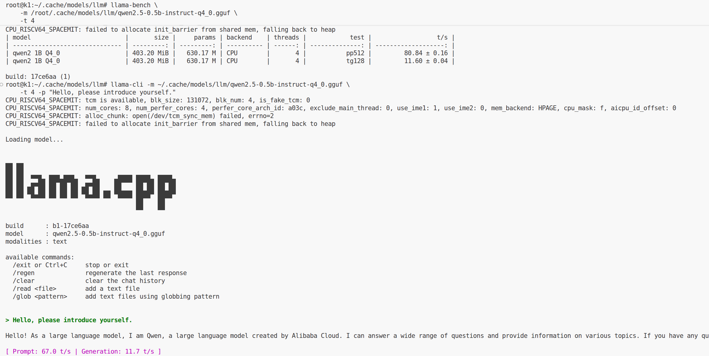
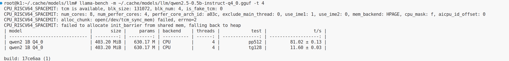
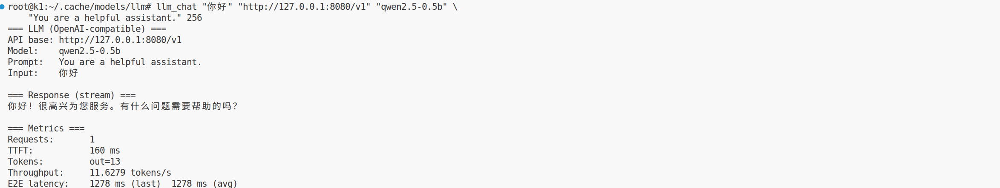

# 4.4 LLM

## 1. 模块概述

LLM 模块提供统一的 C++ LLM 调用接口，便于在机器人应用中集成对话、推理和工具调用能力，支持单轮、多轮、流式输出与 Tool Calling。

代码目录结构：

```text
components/model_zoo/llm/
├── include/llm_service.h          # 对外 C++ API（PIMPL）
├── src/                           # 后端实现与工厂
├── example/cpp/                   # 示例（含 llm_chat）
├── scripts/bench_llm.sh           # 基准测试脚本
└── README.md                      # 组件说明、运行与模型下载说明
```

## 2. 环境准备

### 2.1 获取源码

SDK 源码获取和基础编译环境配置参考 2.3-构建编译。完成 SDK 初始化后，回到本文继续执行 2.2 节。

后续命令默认在 K1 设备的 `spacemit_robot` SDK 根目录执行。

### 2.2 一键编译

```bash
cd /root/spacemit_robot
source build/envsetup.sh
lunch k1-muse-pipro-ai-cubpet

cd components/model_zoo/llm
mm
```

第一次编译会检查系统依赖；缺少 `llama.cpp-tools-spacemit` 时可安装：

```bash
sudo apt-get install llama.cpp-tools-spacemit
```

编译完成后会生成 `llm_chat` 示例，并安装到 `output/staging/bin`。

### 2.3 下载模型（GGUF）

当前示例使用 GGUF 模型。将模型放在默认目录，便于示例与应用复用：

```bash
mkdir -p ~/.cache/models/llm
cd ~/.cache/models/llm

wget https://archive.spacemit.com/spacemit-ai/model_zoo/llm/qwen2.5-0.5b-instruct-q4_0.gguf
```

也可以从 [SpacemiT 模型镜像](https://archive.spacemit.com/spacemit-ai/model_zoo/llm/) 或 Hugging Face 下载其他 `.gguf` 模型，并保存至 `~/.cache/models/llm/`。

## 3. 示例使用

K1 设备具有 8 个 CPU 核。当前 llama.cpp SpaceMIT 后端日志显示 `num_perfer_cores: 4`，因此本节示例统一使用 4 个推理线程；该值不表示设备仅有 4 个 CPU 核。

### 3.1 验证模型与基础对话

`llama-cli`、`llama-bench` 和 `llama-server` 由 `llama.cpp-tools-spacemit` 提供。

**步骤 1**：运行一次对话验证。

```bash
llama-cli -m ~/.cache/models/llm/qwen2.5-0.5b-instruct-q4_0.gguf \
    -t 4 -p "Hello, please introduce yourself."
```



**步骤 2（可选）**：运行基准测试。

```bash
llama-bench -m ~/.cache/models/llm/qwen2.5-0.5b-instruct-q4_0.gguf -t 4
```



### 3.2 llm_chat 应用

前置条件：已完成 2.2 节的编译，并已按 2.3 节下载模型。

**步骤 1**：在一个终端启动 OpenAI 兼容服务。

```bash
llama-server -m ~/.cache/models/llm/qwen2.5-0.5b-instruct-q4_0.gguf \
    -t 4 -tb 4 --host 127.0.0.1 --port 8080
```

启动后，在另一个终端验证服务：

```bash
curl -s http://127.0.0.1:8080/v1/models
```

**步骤 2**：加载 SDK 构建环境并运行 `llm_chat` 示例。

```bash
llm_chat "你好" "http://127.0.0.1:8080/v1" "qwen2.5-0.5b" \
    "You are a helpful assistant." 256
```



## 4. 应用开发

本章说明如何在自己的 C++ 应用中集成 LLM 组件。完整接口定义以 `components/model_zoo/llm/include/llm_service.h` 为准。

### 4.1 接口说明

LLM 组件的核心入口是 `spacemit_llm::LLMService`。应用可通过该类连接本地 `llama-server`、远端 vLLM 或其他兼容 OpenAI API 的服务。

#### 4.1.1 常用数据结构

| 类型 | 说明 |
| --- | --- |
| `ChatMessage` | 多轮对话消息，支持 System、User、Assistant、Tool 四类角色。 |
| `ChatResult` | 多轮流式调用结果，包含 `content`、`tool_calls_json`、`cancelled`、`error`；可通过 `HasToolCalls()` 判断是否包含工具调用。 |
| `Metrics` | 性能指标，包含请求数、处理状态、端到端延迟、TTFT、输出 token 数和 tokens/s。 |

#### 4.1.2 服务初始化

| 接口 | 说明 |
| --- | --- |
| `LLMService(model, api_base, api_key, prompt, max_tokens)` | 创建 OpenAI 兼容 HTTP 后端客户端，适用于连接本地 `llama-server`、远端 vLLM 或其他兼容服务。 |
| `LLMService(config_dir, prompt, max_tokens)` | 预留的自定义后端初始化接口，适用于已注册自定义 backend 的高级场景。 |

#### 4.1.3 文本生成与对话

| 接口 | 说明 |
| --- | --- |
| `complete` | 单轮同步生成，阻塞至模型返回完整结果。 |
| `complete_async` | 单轮异步生成，结果通过完成回调返回。 |
| `complete_stream` | 单轮流式生成；回调返回 `false` 可取消生成。 |
| `chat` | 多轮同步对话。 |
| `chat_stream` | 多轮流式对话，支持 Tool Calling。 |

#### 4.1.4 运行时配置与状态

| 接口 | 说明 |
| --- | --- |
| `update_prompt` | 更新默认 system prompt，也可更新最大输出 token 数。 |
| `update_model` | 切换模型名。 |
| `update_api_settings` | 切换 API 服务地址或鉴权密钥。 |
| `get_metrics` | 获取最近请求的性能指标。 |
| `get_backend_type` | 获取当前后端类型。 |

### 4.2 调用示例

以下示例默认已按 3.2 节启动 `llama-server`。除 4.2.1 外，后续示例默认已创建 `spacemit_llm::LLMService llm` 实例。

在 SDK 内为自己的 C++ 组件链接 LLM 组件时，可参考 `components/model_zoo/llm/example/cpp/CMakeLists.txt`：

```cmake
add_executable(llm_app main.cpp)

find_library(LLM_SERVICE_LIB NAMES llm_service_cpp
    PATHS ${CMAKE_INSTALL_PREFIX}/lib NO_DEFAULT_PATH)
find_path(LLM_SERVICE_INCLUDE_DIR NAMES llm_service.h
    PATHS ${CMAKE_INSTALL_PREFIX}/include NO_DEFAULT_PATH)
if(NOT LLM_SERVICE_LIB OR NOT LLM_SERVICE_INCLUDE_DIR)
    message(FATAL_ERROR "llm_service_cpp not found. Build components/model_zoo/llm first.")
endif()

target_include_directories(llm_app PRIVATE ${LLM_SERVICE_INCLUDE_DIR})
target_link_libraries(llm_app PRIVATE ${LLM_SERVICE_LIB})
```

建议在当前组件的 `package.xml` 中声明 `<depend>llm</depend>`，使构建系统先编译并安装 LLM 组件。

#### 4.2.1 单轮同步问答

适用场景：简单命令解析、一次性文本生成和不需要实时显示输出的任务。

```cpp
#include <iostream>
#include "llm_service.h"

int main() {
    spacemit_llm::LLMService llm(
        "qwen2.5-0.5b",
        "http://127.0.0.1:8080/v1",
        "",
        "You are a helpful assistant.",
        256);

    std::string reply = llm.complete("你好，请用一句话介绍 K1。");
    std::cout << reply << std::endl;
    return 0;
}
```

#### 4.2.2 流式输出与取消生成

适用场景：聊天窗口逐字显示、语音 TTS 边生成边播报和用户打断生成。

```cpp
bool stop_requested = false;

llm.complete_stream(
    "写一段机器人助手的欢迎语。",
    [&](const std::string& chunk, bool is_finished, const std::string& error) {
        if (!error.empty()) {
            std::cerr << "LLM error: " << error << std::endl;
            return false;
        }

        if (!chunk.empty()) {
            std::cout << chunk << std::flush;
        }

        if (stop_requested) {
            return false;
        }

        return !is_finished;
    });
```

`complete_stream()` 会启动后台线程。程序退出或读取性能指标前，应等待回调收到 `is_finished=true`；完整等待方式可参考 `components/model_zoo/llm/example/cpp/llm_chat.cpp`。

#### 4.2.3 多轮对话

适用场景：需要保留上下文的连续问答、机器人任务确认和多轮规划。

```cpp
using spacemit_llm::ChatMessage;

std::vector<ChatMessage> messages;
messages.push_back(ChatMessage::System("You are a robot assistant."));
messages.push_back(ChatMessage::User("你能做什么？"));

std::string answer = llm.chat(messages);
messages.push_back(ChatMessage::Assistant(answer));

messages.push_back(ChatMessage::User("用更短的话再说一遍。"));
std::string short_answer = llm.chat(messages);
```

实际应用应控制历史长度，避免上下文无限增长。

#### 4.2.4 Tool Calling

适用场景：Agent、机器人控制、查询外部状态和调用业务工具。

```cpp
using spacemit_llm::ChatMessage;

std::vector<ChatMessage> messages = {
    ChatMessage::System("You are a robot assistant."),
    ChatMessage::User("查看当前机器人电量。")
};

std::string tools_json = R"([
  {
    "type": "function",
    "function": {
      "name": "get_battery_status",
      "description": "Get current robot battery status",
      "parameters": {
        "type": "object",
        "properties": {}
      }
    }
  }
])";

auto result = llm.chat_stream(
    messages,
    [](const std::string& chunk, bool is_done, const std::string& error) {
        if (!error.empty()) {
            std::cerr << error << std::endl;
            return false;
        }
        if (!chunk.empty()) {
            std::cout << chunk << std::flush;
        }
        return !is_done;
    },
    tools_json);

if (result.HasToolCalls()) {
    // 从 result.tool_calls_json 解析真实 tool_call_id。
    std::string tool_call_id = "<从 result.tool_calls_json 中解析出的 id>";
    std::string tool_result = R"({"battery": 86, "status": "normal"})";

    messages.push_back(ChatMessage::Assistant(result.content, result.tool_calls_json));
    messages.push_back(ChatMessage::Tool(tool_result, tool_call_id));

    std::string final_answer = llm.chat(messages);
    std::cout << final_answer << std::endl;
}
```

`tools_json` 必须是合法的 OpenAI tools JSON 数组。LLM 组件负责返回工具调用请求；工具参数校验、权限控制、真实设备操作和结果回填均由应用层负责。示例中的电量数据为固定演示数据，不代表 K1 实际电量。

#### 4.2.5 性能指标读取

完成一次 `complete()`、`complete_stream()`、`chat()` 或 `chat_stream()` 调用后，使用 `get_metrics()` 读取指标。使用 `complete_stream()` 时，应先等待结束回调。

```cpp
auto metrics = llm.get_metrics();

std::cout << "requests: " << metrics.total_requests << std::endl;
std::cout << "latency(ms): " << metrics.last_latency_ms << std::endl;
std::cout << "ttft(ms): " << metrics.last_ttft_ms << std::endl;
std::cout << "tokens/s: " << metrics.last_tokens_per_second << std::endl;
```

## 5. 调试指南

**检查 llama-server 是否就绪：**

```bash
curl -s http://127.0.0.1:<port>/v1/models
```

**llama-server 常用参数：**

- `-t <threads>`：推理线程数。K1 使用 `-t 4`。
- `-tb <threads>`：批处理推理线程数。K1 使用 `-tb 4`。
- `--port <port>`：服务监听端口。
- `-m <path/to/model.gguf>`：模型文件路径。

## 6. 常见问题

| 现象 | 可能原因 | 处理 |
| --- | --- | --- |
| `llama-server` / `llama-cli` / `llama-bench: command not found` | 未安装 `llama.cpp-tools-spacemit` 或 PATH 未包含命令目录 | 执行 `sudo apt-get install llama.cpp-tools-spacemit`，然后重新打开终端。 |
| `llm_chat` 连接失败 | `api_base` 配置错误或服务未启动 | 检查 `http://127.0.0.1:<port>/v1/models` 是否能返回模型列表。 |
| `thread_n ... exceeds perfer_core_ids size 4`，或 `llama-bench -t 8` 无法完成 | 当前 SpaceMIT 后端为该工作负载提供 4 个 preferred cores | 将 `llama-cli`、`llama-server` 和 `llama-bench` 的 `-t` 设为 `4`；服务端同时使用 `-tb 4`。 |
| 输出较慢 | 模型较大、设备负载较高或散热、电源条件不满足 | 使用更小的量化模型，保持 `-t 4`，并确认设备散热和供电正常。 |
| Tool Calling 未生效 | tools 参数不是 OpenAI tools 格式，或服务端模型不支持 function calling | 检查 `tools_json` 格式，并确认所用服务端和模型支持工具调用。 |

## 附录：性能与测试数据

下表为 K1 上使用 `qwen2.5-0.5b-instruct-q4_0.gguf`、CPU 后端和 4 个推理线程执行 `llama-bench` 的结果。`pp512` 表示 512 token 输入的处理速度，`tg128` 表示 128 token 输出的生成速度。

| 模型文件 | 后端 | 线程 | 测试项 | 性能 |
| --- | --- | ---: | --- | ---: |
| `qwen2.5-0.5b-instruct-q4_0.gguf` | CPU | 4 | pp512 | 80.84 ± 0.16 tokens/s |
| `qwen2.5-0.5b-instruct-q4_0.gguf` | CPU | 4 | tg128 | 11.60 ± 0.04 tokens/s |

性能受模型版本、量化方式、线程设置、设备负载、散热和供电条件影响，实际结果可能不同。
