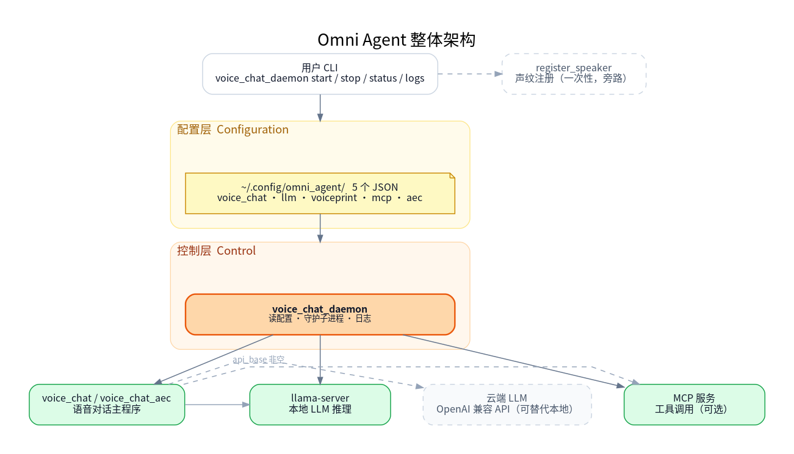
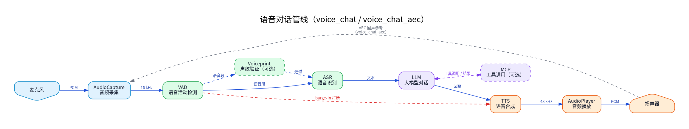

# 4.5 Agent

## 1. 模块概述

`omni_agent` 是 SDK 中的端到端语音对话应用，位于 `application/native/omni_agent`。它将音频采集、VAD、ASR、LLM、TTS、声纹验证和 MCP 工具调用组合为语音助手。推荐通过 `voice_chat_daemon` 使用该应用；该命令统一负责配置初始化、音频设备选择、本地或云端 LLM、声纹注册、MCP 服务、日志和进程管理。

语音处理流程为：麦克风采集后由 VAD 判断语音起止，可选地进行声纹验证；ASR 将语音转为文本，LLM 生成回复并可调用 MCP 工具，最后由 TTS 合成并播放。播放期间持续检测用户说话，可触发打断播放。

### 1.1 整体架构图



整图分四层：用户从顶层 CLI 进入，daemon 读取配置层的 5 个 JSON，再向下启动服务层中的 llama-server、voice_chat / voice_chat_aec 主程序以及可选的 MCP 工具服务；云端 LLM 与声纹注册是旁路。

### 1.2 语音对话管线



voice_chat / voice_chat_aec 进程内部的语音数据流：麦克风采集后，VAD 检测语音起止；可选经声纹验证后送 ASR 识别成文本，交 LLM 生成回复（必要时调用 MCP 工具），再由 TTS 合成回放到扬声器。TTS 播放期间 VAD 持续工作，连续检测到语音即触发 barge-in 打断；voice_chat_aec 模式额外把扬声器输出作为回声参考送回采集端，由 WebRTC AEC3 消除回声。

### 1.3 主要依赖组件

| 组件 | 路径 | 作用 |
| --- | --- | --- |
| audio | `components/multimedia/audio` | 音频采集、播放和重采样。 |
| VAD | `components/model_zoo/vad` | Silero VAD，检测语音起止和打断。 |
| ASR | `components/model_zoo/asr` | SenseVoice 等语音识别后端。 |
| TTS | `components/model_zoo/tts` | Matcha-TTS / Kokoro 语音合成。 |
| voiceprint | `components/model_zoo/voiceprint` | 可选说话人验证。 |
| MCP | `components/agent_tools/mcp` | 可选工具调用客户端。 |

## 2. 构建编译

### 2.1 前置条件

SDK 源码获取和基础构建环境配置参考 2.3-构建编译。以下命令默认在 K1 设备的 `spacemit_robot` SDK 根目录执行。

Agent 需要本地 LLM 工具、音频和 Python 构建依赖。缺少依赖时安装：

```bash
sudo apt install build-essential cmake pkg-config wget git jq \
    pybind11-dev python3-build python3-venv \
    portaudio19-dev libasound2-dev libsndfile1-dev libsamplerate0-dev \
    libfftw3-dev libcurl4-openssl-dev nlohmann-json3-dev \
    llama.cpp-tools-spacemit meson ninja-build
```

### 2.2 编译 Agent

加载 K1 构建环境：

```bash
cd /root/spacemit_robot
source build/envsetup.sh
lunch k1-muse-pipro-ai-cubpet
```

首次使用时，先构建 Agent 依赖的音频定位和 MCP 组件，再构建 Agent：

```bash
cd components/multimedia/audio_process/doa
mm

cd /root/spacemit_robot/components/agent_tools/mcp
mm

cd /root/spacemit_robot/application/native/omni_agent
mm
```

构建完成后，`voice_chat_daemon`、`voice_chat` 等程序安装到 `output/staging/bin`。重新加载 `build/envsetup.sh` 后可直接调用。

软件 AEC 内部模式默认不构建。仅在音频硬件可提供 48 kHz 全双工采集和播放，且需要回声消除时启用：

```bash
cd /root/spacemit_robot/application/native/omni_agent
mm -DUSE_AEC=ON
```

常用 CMake 选项：

| 选项 | 默认值 | 说明 |
| --- | --- | --- |
| `USE_MCP` | `ON` | 启用 MCP 工具调用支持。 |
| `USE_AEC` | `OFF` | 构建软件 AEC 内部模式。 |
| `USE_VP` | `ON` | 启用声纹验证支持。 |

## 3. 一键启动

`voice_chat_daemon` 自动初始化缺失配置、管理本地 LLM 服务并启动语音对话进程。日志写入 `~/.cache/omni_agent/logs/`。默认本地模式不会自动下载模型，首次启动前需要准备本地 GGUF 模型，或将 `llm.json` 配置为云端 OpenAI-compatible API。

### 3.1 准备本地 LLM

```bash
mkdir -p ~/.cache/models/llm
wget -O ~/.cache/models/llm/qwen2.5-0.5b-instruct-q4_0.gguf \
    https://archive.spacemit.com/spacemit-ai/model_zoo/llm/qwen2.5-0.5b-instruct-q4_0.gguf
```

K1 具有 8 个 CPU 核，但当前 llama.cpp SpaceMIT 后端报告 `num_perfer_cores: 4`。本地 LLM 配置使用 4 个推理线程；该数字不是 K1 CPU 总核数。

### 3.2 初始化并配置 K1 音频

首次使用可手动生成配置：

```bash
voice_chat_daemon config-init
```

K1 本地模式使用 SenseVoice 作为 ASR 后端。由于 K1 上本地 LLM 使用 SpaceMIT 推理后端时，ASR 和 LLM 同时占用该后端可能争用 TCM 等运行时资源，需要将 SenseVoice 的推理后端设为 CPU。这个适配包含配置文件和源码两部分：

1. 在 `~/.config/omni_agent/voice_chat.json` 中设置：

   ```json
   {
     "asr": {
       "engine": "sensevoice",
       "auto_start_server": false
     }
   }
   ```

2. 在 SDK 源码 `application/native/omni_agent/src/engine_init.cpp` 的 `initASR(...)` 中，读取 ASR 引擎名称后加入：

   ```cpp
   if (engine == "sensevoice") {
       asr_config.provider = "cpu";
   }
   ```

   该代码修改会使 SenseVoice 使用 CPU provider，LLM 仍可使用 SpaceMIT provider。修改后重新构建 Agent：

   ```bash
   cd /root/spacemit_robot
   source build/envsetup.sh
   lunch k1-muse-pipro-ai-cubpet
   cd application/native/omni_agent
   mm
   ```


配置音频设备前，先查看设备列表：

```bash
voice_chat --list-devices
```

可根据音频设备枚举结果，编辑 `~/.config/omni_agent/voice_chat.json`，将设备名称片段填写到 `audio.input_device_hints` 和 `audio.output_device_hints`；也可以填写对应的设备编号到 `audio.input_device_id` 和 `audio.output_device_id`。修改后重新启动 Agent 服务使配置生效。

### 3.3 启动与管理

```bash
voice_chat_daemon start
voice_chat_daemon status
voice_chat_daemon logs
voice_chat_daemon stop
```

首次启动需要加载 LLM、ASR 和 TTS 模型，完成后 `status` 显示 daemon、LLM 和 voice 进程 PID。启动成功后可直接对着麦克风说话；启动问候语播放后，等待语音输入即可。

需要重载配置时：

```bash
voice_chat_daemon restart
```

配置文件位于 `~/.config/omni_agent/`；设置 `XDG_CONFIG_HOME` 时使用 `$XDG_CONFIG_HOME/omni_agent/`。查看合并后的有效配置：

```bash
voice_chat_daemon config-show
```

`config-init --force` 会备份原配置目录后重建默认配置：

```bash
voice_chat_daemon config-init --force
```

## 4. 命令

```text
voice_chat_daemon start [--aec] [--mcp]
voice_chat_daemon restart [--aec] [--mcp]
voice_chat_daemon stop
voice_chat_daemon status
voice_chat_daemon logs
voice_chat_daemon config-init [--force]
voice_chat_daemon config-show
voice_chat_daemon --register-speaker NAME [--force]
```

| 命令 | 行为 |
| --- | --- |
| `start [--aec] [--mcp]` | 启动 daemon；`--aec` 临时切换到软件 AEC 内部模式，`--mcp` 临时启用 MCP。 |
| `restart [--aec] [--mcp]` | 停止后重新启动 daemon。 |
| `stop` | 停止 daemon 及其托管的子进程。 |
| `status` | 显示 daemon、LLM、语音进程 PID 和当前日志路径。 |
| `logs` | 持续输出当前日志。按 `Ctrl+C` 返回终端，不会停止 daemon。 |
| `config-init` | 写入缺失的默认配置，已有文件不覆盖。 |
| `config-init --force` | 备份现有配置目录后重新生成默认配置。 |
| `config-show` | 输出有效 JSON 配置；API key 会掩码显示。 |
| `--register-speaker NAME [--force]` | 进入三次录音的声纹注册流程。 |

## 5. 配置文件

配置目录中包含 5 个 JSON 文件。文件缺失、字段缺失或字段为 `null` 时使用内置默认值；单个 JSON 语法错误时该文件使用默认值，其余配置继续生效。

| 文件 | 职责 |
| --- | --- |
| `voice_chat.json` | 主干配置：音频设备、ASR、TTS、VAD、DOA、唤醒、调试、日志和 PID 路径。 |
| `llm.json` | 本地或云端 LLM、模型、线程数、上下文和系统提示词。 |
| `voiceprint.json` | 声纹验证开关、数据库、阈值和指定说话人。 |
| `mcp.json` | MCP 工具、超时、registry 和服务列表。 |
| `aec.json` | 软件 AEC 的回声消除、降噪、自动增益、延迟和缓存参数。 |

### 5.1 voice_chat.json

默认模板：

```
{
    "mode": "voice_chat",
    "audio": {
        "input_device_hints":  ["SPV Composite", "USB Audio"],
        "output_device_hints": ["SPV Composite", "USB Audio"],
        "input_device_id":  null,
        "output_device_id": null,
        "capture_rate":     null,
        "playback_rate":    null,
        "capture_channels": 1,
        "playback_channels": 1
    },
    "tts": "matcha:zh-en",
    "vad": {
        "threshold":        0.8,
        "silence_duration": 0.5
    },
    "debug": {
        "save_audio":          false,
        "save_audio_file":     "voice_debug.wav",
        "save_tts_audio":      false,
        "save_tts_audio_file": "tts_debug.wav"
    },
    "startup_greeting": "你好，请问有什么可以帮到您？",
    "log_dir":  "~/.cache/omni_agent/logs",
    "pid_file": "~/.cache/omni_agent/voice_chat_daemon.pid"
}
```

字段说明：

| 字段                        | 默认值                                      | 说明                                                         |
| --------------------------- | ------------------------------------------- | ------------------------------------------------------------ |
| `mode`                      | `voice_chat`                                | 内部运行模式。`voice_chat` 为标准模式；`voice_chat_aec` 为软件 AEC 内部模式。也可用 `start --aec` 临时覆盖。 |
| `audio.input_device_hints`  | `["SPV Composite", "USB Audio"]`            | 输入设备名 substring 匹配序列，按顺序首个命中即采用；非空且都不命中时 daemon 报错并列出当前可见设备。 |
| `audio.output_device_hints` | 同上                                        | 输出设备名 substring 匹配序列。                              |
| `audio.input_device_id`     | `null`                                      | 非 null 时直接使用指定 PortAudio 输入设备 index，跳过 hints。 |
| `audio.output_device_id`    | `null`                                      | 非 null 时直接使用指定 PortAudio 输出设备 index，跳过 hints。 |
| `audio.capture_rate`        | `null`                                      | 标准模式录音采样率；null 使用默认 16000 Hz。软件 AEC 内部模式要求 48000 Hz，非 48000 会被忽略并使用 AEC 默认值。 |
| `audio.playback_rate`       | `null`                                      | 标准模式播放采样率；null 使用默认 48000 Hz。USB 设备如只支持 16kHz，可显式设为 16000。 |
| `audio.capture_channels`    | `1`                                         | 录音声道数。                                                 |
| `audio.playback_channels`   | `1`                                         | 播放声道数。                                                 |
| `tts`                       | `matcha:zh-en`                              | TTS 后端。MCP 工具回复常含英文、数字和路径，推荐保留中英双语后端。 |
| `vad.threshold`             | `0.8`                                       | VAD 触发阈值，范围 0~1，越高越不容易触发。                   |
| `vad.silence_duration`      | `0.5`                                       | 判定语音结束前需要持续静音的秒数。                           |
| `debug.save_audio`          | `false`                                     | 是否保存调试录音。                                           |
| `debug.save_audio_file`     | `voice_debug.wav`                           | 调试录音保存路径。                                           |
| `debug.save_tts_audio`      | `false`                                     | 是否保存 TTS 输出音频，便于排查播放白噪音、截断或异常音色。  |
| `debug.save_tts_audio_file` | `tts_debug.wav`                             | TTS 输出音频保存路径。                                       |
| `startup_greeting`          | `你好，请问有什么可以帮到您？`              | 子进程初始化完 TTS 和音频输出后播放的启动问候；设为空字符串可关闭。 |
| `log_dir`                   | `~/.cache/omni_agent/logs`                  | daemon 日志目录。                                            |
| `pid_file`                  | `~/.cache/omni_agent/voice_chat_daemon.pid` | daemon PID 文件路径。                                        |

K1 使用前需要根据设备枚举结果修改 `audio` 下的设备和音频参数。执行 `voice_chat --list-devices` 后，将实际设备名称片段写入 `input_device_hints` 和 `output_device_hints`，或填写对应的 `input_device_id` 和 `output_device_id`；再按设备支持的采样率和声道数填写 `capture_rate`、`playback_rate`、`capture_channels` 和 `playback_channels`。每次修改后重新执行 `voice_chat_daemon restart`。

K1 本地模式还必须在通用模板的顶层增加以下 ASR 配置（将字段合并到现有 `voice_chat.json`，不要删除其他配置项）：

```
{
    "asr": {
        "engine": "sensevoice",
        "auto_start_server": false
    }
}
```

SenseVoice 使用 CPU provider 的源码适配和重编译步骤见“3.2 初始化并配置 K1 音频”；仅修改 JSON 而不完成该源码适配时，无法保证与本地 LLM 同时运行。

### 5.2 llm.json

默认模板：

```
{
    "auto_start_server": true,
    "api_base":          null,
    "api_key":           null,
    "server_binary":     "llama-server",
    "server_host":       "127.0.0.1",
    "server_port":       9191,
    "model_path":        "~/.cache/models/llm/qwen2.5-0.5b-instruct-q4_0.gguf",
    "model_url":         "https://archive.spacemit.com/spacemit-ai/model_zoo/llm/qwen2.5-0.5b-instruct-q4_0.gguf",
    "model_name":        "qwen2.5-0.5b",
    "ctx_size":          4096,
    "threads":           4,
    "reasoning_budget":  0,
    "extra_args":        [],
    "max_tokens":        150,
    "system_prompt":     "You are a helpful assistant."
}
```

字段说明：

| 字段                | 默认值                                                | 说明                                                         |
| ------------------- | ----------------------------------------------------- | ------------------------------------------------------------ |
| `auto_start_server` | `true`                                                | 是否自动拉起本地 LLM 服务；`api_base` 非空时 daemon 自动跳过本地启动。 |
| `api_base`          | `null`                                                | OpenAI-compatible 云端/外部 API base，按服务商文档填写。例如 DeepSeek 使用 `https://api.deepseek.com`。 |
| `api_key`           | `null`                                                | 云端 API 密钥；daemon 通过 `OPENAI_API_KEY` 传给子进程，不放入命令行；`config-show` 会掩码显示。 |
| `server_binary`     | `llama-server`                                        | 本地 LLM 服务二进制名或绝对路径。                            |
| `server_host`       | `127.0.0.1`                                           | 本地 LLM 服务监听地址。                                      |
| `server_port`       | `9191`                                                | 本地 LLM 服务监听端口。                                      |
| `model_path`        | `~/.cache/models/llm/qwen2.5-0.5b-instruct-q4_0.gguf` | 本地 GGUF 模型路径。                                         |
| `model_url`         | SpacemiT archive URL                                  | 本地模型下载参考地址。daemon 只打印该地址，不会自动下载模型。 |
| `model_name`        | `qwen2.5-0.5b`                                        | 传给 LLM API 的模型名。云端模式必须改成服务商支持的模型名。  |
| `ctx_size`          | `4096`                                                | 本地 LLM 服务上下文长度。                                    |
| `threads`           | `4`                                                   | 本地 LLM 服务推理线程数。                                    |
| `reasoning_budget`  | `0`                                                   | 本地模式传给 `llama-server`；云端 OpenAI-compatible 模式下，`0` 表示隐藏 `reasoning_content` / `thinking` 流式输出，并过滤普通正文里的 `<think>...</think>`，避免把思考内容送入 TTS；`-1` 表示不覆盖。 |
| `extra_args`        | `[]`                                                  | 追加给本地 LLM 服务的原始参数。                              |
| `max_tokens`        | `150`                                                 | 单轮最大生成 token 数。                                      |
| `system_prompt`     | `You are a helpful assistant.`                        | 默认系统提示词；MCP 可在 `mcp.json` 中覆盖。                 |

云端 LLM 示例：

```
{
    "api_base": "https://api.deepseek.com",
    "api_key": "sk-...",
    "model_name": "deepseek-v4-flash"
}
```

只要 `api_base` 非空，daemon 就不会启动本地 LLM 服务。

本地 LLM 模式下，先把模型文件准备到 `model_path`。默认路径如下：

```
mkdir -p ~/.cache/models/llm
wget -O ~/.cache/models/llm/qwen2.5-0.5b-instruct-q4_0.gguf \
    https://archive.spacemit.com/spacemit-ai/model_zoo/llm/qwen2.5-0.5b-instruct-q4_0.gguf
```

### 5.3 voiceprint.json

默认模板：

```
{
    "enabled":   false,
    "database":  "~/.cache/omni_agent/speakers.db",
    "threads":   1,
    "threshold": 0.6,
    "top":       3,
    "verify":    ""
}
```

字段说明：

| 字段        | 默认值                            | 说明                                                         |
| ----------- | --------------------------------- | ------------------------------------------------------------ |
| `enabled`   | `false`                           | 是否启用声纹验证。                                           |
| `database`  | `~/.cache/omni_agent/speakers.db` | 声纹数据库路径。注册和运行时需要使用同一个 Linux 用户，才能共享默认数据库。 |
| `threads`   | `1`                               | 声纹推理线程数。                                             |
| `threshold` | `0.6`                             | 声纹相似度阈值；越高越严格。                                 |
| `top`       | `3`                               | 检查前 N 个匹配结果。                                        |
| `verify`    | `""`                              | 空字符串表示接受所有已注册说话人；非空时只接受指定 name。    |

注册说话人：

```
voice_chat_daemon --register-speaker alice
voice_chat_daemon --register-speaker alice --force
```

### 5.4 mcp.json

默认模板：

```
{
    "enabled":  false,
    "backend":  "llama",
    "system_prompt": null,
    "timeout":  120,
    "registry_url":           null,
    "registry_poll_interval": 5,
    "servers": [
        {
            "name": "Calculator",
            "type": "http",
            "url":  "http://127.0.0.1:8001/mcp"
        },
        {
            "name": "TimeService",
            "type": "http",
            "url":  "http://127.0.0.1:8002/mcp"
        },
        {
            "name": "SystemMonitor",
            "type": "http",
            "url":  "http://127.0.0.1:8003/mcp"
        }
    ]
}
```

字段说明：

| 字段                     | 默认值                 | 说明                                                         |
| ------------------------ | ---------------------- | ------------------------------------------------------------ |
| `enabled`                | `false`                | 是否启用 MCP；也可用 `start --mcp` 临时开启。                |
| `backend`                | `llama`                | MCP LLM backend，透传给 MCP 配置。                           |
| `system_prompt`          | `null`                 | 非 null 时覆盖 `llm.json.system_prompt`。                    |
| `timeout`                | `120`                  | MCP 请求超时秒数。                                           |
| `registry_url`           | `null`                 | MCP registry URL。                                           |
| `registry_poll_interval` | `5`                    | registry 轮询间隔秒数。                                      |
| `servers`                | 三个本地 HTTP 示例服务 | 静态 MCP 服务列表。支持 `stdio`、`socket` 和 `http` 三种连接方式。 |

`servers` 示例：

```
{
    "enabled": true,
    "servers": [
        {
            "name": "Calculator",
            "type": "stdio",
            "command": "python3",
            "args": ["examples/services/calculator/stdio_server.py"]
        },
        {
            "name": "SystemMonitor",
            "type": "socket",
            "path": "/tmp/mcp_system_monitor.sock"
        },
        {
            "name": "TimeService",
            "type": "http",
            "url": "http://127.0.0.1:8002/mcp"
        }
    ]
}
```

说明：

- `stdio` 服务由 MCP client 按 `command + args` 启动。相对脚本路径会在 daemon 写入 resolved 配置时解析为绝对路径。
- `socket` 服务要求对应 Unix socket 已由外部服务创建。
- `http` 服务要求 HTTP MCP 服务已可访问。
- 默认三个本地 HTTP 示例服务写在 `servers` 里，用户可直接删除或追加自己的服务。
- `start --mcp` 发现默认示例服务时，会使用固定目录 `~/.local/share/omni_agent/mcp/services` 启动对应后端服务。
- 首次启动默认 MCP 示例服务时，daemon 会从 SDK 的 `components/agent_tools/mcp/examples` 同步服务到固定目录。首次同步要求当前 SDK 树能找到该目录；如果只拷贝了二进制或源码不在默认位置，需要设置 `OMNI_AGENT_MCP_EXAMPLES_DIR` 指向 `components/agent_tools/mcp/examples`。
- 默认示例服务会使用本机端口 `8001`、`8002`、`8003` 和 registry 端口 `9000`。
- MCP Python 环境固定为 `~/.mcp-env`；daemon 只检查依赖，不会在启动时安装 Python 包。
- `start --mcp` 只临时启用 MCP，不会回写 `~/.config/omni_agent/mcp.json`。
- 删除默认 Calculator、TimeService 和 SystemMonitor 后，daemon 不再自动启动内置三件套；此时由用户自己的 `servers` 或 `registry_url` 决定可用工具。
- resolved 配置写入 `~/.cache/omni_agent/mcp_resolved.json`，用于排查实际传给 MCP client 的内容。

K1 的 SDK 示例服务使用 MCP 1.x API，必须在独立的 `~/.mcp-env` 环境中固定安装 `mcp<2`。直接安装 MCP 2.x 会导致 `mcp.server.fastmcp` 等接口不兼容，MCP 服务无法启动。

MCP Python 环境准备示例：

```
python3 -m venv ~/.mcp-env
~/.mcp-env/bin/python -m pip install flask 'mcp<2' starlette uvicorn psutil \
    --prefer-binary \
    --retries 0 \
    --timeout 15 \
    --index-url https://git.spacemit.com/api/v4/projects/33/packages/pypi/simple \
    --extra-index-url https://mirrors.aliyun.com/pypi/simple/
~/.mcp-env/bin/python -c 'from mcp.server.fastmcp import FastMCP; print("mcp ok")'
```

运行 `start --mcp` 前必须完成上述环境准备；daemon 只检查依赖，不会在启动时自动安装 Python 包。

使用默认三件套启用 MCP：

```
voice_chat_daemon start --mcp
cat ~/.cache/omni_agent/mcp_resolved.json
```

接入 mlink HTTP MCP 服务时，把 `components/agent_tools/mcp/examples/configs/mlink_http.json` 中的 `servers` 内容写入 `~/.config/omni_agent/mcp.json`：

```
{
    "enabled": true,
    "backend": "llama",
    "system_prompt": null,
    "timeout": 120,
    "registry_url": null,
    "registry_poll_interval": 5,
    "servers": [
        {
            "name": "mlink-gateway",
            "type": "http",
            "url": "http://127.0.0.1:18765/mcp"
        }
    ]
}
```

接入用户自己的 registry 时，只设置 `registry_url`：

```
{
    "enabled": true,
    "backend": "llama",
    "system_prompt": null,
    "timeout": 120,
    "registry_url": "http://192.168.1.10:9000/mcp/services",
    "registry_poll_interval": 5,
    "servers": []
}
```

### 5.5 aec.json

默认模板：

```
{
    "no_aec":        false,
    "no_ns":         false,
    "agc":           false,
    "aec_delay_ms":  50,
    "buffer_frames": 0
}
```

字段说明：

| 字段            | 默认值  | 说明                                                         |
| --------------- | ------- | ------------------------------------------------------------ |
| `no_aec`        | `false` | true 时禁用回声消除。                                        |
| `no_ns`         | `false` | true 时禁用噪声抑制。                                        |
| `agc`           | `false` | true 时启用自动增益控制。默认关闭，避免低能量输入被激进放大。 |
| `aec_delay_ms`  | `50`    | AEC 延迟补偿，常用范围 20-100ms。                            |
| `buffer_frames` | `0`     | AEC buffer frames；0 表示使用底层默认。                      |

临时启用软件 AEC 内部模式：

```
voice_chat_daemon start --aec
```

持久启用时，把 `voice_chat.json` 的 `mode` 改为 `voice_chat_aec`。软件 AEC 内部模式按 48kHz 工作；不要把 `audio.capture_rate` 设成 16000 来驱动 AEC。

## 6. 常见操作

### 6.1 修改配置并重启

```bash
vi ~/.config/omni_agent/llm.json
voice_chat_daemon restart
```

### 6.2 启用声纹验证

```bash
voice_chat_daemon --register-speaker alice
vi ~/.config/omni_agent/voiceprint.json
voice_chat_daemon restart
```

将 `enabled` 改为 `true`。只允许指定用户时，将 `verify` 设为该注册名。

### 6.3 启用云端 LLM

在 `llm.json` 填写 `api_base`、`api_key` 和 `model_name` 后运行：

```bash
voice_chat_daemon restart
```

### 6.4 使用 HID 唤醒

HID 唤醒要求系统存在对应的 `/dev/hidraw*` 设备。启用前先确认设备存在，再在 `voice_chat.json` 中设置：

```json
{
  "wake": {
    "enabled": true,
    "device": "/dev/hidraw0"
  }
}
```

## 7. 调试与排查

优先查看运行状态和日志：

```bash
voice_chat_daemon status
voice_chat_daemon logs
```

| 现象 | 可能原因 | 处理 |
| --- | --- | --- |
| `start` 报未找到 `llama-server` | 缺少本地 LLM 工具 | 安装 `llama.cpp-tools-spacemit`，或配置云端 `api_base` / `api_key`。 |
| `start` 报端口 9191 被占用 | 本地 LLM 服务端口被其他进程使用 | 停止占用进程，或修改 `llm.json.server_port`。 |
| 报本地模型不存在 | 默认模型尚未放至 `model_path` | 下载或拷贝 GGUF 模型到配置指定路径。 |
| 找不到麦克风或扬声器 | 设备 hints 不匹配 | 用 `voice_chat --list-devices` 查看名称，再修改 `voice_chat.json` 的 hints 或设备 ID。 |
| 无声音或采样率错误 | 设备不支持配置的采样率或声道数 | 使用 `voice_chat --list-devices` 查看设备能力，将采样率和声道数改为输入、输出设备共同支持的值。 |
| `start --aec` 后语音进程退出 | 采集设备不支持 AEC 所需的 48 kHz 全双工 | 使用支持 48 kHz 采集和播放的音频硬件，或保持标准 `voice_chat` 模式。 |
| MCP 服务导入 `FastMCP` 失败 | 安装了 MCP 2.x，与当前 SDK 服务 API 不兼容 | 在 `~/.mcp-env` 中重新安装 `mcp<2`。 |
| MCP 默认服务无法启动 | 端口冲突、Python 环境未完成或服务目录未同步 | 检查 8001、8002、8003、9000 端口，检查 `~/.mcp-env` 和 `~/.cache/omni_agent/mcp_resolved.json`。 |
| 声纹识别不稳定 | 阈值过高或注册音频质量不足 | 适当降低 `voiceprint.json.threshold`，或使用清晰、稳定的语音重新注册。 |
| 播放时被误打断 | 麦克风采到扬声器回声 | 降低音量、调整麦克风位置；具备合适硬件时可启用 AEC。 |

## 8. 运行时路径

| 路径 | 说明 |
| --- | --- |
| `~/.config/omni_agent/` | 用户可编辑的配置目录。 |
| `~/.cache/omni_agent/logs/` | daemon 和子进程日志。 |
| `~/.cache/omni_agent/voice_chat_daemon.pid` | daemon PID 文件。 |
| `~/.cache/omni_agent/speakers.db` | 默认声纹数据库。 |
| `~/.cache/omni_agent/mcp_resolved.json` | daemon 生成的 MCP 有效配置。 |
| `~/.local/share/omni_agent/mcp/services` | 默认 MCP 示例服务目录。 |
| `~/.mcp-env` | MCP Python 虚拟环境。 |
