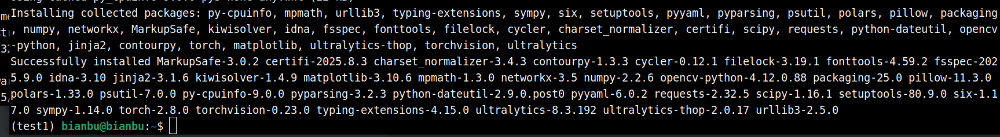
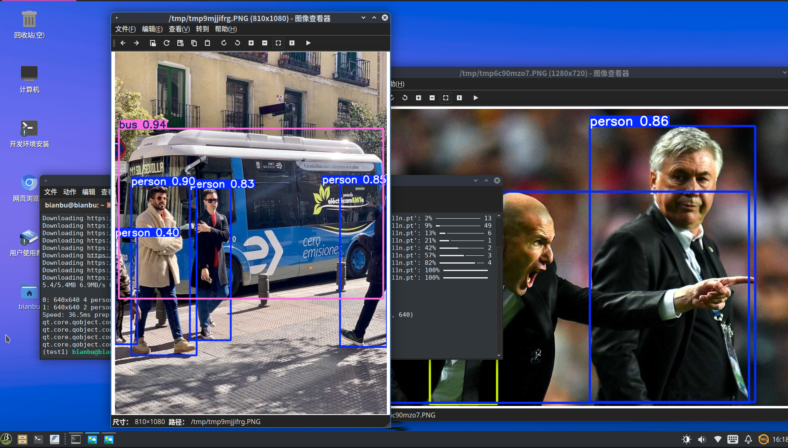

# 4.8 Ultralytics

官网：https://www.ultralytics.com/

## 简介

Ultralytics 是一家专注于**计算机视觉与深度学习**的公司，也是著名的 **YOLO (You Only Look Once) 系列目标检测模型**的重要开发与维护者。它既是一个团队的名字，也是他们开源的 Python 库的名字。

- **核心产品**
   Ultralytics YOLO —— 这是当前最主流、最易用的目标检测与图像分割开源实现之一，支持 **YOLOv3/v5/v8/v9/v11** 等不同版本。
- **主要功能**
  - **目标检测 (Object Detection)**：识别并定位图像/视频中的目标。
  - **图像分割 (Segmentation)**：在像素级别分割物体。
  - **姿态估计 (Pose Estimation)**：检测人体关键点。
  - **分类 (Classification)**：图像分类任务。
- **生态特点**
  - 纯 Python 实现，基于 **PyTorch**。
  - 提供 **pip 一键安装**：`pip install ultralytics`。
  - 开箱即用的命令行工具和 Python API。
  - 内置训练、验证、推理、导出工具链。
  - 支持多种部署格式：ONNX、TensorRT、CoreML、OpenVINO 等（SpacemiT RISCV 平台请使用 ONNX 格式部署）。

- ### 应用领域

  - 视频监控与安防

  - 自动驾驶与交通分析

  - 工业检测与机器人视觉

  - 医学影像分析

  - 智能零售


## 框架适配说明

Ultralytics 使用 PyTorch 后端。SpacemiT RISC-V 平台上的 PyTorch 尚未接入硬件加速，可使用 Ultralytics 验证算法。部署时使用 `spacemit-ort` 获取硬件加速，具体步骤见 SDK Model Zoo 的 [4.2 视觉](4.2-视觉/index.md)（如 [4.2.1 目标检测](4.2-视觉/4.2.1-目标检测.md) 中的 YOLO 部署）和 [模型量化](../06-系统与平台/6.7-开发工具/6.7.10-模型量化开发.md)。


## 环境准备

### 安装依赖项

```bash
sudo apt install python3-pip python3-venv python3-numpy opencv-spacemit \
    libxrender1 libgl1 libglib2.0-0t64 libsleef3 libomp5-18 libnuma1
```

使用支持当前 Python 版本的 OpenCV，并为 PyTorch 配套安装包含原生 NMS 算子的 TorchVision。版本对应关系见 [TorchVision 安装说明](https://github.com/pytorch/vision#installation)：`torch 2.8` 对应 `torchvision 0.23`，`torch 2.9` 对应 `torchvision 0.24`。RISC-V 安装包还需与所用 PyTorch 构建兼容。

`torch 2.8.0+spacemit.0` 与 `torchvision 0.24.1` 组合会报 `operator torchvision::nms does not exist`。使用匹配的安装包后再运行下面的示例；软件源没有可用组合时，按 [4.2.1 目标检测](4.2-视觉/4.2.1-目标检测.md)使用 ONNX 模型部署。

## 安装 Ultralytics

### 设置源

```bash
pip config set global.index-url https://mirrors.aliyun.com/pypi/simple/
pip config set global.extra-index-url https://git.spacemit.com/api/v4/projects/33/packages/pypi/simple
```


### 配置虚拟环境

```bash
python3 -m venv test1
source test1/bin/activate
pip install pip -U
```


### 安装 ultralytics

```bash
pip install --prefer-binary ultralytics
```

安装输出示例：



### 配置 OpenCV 与 NMS

使用系统 NumPy 1.x 和厂商 OpenCV。每次激活虚拟环境后，执行：

```bash
export PYTHONPATH="/usr/lib/python3/dist-packages:/opt/opencv-spacemit/lib/python3.12/dist-packages/cv2/python-3${PYTHONPATH:+:$PYTHONPATH}"
```

调用 NMS 算子，输出应为 `tensor([0])`：

```bash
python - <<'PY'
import cv2
import torch
import torchvision
from torchvision.ops import nms

print("OpenCV:", cv2.__version__, cv2.__file__)
print("PyTorch:", torch.__version__, "TorchVision:", torchvision.__version__)
boxes = torch.tensor([[0.0, 0.0, 10.0, 10.0], [1.0, 1.0, 9.0, 9.0]])
scores = torch.tensor([0.9, 0.8])
print(nms(boxes, scores, 0.5))
PY
```

| 报错 | 处理方式 |
| --- | --- |
| OpenCV 缺少 `config-3.12.py` | 按上述 `PYTHONPATH` 加载厂商 OpenCV，查看 `cv2.__file__` 的实际路径 |
| 缺少 `libsleef.so.3`、`libomp.so.5` 或 `libnuma.so.1` | 安装前述 `libsleef3`、`libomp5-18`、`libnuma1` |
| `operator torchvision::nms does not exist` | 更换与 PyTorch 匹配且包含原生算子的 TorchVision 安装包，再执行 NMS 调用 |

## 图像推理

示例参考来源：https://docs.ultralytics.com/zh/modes/predict/#plotting-results

示例使用 Ultralytics 包内的两张图片。首次加载 `yolo11n.pt` 时会下载权重，也可提前将权重放在脚本所在目录。需要显示窗口时，连接 HDMI 屏幕和键盘鼠标；仅保存结果时省略 `r.show()`。

```python
from pathlib import Path
from PIL import Image

import ultralytics
from ultralytics import YOLO

# Load a pretrained YOLO11n model
model = YOLO("yolo11n.pt")

# Run inference on the images included in the package
assets = Path(ultralytics.__file__).parent / "assets"
results = model([str(assets / "bus.jpg"), str(assets / "zidane.jpg")])

# Visualize the results
for i, r in enumerate(results):
    # Plot results image
    im_bgr = r.plot()  # BGR-order numpy array
    im_rgb = Image.fromarray(im_bgr[..., ::-1])  # RGB-order PIL image

    # Show results to screen (in supported environments)
    r.show()

    # Save results to disk
    r.save(filename=f"results{i}.jpg")
```

保存为 demo1.py

执行：

```bash
source test1/bin/activate
export PYTHONPATH="/usr/lib/python3/dist-packages:/opt/opencv-spacemit/lib/python3.12/dist-packages/cv2/python-3${PYTHONPATH:+:$PYTHONPATH}"
python demo1.py
```

结果显示示例：


