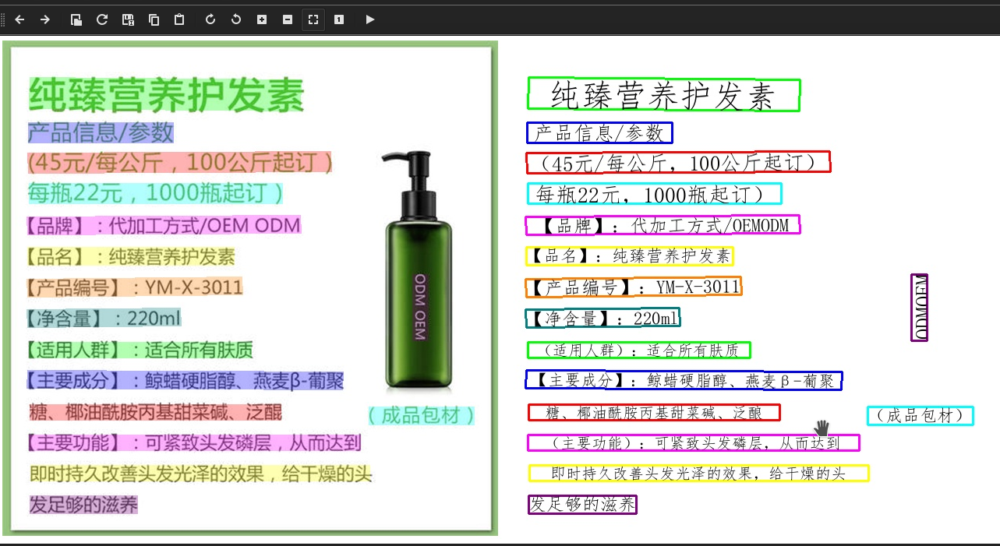
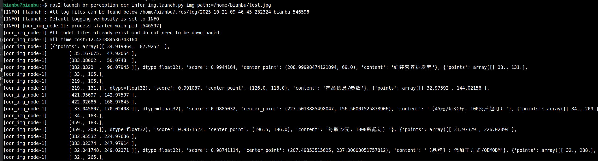
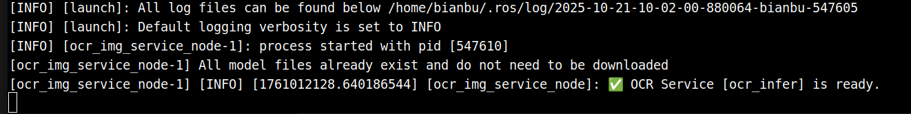
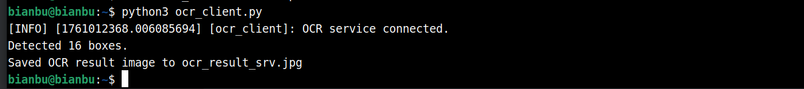

# 5.1.12 OCR


## 1. PaddleOCR 简介

PaddleOCR（简称 **PPOCR**）是由百度飞桨（PaddlePaddle）团队开源的一个**端到端文字识别（OCR）系统**，致力于提供**“从文本检测 → 方向分类 → 文本识别 → 后处理”** 的完整解决方案。
 它不仅支持中英文、多语言场景，还广泛适用于文档、票据、路牌、车牌、自然场景等 OCR 应用。

本示例使用图片或 ROS 2 消息作为输入，通过 CPUExecutionProvider 执行 OCR 模型推理，并通过 ROS 2 返回识别结果。

## 2. 环境准备

### 前置条件

先安装 [ROS 2 Humble](../../06-系统与平台/6.5-ROS2/6.5.1-ROS2安装.md)和 [BROS/RDK](../../06-系统与平台/6.5-ROS2/6.5.5-AI-Robot安装.md)，`/opt/bros/humble` 中包含 `rdk_perception`、`jobot_ppocr_py` 和 `jobot_interfaces`。首次运行需要联网下载模型，模型保存在 `~/.brdk_models/OCR/`。

### 安装依赖

```bash
sudo apt install python3-opencv ros-humble-cv-bridge ros-humble-camera-info-manager \
    ros-humble-image-transport python3-spacemit-ort python3-pyclipper \
    python3-numpy python3-yaml python3-pil
```

每个终端均需加载 ROS 环境：

```bash
source /opt/bros/humble/setup.bash
```

## 3. 图片推理

**准备图片**

```bash
cp /opt/bros/humble/share/jobot_ppocr_py/data/test.jpg .
```

### **本地保存推理结果**

```bash
ros2 launch rdk_perception ocr_infer_img.launch.py img_path:='./test.jpg'
```

输出结果将保存在当前目录的 `ocr_result.jpg` 中，如图所示。



终端打印如下




### 参数说明

**ocr_infer_img.launch.py 的参数说明**

| **参数名称** | 作用                 | 默认值        |
| ------------ | -------------------- | ------------- |
| img_path     | 推理时使用的图片路径 | data/test.jpg |


### 循环发布结果图

已有配套 RDK 源码、需要持续发布识别结果和图像时，先应用 [OCR 图像发布补丁](../../02-快速入门/2.10-SDK补丁.md)。将 `RDK_ROOT` 设置为已有 RDK 源码目录：

```bash
RDK_ROOT="$HOME/rdk"
wget -O /tmp/ocr-image-publisher.patch \
    https://archive.spacemit.com/ros2/k1_sdk/patches/rdk/jobot_ppocr_py/ocr-image-publisher.patch && \
git -C "$RDK_ROOT" apply \
    --directory=core_pkgs/jobot_perception_pkgs/python/jobot_ppocr_py \
    --check /tmp/ocr-image-publisher.patch && \
git -C "$RDK_ROOT" apply \
    --directory=core_pkgs/jobot_perception_pkgs/python/jobot_ppocr_py \
    /tmp/ocr-image-publisher.patch
```

编译该包并加载覆盖环境：

```bash
sudo apt install python3-colcon-common-extensions
source /opt/bros/humble/setup.bash
cd "$RDK_ROOT"
colcon --log-base log/k1-patches build \
    --base-paths core_pkgs/jobot_perception_pkgs/python/jobot_ppocr_py \
    --packages-select jobot_ppocr_py \
    --build-base build/k1-patches --install-base install/k1-patches
source install/k1-patches/setup.bash
ros2 launch rdk_perception ocr_infer_img.launch.py \
    img_path:=/path/to/test.jpg publish_result_img:=true
```

将 `/path/to/test.jpg` 替换为实际图片路径。`/ocr_result` 发布 `jobot_interfaces/msg/OCRResult`，`/result_img` 发布 JPEG 编码的 `sensor_msgs/msg/CompressedImage`。节点持续运行，按 `Ctrl+C` 结束。新终端先加载 BROS 环境，再加载 `$RDK_ROOT/install/k1-patches/setup.bash`。

## 4. 使用推理服务

推理服务接受原始图像消息并返回OCR推理结果，可以通过 `ros2 interface show jobot_interfaces/srv/OCRInfer` 查看服务定义。

### 开启服务

```bash
ros2 launch rdk_perception ocr_service.launch.py
```

终端打印：



### 客户端代码

编写客户端代码

```python
import rclpy
from rclpy.node import Node
from sensor_msgs.msg import Image
from jobot_interfaces.srv import OCRInfer
import cv2
import numpy as np


class OCRClient(Node):
    def __init__(self):
        super().__init__('ocr_client')
        self.client = self.create_client(OCRInfer, 'ocr_infer')
        while not self.client.wait_for_service(timeout_sec=1.0):
            self.get_logger().info('Waiting for OCR service...')
        self.get_logger().info('OCR service connected.')

    def send_request(self, img_path):
        req = OCRInfer.Request()

        img = cv2.imread(img_path)
        img_msg = Image()
        img_msg.height, img_msg.width, _ = img.shape
        img_msg.encoding = 'bgr8'
        img_msg.step = img_msg.width * 3
        img_msg.data = img.tobytes()

        req.image = img_msg

        future = self.client.call_async(req)
        rclpy.spin_until_future_complete(self, future)
        resp = future.result()

        print(f"Detected {len(resp.result.boxes)} boxes.")
        result_img = self.ros_img_to_cv2(resp.result_img)
        cv2.imwrite('ocr_result_srv.jpg', result_img)
        print("Saved OCR result image to ocr_result_srv.jpg")

    def ros_img_to_cv2(self, ros_img: Image):
        img = np.frombuffer(ros_img.data, dtype=np.uint8).reshape(ros_img.height, ros_img.width, 3)
        return img


def main():
    rclpy.init()
    client = OCRClient()
    client.send_request('test.jpg')
    client.destroy_node()
    rclpy.shutdown()


if __name__ == '__main__':
    main()
```

注意确保这里的图像路径正确。

### 请求服务

客户端代码保存为 ocr_client.py

然后执行：

```bash
python3 ocr_client.py
```

终端打印：



结果可视化文件保存在 ocr_result_srv.jpg
