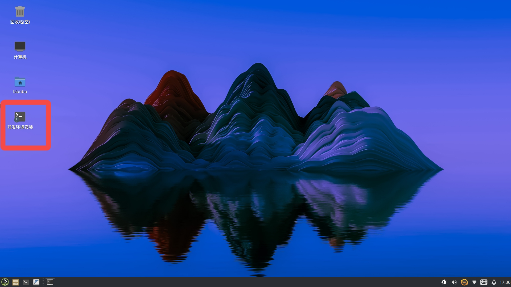
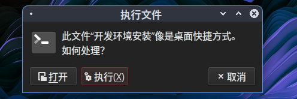
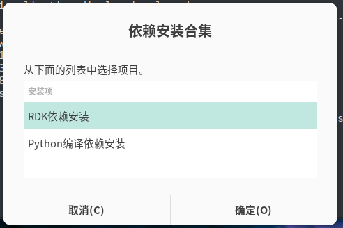

# 5.1.3 ROS2_LXQT 桌面安装工具

本页介绍 **ROS2_LXQT 专用** 的桌面安装方式。该方式属于 ROS2_LXQT 固件的客制化内容，Bianbu 通用固件没有此入口；通用固件按 [5.1 系统准备](index.md) 的安装入口表选择安装方式。

如果使用 ROS2_LXQT 固件，桌面的 **开发环境安装** 图标可安装 RDK、MediaEngine、ROS 2 所需依赖。

1）双击 **开发环境安装** 图标：

2）选择 **执行**：

3）选择相应的依赖安装项，点击 **确认** 后，按提示输入当前用户的密码。

