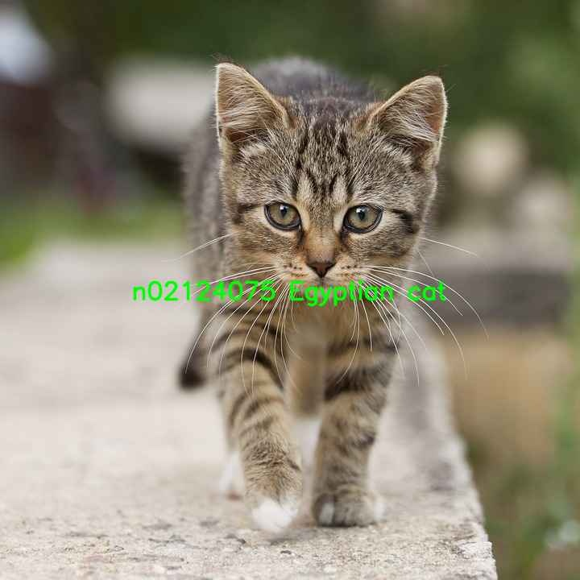

# 机器感知 · 图像分类

## 1. 模块概述

本模块使用 MobileNetV2 对整张图像进行分类，支持图片和摄像头视频流输入，并通过 ROS 2 发布类别结果。配套模型使用 ImageNet 1000 类标签，涵盖动物、车辆和常见物品等类别。

分类结果描述图像的主要类别，不包含目标检测框。支持的类别以 `jobot_infer_py` 包中的 `data/classification/labels.txt` 为准；文字识别请使用 OCR 模块。

## 2. 环境准备

### 前置条件

- K1 Bianbu 系统，已安装 ROS 2 Humble 和 BROS/RDK。
- BROS 安装目录为 `/opt/bros/humble`，包含 `rdk_perception`、`jobot_infer_py`、`rdk_sensors` 和 `rdk_visualization`。
- 首次运行需要联网下载模型，模型保存在 `~/.brdk_models/`。

尚未安装 BROS/RDK 时，请先参照官方[系统依赖安装](https://github.com/spacemit-com/docs-ros/blob/main/zh/k1/02_System_configuration/2.3_System_Dependency_Installation.md)完成开发环境安装。

### 安装依赖

```bash
sudo apt install python3-opencv ros-humble-cv-bridge ros-humble-camera-info-manager \
    ros-humble-image-transport python3-spacemit-ort python3-yaml libyaml-dev \
    python3-numpy python3-pil
```

每个终端均需加载 ROS 环境：

```bash
source /opt/bros/humble/setup.bash
```

### 查看模型配置

```bash
ros2 launch rdk_perception infer_info.launch.py | grep 'classification'
```

支持的分类配置包括：

```text
config/classification/resnet18.yaml
config/classification/resnet50.yaml
config/classification/mobilenet_v2.yaml
```

以下使用 MobileNetV2。更换模型时，将 `config_path` 改为对应的分类配置路径。配套 MobileNetV2 配置指定 SpaceMIT 后端和 2 个推理线程，实际后端取决于运行环境中可用的 ONNX Runtime Provider。

## 3. 图片推理

### 3.1 查看分类结果

准备示例图片：

```bash
cp /opt/bros/humble/share/jobot_infer_py/data/classification/kitten.jpg .
```

运行推理：

```bash
ros2 launch rdk_perception infer_img.launch.py \
    config_path:='config/classification/mobilenet_v2.yaml' \
    img_path:='./kitten.jpg'
```

终端输出类别后，节点退出。结果格式示例：

```text
class predict: n02124075 Egyptian cat
```

`n02124075` 是 ImageNet 类别标识，后面的文本为类别名称。更换输入图片时，修改 `img_path`。



### 3.2 发布结果并在网页显示

终端 1 启动结果发布节点：

```bash
ros2 launch rdk_perception infer_img.launch.py \
    config_path:='config/classification/mobilenet_v2.yaml' \
    img_path:='./kitten.jpg' \
    publish_result_img:=true \
    result_img_topic:=/result_img \
    result_topic:=/inference_result
```

终端 2 启动网页服务：

```bash
ros2 launch rdk_visualization websocket_cpp.launch.py image_topic:=/result_img
```

浏览器访问启动日志中提示的地址，通常为 `http://<设备IP>:8080`。端口已被占用时，可在网页服务命令末尾添加 `port:=18080`。

在另一终端查看分类结果：

```bash
ros2 topic echo /inference_result
```

输出格式：

```yaml
data: n02124075 Egyptian cat
```

图片模式对输入图片推理一次，然后周期发布结果。按 `Ctrl+C` 停止节点后，更换图片并重新运行即可更新结果。

## 4. 视频流推理

### 4.1 启动 USB 摄像头

以下以 `/dev/video0` 为例，请改为实际支持图像采集的设备节点：

```bash
ros2 launch rdk_sensors usb_cam.launch.py video_device:='/dev/video0'
```

摄像头节点向 `/image_raw` 发布图像，运行期间保持该终端开启。

### 4.2 启动分类节点

在新终端运行：

```bash
ros2 launch rdk_perception infer_video.launch.py \
    config_path:='config/classification/mobilenet_v2.yaml' \
    sub_image_topic:=/image_raw \
    publish_result_img:=true \
    result_topic:=/inference_result
```

分类节点订阅摄像头图像并发布结果。仅查看类别数据时，将 `publish_result_img` 设为 `false`。

### 4.3 查看结果

```bash
ros2 topic echo /inference_result
```

需要网页显示时，在另一终端运行：

```bash
ros2 launch rdk_visualization websocket_cpp.launch.py image_topic:=/result_img
```

## 5. 接口与参数

### ROS 接口

| 接口 | 消息类型 | 说明 |
| --- | --- | --- |
| `/image_raw` | `sensor_msgs/msg/Image` | 视频模式的输入图像 |
| `/inference_result` | `std_msgs/msg/String` | 分类标识及类别名称 |
| `/result_img` | `sensor_msgs/msg/CompressedImage` | 带分类文字的 JPEG 图像，需启用 `publish_result_img` |

### 启动参数

| 参数 | 说明 | 默认值 |
| --- | --- | --- |
| `config_path` | 模型配置；分类任务需显式选择分类配置 | `config/detection/yolov6.yaml` |
| `img_path` | 图片模式的输入路径 | `data/detection/test.jpg` |
| `sub_image_topic` | 视频模式订阅的图像话题 | `/image_raw` |
| `publish_result_img` | 是否发布带分类文字的图像；图片模式下同时启用结果循环发布 | `false` |
| `result_img_topic` | 结果图像话题 | `/result_img` |
| `result_topic` | 分类结果话题 | `/inference_result` |

`img_path` 用于 `infer_img.launch.py`，`sub_image_topic` 用于 `infer_video.launch.py`。
