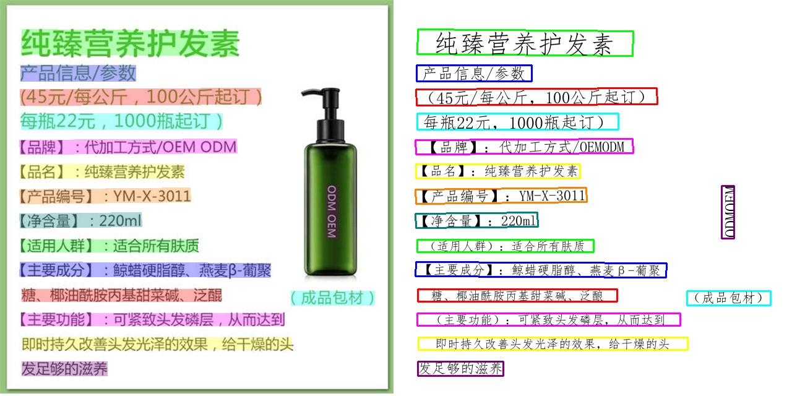

# 机器感知 · OCR

## 1. 模块概述

本模块使用 PaddleOCR 配套的文字检测和识别模型，从图片中提取文字内容及位置。支持单张图片推理和 ROS 2 服务调用，服务返回文字框、文字内容以及绘制结果的图像。

配套 BROS 实现使用 CPUExecutionProvider。识别语言和字符范围取决于模型及配套的 `rec_word_dict.txt`，可用于票据、路牌和自然场景文字识别。

## 2. 环境准备

### 前置条件

K1 Bianbu 系统已安装 ROS 2 Humble 和 BROS/RDK，`/opt/bros/humble` 中包含 `rdk_perception`、`jobot_ppocr_py` 和 `jobot_interfaces`。首次运行需要联网下载模型，模型保存在 `~/.brdk_models/OCR/`。

### 安装依赖

```bash
sudo apt install python3-opencv ros-humble-cv-bridge ros-humble-camera-info-manager \
    ros-humble-image-transport python3-spacemit-ort python3-pyclipper \
    python3-numpy python3-yaml python3-pil
```

每个终端均需加载 ROS 环境：

```bash
source /opt/bros/humble/setup.bash
```

## 3. 图片推理

准备示例图片：

```bash
cp /opt/bros/humble/share/jobot_ppocr_py/data/test.jpg .
```

运行推理：

```bash
ros2 launch rdk_perception ocr_infer_img.launch.py img_path:='./test.jpg'
```

终端输出识别结果，结果图保存为当前目录下的 `ocr_result.jpg`。图像左侧标出文字区域，右侧显示识别文字。更换图片时，修改 `img_path`。



| 参数 | 说明 | 默认值 |
| --- | --- | --- |
| `img_path` | 输入图片路径 | `data/test.jpg` |

## 4. 使用推理服务

### 4.1 启动服务

在终端 1 运行：

```bash
ros2 launch rdk_perception ocr_service.launch.py
```

服务名为 `/ocr_infer`。保持该终端运行，在终端 2 查看接口定义：

```bash
ros2 interface show jobot_interfaces/srv/OCRInfer
```

请求与响应的主要字段：

```text
sensor_msgs/Image image
---
OCRResult result
sensor_msgs/Image result_img
```

### 4.2 编写客户端

将以下代码保存为 `ocr_client.py`，并确保当前目录下存在 `test.jpg`：

```python
import rclpy
from rclpy.node import Node
from sensor_msgs.msg import Image
from jobot_interfaces.srv import OCRInfer
import cv2
import numpy as np


class OCRClient(Node):
    def __init__(self):
        super().__init__('ocr_client')
        self.client = self.create_client(OCRInfer, 'ocr_infer')
        while not self.client.wait_for_service(timeout_sec=1.0):
            self.get_logger().info('Waiting for OCR service...')
        self.get_logger().info('OCR service connected.')

    def send_request(self, img_path):
        req = OCRInfer.Request()

        img = cv2.imread(img_path)
        img_msg = Image()
        img_msg.height, img_msg.width, _ = img.shape
        img_msg.encoding = 'bgr8'
        img_msg.step = img_msg.width * 3
        img_msg.data = img.tobytes()

        req.image = img_msg

        future = self.client.call_async(req)
        rclpy.spin_until_future_complete(self, future)
        resp = future.result()

        print(f"Detected {len(resp.result.boxes)} boxes.")
        result_img = self.ros_img_to_cv2(resp.result_img)
        cv2.imwrite('ocr_result_srv.jpg', result_img)
        print("Saved OCR result image to ocr_result_srv.jpg")

    def ros_img_to_cv2(self, ros_img: Image):
        img = np.frombuffer(ros_img.data, dtype=np.uint8).reshape(ros_img.height, ros_img.width, 3)
        return img


def main():
    rclpy.init()
    client = OCRClient()
    client.send_request('test.jpg')
    client.destroy_node()
    rclpy.shutdown()


if __name__ == '__main__':
    main()
```

### 4.3 请求服务

在终端 2 执行：

```bash
python3 ocr_client.py
```

客户端打印文字框数量，并将服务返回的图像保存为 `ocr_result_srv.jpg`。更换输入图片时，修改客户端 `send_request('test.jpg')` 中的路径。

## 5. 接口说明

| 响应字段 | 类型 | 说明 |
| --- | --- | --- |
| `result` | `jobot_interfaces/msg/OCRResult` | 文字识别结果 |
| `result_img` | `sensor_msgs/msg/Image` | 绘制结果的原始图像，编码为 `bgr8` |

`OCRResult.boxes` 中的每个文字区域包含：

| 字段 | 类型 | 说明 |
| --- | --- | --- |
| `points` | `float32[]` | 四个顶点，按 `x1,y1,x2,y2,x3,y3,x4,y4` 排列 |
| `score` | `float32` | 文字区域的检测置信度 |
| `center_x`、`center_y` | `float32` | 文字区域中心坐标 |
| `content` | `string` | 识别的文字内容 |

客户端示例使用紧密排列的 `bgr8` 图像，`step` 为 `width × 3`。接入其他图像源时，应确保消息的编码和数据布局符合服务要求。
