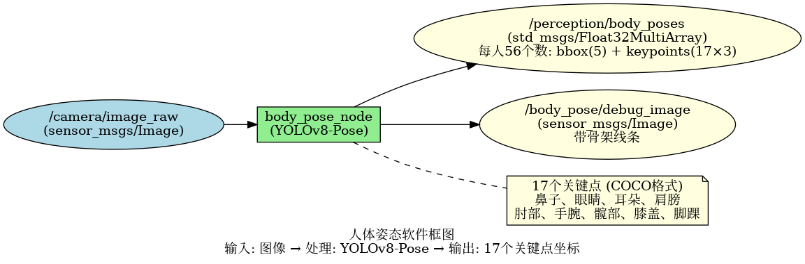
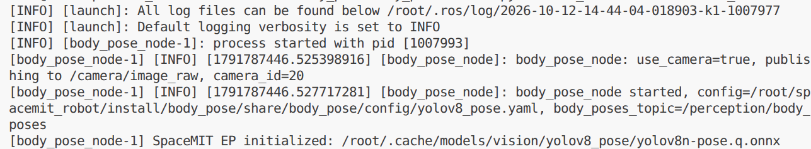
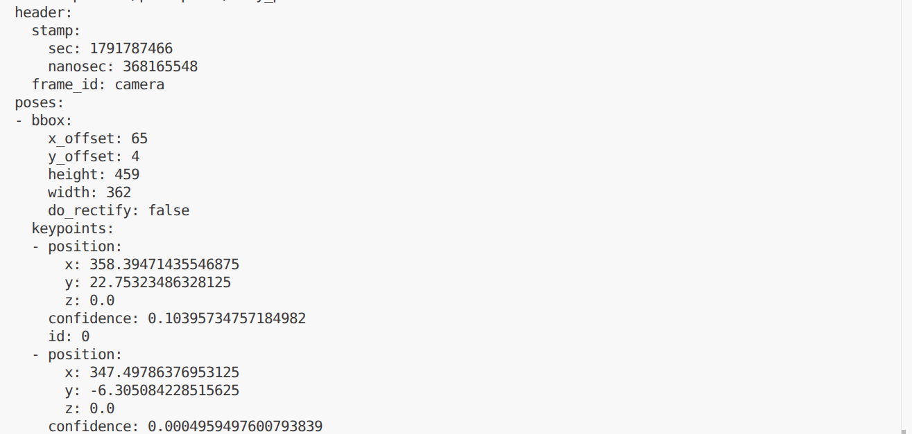

# 机器感知 · 人体姿态

## 1. 模块概述

本模块提供基于 YOLOv8-Pose 的人体姿态估计能力，可以检测图像中的人体并输出 17 个关键点（COCO 格式），包括头部、躯干、四肢等关键部位，适用于动作识别、姿态分析、健身指导等场景。

### 功能特性

- **算法**：YOLOv8-Pose（YOLOv8n-pose 轻量级版本）

- **输入分辨率**：640×640

- **关键点数量**：17 个（COCO 标准）

- **关键点定义**：鼻子、眼睛、耳朵、肩膀、肘部、手腕、髋部、膝盖、脚踝

- **推理后端**：SpaceMIT EP（ONNX Runtime）

- **输出格式**：`body_pose/msg/BodyPoseArray`（检测框与 17 个关键点）

### 软件框图



### 目录结构

```
body_pose/
├── src/
│   └── body_pose_node.cpp         # 主节点实现
├── config/
│   ├── body_pose.yaml             # 节点配置
│   └── yolov8_pose.yaml           # 模型配置
├── launch/
│   └── body_pose.launch.py        # 启动文件
└── package.xml
```

## 2. 环境准备

### 前置条件

SDK 源码获取和基础编译环境配置参考“2.3 构建编译”，ROS 2 环境配置参考快速入门。后续命令默认在 K1 设备的 SDK 根目录执行。

**运行环境与依赖**

- K1 Bianbu 系统、ROS 2 Humble。

- `output/staging/lib/libvision.so` 与 `output/staging/include/vision_service.h`。

- 模型路径由 `middleware/ros2/perception/body_pose/config/yolov8_pose.yaml` 的 `model_path` 指定。

- 摄像头模式使用支持 `Video Capture` 的 V4L2 采集节点；也支持外部图像话题。

### 构建编译

系统缺少依赖时先安装：

```bash
sudo apt install python3-colcon-common-extensions ros-humble-vision-msgs \
    python3-spacemit-ort opencv-spacemit spacemit-onnxruntime \
    eigen-spacemit openblas-spacemit libeigen3-dev libyaml-cpp-dev
```

加载构建环境，编译视觉组件并下载模型、素材：

```bash
cd /root/spacemit_robot
source build/envsetup.sh
lunch k1-muse-pipro-ai-cubpet
cd components/model_zoo/vision
mm
bash examples/yolov8_pose/scripts/download_models.sh
bash scripts/download_assets.sh
cd /root/spacemit_robot
```

模型配置 `yolov8_pose.yaml` 的推理线程数默认已为 `4`，无需修改。

编译 ROS 包。使用 `--base-paths` 限定包发现范围，避免扫描 SDK 内的无关工程：

```bash
source /opt/ros/humble/setup.bash
colcon build --base-paths middleware/ros2/perception/body_pose \
    --packages-select body_pose --symlink-install --cmake-force-configure
source install/setup.bash
ros2 pkg executables body_pose
```

可执行文件位于 `install/body_pose/lib/body_pose/body_pose_node`；配置和启动文件位于 `install/body_pose/share/body_pose/`。新终端需重新加载 `/opt/ros/humble/setup.bash` 和 SDK 的 `install/setup.bash`。

## 3. 快速上手

### 3.1 使用摄像头运行人体姿态

**准备工作**

确认模型已下载，连接摄像头并选择支持 `Video Capture` 的采集节点。一个摄像头可能同时提供图像与元数据节点。

```bash
v4l2-ctl --list-devices
ls /dev/video*
# 将 N 替换为实际设备号
v4l2-ctl -d /dev/videoN -D
```

**步骤 1：启动节点**

以下以 `/dev/video0` 为模板，将 `camera_id` 改为实际设备号：

```
ros2 launch body_pose body_pose.launch.py \
    use_camera:=true camera_id:=0
```

**终端输出：**




在具有桌面环境的 ROS 终端可使用 rqt_image_view，选择 /body_pose/debug_image 查看实时画面。缺少该工具时安装 ros-humble-rqt-image-view。节点持续运行，按 `Ctrl+C` 退出。模型采用延迟加载，收到图像后才开始推理。节点不自动打开显示窗口。


**步骤 2：查看结果**

在新终端加载相同 ROS 环境：

```bash
cd /root/spacemit_robot
source /opt/ros/humble/setup.bash
source install/setup.bash
ros2 topic echo /perception/body_poses --once
ros2 topic hz /perception/body_poses
```

**终端输出：**



### 3.2 订阅外部图像话题

```bash
ros2 launch body_pose body_pose.launch.py use_camera:=false
```

由摄像头驱动或图像发布节点向 `/camera/image_raw` 发布 `sensor_msgs/msg/Image`。仅启动上述节点不会自动产生输入；图像订阅使用 best-effort QoS。

## 4. 应用开发

### 接口说明

**订阅话题**

- `/camera/image_raw` (sensor_msgs/msg/Image) - 输入图像

**发布话题**

- `/perception/body_poses` (`body_pose/msg/BodyPoseArray`)：`poses` 数组，每人包含 `bbox`、`confidence`、`track_id` 和 `keypoints`。`bbox` 为 `sensor_msgs/msg/RegionOfInterest`；关键点包含像素坐标 `position`、置信度 `confidence` 和序号 `id`。

- `/body_pose/debug_image` (sensor_msgs/msg/Image) - 带骨架的可视化图像

### 关键点说明

**COCO 17 点顺序**（索引从 0 开始）：

- 0: 鼻子 (nose)

- 1: 左眼 (left_eye)

- 2: 右眼 (right_eye)

- 3: 左耳 (left_ear)

- 4: 右耳 (right_ear)

- 5: 左肩 (left_shoulder)

- 6: 右肩 (right_shoulder)

- 7: 左肘 (left_elbow)

- 8: 右肘 (right_elbow)

- 9: 左腕 (left_wrist)

- 10: 右腕 (right_wrist)

- 11: 左髋 (left_hip)

- 12: 右髋 (right_hip)

- 13: 左膝 (left_knee)

- 14: 右膝 (right_knee)

- 15: 左踝 (left_ankle)

- 16: 右踝 (right_ankle)

**关键点置信度**：`confidence` 为连续置信度值，业务侧可按置信度阈值判断关键点是否可用。遮挡可能降低置信度，也可能造成误定位。

### 使用方式

**参数配置**

- `use_camera`：true 时直连摄像头，false 时订阅外部图像话题

- `score_threshold`：置信度阈值，默认 0.25

**命令行传参示例**
```bash
# 使用摄像头 1，置信度阈值 0.3
ros2 launch body_pose body_pose.launch.py camera_id:=1 score_threshold:=0.3
```

### 注意事项

1. **关键点坐标**：x, y 为像素坐标，原点在图像左上角

2. **有效性判断**：使用 `confidence` 阈值判断关键点是否可用

3. **人体完整性**：遮挡可能降低关键点置信度，也可能造成误定位，应结合场景判断

### 参考资料

- 配置文件：`install/body_pose/share/body_pose/config/body_pose.yaml`

- 模型配置：`install/body_pose/share/body_pose/config/yolov8_pose.yaml`

- 启动文件：`install/body_pose/share/body_pose/launch/body_pose.launch.py`

## 5. 调试指南

### 日志调试

日志输出到启动终端和 `~/.ros/log/`。使用 `ros2 run` 启动时，可在原命令的 `--ros-args` 后增加 `--log-level debug`。

### 常用调试命令

```bash
ros2 topic list | grep -E 'body_pose|perception'
ros2 topic hz /perception/body_poses
ros2 topic hz /camera/image_raw
ros2 node info /body_pose_node
ros2 param list /body_pose_node
```

参数在启动时读取。改变阈值或输入配置后，应重启节点并传入新参数；不要仅依据 `ros2 param set` 返回成功判断算法已经更新。

图像话题使用 best-effort QoS，查看编码可执行：

```bash
ros2 topic echo /body_pose/debug_image --once \
    --qos-reliability best_effort --field encoding
```

### 性能分析

```bash
ps -ef | grep '[b]ody_pose_node'
# 将 PID 替换为上面查到的节点进程号
top -p PID
```

`ros2 topic hz` 测量订阅端接收频率，包含采集、推理、后处理及消息传输影响，不等同于纯模型帧率。当前节点没有逐帧推理耗时日志。

## 6. 常见问题

模型采用延迟加载时，首次图像或骨架输入才触发初始化。K1 上应避免与不需要的 SpaceMIT 推理服务并行占用资源。


| 问题现象 | 可能原因 | 解决方法 |
| --- | --- | --- |
| 节点启动失败，提示找不到模型文件 | 模型路径配置错误 | 检查 `~/.cache/models/vision/yolov8_pose/yolov8n-pose.q.onnx` 是否存在 |
| 无姿态输出 | 输入图像无人或置信度阈值过高 | 1. 确认场景中有完整人体<br>2. 降低 score_threshold |
| 关键点位置不准确 | 人体被遮挡或姿态复杂 | 1. 改善拍摄角度<br>2. 提高图像分辨率<br>3. 使用更大的模型 |
| 节点崩溃 exit -11 | 推理库或摄像头驱动问题 | 保存节点日志、软件版本与输入样本，使用 gdb 获取回溯 |
| 关键点抖动严重 | 检测不稳定 | 1. 提高置信度阈值<br>2. 添加时序平滑算法 |
| 小人体检测不到关键点 | 输入分辨率不足 | 提高输入图像分辨率 |

## 附录

### 应用场景

- **动作识别**：作为动作识别的输入，提供骨架序列数据

- **姿态分析**：分析人体姿态，用于健身指导、康复训练

- **动作交互**：结合肩、肘、腕等身体关键点分析抬手动作；该模型不提供手指关键点

- **跌倒检测**：通过关键点位置判断是否跌倒

- **人机交互**：基于姿态的交互控制

- **运动分析**：体育运动中的动作分析

