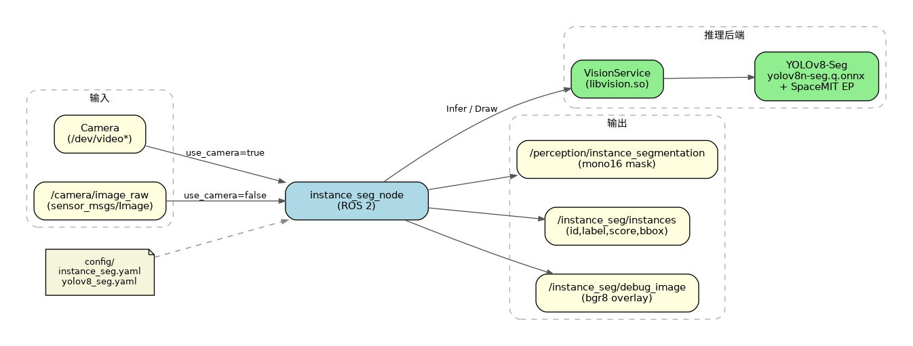
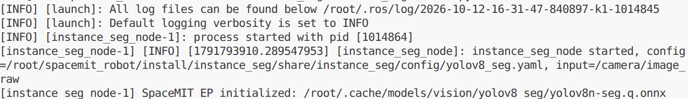
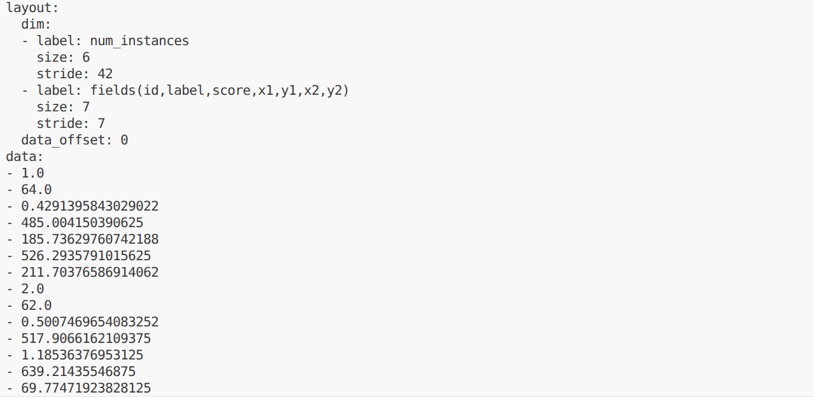

# 机器感知 · 实例分割

## 1. 模块概述

本模块提供基于 YOLOv8-Seg 的实例分割能力，可对图像中的每个目标实例输出分割掩码与检测框，适用于目标抠图、精确轮廓感知、场景交互等场景。

### 功能特性

- **算法**：YOLOv8n-Seg（量化 ONNX，适合板端推理）

- **输入分辨率**：640×640

- **支持类别**：COCO 80 类

- **推理后端**：SpaceMIT EP（ONNX Runtime）

- **输出格式**：
  - `sensor_msgs/msg/Image`（`mono16` 实例掩码）
  - `std_msgs/msg/Float32MultiArray`（实例元数据）
  - `sensor_msgs/msg/Image`（`bgr8` 调试叠加图）

### 软件框图



### 目录结构

```
instance_seg/
├── src/
│   ├── instance_seg_node.cpp   # 主节点实现
│   ├── image_utils.cpp         # 图像消息转换
│   └── instance_utils.cpp      # 实例元数据编码
├── config/
│   ├── instance_seg.yaml       # 节点参数
│   └── yolov8_seg.yaml         # 模型配置
├── launch/
│   └── instance_seg.launch.py  # 启动文件
├── include/instance_seg/
├── tests/
└── package.xml
```

## 2. 环境准备

### 前置条件

SDK 源码获取和基础编译环境配置参考“2.3 构建编译”，ROS 2 环境配置参考快速入门。后续命令默认在 K1 设备的 SDK 根目录执行。

**运行环境与依赖**

- K1 Bianbu 系统、ROS 2 Humble。

- `output/staging/lib/libvision.so` 与 `output/staging/include/vision_service.h`。

- 模型路径由 `middleware/ros2/perception/instance_seg/config/yolov8_seg.yaml` 的 `model_path` 指定。

- 摄像头模式使用支持 `Video Capture` 的 V4L2 采集节点；也支持外部图像话题。

### 构建编译

系统缺少依赖时先安装：

```bash
sudo apt install python3-colcon-common-extensions ros-humble-vision-msgs \
    python3-spacemit-ort opencv-spacemit spacemit-onnxruntime \
    eigen-spacemit openblas-spacemit libeigen3-dev libyaml-cpp-dev
```

加载构建环境，编译视觉组件并下载模型、素材：

```bash
cd /root/spacemit_robot
source build/envsetup.sh
lunch k1-muse-pipro-ai-cubpet
cd components/model_zoo/vision
mm
bash examples/yolov8_seg/scripts/download_models.sh
bash scripts/download_assets.sh
cd /root/spacemit_robot
```

示例配置默认使用 `num_threads: 8`。当前 K1 运行时报告可用 AI 核资源为 4，需将**推理线程数**改为 `4`；该数值不代表设备的 CPU 总核数。`sed -i.bak` 将修改前的配置保存为同名 `.bak` 文件。

```bash
sed -i.bak 's/num_threads: 8/num_threads: 4/' \
    middleware/ros2/perception/instance_seg/config/yolov8_seg.yaml
```

若旧版 `instance_seg/CMakeLists.txt` 在探测 OpenCV 5 后报找不到 OpenCV 4，应在 `if(NOT OpenCV_FOUND)` 分支中、`find_package(OpenCV 4 ...)` 前清除失败的缓存并恢复 K1 的 OpenCV 路径：

```cmake
unset(OpenCV_DIR CACHE)
set(OpenCV_DIR "/opt/opencv-spacemit/lib/cmake/opencv4")
```

该处理用于 OpenCV 5 探测失败后的回退分支；使用其他安装路径时替换为实际的 `OpenCVConfig.cmake` 所在目录。

编译 ROS 包。使用 `--base-paths` 限定包发现范围，避免扫描 SDK 内的无关工程：

```bash
source /opt/ros/humble/setup.bash
colcon build --base-paths middleware/ros2/perception/instance_seg \
    --packages-select instance_seg
source install/setup.bash
ros2 pkg executables instance_seg
```

可执行文件位于 `install/instance_seg/lib/instance_seg/instance_seg_node`；配置和启动文件位于 `install/instance_seg/share/instance_seg/`。新终端需重新加载 `/opt/ros/humble/setup.bash` 和 SDK 的 `install/setup.bash`。

## 3. 快速上手

### 3.1 使用摄像头运行实例分割

**准备工作**

确认模型已下载，连接摄像头并选择支持 `Video Capture` 的采集节点。一个摄像头可能同时提供图像与元数据节点。

```bash
v4l2-ctl --list-devices
ls /dev/video*
# 将 N 替换为实际设备号
v4l2-ctl -d /dev/videoN -D
```

**重要提示**：默认配置 `config/instance_seg.yaml` 中 `camera_id` 为 `1`。若摄像头不是对应设备，请修改该参数。

**步骤 1：启动实例分割节点**

```
ros2 launch instance_seg instance_seg.launch.py
```

节点持续运行，按 `Ctrl+C` 退出。模型采用延迟加载，收到图像后才开始推理。节点不自动打开显示窗口。



**步骤 2：查看结果**

在新终端加载相同 ROS 环境后执行：

```bash
cd /root/spacemit_robot
source /opt/ros/humble/setup.bash
source install/setup.bash
ros2 topic echo /instance_seg/instances --once
```



**步骤 3：查看掩码与调试图**

```
# 实例掩码（mono16；0 为背景，1..N 为本帧实例 ID）
ros2 topic echo /perception/instance_segmentation --once --qos-reliability best_effort

# 调试叠加图（若无 rqt，可用其他工具订阅该话题）
ros2 topic hz /instance_seg/debug_image
```

### 3.2 订阅外部图像话题

```bash
ros2 run instance_seg instance_seg_node --ros-args \
  -p use_camera:=false \
  -p image_topic:=/camera/image_raw
```

由摄像头驱动或图像发布节点向 `/camera/image_raw` 发布 `sensor_msgs/msg/Image`。仅启动上述节点不会自动产生输入；图像订阅使用 best-effort QoS。

## 4. 应用开发

### 接口说明

**订阅话题**

- `/camera/image_raw` (`sensor_msgs/msg/Image`)：当 `use_camera:=false` 时订阅；`use_camera:=true` 时由节点打开摄像头并发布该话题

**发布话题**

- `/perception/instance_segmentation` (`sensor_msgs/msg/Image`, `mono16`)：像素 0 为背景，1..N 为实例序号

- `/instance_seg/instances` (`std_msgs/msg/Float32MultiArray`)：连续字段 `[id,label,score,x1,y1,x2,y2]`

- `/instance_seg/debug_image` (`sensor_msgs/msg/Image`, `bgr8`)：`VisionService::Draw` 可视化结果

### 使用方式

**参数配置（`config/instance_seg.yaml`）**

| 参数 | 默认值 | 说明 |
| --- | --- | --- |
| `config_path` | 空（自动指向 `yolov8_seg.yaml`） | 模型 yaml 路径 |
| `lazy_load` | `true` | 是否延迟加载模型 |
| `score_threshold` | `0.25` | 实例置信度阈值，范围 `[0, 1]` |
| `image_topic` | `/camera/image_raw` | 图像话题 |
| `mask_topic` | `/perception/instance_segmentation` | 掩码输出话题 |
| `instances_topic` | `/instance_seg/instances` | 元数据输出话题 |
| `debug_image_topic` | `/instance_seg/debug_image` | 调试图话题 |
| `use_camera` | `true` | 是否直连摄像头 |
| `camera_id` | `1` | 摄像头编号 |
| `camera_fps` | `30.0` | 摄像头处理定时器目标频率，必须 `> 0`；不保证实际达到该频率 |

**命令行传参示例**
```bash
ros2 launch instance_seg instance_seg.launch.py \
  use_camera:=false \
  image_topic:=/camera/image_raw \
  score_threshold:=0.35
```

### 注意事项

1. **实例 ID 仅在本帧有效，不是跨帧跟踪 ID**。实例掩码与元数据一一对应：掩码中的 ID 与 `instances` 中的 `id` 一致（从 1 开始）

2. **重叠区域**：同一像素被多个实例覆盖时，以后出现的有效实例为准

3. **无效掩码会被跳过**：空、非单通道，或尺寸与输入图像不一致的掩码会丢弃并打 throttled 警告

4. **mask/debug 话题 QoS**：使用 `SensorDataQoS`（best_effort），订阅时请匹配 reliability

### 参考资料

- 节点配置：`install/instance_seg/share/instance_seg/config/instance_seg.yaml`

- 模型配置：`install/instance_seg/share/instance_seg/config/yolov8_seg.yaml`

- 启动文件：`install/instance_seg/share/instance_seg/launch/instance_seg.launch.py`

- 包内 README：`middleware/ros2/perception/instance_seg/README.md`

## 5. 调试指南

### 日志调试

日志输出到启动终端和 `~/.ros/log/`。使用 `ros2 run` 启动时，可在原命令的 `--ros-args` 后增加 `--log-level debug`。

### 常用调试命令

```bash
ros2 topic list | grep -E 'instance_seg|perception'
ros2 topic hz /instance_seg/instances
ros2 topic hz /camera/image_raw
ros2 node info /instance_seg_node
ros2 param list /instance_seg_node
```

参数在启动时读取。改变阈值或输入配置后，应重启节点并传入新参数；不要仅依据 `ros2 param set` 返回成功判断算法已经更新。

图像话题使用 best-effort QoS，查看编码可执行：

```bash
ros2 topic echo /instance_seg/debug_image --once \
    --qos-reliability best_effort --field encoding
```

### 性能分析

```bash
ps -ef | grep '[i]nstance_seg_node'
# 将 PID 替换为上面查到的节点进程号
top -p PID
```

`ros2 topic hz` 测量订阅端接收频率，包含采集、推理、后处理及消息传输影响，不等同于纯模型帧率。当前节点没有逐帧推理耗时日志。

## 6. 常见问题

模型采用延迟加载时，首次图像或骨架输入才触发初始化。K1 上应避免与不需要的 SpaceMIT 推理服务并行占用资源。


| 问题现象 | 可能原因 | 解决方法 |
| --- | --- | --- |
| 节点启动失败，找不到模型 | `yolov8_seg.yaml` 中 `model_path` 不正确或模型未下载 | 检查 `~/.cache/models/vision/yolov8_seg/yolov8n-seg.q.onnx`，必要时重新执行模型下载脚本 |
| 话题存在但长时间无结果 | 1. 无输入图<br>2. 置信度过高被过滤<br>3. 推理失败 | 1. 确认摄像头/`image_topic` 有数据<br>2. 降低 `score_threshold`<br>3. 查看节点 throttled 警告 |
| `echo` 不到 mask/debug | QoS 不匹配 | 增加 `--qos-reliability best_effort` |
| `camera_fps` / `score_threshold` 启动即退出 | 参数越界 | `score_threshold` 必须在 `[0,1]`，`camera_fps` 必须有限且 `> 0` |
| 外接话题无输入 | 仍在摄像头模式 | 设置 `use_camera:=false` 并指定正确的 `image_topic` |

## 附录

### 应用场景

- **目标抠图**：按实例 mask 提取目标区域

- **精确避障**：结合轮廓信息做近距离交互

- **检测增强**：在检测框之外补充像素级实例轮廓

### 与语义分割的区别

| 对比项 | 实例分割（本模块） | 语义分割（5.2.7） |
| --- | --- | --- |
| 模型 | YOLOv8-Seg | PP-LiteSeg |
| 输出含义 | 每个目标一个实例 ID | 每个像素一个语义类别 |
| 掩码格式 | `mono16` | `mono8` |
| 元数据 | 实例框 + score + label | 各类别像素计数 |

