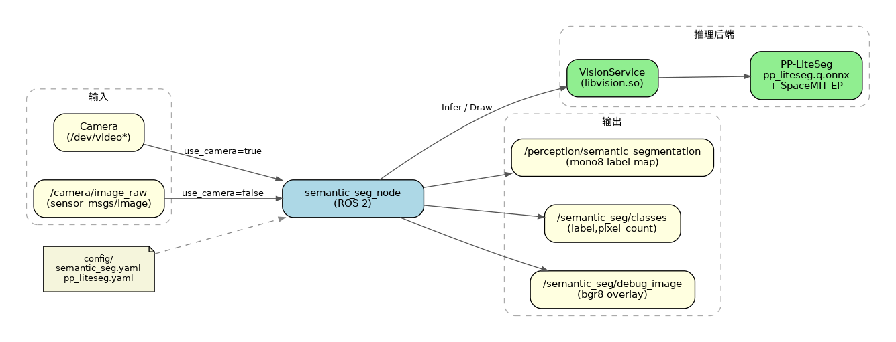
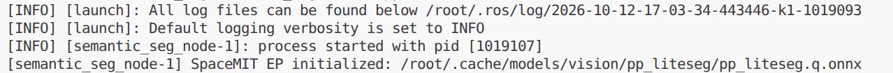
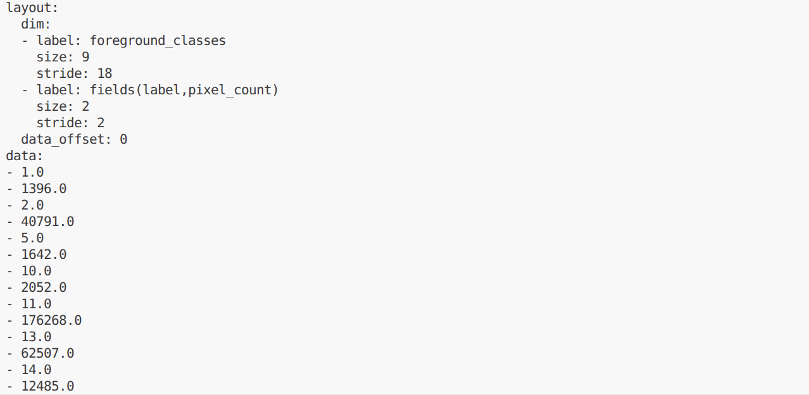

# 机器感知 · 语义分割

## 1. 模块概述

本模块提供基于 PP-LiteSeg 的语义分割能力，对图像中每个像素分配语义类别，适用于场景理解、可行驶区域分析、环境语义建模等场景。

### 功能特性

- **算法**：PP-LiteSeg（Cityscapes，19 类）

- **推理后端**：SpaceMIT EP（ONNX Runtime）

- **输出格式**：
  - `sensor_msgs/msg/Image`（`mono8` 类别标签图）
  - `std_msgs/msg/Float32MultiArray`（前景类别像素统计）
  - `sensor_msgs/msg/Image`（`bgr8` 调试叠加图）

- **不支持**：实例级 ID、目标跟踪

### 软件框图



### 目录结构

```
semantic_seg/
├── src/
│   ├── semantic_seg_node.cpp    # 主节点实现
│   ├── image_utils.cpp          # 图像消息转换
│   └── segmentation_utils.cpp   # 掩码合成与像素统计
├── config/
│   ├── semantic_seg.yaml        # 节点参数
│   └── pp_liteseg.yaml          # 模型配置
├── launch/
│   └── semantic_seg.launch.py   # 启动文件
├── include/semantic_seg/
├── tests/
└── package.xml
```

## 2. 环境准备

### 前置条件

SDK 源码获取和基础编译环境配置参考“2.3 构建编译”，ROS 2 环境配置参考快速入门。后续命令默认在 K1 设备的 SDK 根目录执行。

**运行环境与依赖**

- K1 Bianbu 系统、ROS 2 Humble。

- `output/staging/lib/libvision.so` 与 `output/staging/include/vision_service.h`。

- 模型路径由 `middleware/ros2/perception/semantic_seg/config/pp_liteseg.yaml` 的 `model_path` 指定。

- 摄像头模式使用支持 `Video Capture` 的 V4L2 采集节点；也支持外部图像话题。

### 构建编译

系统缺少依赖时先安装：

```bash
sudo apt install python3-colcon-common-extensions ros-humble-vision-msgs \
    python3-spacemit-ort opencv-spacemit spacemit-onnxruntime \
    eigen-spacemit openblas-spacemit libeigen3-dev libyaml-cpp-dev
```

加载构建环境，编译视觉组件并下载模型、素材：

```bash
cd /root/spacemit_robot
source build/envsetup.sh
lunch k1-muse-pipro-ai-cubpet
cd components/model_zoo/vision
mm
bash examples/pp_liteseg/scripts/download_models.sh
bash scripts/download_assets.sh
cd /root/spacemit_robot
```

示例配置默认使用 `num_threads: 8`。当前 K1 运行时报告可用 AI 核资源为 4，需将**推理线程数**改为 `4`；该数值不代表设备的 CPU 总核数。`sed -i.bak` 将修改前的配置保存为同名 `.bak` 文件。

```bash
sed -i.bak 's/num_threads: 8/num_threads: 4/' \
    middleware/ros2/perception/semantic_seg/config/pp_liteseg.yaml
```

编译 ROS 包。使用 `--base-paths` 限定包发现范围，避免扫描 SDK 内的无关工程：

```bash
source /opt/ros/humble/setup.bash
colcon build --base-paths middleware/ros2/perception/semantic_seg \
    --packages-select semantic_seg
source install/setup.bash
ros2 pkg executables semantic_seg
```

可执行文件位于 `install/semantic_seg/lib/semantic_seg/semantic_seg_node`；配置和启动文件位于 `install/semantic_seg/share/semantic_seg/`。新终端需重新加载 `/opt/ros/humble/setup.bash` 和 SDK 的 `install/setup.bash`。

## 3. 快速上手

### 3.1 使用摄像头运行语义分割

**准备工作**

确认模型已下载，连接摄像头并选择支持 `Video Capture` 的采集节点。一个摄像头可能同时提供图像与元数据节点。

```bash
v4l2-ctl --list-devices
ls /dev/video*
# 将 N 替换为实际设备号
v4l2-ctl -d /dev/videoN -D
```

**重要提示**：默认配置 `config/semantic_seg.yaml` 中 `camera_id` 为 `1`。若摄像头不是对应设备，请修改该参数。

**步骤 1：启动语义分割节点**

```
source install/setup.bash   # 或 source output/staging/setup.bash
ros2 launch semantic_seg semantic_seg.launch.py
```

**终端输出：**



节点持续运行，按 `Ctrl+C` 退出。模型采用延迟加载，收到图像后才开始推理。节点不自动打开显示窗口。

**步骤 2：查看结果**

在新终端加载相同 ROS 环境后执行：

```bash
cd /root/spacemit_robot
source /opt/ros/humble/setup.bash
source install/setup.bash
ros2 topic echo /semantic_seg/classes
```

**终端输出：**

**步骤 3：查看掩码与调试图**

```
# 语义标签图（mono8；像素值为类别 ID，0 为背景）
ros2 topic echo /perception/semantic_segmentation --once --qos-reliability best_effort

# 调试叠加图频率
ros2 topic hz /semantic_seg/debug_image
```

### 3.2 订阅外部图像话题

```bash
ros2 run semantic_seg semantic_seg_node --ros-args \
  -p use_camera:=false \
  -p image_topic:=/camera/image_raw
```

由摄像头驱动或图像发布节点向 `/camera/image_raw` 发布 `sensor_msgs/msg/Image`。仅启动上述节点不会自动产生输入；图像订阅使用 best-effort QoS。

## 4. 应用开发

### 接口说明

**订阅话题**

- `/camera/image_raw` (`sensor_msgs/msg/Image`)：当 `use_camera:=false` 时订阅；`use_camera:=true` 时由节点打开摄像头并发布该话题

**发布话题**

- `/perception/semantic_segmentation` (`sensor_msgs/msg/Image`, `mono8`)：像素值为类别 ID，0 为未输出的零类区域

- `/semantic_seg/classes` (`std_msgs/msg/Float32MultiArray`)：成对字段 `[label, pixel_count]`

- `/semantic_seg/debug_image` (`sensor_msgs/msg/Image`, `bgr8`)：`VisionService::Draw` 可视化结果

### 语义类别（Cityscapes 19 类参考）

默认模型基于 Cityscapes 风格类别（具体以模型训练定义为准），常见包括：

- 道路、人行道、建筑、墙壁、栅栏、杆

- 交通灯、交通标志、植被、地形、天空

- 人、骑行者、汽车、卡车、公交车、火车、摩托车、自行车

当前视觉库仅导出非零类掩码，ROS 像素统计也不包含 0 类。Cityscapes 的 0 类通常为道路，不能将其直接解释为无语义背景；道路像素统计需要结合该模型的类别定义和零类处理逻辑扩展。

### 使用方式

**参数配置（`config/semantic_seg.yaml`）**

| 参数 | 默认值 | 说明 |
| --- | --- | --- |
| `config_path` | 空（自动指向 `pp_liteseg.yaml`） | 模型 yaml 路径 |
| `lazy_load` | `true` | 是否延迟加载模型 |
| `image_topic` | `/camera/image_raw` | 图像话题 |
| `mask_topic` | `/perception/semantic_segmentation` | 标签图输出话题 |
| `classes_topic` | `/semantic_seg/classes` | 类别像素统计话题 |
| `debug_image_topic` | `/semantic_seg/debug_image` | 调试图话题 |
| `use_camera` | `true` | 是否直连摄像头 |
| `camera_id` | `1` | 摄像头编号 |
| `camera_fps` | `30.0` | 摄像头处理定时器目标频率，必须 `> 0`；不保证实际达到该频率 |

**命令行传参示例**
```bash
ros2 launch semantic_seg semantic_seg.launch.py \
  use_camera:=false \
  image_topic:=/camera/image_raw
```

### 注意事项

1. **标签范围**：节点接受 `1..255`；配套 19 类模型使用 `1..18`，零类未进入统计；不合法掩码会被跳过

2. **重叠处理**：多份有效掩码重叠时，以后来者覆盖先到者

3. **mask/debug 话题 QoS**：使用 `SensorDataQoS`（best_effort），订阅时请匹配 reliability

4. **计算量**：分割相对检测更重，可关注板端帧率与线程数配置（见 `pp_liteseg.yaml`）

### 参考资料

- 节点配置：`install/semantic_seg/share/semantic_seg/config/semantic_seg.yaml`

- 模型配置：`install/semantic_seg/share/semantic_seg/config/pp_liteseg.yaml`

- 启动文件：`install/semantic_seg/share/semantic_seg/launch/semantic_seg.launch.py`

- 包内 README：`middleware/ros2/perception/semantic_seg/README.md`

## 5. 调试指南

### 日志调试

日志输出到启动终端和 `~/.ros/log/`。使用 `ros2 run` 启动时，可在原命令的 `--ros-args` 后增加 `--log-level debug`。

### 常用调试命令

```bash
ros2 topic list | grep -E 'semantic_seg|perception'
ros2 topic hz /semantic_seg/classes
ros2 topic hz /camera/image_raw
ros2 node info /semantic_seg_node
ros2 param list /semantic_seg_node
```

参数在启动时读取。改变阈值或输入配置后，应重启节点并传入新参数；不要仅依据 `ros2 param set` 返回成功判断算法已经更新。

图像话题使用 best-effort QoS，查看编码可执行：

```bash
ros2 topic echo /semantic_seg/debug_image --once \
    --qos-reliability best_effort --field encoding
```

### 性能分析

```bash
ps -ef | grep '[s]emantic_seg_node'
# 将 PID 替换为上面查到的节点进程号
top -p PID
```

`ros2 topic hz` 测量订阅端接收频率，包含采集、推理、后处理及消息传输影响，不等同于纯模型帧率。当前节点没有逐帧推理耗时日志。

## 6. 常见问题

模型采用延迟加载时，首次图像或骨架输入才触发初始化。K1 上应避免与不需要的 SpaceMIT 推理服务并行占用资源。


| 问题现象 | 可能原因 | 解决方法 |
| --- | --- | --- |
| 节点启动失败，找不到模型 | `pp_liteseg.yaml` 中 `model_path` 不正确或模型未下载 | 检查 `~/.cache/models/vision/pp_liteseg/pp_liteseg.q.onnx`，必要时重新执行模型下载脚本 |
| 有话题但结果全背景 | 输入图异常或推理失败 | 检查输入话题与节点日志中的 `infer failed` 警告 |
| `echo` 不到 mask/debug | QoS 不匹配 | 增加 `--qos-reliability best_effort` |
| `camera_fps` 启动即退出 | 参数非法 | `camera_fps` 必须有限且 `> 0` |
| 外接话题无输入 | 仍在摄像头模式 | 设置 `use_camera:=false` 并指定正确的 `image_topic` |
| 分割结果不理想 | 场景与 Cityscapes 域差异大 | 更换适配场景的模型或补充训练数据 |

## 附录

### 应用场景

- **场景理解**：区分天空、建筑、植被、道路等区域

- **导航辅助**：识别可行驶/可行走区域语义

- **环境建模**：为规划与定位提供语义先验

### 与实例分割的区别

| 对比项 | 语义分割（本模块） | 实例分割（5.2.6） |
| --- | --- | --- |
| 模型 | PP-LiteSeg | YOLOv8-Seg |
| 输出含义 | 每个像素一个语义类别 | 每个目标一个实例 ID |
| 掩码格式 | `mono8` | `mono16` |
| 元数据 | 各类别像素计数 | 实例框 + score + label |

