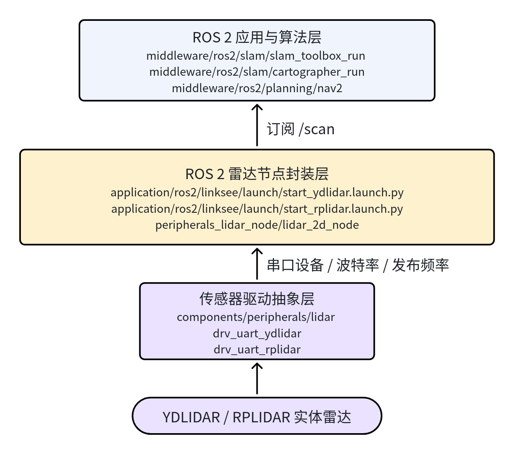
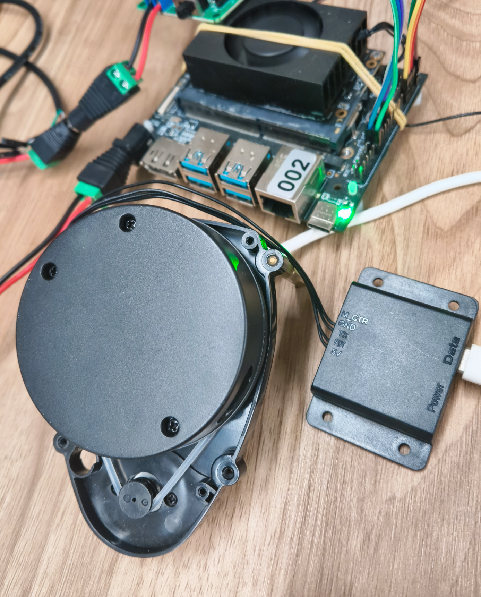
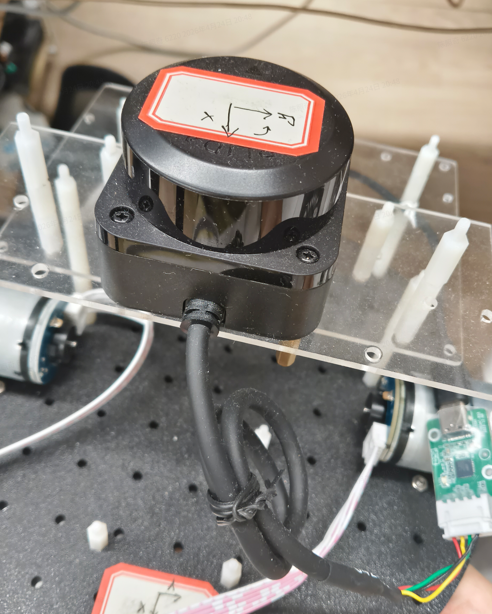

# 基础传感器 · 雷达

## 1. 模块概述

- **主要功能**：本模块提供统一的 2D 激光雷达接入能力，屏蔽不同厂商雷达的驱动差异，为 ROS 2 上层应用稳定发布 `LaserScan` 数据。雷达通常作为移动机器人的基础传感器使用，为 `slam_toolbox`、`cartographer`、`nav2` 等模块提供 `/scan` 输入。
- **规格或特性**：
  - 支持驱动：`YDLIDAR`（X3 Pro）、`RPLIDAR`（C1）；
  - 接口形态：串口型 2D 激光雷达，设备节点为 `/dev/ttyUSB0`；
  - ROS 2 节点：`peripherals_lidar_node` 包中的 `lidar_2d_node`；
  - 默认输出话题：`/scan`；
  - 默认坐标系：`laser_frame`；
  - 典型参数：10 Hz 扫描频率、量程 `0.1 m ~ 30 m`；
  - `YDLIDAR X3 Pro` 默认串口波特率为 `115200`，`RPLIDAR C1` 默认串口波特率为 `460800`。
- **软件框图**：雷达模块在 ROS 2 使用链路中的位置如下：



- **相关目录结构**：

| 路径 | 职责 |
| --- | --- |
| `components/peripherals/lidar/` | 雷达组件抽象层，统一管理不同型号驱动 |
| `components/peripherals/lidar/src/drivers/drv_uart_ydlidar/` | YDLIDAR 串口驱动实现 |
| `components/peripherals/lidar/src/drivers/drv_uart_rplidar/` | RPLIDAR 串口驱动实现 |
| `middleware/ros2/peripherals/lidar/src/` | ROS 2 节点实现 |
| `middleware/ros2/peripherals/lidar/params/lidar_2d.yaml` | 默认节点参数文件 |

## 2. 环境准备

### 前置条件

- 运行环境：K1 MUSE Pi Pro 开发板，Bianbu 2.3.5，Linux 6.6.63，ROS 2 Humble；
- 硬件与连接：串口型 2D 激光雷达，如 `YDLIDAR X3 Pro` 或 `RPLIDAR C1`，通过 USB 转串口连接到 K1，确认设备节点为 `/dev/ttyUSB0`；
- 工具与权限：需要串口设备访问权限，如提示权限不足，可将当前用户加入 `dialout` 组，或使用 `sudo`。

### 构建编译

```bash
cd ~/spacemit_robot
source build/envsetup.sh
lunch k1-muse-pipro-minimal

cd ~/spacemit_robot/middleware/ros2/peripherals/lidar
mm
```

构建完成后产物位于：

```text
~/spacemit_robot/output/staging/lib/peripherals_lidar_node/lidar_2d_node
~/spacemit_robot/output/staging/share/peripherals_lidar_node/params/lidar_2d.yaml
```

### K1 参数配置

K3 默认参数中 `model` 为空，需要根据实际雷达型号填写。在参数文件目录创建 K1 适配文件。

**RPLIDAR C1 配置** (`lidar_2d_k1_rplidar.yaml`)：

```yaml
lidar_2d_node:
  ros__parameters:
    channel_type: "serial"
    model: "RPLIDAR"
    serial_port: "/dev/ttyUSB0"
    serial_baudrate: 460800
    frame_id: "laser_frame"
    topic_name: "scan"
    scan_frequency: 10.0
    angle_min: -3.14159
    angle_max: 3.14159
    range_min: 0.1
    range_max: 30.0
    inverted: false
    flip_x_axis: false
    angle_compensate: false
    scan_bins: 720
    return_mode: 0
```

**YDLIDAR X3 Pro 配置** (`lidar_2d_k1_ydlidar.yaml`)：

```yaml
lidar_2d_node:
  ros__parameters:
    channel_type: "serial"
    model: "YDLIDAR"
    serial_port: "/dev/ttyUSB0"
    serial_baudrate: 115200
    frame_id: "laser_frame"
    topic_name: "scan"
    scan_frequency: 10.0
    angle_min: -3.14159
    angle_max: 3.14159
    range_min: 0.1
    range_max: 30.0
    inverted: false
    flip_x_axis: false
    angle_compensate: true
    scan_bins: 720
    return_mode: 0
```

## 3. 示例使用（从 0 跑通）

### 3.1 连接雷达并确认设备节点

标准 2D 激光雷达通过 USB 转串口与 K1 连接。两个已验证型号的外观如下：

**YDLIDAR X3 Pro：**



**RPLIDAR C1：**



接线完成后，确认雷达供电并开始旋转，再执行：

```bash
ls -l /dev/ttyUSB*
```

预期输出（以 CP210x 为例）：

```text
crw-rw---- 1 root dialout 188, 0 Oct 27 11:06 /dev/ttyUSB0
```

### 3.2 启动 ROS 2 雷达节点

加载环境后启动节点（以 RPLIDAR C1 为例）：

```bash
source /opt/ros/humble/setup.bash
source ~/spacemit_robot/output/staging/setup.bash

ros2 run peripherals_lidar_node lidar_2d_node \
  --ros-args \
  --params-file ~/spacemit_robot/output/staging/share/peripherals_lidar_node/params/lidar_2d_k1_rplidar.yaml
```

预期现象：节点启动并开始发布 `/scan` 话题，终端持续打印扫描帧信息。

### 3.3 订阅扫描数据

另开终端：

```bash
source /opt/ros/humble/setup.bash
source ~/spacemit_robot/output/staging/setup.bash

ros2 topic echo /scan --once
```

预期输出（节选）：

```yaml
header:
  frame_id: laser_frame
angle_min: -3.1415927
angle_max: 3.1415927
ranges:
- 2.93
- 2.88
...
```

也可以使用底层组件测试程序直接验证雷达数据：

```bash
test_lidar_uart RPLIDAR /dev/ttyUSB0 460800
```

每帧点云数据将打印点数量和边界框信息：

```text
[Frame 1] Points: 462, BBox: [-3.97, 2.93] x [-2.25, 8.24] x [0.00, 0.00]
```

## 4. 应用开发

上层应用通过订阅 `/scan` 话题获取 `sensor_msgs/msg/LaserScan` 消息。主要字段：

| 字段 | 含义 |
| --- | --- |
| `angle_min` / `angle_max` | 扫描角度范围（弧度） |
| `angle_increment` | 相邻点角度增量 |
| `ranges` | 每个角度的距离值数组（米） |
| `range_min` / `range_max` | 有效距离范围 |

切换雷达型号时只需修改参数文件中的 `model` 和 `serial_baudrate`，上层建图/导航节点无需改动。

## 5. 调试指南

- 节点报 `Failed to open serial port`：先确认 `/dev/ttyUSB0` 存在，可使用 `ls -l /dev/ttyUSB*` 检查，如权限不足则加 `sudo` 或将用户加入 `dialout` 组。
- 节点启动但 `/scan` 无数据：检查雷达是否已开始旋转、供电是否稳定，以及 `model` 和 `serial_baudrate` 是否与实际型号一致。
- 扫描数据方向异常：可尝试修改参数中的 `inverted` 或 `flip_x_axis`。

## 6. 常见问题

- `YDLIDAR` 与 `RPLIDAR` 的默认波特率不同，切换型号时需同步修改 `model` 和 `serial_baudrate`；
- 上层建图/导航统一订阅 `/scan`，因此更换雷达型号通常无需修改算法节点，只需确保话题和坐标系名称一致。
