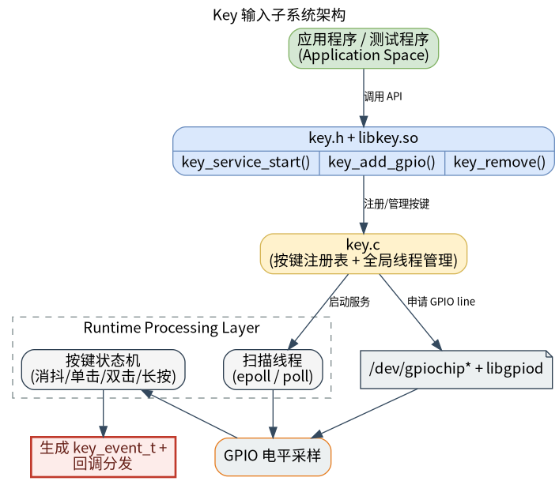

# 基础传感器 · 按键

## 1. 模块概述

- 主要功能：按键模块位于机器人开发层的基础传感器能力中，对下封装 `components/peripherals/key` 用户态 GPIO 按键组件，对上提供 ROS 2 节点 `key_node` 和按键事件话题。模块用于把物理 GPIO 电平变化转换为按下、释放、单击、双击、长按和长按连发等离散事件，供上层应用、交互逻辑或状态机订阅使用。
- 规格或特性：对外接口为 ROS 2 话题 `peripherals_key_node/msg/KeyEvent`，默认话题名为 `/key/events`；节点名固定为 `key_node`；发布队列深度为 `32`；默认事件队列刷出周期为 `10 ms`；支持一次注册多个 GPIO 按键；每个按键可配置逻辑 `key_id`、Linux GPIO 编号、有效电平、长按阈值、双击窗口和日志名称。底层依赖 `libkey.so`、`key.h`、`libgpiod` 与 `/dev/gpiochip*`。
- 软件框图：



- 相关目录结构：

| 路径 | 职责 |
| --- | --- |
| `middleware/ros2/peripherals/key/src/key_node.cpp` | ROS 2 按键节点实现，负责加载参数、注册底层 GPIO 按键、缓存回调事件并发布 `KeyEvent` |
| `middleware/ros2/peripherals/key/params/key_node.yaml` | 默认节点参数文件 |
| `middleware/ros2/peripherals/key/msg/KeyEvent.msg` | 按键事件消息定义 |
| `components/peripherals/key/include/key.h` | 底层按键组件 C API、事件枚举和 `key_config_t` 配置结构体 |
| `components/peripherals/key/example/test_key.c` | 底层按键组件自测程序，可用于先排除硬件和 GPIO 配置问题 |

## 2. 环境准备

### 前置条件

- 运行环境：K1 MUSE Pi Pro 开发板，Bianbu 2.3.5，Linux 6.6.63，ROS 2 Humble；
- 硬件与连接：需要两根测试线，或两个常开瞬时按键，接法参考 [6.2.4 按键](../../../06-进阶开发/6.2-外设与驱动/6.2.4-按键.md) 接线部分。K1 MUSE Pi Pro 默认使用 GPIO49（物理针脚 22）和 GPIO50（物理针脚 26），低电平有效；
- 工具与权限：运行账户需要访问 `/dev/gpiochip*`，如出现权限错误可使用 `sudo` 或配置 GPIO 设备权限。

### 构建编译

```bash
cd ~/spacemit_robot
source build/envsetup.sh
lunch k1-muse-pipro-minimal

cd ~/spacemit_robot/middleware/ros2/peripherals/key
mm
```

构建完成后产物位于：

```text
~/spacemit_robot/output/staging/lib/peripherals_key_node/key_node
~/spacemit_robot/output/staging/share/peripherals_key_node/params/key_node.yaml
~/spacemit_robot/output/staging/lib/libkey.so
```

### K1 参数配置

K3 默认参数使用 GPIO83，K1 MUSE Pi Pro 需要改用 GPIO49/GPIO50。在参数文件目录创建 K1 适配文件 `key_node_k1.yaml`：

```yaml
key_node:
  ros__parameters:
    event_topic: "key/events"
    frame_id: "key"
    publish_period_ms: 10
    key_ids: [0, 1]
    gpio_nums: [49, 50]
    active_lows: [1, 1]
    long_press_ms: [1500, 2000]
    double_click_ms: [300, 400]
    key_names: ["key1", "key2"]
```

参数说明：

| 参数 | 含义 |
| --- | --- |
| `key_ids` | 逻辑按键 ID，必须唯一 |
| `gpio_nums` | Linux GPIO 编号，K1 上等于 line_offset |
| `active_lows` | 有效电平，`1=低电平有效`，`0=高电平有效` |
| `long_press_ms` | 长按阈值（ms） |
| `double_click_ms` | 双击判定窗口（ms） |
| `key_names` | 仅用于日志打印，可选 |

## 3. 示例使用（从 0 跑通）

### 3.1 启动 ROS 2 按键节点并观察事件

**步骤 1**：加载运行环境。

```bash
source /opt/ros/humble/setup.bash
source ~/spacemit_robot/output/staging/setup.bash
```

**步骤 2**：启动按键节点。

```bash
ros2 run peripherals_key_node key_node \
  --ros-args \
  --params-file ~/spacemit_robot/output/staging/share/peripherals_key_node/params/key_node_k1.yaml
```

预期现象：终端打印按键注册日志：

```text
[INFO] [key_node]: registered key: key_id=0 gpio=49 active_low=true long_press_ms=1500 double_click_ms=300 name=key1
[INFO] [key_node]: registered key: key_id=1 gpio=50 active_low=true long_press_ms=2000 double_click_ms=400 name=key2
[INFO] [key_node]: key_node ready: topic=/key/events, keys=2
```

**步骤 3**：另开终端订阅事件话题。

```bash
source /opt/ros/humble/setup.bash
source ~/spacemit_robot/output/staging/setup.bash

ros2 topic echo /key/events
```

**步骤 4**：触发按键事件。

将 GPIO49 的测试线短暂碰 GND 后松开（单击），终端应打印：

```yaml
header:
  frame_id: key
key_id: 0
event: 1
---
```

`event` 字段含义：`0=按下`、`1=单击`、`2=双击`、`3=长按`、`4=长按连发`、`5=释放`。

- **短按**：碰 GND 后松开，等双击窗口结束后打印 `event=1`（单击）；
- **双击**：300 ms 内快速碰两次 GND，打印 `event=2`；
- **长按**：持续碰 GND 超过 1.5 s，先打印 `event=3`（长按），继续保持则周期打印 `event=4`（连发）；
- **释放**：松开后打印 `event=5`。

## 4. 应用开发

上层应用订阅 `/key/events` 话题，消息类型为 `peripherals_key_node/msg/KeyEvent`。

消息字段：

| 字段 | 类型 | 含义 |
| --- | --- | --- |
| `header` | `std_msgs/Header` | 时间戳和 frame_id |
| `key_id` | `int32` | 逻辑按键 ID |
| `event` | `int32` | 事件类型：`0=按下 1=单击 2=双击 3=长按 4=连发 5=释放` |

调用注意点：节点内部通过后台线程 10 ms 周期扫描 GPIO 电平，回调会累积在队列里统一在定时器中发布；`publish_period_ms` 控制发布周期，降低此值可减少事件延迟；所有 GPIO 使用 `gpiochip0`，`gpio_num` 直接等于 K1 的 GPIO 编号。

## 5. 调试指南

- 节点启动失败报 `key alloc failed`：检查 `gpio_nums` 是否在 K1 可用范围内，确认 `/dev/gpiochip0` 访问权限；
- 有物理动作但无事件输出：核对 `active_lows` 与接线方式是否一致；扩展板有硬件上拉时应设为 `1`（低电平有效）；
- 事件误触发：增大 `double_click_ms` 或底层 `debounce_ms`，或检查接线是否有抖动。

## 6. 常见问题

- 底层 `GPIO49/GPIO50` 已被其他进程占用：先 `pkill test_key` 或 `pkill test_misc_io` 释放占用再启动节点；
- 单击延迟约为 `double_click_ms` 的时长：这是正常行为，节点需等双击判定窗口结束才能确认是单击。
