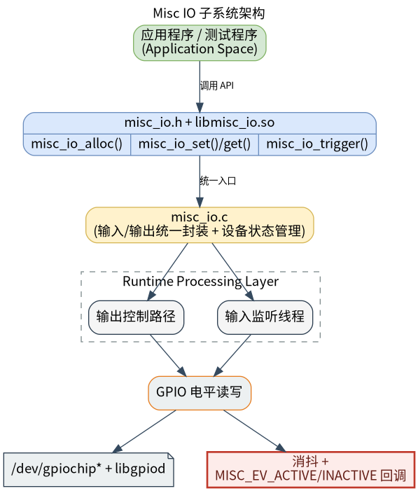

# 基础传感器 · IO

## 1. 模块概述

- 主要功能：IO 模块位于机器人开发层的基础传感器能力中，对下封装 `components/peripherals/misc_io` Linux GPIO 组件，对上提供 ROS 2 节点 `misc_io_node`。模块用于统一接入开关、光耦、限位、普通数字传感器、蜂鸣器、继电器和通用 GPIO 输出等零散 IO 外设，并向上层提供命令、状态和事件三类 ROS 2 接口。
- 规格或特性：命令输入为 `peripherals_misc_io_node/msg/MiscIoCommand`，默认话题 `/misc_io/command`；状态输出为 `peripherals_misc_io_node/msg/MiscIoState`，默认话题 `/misc_io/state`；输入事件输出为 `peripherals_misc_io_node/msg/MiscIoEvent`，默认话题 `/misc_io/events`。默认状态发布周期为 `100 ms`；支持一次注册多个 IO；每路 IO 可配置逻辑 ID、类型、方向、有效电平、去抖时间、`gpiochip` 名称、line offset、consumer 名称和日志名称。状态话题使用 `reliable + transient_local` QoS，新订阅者可立即收到最近一次状态快照。
- 软件框图：



- 相关目录结构：

| 路径 | 职责 |
| --- | --- |
| `middleware/ros2/peripherals/misc_io/src/misc_io_node.cpp` | ROS 2 IO 节点实现，负责注册 IO、订阅命令、发布状态和输入事件 |
| `middleware/ros2/peripherals/misc_io/params/misc_io_node.yaml` | 默认节点参数文件 |
| `middleware/ros2/peripherals/misc_io/msg/MiscIoCommand.msg` | IO 输出命令消息定义 |
| `middleware/ros2/peripherals/misc_io/msg/MiscIoState.msg` | IO 状态消息定义 |
| `middleware/ros2/peripherals/misc_io/msg/MiscIoEvent.msg` | IO 输入事件消息定义 |
| `components/peripherals/misc_io/include/misc_io.h` | 底层 misc_io C API |
| `components/peripherals/misc_io/example/test_misc_io.c` | 底层组件测试程序 |

## 2. 环境准备

### 前置条件

- 运行环境：K1 MUSE Pi Pro 开发板，Bianbu 2.3.5，Linux 6.6.63，ROS 2 Humble；
- 硬件与连接：目标板需暴露可由 Linux 访问的 GPIO 控制器，并已连接好待测试的 IO 外设。K1 MUSE Pi Pro 的所有 GPIO 均位于 `gpiochip0`，`line_offset` 直接等于 GPIO 编号。本示例使用 GPIO49（物理针脚 22）作为输入，GPIO50（物理针脚 26）作为输出，接法参考 [6.2.6 通用IO](../../../06-进阶开发/6.2-外设与驱动/6.2.6-通用IO.md)；
- 工具与权限：运行用户需要访问 `/dev/gpiochip*` 的权限；如设备节点权限未放开，可使用 `sudo` 运行。

### 构建编译

```bash
cd ~/spacemit_robot
source build/envsetup.sh
lunch k1-muse-pipro-minimal

cd ~/spacemit_robot/middleware/ros2/peripherals/misc_io
mm
```

构建完成后产物位于：

```text
~/spacemit_robot/output/staging/lib/peripherals_misc_io_node/misc_io_node
~/spacemit_robot/output/staging/share/peripherals_misc_io_node/params/misc_io_node.yaml
```

### K1 参数配置

K3 默认参数使用 `gpiochip2 + line_offset 19`，K1 需要改用 `gpiochip0` 并按实际接线设置 `line_offset`。在参数文件目录创建 `misc_io_node_k1.yaml`：

```yaml
misc_io_node:
  ros__parameters:
    command_topic: "misc_io/command"
    state_topic: "misc_io/state"
    event_topic: "misc_io/events"
    frame_id: "misc_io"
    publish_period_ms: 100

    # K1 MUSE Pi Pro: one input trigger + one output control
    io_ids: [0, 1]
    types: [3, 3]
    dirs: [0, 1]
    active_logics: [1, 1]
    debounce_mss: [20, 0]
    chip_names: ["gpiochip0", "gpiochip0"]
    line_offsets: [49, 50]
    consumers: ["status_input_0", "control_output_0"]
    io_names: ["status_input_0", "control_output_0"]
```

参数说明：

| 参数 | 含义 |
| --- | --- |
| `io_ids` | 逻辑 IO ID，必须唯一 |
| `types` | 设备类型，`0=GENERIC 1=BUZZER 2=RELAY 3=SWITCH 4=SENSOR` |
| `dirs` | 方向，`0=INPUT 1=OUTPUT` |
| `active_logics` | 有效电平，`0=ACTIVE_LOW 1=ACTIVE_HIGH` |
| `debounce_mss` | 去抖时间（ms），主要对输入 IO 有意义 |
| `chip_names` | GPIO 芯片名，K1 统一为 `gpiochip0` |
| `line_offsets` | GPIO line offset，K1 等于 GPIO 编号 |

## 3. 示例使用（从 0 跑通）

### 3.1 启动 IO 节点并观察状态与事件

**步骤 1**：加载运行环境。

```bash
source /opt/ros/humble/setup.bash
source ~/spacemit_robot/output/staging/setup.bash
```

**步骤 2**：启动 IO 节点。

```bash
ros2 run peripherals_misc_io_node misc_io_node \
  --ros-args \
  --params-file ~/spacemit_robot/output/staging/share/peripherals_misc_io_node/params/misc_io_node_k1.yaml
```

预期现象：终端打印每路 IO 的注册日志：

```text
[INFO] [misc_io_node]: registered io: io_id=0 type=3 dir=0 active_logic=1 debounce_ms=20 chip=gpiochip0 line_offset=49 consumer=status_input_0 name=status_input_0
[INFO] [misc_io_node]: registered io: io_id=1 type=3 dir=1 active_logic=1 debounce_ms=0 chip=gpiochip0 line_offset=50 consumer=control_output_0 name=control_output_0
[INFO] [misc_io_node]: misc_io_node ready: command_topic=misc_io/command state_topic=misc_io/state event_topic=misc_io/events ios=2
```

**步骤 3**：另开终端订阅状态话题。

```bash
source ~/spacemit_robot/output/staging/setup.bash
ros2 topic echo /misc_io/state --once
```

预期输出（GPIO49 硬件上拉，active=true）：

```yaml
header:
  stamp:
    sec: 1793240374
    nanosec: 626410150
  frame_id: misc_io
io_id: 0
type: 3
dir: 0
active: true
---
```

**步骤 4**：订阅输入事件话题，并触发输入电平变化。

```bash
ros2 topic echo /misc_io/events
```

将 GPIO49 测试线碰 GND 后松开，应看到 `event=0`（ACTIVE）和 `event=1`（INACTIVE）。

### 3.2 通过命令话题控制输出 IO

发送打开命令（GPIO50 输出高电平）：

```bash
ros2 topic pub --once /misc_io/command peripherals_misc_io_node/msg/MiscIoCommand "{io_id: 1, active: true}"
```

交叉验证 GPIO50 电平变化：

```bash
cat /sys/kernel/debug/gpio | grep "gpio-50"
```

预期输出：

```text
 gpio-50  (                    |control_output_0    ) out hi 
```

发送关闭命令：

```bash
ros2 topic pub --once /misc_io/command peripherals_misc_io_node/msg/MiscIoCommand "{io_id: 1, active: false}"
```

再次查看 GPIO50：

```bash
cat /sys/kernel/debug/gpio | grep "gpio-50"
```

预期输出：

```text
 gpio-50  (                    |control_output_0    ) out lo 
```

向输入 IO 发送命令（应被忽略）：

```bash
ros2 topic pub --once /misc_io/command peripherals_misc_io_node/msg/MiscIoCommand "{io_id: 0, active: true}"
```

预期现象：节点忽略这条命令，输入 IO 物理状态不会被改写。

## 4. 应用开发

上层应用通过三类话题与 IO 节点交互：

| 接口 | 消息类型 | 默认话题 | 方向 |
| --- | --- | --- | --- |
| 命令 | `MiscIoCommand` | `/misc_io/command` | 上层 → 节点 |
| 状态 | `MiscIoState` | `/misc_io/state` | 节点 → 上层 |
| 事件 | `MiscIoEvent` | `/misc_io/events` | 节点 → 上层 |

消息字段说明：

| 接口 | 字段 | 含义 |
| --- | --- | --- |
| `MiscIoCommand` | `io_id` | 目标 IO ID |
| `MiscIoCommand` | `active` | 输出期望状态，`true=有效/开启` |
| `MiscIoState` | `type` | `0=GENERIC 1=BUZZER 2=RELAY 3=SWITCH 4=SENSOR` |
| `MiscIoState` | `dir` | `0=INPUT 1=OUTPUT` |
| `MiscIoState` | `active` | 当前逻辑状态（已按 active_logic 解释） |
| `MiscIoEvent` | `event` | `0=ACTIVE 1=INACTIVE` |

注意点：命令只对 `dir=1` 的输出 IO 生效；事件只对 `dir=0` 的输入 IO 发布；`MiscIoState.active` 是逻辑值，不是 GPIO 原始电平；参数数组按下标一一对应，`io_ids` 必须唯一。

## 5. 调试指南

- 配置文件中只能配置成输入或者输出，需要根据实际的应用场景配置；
- 节点启动报 `misc_io_alloc failed`：检查 `chip_names` 和 `line_offsets` 是否正确，确认 GPIO 未被其他进程占用（`pkill test_misc_io`）；
- 状态话题无数据：确认订阅端 QoS 与发布端兼容，状态话题使用 `transient_local`；
- 输入事件无输出：确认 `dirs` 配置为 `0`（输入），并实际触发电平变化。

## 6. 常见问题

- 上一个进程占用 GPIO 导致 `misc_io_alloc` 失败：先 `pkill` 相关进程再启动节点；
- 向输入 IO 发命令无效：这是设计行为，命令只对输出 IO 生效。
