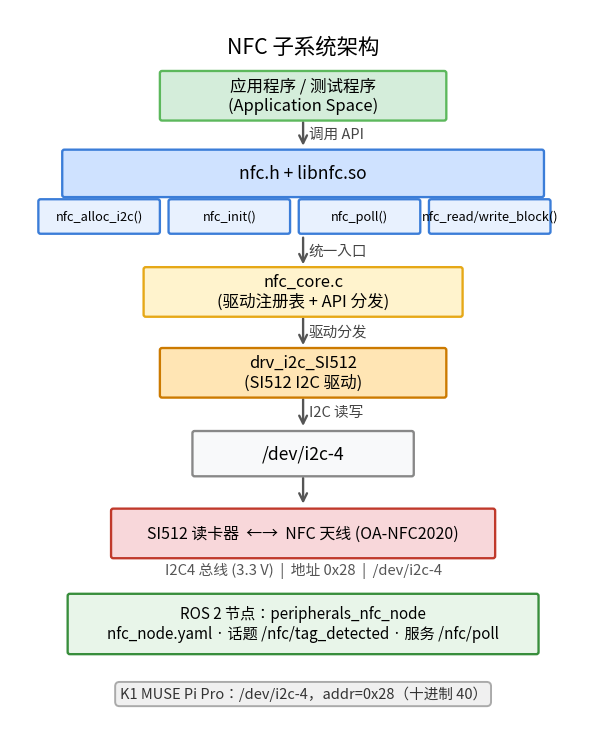

# 基础传感器 · NFC

## 1. 模块概述

- 主要功能:NFC 模块位于机器人开发层的基础传感器能力中,对下封装 `components/peripherals/nfc` 读卡组件,对上提供 ROS 2 节点 `nfc_node`、标签检测话题以及块读写服务。模块用于检测 NFC 标签、发布 UID/标签类型等信息,并向上层应用提供按块读取和写入的请求-响应接口。
- 规格或特性:对外同时提供 ROS 2 话题和服务。默认话题为 `/nfc/tag_detected`,消息类型为 `peripherals_nfc_node/msg/NfcTagInfo`;默认服务为 `/nfc/poll`、`/nfc/read_block`、`/nfc/write_block`,服务类型分别为 `peripherals_nfc_node/srv/NfcPoll`、`peripherals_nfc_node/srv/NfcReadBlock`、`peripherals_nfc_node/srv/NfcWriteBlock`;节点名固定为 `nfc_node`;默认后台自动轮询周期 `100 ms`,单次轮询超时 `50 ms`;支持通过参数选择 `i2c` / `spi` / `uart` 传输方式。当前 K1 扩展板使用 I2C 模式,芯片为 SI512,总线为 `/dev/i2c-4`,地址为 `0x28`(40)。
- 软件框图:



- 相关目录结构:

| 路径 | 职责 |
| --- | --- |
| `middleware/ros2/peripherals/nfc/src/nfc_node.cpp` | ROS 2 NFC 节点实现,负责加载参数、创建底层设备、自动轮询、发布标签话题以及处理读写服务 |
| `middleware/ros2/peripherals/nfc/params/nfc_node.yaml` | 默认节点参数文件,包含传输方式、设备路径、话题名、服务名和轮询参数 |
| `middleware/ros2/peripherals/nfc/msg/NfcTagInfo.msg` | NFC 标签信息消息定义 |
| `middleware/ros2/peripherals/nfc/srv/NfcPoll.srv` | 主动轮询标签服务定义 |
| `middleware/ros2/peripherals/nfc/srv/NfcReadBlock.srv` | 按块读取标签数据服务定义 |
| `middleware/ros2/peripherals/nfc/srv/NfcWriteBlock.srv` | 按块写入标签数据服务定义 |
| `components/peripherals/nfc/include/nfc.h` | 底层 NFC 组件 C API、标签结构体和工厂函数声明 |
| `components/peripherals/nfc/src/nfc_core.c` | 底层设备对象、驱动注册和 `nfc_alloc_i2c/spi/uart()` 分发实现 |
| `components/peripherals/nfc/src/drivers/drv_i2c_SI512/drv_i2c_SI512.c` | SI512 I2C 驱动实现 |
| `components/peripherals/nfc/test/test_nfc_i2c.c` | 底层 I2C 自测程序,可用于先排除设备、地址和卡片交互问题 |

## 2. 环境准备

### 前置条件

- 运行环境:K1 MUSE Pi Pro 开发板,Bianbu 2.3.5,Linux 6.6.63,ROS 2 Humble;
- 依赖与外部资源:I2C 模式依赖内核导出的 `/dev/i2c-*` 设备节点,不额外依赖第三方动态库;本仓库当前提供的驱动源文件为 I2C + SI512;
- 硬件与连接:需要一块 SI512 NFC 模块,并通过 I2C 连接到目标板。K1 MUSE Pi Pro 扩展板已焊接 SI512 芯片,连接到 I2C-4 总线,从设备地址为 `0x28`。待测试卡片应为驱动当前示例路径支持的 Type A 类卡片(如手机 NFC、门禁卡等);
- 工具与权限:运行用户需要访问 `/dev/i2c-4` 的权限;如设备节点权限未放开,可使用 `sudo` 运行。

### 构建编译

```bash
cd ~/spacemit_robot
source build/envsetup.sh
lunch k1-muse-pipro-minimal

cd ~/spacemit_robot/components/peripherals/nfc
mm -DSROBOTIS_PERIPHERALS_NFC_ENABLED_DRIVERS=drv_i2c_SI512

cd ~/spacemit_robot/middleware/ros2/peripherals/nfc
mm
```

构建完成后产物位于:

```text
~/spacemit_robot/output/staging/lib/peripherals_nfc_node/nfc_node
~/spacemit_robot/output/staging/share/peripherals_nfc_node/params/nfc_node.yaml
~/spacemit_robot/output/staging/lib/libnfc.so
~/spacemit_robot/output/staging/bin/test_nfc_i2c
```

### K1 参数配置

K1 扩展板 NFC 硬件对应 I2C-4 总线、地址 0x28,在参数文件目录创建 `nfc_node_k1.yaml`:

```yaml
nfc_node:
  ros__parameters:
    transport: "i2c"
    driver: "SI512"
    name: "nfc0"
    device: "/dev/i2c-4"
    i2c_addr: 40  # 0x28
    frame_id: "nfc"
    tag_topic: "nfc/tag_detected"
    poll_service: "nfc/poll"
    read_block_service: "nfc/read_block"
    write_block_service: "nfc/write_block"
    auto_poll: true
    poll_period_ms: 100
    poll_timeout_ms: 50
    publish_duplicates: false
```

## 3. 示例使用(从 0 跑通)

### 3.1 底层组件验证

**步骤 1**:使用底层测试程序验证硬件连接。

```bash
cd ~/spacemit_robot
source build/envsetup.sh

sudo ~/spacemit_robot/output/staging/bin/test_nfc_i2c /dev/i2c-4 0x28 4
```

**步骤 2**:将支持 NFC Type A 的卡片(如手机背面 NFC 区域、门禁卡)靠近扩展板上的 NFC 天线模块(焊接的黑色圆形芯片及周边天线区域)。

预期现象:

```text
[NFC-SI512] init: nfc0 dev=/dev/i2c-4 addr=0x28
[callback] dev=0x... uid_len=4 type=1 rssi=0
[poll] tag detected:
  UID: 08 27 61 ED
read block ret=-5 first4=00 00 00 00
write block ret=-5
```

说明:
- UID 读取成功表示通信正常;
- `ret=-5` 表示手机卡或门禁卡受保护块无法直接读写,这是正常现象,不影响节点发布标签信息;
- 移开卡片后应显示 `[poll] no tag`。

### 3.2 ROS 2 NFC 节点

**步骤 1**:加载运行环境。

```bash
source /opt/ros/humble/setup.bash
source ~/spacemit_robot/output/staging/setup.bash
```

**步骤 2**:启动 NFC 节点。

```bash
ros2 run peripherals_nfc_node nfc_node \
  --ros-args \
  --params-file ~/spacemit_robot/output/staging/share/peripherals_nfc_node/params/nfc_node_k1.yaml
```

预期现象:

```text
[NFC-SI512] init: nfc0 dev=/dev/i2c-4 addr=0x28
[INFO] [nfc_node]: nfc_node ready: transport=i2c driver=SI512 name=nfc0 device=/dev/i2c-4 tag_topic=nfc/tag_detected auto_poll=true period_ms=100 timeout_ms=50
```

**步骤 3**:另开终端订阅标签话题。

```bash
source ~/spacemit_robot/output/staging/setup.bash
ros2 topic echo /nfc/tag_detected
```

**步骤 4**:将卡片靠近 NFC 天线,观察话题输出。

预期输出(节选):

```yaml
header:
  frame_id: nfc
uid:
- 8
- 39
- 97
- 237
uid_len: 4
tag_type: 1
rssi_dbm: 0
ats: []
ats_len: 0
---
```

移开卡片后话题停止发布新消息(因为 `publish_duplicates: false`,只在检测到新标签或标签信息变化时发布)。

### 3.3 调用轮询服务

```bash
source ~/spacemit_robot/output/staging/setup.bash
ros2 service call /nfc/poll peripherals_nfc_node/srv/NfcPoll "{timeout_ms: 500}"
```

预期输出(卡片靠近时):

```text
response:
peripherals_nfc_node.srv.NfcPoll_Response(
  success=True,
  message='ok',
  tag_info=peripherals_nfc_node.msg.NfcTagInfo(
    uid=[8, 39, 97, 237],
    uid_len=4,
    tag_type=1,
    rssi_dbm=0,
    ats=[],
    ats_len=0
  )
)
```

无卡片时:

```text
response:
peripherals_nfc_node.srv.NfcPoll_Response(success=False, message='no tag', ...)
```

## 4. 应用开发

- **对外 API 或接口形态**:上层应用可订阅 ROS 2 话题 `/nfc/tag_detected`,消息类型为 `peripherals_nfc_node/msg/NfcTagInfo`;也可调用服务 `/nfc/poll`、`/nfc/read_block`、`/nfc/write_block`,服务类型分别为 `peripherals_nfc_node/srv/NfcPoll`、`peripherals_nfc_node/srv/NfcReadBlock`、`peripherals_nfc_node/srv/NfcWriteBlock`。话题适合广播"检测到标签"的异步事件,服务适合表达"现在检测一次""读取某块""写入某块"的请求-响应语义。
- **消息与服务字段**:
  - `NfcTagInfo` 包含 `header`、`uid`、`uid_len`、`tag_type`、`rssi_dbm`、`ats`、`ats_len`。节点会把 UID 最多截断到 16 字节,把 ATS 最多截断到 32 字节。
  - `NfcPoll` 请求字段为 `uint32 timeout_ms`;响应字段为 `bool success`、`string message` 和 `NfcTagInfo tag_info`。
  - `NfcReadBlock` 请求字段为 `uint8 block_addr`;响应字段为 `bool success`、`string message` 和 `uint8[] data`。
  - `NfcWriteBlock` 请求字段为 `uint8 block_addr` 和 `uint8[] data`;响应字段为 `bool success` 和 `string message`。当前节点在进入底层前就要求 `data.size() == 16`。
- **调用方式与注意点**:
  - 节点内部的标签话题不是依赖底层 `nfc_set_callback()` 推出来的,而是通过定时器主动调用 `nfc_poll()` 得到检测结果后发布的。
  - 自动轮询、`poll` 服务、`read_block` 服务和 `write_block` 服务都共享同一个底层设备句柄;节点内部用 `std::mutex` 串行化这些访问,因此不会出现读写与轮询同时并发进入驱动的问题。
  - `transport` 参数只做语义校验,允许 `i2c` / `spi` / `uart` 三个值;但当前仓库实际注册的驱动只有 I2C 的 `SI512`。因此接口"允许"不等于当前源码"已实现"。
  - `driver` 和 `name` 会组合成底层实例名,例如默认组合后是 `SI512:nfc0`。如果 `driver` 找不到,`nfc_alloc_*()` 会失败,节点会抛出 `nfc_alloc_* failed`。
  - `poll_period_ms` 必须大于 `0`,`poll_timeout_ms` 必须大于等于 `0`,`i2c_addr` 必须在 `[0, 127]`;
  - 默认 `publish_duplicates=false` 时,节点只在"当前检测结果与上一次检测到的标签信息不完全相同"时发布话题;由于比较项包含 `rssi_dbm`,同一张卡在信号强度变化时也可能再次触发发布。
  - `poll` 服务成功时,节点除了返回 `tag_info` 外,还会同步向话题发布同一张标签;如果业务侧同时订阅话题并调用服务,需要考虑这一点,避免重复处理。
  - 手机 NFC 卡、门禁卡等包含保护块,底层 `read_block` / `write_block` 返回 `ret=-5` 属于正常现象,不影响 UID 和标签类型的读取。

## 5. 调试指南

- 先用底层组件排除总线和卡片问题:在 `~/spacemit_robot` 根目录执行 `sudo output/staging/bin/test_nfc_i2c /dev/i2c-4 0x28 4`。如果底层 `test_nfc_i2c` 都无法检测标签,优先检查 I2C 总线号、地址、供电、天线连接以及卡片类型和距离。
- 使用 `i2cdetect -y 4` 确认设备是否出现在预期总线上;如果节点启动时报 `nfc_init failed`,常见原因是设备路径错误、地址错误、权限不足,或底层 SI512 驱动初始化失败。
- 观察节点日志:正常启动应看到 `nfc_node ready`。如果参数非法,程序会在标准错误输出打印 `nfc_node exception: ...`,常见内容包括 `transport must be one of: i2c, spi, uart`、`poll_period_ms must be > 0`、`i2c_addr must be in [0, 127]`。
- 观察 ROS 2 图和接口:使用 `ros2 node list` 确认存在 `/nfc_node`,使用 `ros2 topic list | grep nfc` 确认话题存在,使用 `ros2 service list | grep '^/nfc/'` 确认三个服务存在,使用 `ros2 topic echo /nfc/tag_detected` 和 `ros2 service call /nfc/poll ...` 验证功能链路。
- 如果节点一启动就抛出 `nfc_alloc_* failed`,除了检查 `device`、`driver` 和 `transport`,还要重点检查底层库是否真的编入了 `drv_i2c_SI512`。当前组件代码默认不会自动把所有驱动都编进 `libnfc.so`。
- 如果 `read_block` 或 `write_block` 一直失败,但标签检测正常,先不要假设"节点坏了"。更常见的原因是当前卡片类型、目标块地址或硬件驱动能力不支持读写操作;可以先用 `test_nfc_i2c` 对同一块地址做底层验证。

## 6. 常见问题

暂无
