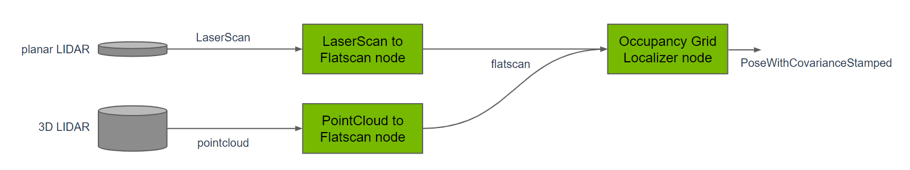
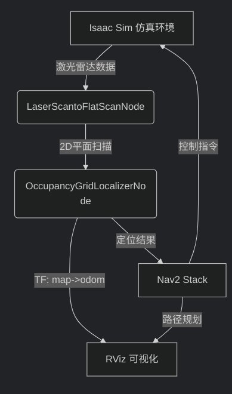
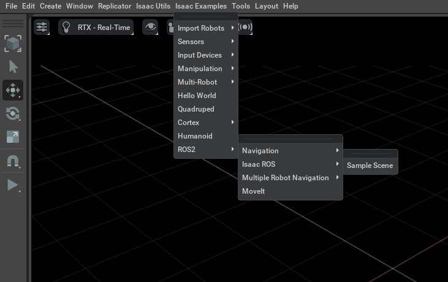
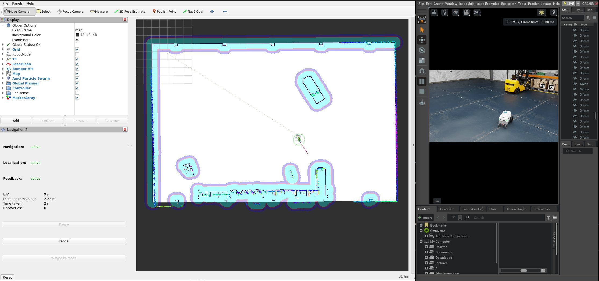

# 5.9.2 Isaac-Sim仿真导航

> ⚠️运行环境说明：
>
> - Isaac Sim运行在 GPU 服务器，Isaac ROS 运行在部署于 GPU 服务器的 Docker 容器（[isaac-ros-dev](https://nvidia-isaac-ros.github.io/v/release-3.2/concepts/docker_devenv/index.html#development-environment)）。
>
> - 官方教程：[Isaac ROS 官方示例](https://nvidia-isaac-ros.github.io/v/release-3.2/concepts/visual_slam/cuvslam/tutorial_isaac_sim.html)

## Isaac ROS Occupancy Grid Localizer 简介

该案例借助 [Isaac ROS Occupancy Grid Localizer](https://github.com/NVIDIA-ISAAC-ROS/isaac_ros_map_localization/tree/release-3.2) 实现地图本地化（定位），使用标准 Nav2 进行导航。

Occupancy Grid Localizer 是一个基于已知栅格地图和激光传感器数据来实现 2D 定位的模块，最终输出机器人在地图中的位姿。

Isaac ROS Occupancy Grid Localizer 定位器设计：



该定位器有两个主要节点：

- Occupancy Grid Localizer Node：NVIDIA 提供的占用栅格定位器（将激光雷达数据匹配到地图）
- Laser Scanto FlatScan Node：将平面2D/3D 激光雷达数据转换成 Isaac ROS 内部标准格式

## 仿真流程



## 准备工作

### 下载离线资源

在 GPU 服务器上完成 [Isaac ROS 3.2 工作空间准备](https://nvidia-isaac-ros.github.io/v/release-3.2/getting_started/dev_env_setup.html)，并设置 `ISAAC_ROS_WS`。以下命令在 Bash 终端执行，下载与 Isaac ROS 3.2 配套的 Isaac ROS Occupancy Grid Localizer 离线资源。

```bash
sudo apt-get update
sudo apt-get install -y curl jq tar
```

```bash
(
set -euo pipefail
: "${ISAAC_ROS_WS:?请先设置 ISAAC_ROS_WS 为 Isaac ROS 工作空间路径}"
NGC_RESOURCE="isaac_ros_occupancy_grid_localizer_assets"
VERSION_REQ_URL="https://api.ngc.nvidia.com/v2/resources/nvidia/isaac/${NGC_RESOURCE}/versions"
ASSET_VERSION=$(curl -fsSL "$VERSION_REQ_URL" | jq -r '
    .recipeVersions[].versionId
    | select(test("^3\\.[0-9]+\\.[0-9]+$"))
    | select((split(".")[1] | tonumber) <= 2)
    ' | sort -V | tail -n 1)

if [ -z "$ASSET_VERSION" ]; then
    echo "未找到适用于 Isaac ROS 3.2 的资源版本" >&2
    exit 1
fi

ASSET_DIR="${ISAAC_ROS_WS}/isaac_ros_assets"
mkdir -p "$ASSET_DIR"
ARCHIVE_PATH=$(mktemp "${TMPDIR:-/tmp}/isaac-assets.XXXXXX.tar.gz")
trap 'rm -f "$ARCHIVE_PATH"' EXIT
FILE_REQ_URL="https://api.ngc.nvidia.com/v2/resources/nvidia/isaac/${NGC_RESOURCE}/versions/${ASSET_VERSION}/files/quickstart.tar.gz"
curl -fL --retry 3 "$FILE_REQ_URL" -o "$ARCHIVE_PATH"
tar -xzf "$ARCHIVE_PATH" -C "$ASSET_DIR"
)
```

### 安装/编译 Isaac ROS Occupancy Grid Localizer

进入 `isaac-ros-dev` 容器，安装或编译 `isaac_ros_occupancy_grid_localizer` 包。

- 安装预编译包：

```Plain
sudo apt-get update
sudo apt-get install -y ros-humble-isaac-ros-occupancy-grid-localizer
```

- 源码编译：

```Plain
cd ${ISAAC_ROS_WS}/src
git clone -b release-3.2 https://github.com/NVIDIA-ISAAC-ROS/isaac_ros_map_localization.git isaac_ros_map_localization

sudo apt-get update
rosdep update && rosdep install --from-paths ${ISAAC_ROS_WS}/src/isaac_ros_map_localization/isaac_ros_occupancy_grid_localizer --ignore-src -y

cd ${ISAAC_ROS_WS}
colcon build --symlink-install --packages-up-to isaac_ros_occupancy_grid_localizer --base-paths ${ISAAC_ROS_WS}/src/isaac_ros_map_localization/isaac_ros_occupancy_grid_localizer

source install/setup.bash
```

## 启动仿真

在 GPU 服务器上启动仿真。

### 启动 IsaacSim

```Plain
cd issacsim
./isaac-sim.sh
```

### 加载场景和小车模型

参考：[https://nvidia-isaac-ros.github.io/v/release-3.2/getting_started/isaac_sim/index.html](https://nvidia-isaac-ros.github.io/v/release-3.2/getting_started/isaac_sim/index.html)



### 修改话题名称

在视图右部 Stage 栏目，选择 /World/Nova_Carter_ROS/ros_lidars/publish_front_2d_lidar_scan，将 2D 雷达发布的话题名称修改为 `/scan`，这是为了与 Nav2 导航栈的标准接口兼容。

### 启用雷达

在视图右部 Stage 栏目，选择 /World/Nova_Carter_ROS/ros_lidars/front_2d_lidar_render_product，在Inputs属性里面勾选 enabled，启用 2D 雷达输出，让 ROS2 驱动节点可以从仿真中接收到模拟的 2D 激光雷达数据。

### 启动仿真过程

点击视图左边的 **PLAY** 按钮启动场景，雷达开始发布数据话题，控制器开始接收速度等指令。

## 启动导航

```text
ros2 launch isaac_ros_occupancy_grid_localizer isaac_ros_occupancy_grid_localizer_nav2.launch.py
```

上述脚本启动 isaac_ros_occupancy_grid_localizer 的导航脚本，启动以下节点和功能：

| 节点/组件                    | 功能描述                                                     |
| ---------------------------- | ------------------------------------------------------------ |
| `rviz_launch`                | 启动 RViz 并加载预配置的可视化界面                           |
| `nav2_bringup_launch`        | 启动 Nav2 核心组件，包括控制器、全局/局部规划器等            |
| `OccupancyGridLocalizerNode` | NVIDIA 提供的占用栅格定位器，将激光数据匹配到栅格地图实现定位 |
| `LaserScantoFlatScanNode`    | 将 3D/2D激光雷达数据转化成FlatScan格式供定位器使用           |
| `static_transform_publisher` | 发布 `base_link` 到 `base_footprint` 的静态 TF               |

导航启动之后，需要初始化起始位置，执行下列命令触发本地化服务：

```text
ros2 service call /trigger_grid_search_localization std_srvs/srv/Empty {}
```

本地化服务返回后，在 RVIZ 视图中检查机器人位姿，再点击 Nav2 Goal 选择地图上的目标点，开始导航：


