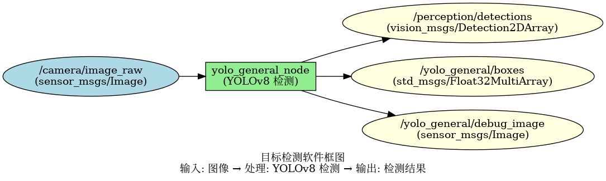
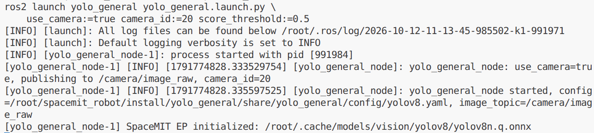
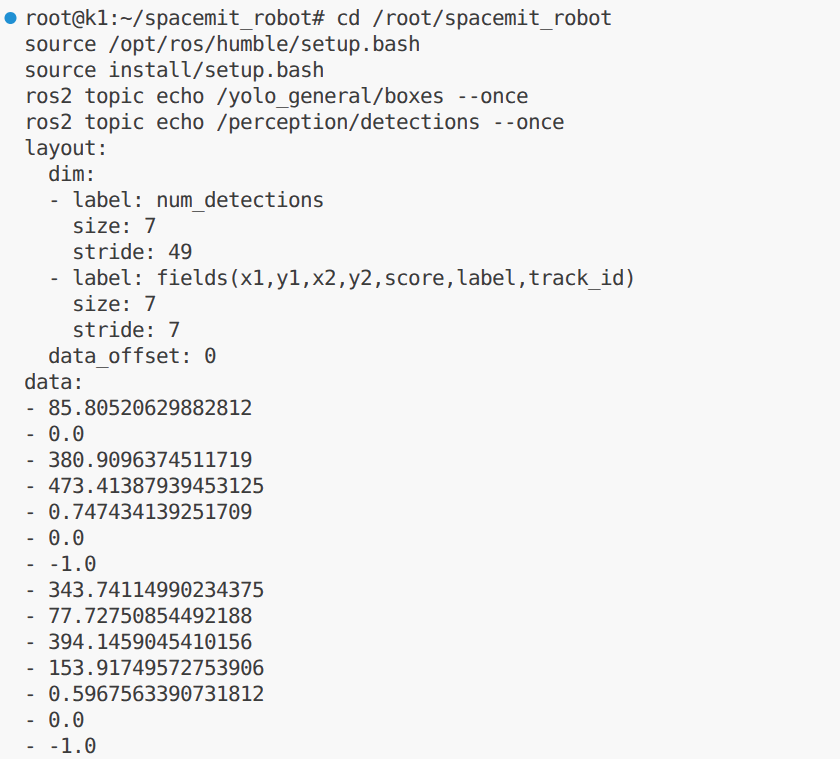

# 机器感知 · 目标检测

## 1. 模块概述

本模块提供基于 YOLOv8 的通用目标检测能力，可以实时识别图像中的 80 类常见物体（人、车辆、动物、日常用品等）。

### 功能特性

- **算法**：YOLOv8n（轻量级版本，适合嵌入式设备）
- **输入分辨率**：640×640
- **支持类别**：COCO 80 类（包括人、自行车、汽车、猫、狗、椅子、杯子等）
- **推理后端**：SpaceMIT EP（ONNX Runtime）
- **输出格式**：vision_msgs/Detection2DArray、Float32MultiArray

### 软件框图



### 目录结构

```text
middleware/ros2/perception/yolo_general/
├── src/yolo_general_node.cpp
├── config/
│   ├── yolo_general.yaml           # ROS 节点参数
│   └── yolov8.yaml                 # 模型与推理配置
├── launch/yolo_general.launch.py
└── package.xml
```

## 2. 环境准备

### 前置条件

SDK 源码获取和基础编译环境配置参考“2.3 构建编译”，ROS 2 环境配置参考快速入门。后续命令默认在 K1 设备的 SDK 根目录执行。

**运行环境**

- K1 Bianbu 系统、ROS 2 Humble
- 视觉推理库：`output/staging/lib/libvision.so` 与 `output/staging/include/vision_service.h`
- 模型：`~/.cache/models/vision/yolov8/yolov8n.q.onnx`
- ROS 依赖：`rclcpp`、`ament_index_cpp`、`sensor_msgs`、`std_msgs`、`vision_msgs`
- 摄像头模式需使用可采集图像的 V4L2 节点；也支持外部 `sensor_msgs/msg/Image` 输入

### 构建编译

安装缺少的依赖：

```bash
sudo apt install python3-colcon-common-extensions ros-humble-vision-msgs \
    python3-spacemit-ort opencv-spacemit spacemit-onnxruntime \
    eigen-spacemit openblas-spacemit libeigen3-dev libyaml-cpp-dev
```

加载 K1 构建环境，准备视觉推理库、模型和素材：

```bash
cd /root/spacemit_robot
source build/envsetup.sh
lunch k1-muse-pipro-ai-cubpet
cd components/model_zoo/vision
mm
bash examples/yolov8/scripts/download_models.sh
bash scripts/download_assets.sh
cd /root/spacemit_robot
```

编译 ROS 包。通过 `--base-paths` 限定包发现范围，避免扫描 SDK 中其他工程：

```bash
source /opt/ros/humble/setup.bash
colcon build \
    --base-paths middleware/ros2/perception/yolo_general \
    --packages-select yolo_general
source install/setup.bash
ros2 pkg executables yolo_general
```

预期输出包含 `yolo_general yolo_general_node`。可执行文件位于 `install/yolo_general/lib/yolo_general/yolo_general_node`；配置和启动文件位于 `install/yolo_general/share/yolo_general/`。`--cmake-force-configure` 使新增依赖（例如 `vision_msgs`）在重新配置时被检测到。

模型配置 `middleware/ros2/perception/yolo_general/config/yolov8.yaml` 的 `default_params.num_threads` 默认已为 `4`，适用于当前 K1 运行时。设备的 CPU 总核数与推理后端报告的可用资源数量不能混为一谈。

## 3. 快速上手

### 3.1 使用摄像头实时检测

**准备工作**

1. 连接摄像头并确认模型已下载。
2. 查找图像采集节点；同一摄像头可能同时提供图像和元数据节点，应选择支持 `Video Capture` 的节点。

```bash
v4l2-ctl --list-devices
ls /dev/video*
# 将 N 换成实际设备号
v4l2-ctl -d /dev/videoN -D
```

**步骤 1：启动检测节点**

以下以 `/dev/video0` 为模板；将 `camera_id` 改为实际采集节点编号。启动文件默认编号为 `1`，显式传参可以避免选错设备。

```bash
cd /root/spacemit_robot
ros2 launch yolo_general yolo_general.launch.py \
    use_camera:=true camera_id:=0 score_threshold:=0.5
```

模型采用延迟加载，收到第一帧后显示 `SpaceMIT EP initialized`。节点持续运行，按 `Ctrl+C` 退出。



**步骤 2：查看检测结果**

在新终端加载相同 ROS 环境：

```bash
cd /root/spacemit_robot
source /opt/ros/humble/setup.bash
source install/setup.bash
ros2 topic echo /yolo_general/boxes --once
ros2 topic echo /perception/detections --once
```

`layout.dim[0].size` 表示目标数；`data` 中每个目标依次占 7 个字段。目标数量和类别随输入画面变化。



### 3.2 订阅外部图像话题

```bash
ros2 launch yolo_general yolo_general.launch.py \
    use_camera:=false score_threshold:=0.25
```

由摄像头驱动或图像发布节点向 `/camera/image_raw` 发布 `sensor_msgs/msg/Image`。仅启动检测节点不会产生输入图像。

## 4. 应用开发

### 接口说明

**订阅话题**

- `/camera/image_raw`（`sensor_msgs/msg/Image`）：`use_camera:=false` 时订阅；摄像头模式由本节点发布该话题。

**发布话题**

- `/perception/detections`（`vision_msgs/msg/Detection2DArray`）：包含类别、置信度、边界框；需在编译前安装 `vision_msgs`。
- `/yolo_general/boxes`（`std_msgs/msg/Float32MultiArray`）：每个目标 7 个数，`x1, y1, x2, y2, score, label, track_id`。坐标以输入图像像素为单位，检测节点的 `track_id` 为 `-1`。
- `/yolo_general/debug_image`（`sensor_msgs/msg/Image`，`bgr8`）：可视化图像，采用 best-effort QoS。

### 使用方式

**参数配置**

- `use_camera`：是否直连摄像头。
- `score_threshold`：置信度阈值，默认 `0.25`，范围 `[0,1]`。
- `camera_id`：摄像头设备号，启动文件默认 `1`。
- `image_topic`：输入/原图话题，默认 `/camera/image_raw`，可通过 `ros2 run` 的 `-p` 参数覆盖。
- `config_path`：视觉模型 YAML 路径；留空自动选择包内 `config/yolov8.yaml`。
- `labels`：标准消息使用的类别名称列表；未提供时使用 `class_<id>`，数值类别仍对应 COCO。

**命令行传参示例**

```bash
ros2 launch yolo_general yolo_general.launch.py \
    camera_id:=1 score_threshold:=0.5
```

### 注意事项

1. 提高阈值可过滤低置信度结果；降低阈值可减少部分漏检。
2. 参数在节点启动时读取。修改阈值后应重启并在启动命令传参；当前实现没有阈值动态更新回调。
3. 摄像头模式发布原始图像；订阅模式需要外部图像源。避免两个节点同时打开同一个摄像头。
4. 在 K1 上运行 SpaceMIT 后端前，应停止不需要的同类推理服务，避免占用同一组推理资源。不要仅依据节点启动日志判断推理成功，应确认输出话题有数据。

### 参考资料

- 节点配置：`install/yolo_general/share/yolo_general/config/yolo_general.yaml`
- 模型配置：`install/yolo_general/share/yolo_general/config/yolov8.yaml`
- 启动文件：`install/yolo_general/share/yolo_general/launch/yolo_general.launch.py`

## 5. 调试指南

### 日志调试

节点日志输出至启动终端和 `~/.ros/log/`。使用 `ros2 run` 可指定 `--ros-args --log-level debug`。

### 常用调试命令

```bash
ros2 topic list | grep -E 'yolo_general|detections'
ros2 topic hz /yolo_general/boxes
ros2 topic hz /camera/image_raw
ros2 topic info /yolo_general/debug_image --verbose
ros2 node info /yolo_general_node
ros2 param list /yolo_general_node
```

图像话题使用 best-effort QoS，读取时可指定：

```bash
ros2 topic echo /yolo_general/debug_image --once \
    --qos-reliability best_effort --field encoding
```

### 性能分析

```bash
ps -ef | grep '[y]olo_general_node'
# 将 PID 替换为上面查到的节点进程号
top -p PID
```

`ros2 topic hz` 测量的是订阅端接收频率，受摄像头、预处理、推理、绘图和消息传输影响，不等同于纯模型推理帧率。当前节点没有逐帧推理耗时日志。

## 6. 常见问题

| 问题现象 | 可能原因 | 解决方法 |
| --- | --- | --- |
| 模型初始化失败 | 模型路径错误或文件缺失 | 检查模型 YAML 的 `model_path`，执行对应下载脚本 |
| 摄像头无法打开 | 编号不正确、选到元数据节点或设备被占用 | 使用 `v4l2-ctl` 确认采集节点，覆盖 `camera_id`，退出占用该设备的进程 |
| 话题存在但没有检测消息 | 延迟加载尚未收到图像，或推理失败 | 检查输入话题频率及节点日志 |
| 检测数组为空 | 画面无支持类别或置信度被过滤 | 更换场景，重启时调低阈值 |
| 没有 `/perception/detections` | 编译时缺少 `vision_msgs` | 安装 `ros-humble-vision-msgs` 后使用 `--cmake-force-configure` 重新编译 |
| `ros2 param set` 成功但结果阈值未变 | 节点未实现动态更新 | 重启节点并通过启动参数设置阈值 |
| colcon 报其他模块的解析错误 | 从 SDK 根目录扫描了无关工程 | 同时使用本文的 `--base-paths` 和 `--packages-select` |
| apt 报 catkin_pkg 文件覆盖冲突 | 软件源中的 catkin Python 包版本不兼容 | 先检查 `apt-cache policy python3-catkin-pkg python3-catkin-pkg-modules`；在提供兼容版本 `1.0.0-100` 的 ROS 源上，可执行 `sudo apt-get --fix-broken install python3-catkin-pkg=1.0.0-100`，不要强制覆盖文件 |
| 同时运行其他推理服务后节点异常退出 | 推理资源可能冲突 | 先停止不需要的推理服务并独立运行；若仍失败，保存完整日志和版本供排查 |

## 附录

### COCO 80 类别列表

常见类别包括：

- 人物：person
- 交通工具：bicycle, car, motorcycle, bus, truck
- 动物：cat, dog, bird, horse, cow
- 家具：chair, couch, bed, dining table
- 电子设备：tv, laptop, mouse, keyboard, cell phone
- 日常用品：bottle, cup, fork, knife, spoon, bowl

完整类别列表请参考 `assets/labels/coco.txt` 文件。
