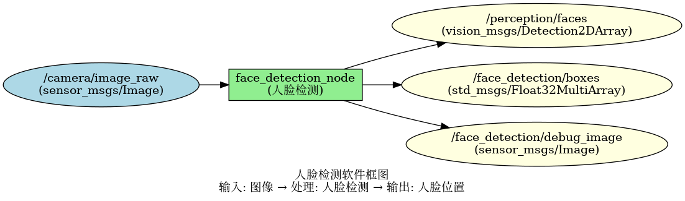
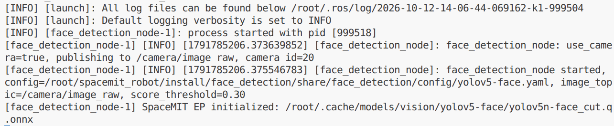
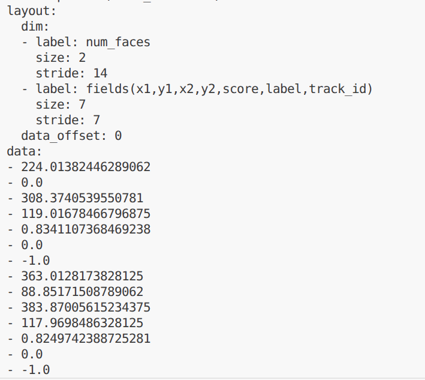

# 机器感知 · 人脸检测

## 1. 模块概述

本模块提供基于深度学习的人脸检测能力，可以实时检测图像中的人脸位置，支持多人脸同时检测。

### 功能特性

- **算法**：YOLOv5n-Face

- **输入分辨率**：640×640（模型输入，原图由视觉库预处理）

- **检测能力**：支持多角度、多尺度人脸检测

- **推理后端**：SpaceMIT EP（ONNX Runtime）

- **输出格式**：vision_msgs/msg/Detection2DArray、Float32MultiArray

### 软件框图



### 目录结构

```
face_detection/
├── src/
│   └── face_detection_node.cpp    # 主节点实现
├── config/
│   └── face_detection.yaml        # 节点配置
├── launch/
│   └── face_detection.launch.py   # 启动文件
└── package.xml
```

## 2. 环境准备

### 前置条件

SDK 源码获取和基础编译环境配置参考“2.3 构建编译”，ROS 2 环境配置参考快速入门。后续命令默认在 K1 设备的 SDK 根目录执行。

**运行环境与依赖**

- K1 Bianbu 系统、ROS 2 Humble。

- `output/staging/lib/libvision.so` 与 `output/staging/include/vision_service.h`。

- 模型路径由 `middleware/ros2/perception/face_detection/config/yolov5-face.yaml` 的 `model_path` 指定。

- 摄像头模式使用支持 `Video Capture` 的 V4L2 采集节点；也支持外部图像话题。

### 构建编译

系统缺少依赖时先安装：

```bash
sudo apt install python3-colcon-common-extensions ros-humble-vision-msgs \
    python3-spacemit-ort opencv-spacemit spacemit-onnxruntime \
    eigen-spacemit openblas-spacemit libeigen3-dev libyaml-cpp-dev
```

加载构建环境，编译视觉组件并下载模型、素材：

```bash
cd /root/spacemit_robot
source build/envsetup.sh
lunch k1-muse-pipro-ai-cubpet
cd components/model_zoo/vision
mm
bash examples/yolov5-face/scripts/download_models.sh
bash scripts/download_assets.sh
cd /root/spacemit_robot
```

模型配置 `yolov5-face.yaml` 的推理线程数默认已为 `4`，无需修改。

编译 ROS 包。使用 `--base-paths` 限定包发现范围，避免扫描 SDK 内的无关工程：

```bash
source /opt/ros/humble/setup.bash
colcon build --base-paths middleware/ros2/perception/face_detection \
    --packages-select face_detection
source install/setup.bash
ros2 pkg executables face_detection
```

可执行文件位于 `install/face_detection/lib/face_detection/face_detection_node`；配置和启动文件位于 `install/face_detection/share/face_detection/`。新终端需重新加载 `/opt/ros/humble/setup.bash` 和 SDK 的 `install/setup.bash`。

## 3. 快速上手

### 3.1 使用摄像头运行人脸检测

**准备工作**

确认模型已下载，连接摄像头并选择支持 `Video Capture` 的采集节点。一个摄像头可能同时提供图像与元数据节点。

```bash
v4l2-ctl --list-devices
ls /dev/video*
```

**步骤 1：启动节点**

以下以 `/dev/video0` 为模板，将 `camera_id` 改为实际设备号：

```bash
ros2 launch face_detection face_detection.launch.py \
    use_camera:=true camera_id:=0
```

节点持续运行，按 `Ctrl+C` 退出。模型采用延迟加载，收到图像后才开始推理。节点不自动打开显示窗口。



**步骤 2：查看结果**

在新终端加载相同 ROS 环境并执行：

```bash
cd /root/spacemit_robot
source /opt/ros/humble/setup.bash
source install/setup.bash
ros2 topic echo /face_detection/boxes --once
ros2 topic hz /face_detection/boxes
```



### 3.2 订阅外部图像话题

```bash
ros2 launch face_detection face_detection.launch.py use_camera:=false
```

由摄像头驱动或图像发布节点向 `/camera/image_raw` 发布 `sensor_msgs/msg/Image`。仅启动上述节点不会自动产生输入；图像订阅使用 best-effort QoS。

## 4. 应用开发

### 接口说明

标准检测话题需要在编译前安装 `vision_msgs`。检测框坐标以输入图像像素为单位。

**订阅话题**

- `/camera/image_raw` (sensor_msgs/msg/Image) - 输入图像

**发布话题**

- `/perception/faces` (vision_msgs/msg/Detection2DArray) - 标准检测消息

- `/face_detection/boxes` (std_msgs/msg/Float32MultiArray) - 每人脸 7 个数：x1, y1, x2, y2, score, label, track_id

- `/face_detection/debug_image` (sensor_msgs/msg/Image) - 可视化图像

### 使用方式

**参数配置**

- `use_camera`：true 时直连摄像头，false 时订阅外部图像话题

- `score_threshold`：置信度阈值，默认 `0.3`，可调整检测灵敏度

- `camera_id`：摄像头设备号

**命令行传参示例**
```bash
# 使用摄像头 1，置信度阈值 0.6
ros2 launch face_detection face_detection.launch.py camera_id:=1 score_threshold:=0.6
```

### 注意事项

1. **检测结果中的 class_id 默认为 "face"**

2. **支持多人脸同时检测**，每个人脸都会有独立的检测框

3. **光照条件影响检测效果**，建议在良好光照下使用

### 参考资料

- 配置文件：`install/face_detection/share/face_detection/config/`

- 启动文件：`install/face_detection/share/face_detection/launch/face_detection.launch.py`

## 5. 调试指南

### 日志调试

日志输出到启动终端和 `~/.ros/log/`。使用 `ros2 run` 启动时，可在原命令的 `--ros-args` 后增加 `--log-level debug`。

### 常用调试命令

```bash
ros2 topic list | grep -E 'face_detection|perception'
ros2 topic hz /face_detection/boxes
ros2 topic hz /camera/image_raw
ros2 node info /face_detection_node
ros2 param list /face_detection_node
```

参数在启动时读取。改变阈值或输入配置后，应重启节点并传入新参数；不要仅依据 `ros2 param set` 返回成功判断算法已经更新。

图像话题使用 best-effort QoS，查看编码可执行：

```bash
ros2 topic echo /face_detection/debug_image --once \
    --qos-reliability best_effort --field encoding
```

### 性能分析

```bash
ps -ef | grep '[f]ace_detection_node'
# 将 PID 替换为上面查到的节点进程号
top -p PID
```

`ros2 topic hz` 测量订阅端接收频率，包含采集、推理、后处理及消息传输影响，不等同于纯模型帧率。当前节点没有逐帧推理耗时日志。

## 6. 常见问题

模型采用延迟加载时，首次图像或骨架输入才触发初始化。K1 上应避免与不需要的 SpaceMIT 推理服务并行占用资源。


| 问题现象 | 可能原因 | 解决方法 |
| --- | --- | --- |
| 节点启动失败，提示找不到模型文件 | 模型路径配置错误 | 检查 config yaml 中的 model_path 是否正确 |
| 无检测结果输出 | 输入图像无人脸或置信度阈值过高 | 1. 确认输入图像中有清晰人脸<br>2. 降低 score_threshold 参数 |
| 漏检或误检 | 模型精度问题或图像质量差 | 1. 提高图像分辨率<br>2. 改善光照条件<br>3. 调整置信度阈值 |
| 小人脸检测不到 | 输入分辨率不足 | 提高输入图像分辨率或使用多尺度检测 |
| 侧脸检测不到 | 人脸角度过大 | 1. 调整拍摄角度<br>2. 使用支持多角度的模型 |
| 提示缺少 vision_msgs | ROS 2 依赖包未安装 | 安装 `ros-humble-vision-msgs` 后带 `--cmake-force-configure` 重新编译 |

## 附录

### 应用场景

- **人脸识别预处理**：为人脸识别系统提供人脸区域定位

- **人脸计数**：统计画面中检出的人脸数量

- **人脸跟踪**：结合跟踪算法实现人脸跟踪

- **安防监控**：实时监控场景中的人脸

- **人机交互**：检测用户人脸位置，用于交互控制

