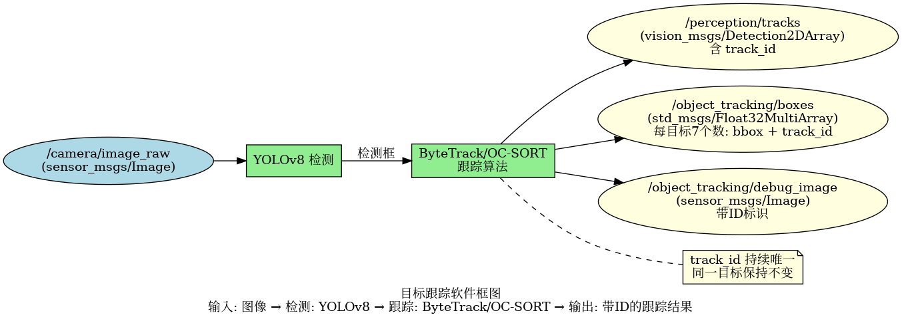
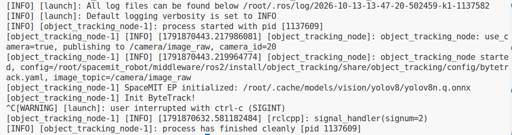
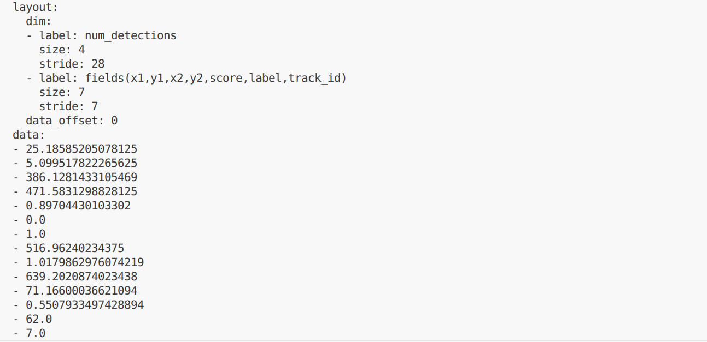

# 机器感知 · 目标跟踪

## 1. 模块概述

本模块提供基于 YOLOv8 检测 + ByteTrack/OC-SORT 跟踪算法的目标跟踪能力，可以对视频序列中的目标进行持续跟踪，为每个目标分配唯一 ID，适用于人流统计、轨迹分析、行为监控等场景。

### 功能特性

- **检测算法**：YOLOv8n

- **跟踪算法**：ByteTrack（默认）或 OC-SORT（可配置）

- **输入分辨率**：640×640

- **支持类别**：COCO 80 类

- **推理后端**：SpaceMIT EP（ONNX Runtime）

- **输出格式**：vision_msgs/msg/Detection2DArray（含 track_id）、Float32MultiArray

### 软件框图



### 目录结构

```
object_tracking/
├── src/
│   └── object_tracking_node.cpp       # 主节点实现
├── config/
│   ├── object_tracking.yaml           # 节点配置
│   ├── bytetrack.yaml                 # ByteTrack 配置
│   └── ocsort.yaml                    # OC-SORT 配置
├── launch/
│   └── object_tracking.launch.py      # 启动文件
└── package.xml
```

## 2. 环境准备

### 前置条件

SDK 源码获取和基础编译环境配置参考“2.3 构建编译”，ROS 2 环境配置参考快速入门。后续命令默认在 K1 设备的 SDK 根目录执行。

**运行环境与依赖**

- K1 Bianbu 系统、ROS 2 Humble。

- `output/staging/lib/libvision.so` 与 `output/staging/include/vision_service.h`。

- 模型路径由 `middleware/ros2/perception/object_tracking/config/bytetrack.yaml` 的 `model_path` 指定。

- 摄像头模式使用支持 `Video Capture` 的 V4L2 采集节点；也支持外部图像话题。

### 构建编译

系统缺少依赖时先安装：

```bash
sudo apt install python3-colcon-common-extensions ros-humble-vision-msgs \
    python3-spacemit-ort opencv-spacemit spacemit-onnxruntime \
    eigen-spacemit openblas-spacemit libeigen3-dev libyaml-cpp-dev
```

加载构建环境，编译视觉组件并下载模型、素材：

```bash
cd /root/spacemit_robot
source build/envsetup.sh
lunch k1-muse-pipro-ai-cubpet
cd components/model_zoo/vision
mm
bash examples/yolov8/scripts/download_models.sh
bash scripts/download_assets.sh
cd /root/spacemit_robot
```

模型配置 `bytetrack.yaml` 的推理线程数默认已为 `4`，无需修改。

编译 ROS 包。使用 `--base-paths` 限定包发现范围，避免扫描 SDK 内的无关工程：

```bash
source /opt/ros/humble/setup.bash
colcon build --base-paths middleware/ros2/perception/object_tracking \
    --packages-select object_tracking
source install/setup.bash
ros2 pkg executables object_tracking
```

可执行文件位于 `install/object_tracking/lib/object_tracking/object_tracking_node`；配置和启动文件位于 `install/object_tracking/share/object_tracking/`。新终端需重新加载 `/opt/ros/humble/setup.bash` 和 SDK 的 `install/setup.bash`。

## 3. 快速上手

### 3.1 使用摄像头运行目标跟踪

**准备工作**

确认模型已下载，连接摄像头并选择支持 `Video Capture` 的采集节点。一个摄像头可能同时提供图像与元数据节点。

```bash
v4l2-ctl --list-devices
ls /dev/video*
# 将 N 替换为实际设备号
v4l2-ctl -d /dev/videoN -D
```

**重要提示**：如果您的摄像头不是 `/dev/video0`，需要修改配置文件 `config/object_tracking.yaml` 中的 `camera_id` 参数。

**步骤 1：启动目标跟踪节点**

```
source install/setup.bash
ros2 launch object_tracking object_tracking.launch.py
```

节点持续运行，按 `Ctrl+C` 退出。模型采用延迟加载，收到图像后才开始推理。节点不自动打开显示窗口。

**终端输出：**


**步骤 2：查看结果**

在新终端加载相同 ROS 环境后执行：

```bash
cd /root/spacemit_robot
source /opt/ros/humble/setup.bash
source install/setup.bash
ros2 topic echo /object_tracking/boxes --once
ros2 topic hz /object_tracking/boxes
```

**终端输出：**



### 3.2 订阅外部图像话题

```bash
ros2 launch object_tracking object_tracking.launch.py use_camera:=false
```

由摄像头驱动或图像发布节点向 `/camera/image_raw` 发布 `sensor_msgs/msg/Image`。仅启动上述节点不会自动产生输入；图像订阅使用 best-effort QoS。

### 3.3 切换 OC-SORT 跟踪器

ByteTrack 和 OC-SORT 各有优势，可以根据场景选择。保持 `config/object_tracking.yaml` 中的 `config_path` 为空，通过启动参数切换跟踪算法，无需重新编译。切换前需按 `Ctrl+C` 退出当前节点。

**步骤 1：启动 OC-SORT**

```
ros2 launch object_tracking object_tracking.launch.py tracker_type:=ocsort
```

启动日志显示加载 `config/ocsort.yaml`，表示已选择 OC-SORT。

切换回 ByteTrack 时执行：

```
ros2 launch object_tracking object_tracking.launch.py tracker_type:=bytetrack
```

**步骤 2：查看结果**

在另一个已加载相同 ROS 环境的终端执行：

```
ros2 topic echo /object_tracking/boxes --once
```

每个目标包含 7 个字段：`x1, y1, x2, y2, score, label, track_id`，其中 `track_id` 为跟踪编号。

## 4. 应用开发

### 接口说明

标准检测话题需要在编译前安装 `vision_msgs`。检测框坐标以输入图像像素为单位。

**订阅话题**

- `/camera/image_raw` (sensor_msgs/msg/Image) - 输入图像

**发布话题**

- `/perception/tracks` (vision_msgs/msg/Detection2DArray) - 标准检测消息；跟踪 ID 写入每个 `Detection2D.id` 字符串

- `/object_tracking/boxes` (std_msgs/msg/Float32MultiArray) - 每目标 7 个数：x1, y1, x2, y2, score, label, **track_id**

- `/object_tracking/debug_image` (sensor_msgs/msg/Image) - 带追踪框的可视化图像

### 跟踪算法对比

| 算法 | 主要方式 | 使用建议 |
| --- | --- | --- |
| ByteTrack | 结合高低置信度检测框进行关联 | 根据检测质量调整阈值 |
| OC-SORT | 使用观测信息改进运动关联 | 使用实际视频比较轨迹稳定性 |

两者均不能保证遮挡后身份永久不变，当前 OC-SORT 配置未提供基于外观特征的 ReID。效果需结合实际场景评估。

### 使用方式

**参数配置**

- `tracker_type`：`"bytetrack"` 或 `"ocsort"`，选择跟踪算法

- `config_path`：留空则按 `tracker_type` 自动加载对应配置文件

- `score_threshold`：检测置信度阈值

- `use_camera`：true 时直连摄像头，false 时订阅外部图像话题

**命令行传参示例**
```bash
# 使用 OC-SORT，置信度阈值 0.3
ros2 launch object_tracking object_tracking.launch.py tracker_type:=ocsort score_threshold:=0.3
```

旧版 `src/detection_utils.cpp` 若未设置 `Detection2D.id`，需在编码每个检测框时加入 `if (b.track_id >= 0) det.id = std::to_string(b.track_id);` 并重新编译。该修正影响 K1/K3 共用的标准消息编码；数组话题中的 `track_id` 不变。

### 注意事项

1. **track_id 用于当前跟踪过程中的目标关联**：遮挡、离场和重启均可能导致 ID 变化

2. **跟踪效果受检测质量影响**：建议调整 score_threshold 以平衡召回率和精度

3. **跟踪器选择**：在相同视频和阈值下比较实际关联效果

4. **视频测试更能体现跟踪效果**：建议使用视频文件测试

### 参考资料

- 配置文件：`install/object_tracking/share/object_tracking/config/`

- 启动文件：`install/object_tracking/share/object_tracking/launch/object_tracking.launch.py`

## 5. 调试指南

### 日志调试

日志输出到启动终端和 `~/.ros/log/`。使用 `ros2 run` 启动时，可在原命令的 `--ros-args` 后增加 `--log-level debug`。

### 常用调试命令

```bash
ros2 topic list | grep -E 'object_tracking|perception'
ros2 topic hz /object_tracking/boxes
ros2 topic hz /camera/image_raw
ros2 node info /object_tracking_node
ros2 param list /object_tracking_node
```

参数在启动时读取。改变阈值或输入配置后，应重启节点并传入新参数；不要仅依据 `ros2 param set` 返回成功判断算法已经更新。

图像话题使用 best-effort QoS，查看编码可执行：

```bash
ros2 topic echo /object_tracking/debug_image --once \
    --qos-reliability best_effort --field encoding
```

### 性能分析

```bash
ps -ef | grep '[o]bject_tracking_node'
# 将 PID 替换为上面查到的节点进程号
top -p PID
```

`ros2 topic hz` 测量订阅端接收频率，包含采集、推理、后处理及消息传输影响，不等同于纯模型帧率。当前节点没有逐帧推理耗时日志。

跟踪评估可使用 MOTA、IDF1、ID Switch 等指标，需要带身份与检测框标注的序列及评测工具；观察演示视频不能代替这些定量评测。

## 6. 常见问题

模型采用延迟加载时，首次图像或骨架输入才触发初始化。K1 上应避免与不需要的 SpaceMIT 推理服务并行占用资源。


| 问题现象 | 可能原因 | 解决方法 |
| --- | --- | --- |
| 节点启动失败，提示找不到模型文件 | 模型路径配置错误 | 检查 `~/.cache/models/vision/yolov8/yolov8n.q.onnx` 是否存在 |
| track_id 频繁变化 | 检测不稳定或跟踪参数不当 | 1. 提高检测置信度阈值<br>2. 调整跟踪器参数（如 track_thresh）<br>3. 尝试切换跟踪算法 |
| 目标丢失后重新出现 ID 改变 | 跟踪器未能重识别 | 按场景调整跟踪缓冲参数并比较两种算法；需要外观重识别时另行集成 ReID |
| 多个目标 ID 相同 | 跟踪器混淆 | 1. 提高检测精度<br>2. 调整 match_thresh 参数 |
| 无跟踪结果输出 | 输入图像无目标或检测失败 | 1. 检查 `/camera/image_raw` 是否有数据<br>2. 降低 score_threshold |
| 跟踪延迟高 | 图像分辨率过高或硬件性能不足 | 1. 降低输入分辨率<br>2. 调整 num_threads 参数 |

## 附录

### 应用场景

- **人流统计**：统计特定区域的人流量，分析人员进出

- **轨迹分析**：记录目标运动轨迹，分析行为模式

- **安防监控**：跟踪可疑目标，记录活动轨迹

- **交通监控**：跟踪车辆，统计交通流量

- **体育分析**：跟踪运动员，分析比赛数据

- **零售分析**：跟踪顾客，分析购物行为

