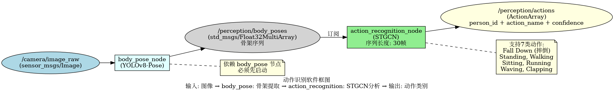
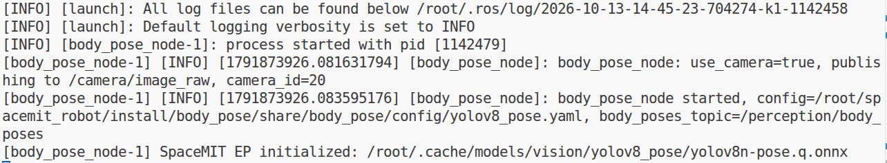
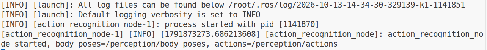
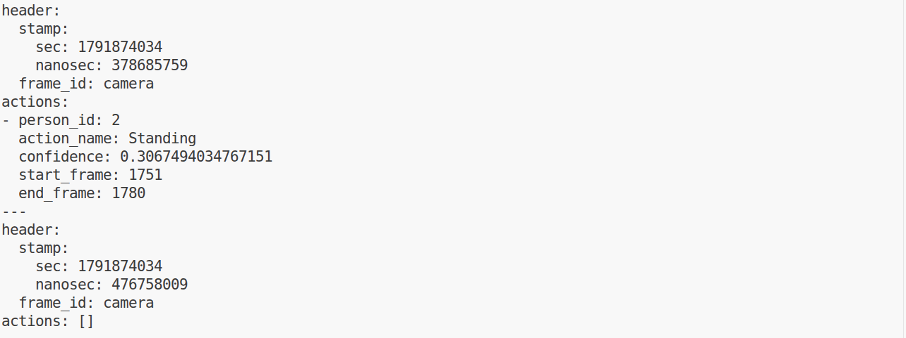

# 机器感知 · 动作识别

## 1. 模块概述

本模块提供基于 STGCN（时空图卷积网络）的动作识别能力，订阅人体骨架序列数据，识别 7 类动作（包括摔倒检测），适用于跌倒报警、行为分析、安全监控等场景。

### 功能特性

- **算法**：STGCN（Spatial Temporal Graph Convolutional Networks）
- **输入**：人体骨架序列（17 个关键点，COCO 格式）
- **序列长度**：30 帧（与配套模型固定输入一致）
- **支持动作类别**：7 类（含 Fall Down 摔倒动作）
- **推理后端**：STGCN 使用 CPUExecutionProvider；上游姿态模型使用 SpaceMITExecutionProvider
- **输出格式**：自定义 ActionArray 消息

### 软件框图



### 目录结构

```text
action_recognition/
├── src/
│   └── action_recognition_node.cpp    # 主节点实现
├── config/
│   ├── action_recognition.yaml        # 节点配置
│   └── stgcn.yaml                     # STGCN 模型配置
├── launch/
│   └── action_recognition.launch.py   # 启动文件
├── msg/
│   ├── Action.msg                     # 单个动作消息
│   └── ActionArray.msg                # 动作数组消息
└── package.xml
```

## 2. 环境准备

### 前置条件

**运行环境**

- 操作系统：K1 Bianbu 系统
- ROS 版本：ROS 2 Humble

**依赖资源**

- **body_pose 节点**：提供 `/perception/body_poses` 话题，配置参照“5.1.4 人体姿态估计”
- `output/staging`：提供视觉推理库（`libvision.so` 与 `vision_service.h`）
- STGCN 模型文件：在 `config/stgcn.yaml` 中配置 `model_path`
- ROS 2 依赖包：rclcpp、std_msgs、body_pose、rosidl_default_generators

**硬件要求**

- 依赖 body_pose 节点的摄像头配置

**环境初始化**

- 参照《02 快速入门》中的 ROS 2 环境配置

### 构建编译

**获取代码**

- 参照《02 快速入门 · 2.3 构建编译》获取完整代码

**推理配置**

STGCN 使用 FP32 模型和 CPU 后端。编译前检查 `middleware/ros2/perception/action_recognition/config/stgcn.yaml`，确认模型路径及推理参数如下：

```yaml
model_path: ~/.cache/models/vision/stgcn/stgcn.fp32.onnx

default_params:
  num_threads: 4
  lazy_load: false
  providers:
    - CPUExecutionProvider
```

若 `providers` 仍位于 YAML 顶层，需将其缩进到 `default_params` 内，才能使 CPU 后端配置生效。

**编译步骤**

```bash
cd /root/spacemit_robot
source build/envsetup.sh
lunch k1-muse-pipro-ai-cubpet
cd components/model_zoo/vision
mm
bash applications/fall_detection/scripts/download_models.sh
bash scripts/download_assets.sh
cd ../../../
source /opt/ros/humble/setup.bash
colcon build \
    --base-paths middleware/ros2/perception/body_pose middleware/ros2/perception/action_recognition \
    --packages-select body_pose action_recognition
source install/setup.bash
```

`--base-paths` 限定这两个包的发现范围，避免扫描 SDK 内的其他工程。已完成视觉组件和模型准备时，可从 ROS 包编译步骤开始。

**编译产物**

- 可执行文件：`install/action_recognition/lib/action_recognition/action_recognition_node`

## 3. 快速上手

本节提供完整的操作步骤，帮助您快速跑通动作识别功能。

### 3.1 完整动作识别流程

动作识别需要先运行 body_pose 节点获取骨架数据。

**准备工作**

1. 确保摄像头已连接
2. 确认 body_pose 和 action_recognition 模型文件已准备
3. 确认 `config/action_recognition.yaml` 中的 `image_width`、`image_height` 与输入图像尺寸一致，默认值为 640×480

**重要提示**：本模块摄像头输入来自 `body_pose`。以下以 `/dev/video0` 为例，请将 `camera_id:=0` 改为实际采集节点编号。启动文件会覆盖 YAML 中的 `camera_id`，应通过启动参数指定。

**步骤 1：启动人体姿态节点**

```bash
# 终端 1
cd /root/spacemit_robot
source /opt/ros/humble/setup.bash
source install/setup.bash
ros2 launch body_pose body_pose.launch.py camera_id:=0
```

**终端输出：**



**步骤 2：启动动作识别节点**

打开新终端：

```bash
# 终端 2
cd /root/spacemit_robot
source /opt/ros/humble/setup.bash
source install/setup.bash
ros2 launch action_recognition action_recognition.launch.py
```

**终端输出：**



**步骤 3：查看动作识别结果**

打开新终端：

```bash
# 终端 3
cd /root/spacemit_robot
source /opt/ros/humble/setup.bash
source install/setup.bash
ros2 topic echo /perception/actions
```

**重要提示**：

- 保持前两个终端中的节点运行，并让人体完整出现在摄像头画面中
- 动作识别需要累积同一人的 **30 帧有效骨架数据**，并到达推理间隔后才执行分类
- 推理间隔默认为每 10 帧，可在配置文件中调整 `infer_interval` 参数
- 尚未满足分类条件时可能看到 `actions: []`；等待时间取决于有效骨架接收频率

**终端输出：**



## 4. 应用开发

### 接口说明

**订阅话题**

- `/perception/body_poses` (`body_pose/msg/BodyPoseArray`) - 来自 body_pose 节点的骨架数据

**发布话题**

- `/perception/actions` (`action_recognition/msg/ActionArray`) - 动作识别结果

**ActionArray 消息结构**：

```text
std_msgs/Header header
Action[] actions
```

**Action 消息结构**：

```text
uint32 person_id          # 人员 ID
string action_name       # 动作名称（如 "Fall Down"）
float32 confidence       # 置信度
uint32 start_frame        # 动作起始帧
uint32 end_frame          # 动作结束帧
```

### 使用方式

**参数配置**

- `sequence_length`：序列长度，配套 STGCN 模型固定为 30 帧
- `infer_interval`：推理间隔，默认每 10 帧
- `config_path`：STGCN 模型配置文件路径，留空时使用包内的 `config/stgcn.yaml`；模型路径在该文件的 `model_path` 中设置
- `image_width` / `image_height`：用于骨架坐标归一化，应与实际输入图像尺寸一致，默认 640×480
- `score_threshold`：姿态输入的置信度阈值，默认 0.25

在启动时加载的 `config/action_recognition.yaml` 中设置参数，修改后重启节点。

**命令行传参示例**

```bash
# 配套模型使用 30 帧序列
ros2 launch action_recognition action_recognition.launch.py sequence_length:=30
```

### 注意事项

1. **必须先启动 body_pose 节点**并提供连续的有效骨架输入
2. **序列累积时间约为 30 / 有效骨架接收频率**，总延迟还包括推理间隔和计算耗时
3. **动作类别取决于 STGCN 模型训练数据**；节点将 COCO 17 个关键点转换为模型所需的 13 个关键点
4. **配套模型固定使用 30 帧序列**，保持 `sequence_length=30`
5. `person_id` 用于骨架序列关联，不表示真实身份

### 支持的动作类别

STGCN 模型支持以下 7 类动作：

- **Standing**：站立
- **Walking**：行走
- **Sitting**：坐着
- **Lying Down**：躺下
- **Stand up**：站起
- **Sit down**：坐下
- **Fall Down**：摔倒（重点检测）

### 参考资料

- 配置文件：`install/action_recognition/share/action_recognition/config/action_recognition.yaml`
- 模型配置：`install/action_recognition/share/action_recognition/config/stgcn.yaml`
- 启动文件：`install/action_recognition/share/action_recognition/launch/action_recognition.launch.py`
- 消息定义：`install/action_recognition/share/action_recognition/msg/`

## 5. 调试指南

### 日志调试

**查看节点日志**

启动日志输出到终端及 `~/.ros/log/`。需要查看 DEBUG 日志时，使用以下命令启动动作识别节点：

```bash
ros2 run action_recognition action_recognition_node --ros-args \
    --params-file install/action_recognition/share/action_recognition/config/action_recognition.yaml \
    --log-level debug
```

### 常用调试命令

**检查话题状态**

```bash
# 查看所有相关话题
ros2 topic list | grep action

# 查看话题发布频率
ros2 topic hz /perception/actions

# 查看节点参数
ros2 param list /action_recognition_node
```

**检查依赖节点**

```bash
# 确认 body_pose 节点是否运行
ros2 node list | grep body_pose

# 确认骨架数据是否发布
ros2 topic hz /perception/body_poses
```

### 日志解读

以下日志在 DEBUG 级别输出：

- `body_poses: N poses, frame=..., buffers=...` - 收到骨架数据，显示当前帧号及人员缓存数量
- `STGCN: person_id=... action=...` - 动作分类成功

**异常情况**：

- DEBUG 级别下从未出现 `body_poses` 日志：检查 body_pose 是否发布非空骨架数据
- 出现 `body_poses` 但无 `STGCN`：检查有效骨架序列是否满 30 帧、是否到达推理间隔，以及是否有推理错误日志

### 性能分析

**检查 CPU 占用**

```bash
top -p $(pgrep -f action_recognition_node)
```

**检查输出频率**

- 使用 `ros2 topic hz /perception/actions` 查看消息接收频率；其中可能包含空数组消息，该频率不等同于动作分类频率
- 当前节点未输出逐次推理耗时，不能从默认日志直接读取纯模型推理延迟

## 6. 常见问题

| 问题现象 | 可能原因 | 解决方法 |
| --- | --- | --- |
| 节点启动失败，提示找不到模型文件 | STGCN 模型路径配置错误 | 检查 `config/stgcn.yaml` 中的 `model_path` |
| STGCN 推理报告 TCM 错误 | CPU 后端配置未生效 | 检查实际加载的 `stgcn.yaml`，将 `providers: [CPUExecutionProvider]` 放在 `default_params` 内，并重启节点 |
| 无动作识别结果或一直显示 `actions: []` | 无有效人体骨架、未攒满 30 帧序列或未到推理间隔 | 确认 body_pose 正常运行、画面中有人且骨架有效，等待同一人的 30 帧有效输入并到达推理间隔 |
| 日志无 body_poses 输出 | 日志级别为 INFO，或未收到非空骨架数据 | 开启 DEBUG 日志，检查 body_pose 节点和 `/perception/body_poses` 话题 |
| 动作识别错误 | 骨架质量、输入尺寸或模型适用场景不匹配 | 确保人体完整可见，核对 `image_width`、`image_height`，并在目标场景中评估分类效果 |
| 识别延迟高 | 有效骨架接收频率低或处理耗时较大 | 保持 `sequence_length=30`，检查骨架接收频率、推理间隔和 CPU 占用 |
| 摔倒检测不准确 | 姿态估计不准或模型精度问题 | 改善光照和拍摄角度，检查骨架及坐标归一化尺寸，使用带标注视频评估告警阈值 |

## 附录

### 应用场景

- **跌倒检测**：检测老人或病人跌倒，为业务侧报警提供动作结果
- **行为分析**：分析站立、行走、坐下等行为，用于安防监控
- **康复辅助**：提供模型支持的动作状态，动作标准性需由专用算法评估
- **人机交互**：通过动作控制机器人或设备

### 摔倒检测说明

摔倒检测是本模块的重点功能，可用于老人看护、安全监控等场景。

**检测原理**：

- 通过分析人体骨架序列的时空特征
- 识别摔倒动作的特征模式（如快速下降、姿态突变等）

**使用建议**：

1. 确保摄像头视野覆盖可能摔倒的区域
2. 保持良好的光照条件
3. 避免遮挡，确保人体完整可见
4. `score_threshold` 过滤姿态输入；业务侧可根据输出的 `confidence` 设置动作告警阈值
