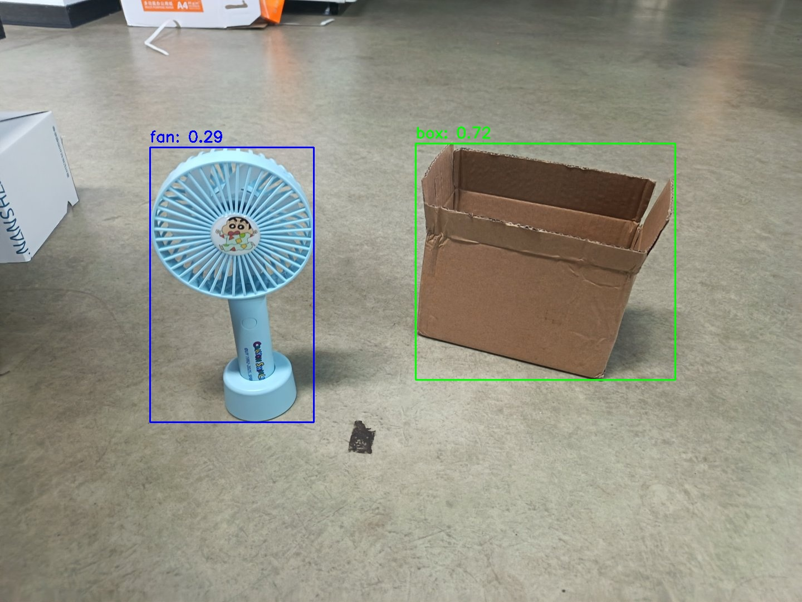

# 机器感知 · YOLO-World

## 1. 模块概述

YOLO-World 是开放词汇目标检测模型，通过类别名称或文本描述指定检测目标。本模块支持图片和摄像头视频流输入，通过 ROS 2 发布目标名称、检测框和置信度，并提供网页显示。

配套 BROS 实现使用 CPUExecutionProvider 运行文本编码和目标检测。检测效果取决于模型、提示词和输入场景，不保证任意描述均能准确识别。

## 2. 环境准备

### 前置条件

K1 Bianbu 系统已安装 ROS 2 Humble 和 BROS/RDK，`/opt/bros/humble` 中包含 `rdk_perception`、`jobot_yolo_world`、`rdk_sensors` 和 `rdk_visualization`。首次运行需要联网下载模型，模型保存在 `~/.brdk_models/YOLO-World/`。

### 安装依赖

```bash
sudo apt install python3-venv python3-pip ros-humble-camera-info-manager \
    ros-humble-image-transport python3-spacemit-ort libsleef3 libomp5 libnuma1
```

### 准备 Python 环境

```bash
source /opt/bros/humble/setup.bash
python3 -m venv ~/test3
source ~/test3/bin/activate
python3 -m pip install \
    --extra-index-url https://git.spacemit.com/api/v4/projects/33/packages/pypi/simple \
    -r /opt/bros/humble/share/jobot_yolo_world/data/requirements.txt \
    pyyaml torch==2.8.0+spacemit.0 torchvision==0.23.0
export PYTHONPATH="$HOME/test3/lib/python3.12/site-packages${PYTHONPATH:+:$PYTHONPATH}"
```

厂商索引提供 RISC-V 依赖包。BROS 节点使用系统 Python 入口，需通过 `PYTHONPATH` 加载虚拟环境中的依赖。上述路径适用于 Python 3.12。

配套依赖使用 `torch 2.8.0+spacemit.0` 与 `torchvision 0.23.0`。请保持这两个版本匹配，避免导入 CLIP 时出现 `operator torchvision::nms does not exist`。

后续每个终端均需加载相同环境：

```bash
source /opt/bros/humble/setup.bash
source ~/test3/bin/activate
export PYTHONPATH="$HOME/test3/lib/python3.12/site-packages${PYTHONPATH:+:$PYTHONPATH}"
```

## 3. 图片推理

### 3.1 保存检测结果

准备示例图片：

```bash
cp /opt/bros/humble/share/jobot_yolo_world/data/test2.jpg .
```

检测风扇和箱子：

```bash
ros2 launch rdk_perception yoloworld_infer_img.launch.py \
    img_path:='./test2.jpg' \
    class_names:="[fan, box]"
```

终端输出目标名称、检测框和置信度，并将结果图保存为当前目录下的 `yoloworld_result.jpg`。可修改 `img_path` 和 `class_names` 使用其他图片或检测类别。



### 3.2 网页显示与结果话题

终端 1 启动结果发布节点：

```bash
ros2 launch rdk_perception yoloworld_infer_img.launch.py \
    publish_result_img:=true \
    img_path:='./test2.jpg' \
    class_names:="[fan, box]"
```

终端 2 启动网页服务：

```bash
ros2 launch rdk_visualization websocket_cpp.launch.py image_topic:=/result_img
```

浏览器访问日志中提示的 `http://<设备IP>:8080`。端口已被占用时，在网页服务命令末尾添加 `port:=18080`。

在另一终端查看结构化结果：

```bash
ros2 topic echo /inference_result
```

图片模式对输入图片推理一次，然后周期发布检测结果及图像。按 `Ctrl+C` 停止节点后，可更换输入重新运行。

## 4. 视频流推理

### 4.1 启动 USB 摄像头

将设备路径改为实际摄像头采集节点：

```bash
ros2 launch rdk_sensors usb_cam.launch.py video_device:='/dev/video0'
```

### 4.2 启动检测节点

在新终端运行：

```bash
ros2 launch rdk_perception yoloworld_infer_video.launch.py \
    sub_image_topic:=/image_raw \
    publish_result_img:=true \
    result_topic:=/inference_result \
    class_names:="[box]"
```

仅查看检测数据时，将 `publish_result_img` 改为 `false`。

### 4.3 查看结果

```bash
ros2 topic echo /inference_result
```

需要网页显示时，在另一终端运行：

```bash
ros2 launch rdk_visualization websocket_cpp.launch.py image_topic:=/result_img
```

## 5. 应用开发

### ROS 接口

| 接口 | 消息类型 | 说明 |
| --- | --- | --- |
| `/image_raw` | `sensor_msgs/msg/Image` | 视频模式的输入图像 |
| `/inference_result` | `jobot_interfaces/msg/DetectionResultArray` | 检测结果数组 |
| `/result_img` | `sensor_msgs/msg/CompressedImage` | 带检测框的 JPEG 图像 |

`DetectionResultArray.results` 中的每个目标包含：

| 字段 | 类型 | 含义 |
| --- | --- | --- |
| `x_min`、`y_min` | `int32` | 检测框左上角坐标，单位为像素 |
| `width`、`height` | `int32` | 检测框宽高，单位为像素 |
| `label` | `string` | 目标名称 |
| `conf` | `float32` | 检测置信度 |

### 订阅示例

将以下代码保存为 `detection_subscriber.py`，在已加载环境的终端执行 `python3 detection_subscriber.py`：

```python
from rclpy.node import Node
from std_msgs.msg import Header
from jobot_interfaces.msg import DetectionResultArray, DetectionResult
import rclpy

class DetectionSubscriber(Node):
    def __init__(self):
        super().__init__('detection_sub')
        self.subscription = self.create_subscription(
            DetectionResultArray,
            '/inference_result',
            self.listener_callback,
            10)

    def listener_callback(self, msg: DetectionResultArray):
        self.get_logger().info(f"Frame: {msg.header.frame_id}")
        for det in msg.results:
            self.get_logger().info(
                f"[{det.label}] ({det.x_min},{det.y_min}) "
                f"{det.width}x{det.height} conf={det.conf:.2f}"
            )

def main(args=None):
    rclpy.init(args=args)
    node = DetectionSubscriber()
    rclpy.spin(node)
    node.destroy_node()
    rclpy.shutdown()

main()
```

### 启动参数

| 参数 | 说明 | 默认值 |
| --- | --- | --- |
| `img_path` | 图片模式的输入路径 | `data/test.jpg` |
| `sub_image_topic` | 视频模式订阅的图像话题 | `/image_raw` |
| `publish_result_img` | 是否发布检测结果图；图片模式下同时启用结果循环发布 | `false` |
| `result_img_topic` | 结果图像话题 | `/result_img` |
| `result_topic` | 检测结果话题 | `/inference_result` |
| `conf_threshold` | 最低检测置信度 | `0.2` |
| `iou_threshold` | 非极大值抑制的 IoU 阈值 | `0.45` |
| `class_names` | 检测目标列表，建议使用英文名称或描述 | `[people]` |

`img_path` 用于 `yoloworld_infer_img.launch.py`，`sub_image_topic` 用于 `yoloworld_infer_video.launch.py`。
