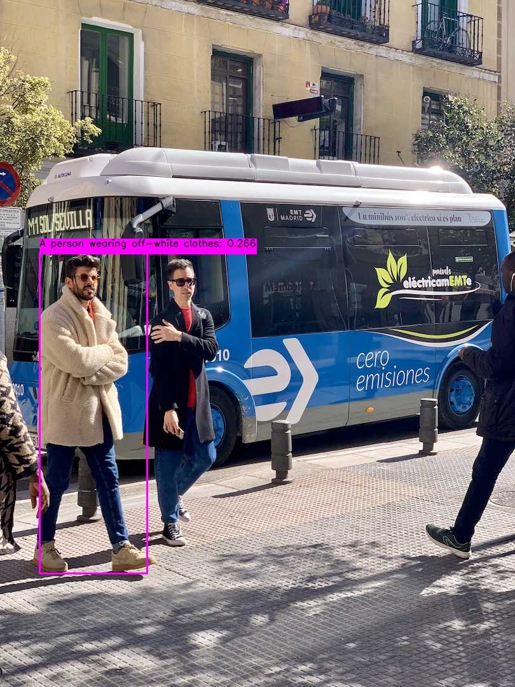

# 机器感知 · YOLOE

## 1. 模块概述

[YOLOE](https://arxiv.org/html/2503.07465v1) 是支持提示词的开放词汇检测与分割模型。本节介绍 BROS 提供的文本提示检测示例：输入图片和文本描述，输出目标名称、检测框及置信度，并通过 ROS 2 话题或服务提供结果。

配套示例使用 MobileCLIP 文本编码与 YOLOE 检测模型，两者均使用 CPUExecutionProvider。以下流程涵盖图片推理、网页显示、话题订阅及推理服务。

## 2. 环境准备

### 前置条件

K1 Bianbu 系统已安装 ROS 2 Humble 和 BROS/RDK，`/opt/bros/humble` 中包含 `rdk_perception`、`jobot_yoloe_py`、`jobot_interfaces` 和 `rdk_visualization`。首次运行需要联网下载模型，模型保存在 `~/.brdk_models/YOLOE/`。

### 安装依赖

```bash
sudo apt install python3-venv python3-pip ros-humble-camera-info-manager \
    ros-humble-image-transport python3-spacemit-ort libsleef3 libomp5 libnuma1
```

### 准备 Python 环境

```bash
source /opt/bros/humble/setup.bash
python3 -m venv ~/yoloe_env
source ~/yoloe_env/bin/activate
python3 -m pip install \
    --extra-index-url https://git.spacemit.com/api/v4/projects/33/packages/pypi/simple \
    -r /opt/bros/humble/share/jobot_yoloe_py/data/requirements.txt \
    pyyaml torch==2.8.0+spacemit.0 torchvision==0.23.0
export PYTHONPATH="$HOME/yoloe_env/lib/python3.12/site-packages${PYTHONPATH:+:$PYTHONPATH}"
```

厂商索引提供 RISC-V 依赖包。BROS 节点使用系统 Python 入口，需通过 `PYTHONPATH` 加载虚拟环境中的依赖。上述路径适用于 Python 3.12。

配套依赖使用 `torch 2.8.0+spacemit.0` 与 `torchvision 0.23.0`。请保持这两个版本匹配，避免导入 CLIP 时出现 `operator torchvision::nms does not exist`。

后续每个终端均需加载相同环境：

```bash
source /opt/bros/humble/setup.bash
source ~/yoloe_env/bin/activate
export PYTHONPATH="$HOME/yoloe_env/lib/python3.12/site-packages${PYTHONPATH:+:$PYTHONPATH}"
```

## 3. 图片推理

### 3.1 保存检测结果

准备示例图片：

```bash
cp /opt/bros/humble/share/jobot_yoloe_py/data/bus.jpg .
```

运行文本提示检测：

```bash
ros2 launch rdk_perception yoloe_infer_img.launch.py \
    img_path:='./bus.jpg' \
    text_prompt:="A person wearing off-white clothes"
```

终端输出检测结果，并将结果图保存为当前目录下的 `yoloe_result.jpg`。可修改 `img_path` 和 `text_prompt` 使用其他图片或目标描述。



### 3.2 网页显示与结果话题

终端 1 启动结果发布节点：

```bash
ros2 launch rdk_perception yoloe_infer_img.launch.py \
    publish_result_img:=true \
    img_path:='./bus.jpg' \
    text_prompt:="A person wearing off-white clothes"
```

终端 2 启动网页服务：

```bash
ros2 launch rdk_visualization websocket_cpp.launch.py image_topic:=/result_img
```

浏览器访问日志中提示的 `http://<设备IP>:8080`。端口已被占用时，在网页服务命令末尾添加 `port:=18080`。

在另一终端查看结构化结果：

```bash
ros2 topic echo /inference_result
```

图片模式对输入图片推理一次，然后周期发布检测结果及图像。按 `Ctrl+C` 停止节点后，可更换输入重新运行。

## 4. 应用开发

### 4.1 话题接口

| 话题 | 消息类型 | 说明 |
| --- | --- | --- |
| `/inference_result` | `jobot_interfaces/msg/DetectionResultArray` | 检测结果数组 |
| `/result_img` | `sensor_msgs/msg/CompressedImage` | 带检测框的 JPEG 图像 |

`DetectionResultArray.results` 中的每个目标包含 `x_min`、`y_min`、`width`、`height`、`label` 和 `conf`，分别表示检测框坐标、宽高、目标名称和置信度。

当前实现的 `label` 包含类别名称及保留三位小数的分数，例如 `person: 0.653`；`conf` 为独立的数值置信度。业务侧比较类别名称时，应先去掉 `label` 末尾的分数。

订阅代码与 [YOLO-World](11%20YOLO-World.md) 的 `DetectionSubscriber` 示例相同。

### 4.2 图片推理参数

| 参数 | 说明 | 默认值 |
| --- | --- | --- |
| `img_path` | 输入图片路径 | `data/bus.jpg` |
| `publish_result_img` | 是否发布检测结果图，并循环发布检测结果 | `false` |
| `result_img_topic` | 结果图像话题 | `/result_img` |
| `result_topic` | 检测结果话题 | `/inference_result` |
| `conf_threshold` | 最低检测置信度 | `0.2` |
| `iou_threshold` | 非极大值抑制的 IoU 阈值 | `0.7` |
| `text_prompt` | 英文目标名称或描述；多个描述用英文逗号分隔 | `person` |

例如，设置 `text_prompt:="person,bus"` 可同时检测行人和公交车。

## 5. 使用推理服务

### 5.1 启动服务

在终端 1 运行：

```bash
ros2 launch rdk_perception yoloe_service.launch.py
```

服务名为 `/yoloe_infer`。保持该终端运行，在终端 2 查看接口定义：

```bash
ros2 interface show jobot_interfaces/srv/YOLOEInfer
```

请求与响应的主要字段：

```text
sensor_msgs/Image image
string text_prompt
---
DetectionResultArray detections
sensor_msgs/Image result_img
```

### 5.2 编写客户端

将以下代码保存为 `yoloe_client.py`，并确保当前目录下存在 `bus.jpg`：

```python
import rclpy
from rclpy.node import Node
from jobot_interfaces.srv import YOLOEInfer
from sensor_msgs.msg import Image
import cv2
from jobot_perception_utils_py.cv_bridge import CvBridge

class TestClient(Node):
    def __init__(self):
        super().__init__('yoloe_test_client')
        self.cli = self.create_client(YOLOEInfer, '/yoloe_infer')
        while not self.cli.wait_for_service(timeout_sec=2.0):
            self.get_logger().info('Waiting for service /yoloe_infer...')
        self.req = YOLOEInfer.Request()
        self.bridge = CvBridge()

    def send_request(self, img_path, text_prompt="person"):
        img = cv2.imread(img_path)
        self.req.image = self.bridge.cv2_to_imgmsg(img, encoding='bgr8')
        self.req.text_prompt = text_prompt
        future = self.cli.call_async(self.req)
        rclpy.spin_until_future_complete(self, future)
        return future.result()

def main():
    rclpy.init()
    client = TestClient()
    resp = client.send_request('bus.jpg', 'person')
    print(f"Detected {len(resp.detections.results)} objects")

    for box in resp.detections.results:
        print(f'x_min:{box.x_min}, y_min:{box.y_min}, width:{box.width}, height:{box.height}, label:{box.label}, confidence:{box.conf:.2f}')

    # ROS Image -> OpenCV
    img_result = client.bridge.imgmsg_to_cv2(resp.result_img, desired_encoding='bgr8')

    cv2.imwrite('yoloe_service_result.jpg', img_result)
    print("The yoloe result are saved in: yoloe_service_result.jpg")

    client.destroy_node()
    rclpy.shutdown()

if __name__ == "__main__":
    main()
```

### 5.3 请求服务

在终端 2 执行：

```bash
python3 yoloe_client.py
```

客户端打印目标数量及检测框信息，并将服务返回的图像保存为 `yoloe_service_result.jpg`。更换图片或提示词时，修改 `send_request('bus.jpg', 'person')` 中的参数。

### 5.4 服务启动参数

| 参数 | 说明 | 默认值 |
| --- | --- | --- |
| `conf_threshold` | 最低检测置信度 | `0.2` |
| `iou_threshold` | 非极大值抑制的 IoU 阈值 | `0.7` |
