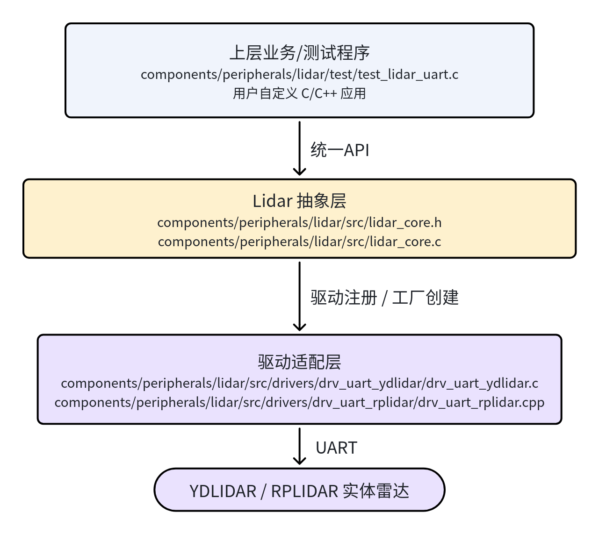
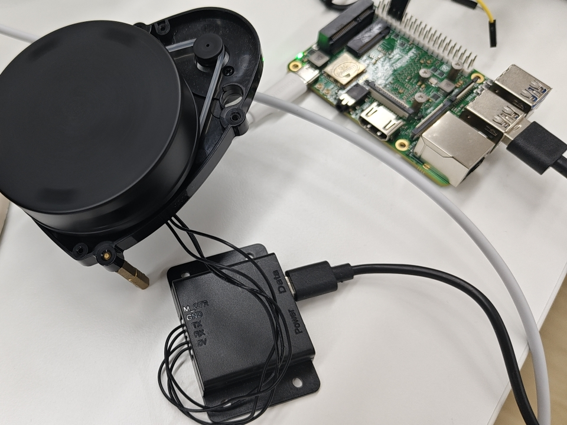
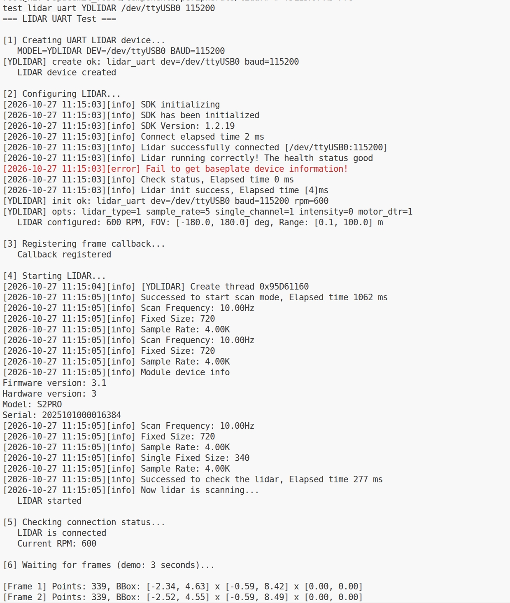
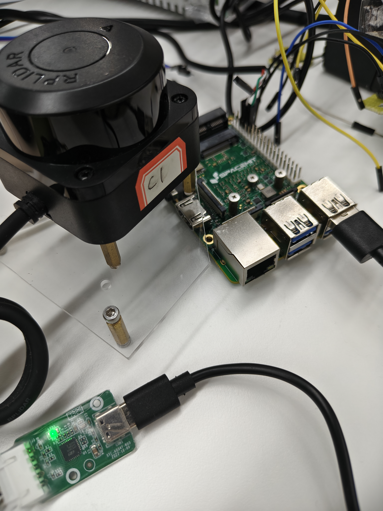
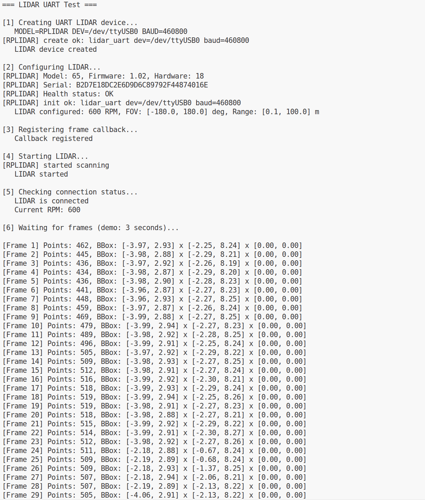

# 外设与驱动 · lidar

## 1. 模块概述

- 主要功能：`lidar` 组件位于 `components/peripherals/lidar/`，提供统一的激光雷达抽象层，屏蔽不同厂商、不同型号 2D 激光雷达的差异，对上层输出一致的点云帧接口。当前项目内已接入 `YDLIDAR` 与 `RPLIDAR` 两类串口雷达，可用于底层采集验证、点云回调处理和上层算法集成。
- 规格或特性（接口形态、速率、分辨率、算法版本等）：
  - 接口形态：当前使用 `UART` 串口接入；`Ethernet` 与 `Sim` 为预留接口，当前未提供可运行的对应驱动；
  - 支持驱动：`drv_uart_ydlidar`、`drv_uart_rplidar`；
  - 数据形式：统一输出 `struct lidar_frame`，点云点为 `struct lidar_point`，坐标系为 `FLU`（前、左、上），2D 雷达的 Z 坐标为 0；
  - 运行参数：`lidar_config` 定义转速、扫描角范围、量程范围、返回模式和位姿变换字段，各字段是否生效取决于具体驱动及设备，详见第 4 节；
  - 运行方式：支持通过回调 `lidar_set_callback()` 异步接收每帧点云。
- 软件框图：



- 相关目录结构：

| 路径 | 职责 |
| --- | --- |
| `components/peripherals/lidar/include/lidar.h` | 对外公开 API 与数据结构定义 |
| `components/peripherals/lidar/src/lidar_core.c` | 统一生命周期封装、驱动工厂与公共逻辑 |
| `components/peripherals/lidar/src/drivers/drv_uart_ydlidar/` | `YDLIDAR` 串口驱动适配 |
| `components/peripherals/lidar/src/drivers/drv_uart_rplidar/` | `RPLIDAR` 串口驱动适配 |
| `components/peripherals/lidar/test/test_lidar_uart.c` | 底层 API 最小化串口测试程序 |
| `components/peripherals/lidar/README.md` | 组件独立构建、快速开始与 FAQ |
| `build/README.md` | SDK 顶层构建、`m` / `mm` / `lunch` 等命令说明 |

## 2. 环境准备

### 2.1 前置条件

- 确保代码拉取：

  SDK 源码获取和基础编译环境配置统一参考 [1.6 构建编译](../../01-快速开始/1.6-构建编译.md)。完成 SDK 初始化后，回到本文继续执行。以下命令在 K1 板端的 Bash 终端中执行，SDK 默认位于 `~/spacemit_robot`。

- 运行环境：
  - K1 MUSE Pi Pro 开发板及其配套 Bianbu 系统。
- 依赖与外部资源：
  - 基础依赖：`build-essential`、`cmake`、`pkg-config`、`jq`、`git`；
  - `YDLIDAR` 与 `RPLIDAR` 第三方 SDK 会在 CMake 配置阶段自动拉取到 `~/.cache/thirdparty/`；首次构建需保证网络可访问。
- 环境变量与初始化：

  在仓库根目录执行：

  ```bash
  cd ~/spacemit_robot
  source build/envsetup.sh
  ```

- 硬件与连接：
  - 本文示例使用 `YDLIDAR X3 Pro` 和 `RPLIDAR C1`；
  - 使用各自配套的 USB 转串口板与 USB 数据线，将雷达连接到 K1 的 USB Host 接口；
  - 确认系统侧设备节点（如 `/dev/ttyUSB0`）已出现，并保证供电稳定；旋转本身不代表已经成功接收扫描数据；
  - 首次使用建议逐台连接，便于确认设备节点；多台设备同时连接时，应分别核对对应的串口路径。
- 工具与权限：
  - 需要具备串口访问权限；若权限不足，可将当前用户加入 `dialout` 组；
  - 可使用 `ls /dev/ttyUSB*`、`ls -l /dev/serial/by-id/`、`sudo dmesg | tail` 辅助确认设备枚举；
  - 若需要安装依赖或调整权限，需具备 `sudo` 权限。

### 2.2 构建编译

以下三种方式选择一种即可。本文第 3 节默认使用方式一或方式二生成的 SDK 安装产物。

- **方式一：通过 SDK 顶层构建当前模块**

  ```bash
  cd ~/spacemit_robot
  source build/envsetup.sh
  lunch k1-muse-pipro-minimal
  cd ~/spacemit_robot/components/peripherals/lidar
  mm
  ```

  `k1-muse-pipro-minimal` 方案已启用雷达组件及 `drv_uart_ydlidar`、`drv_uart_rplidar` 两个驱动。构建完成后，测试程序安装到 `output/staging/bin/`，库和头文件分别安装到 `output/staging/lib/`、`output/staging/include/`。环境脚本会配置命令及动态库搜索路径。

  ```bash
  command -v test_lidar_uart
  ```

  默认安装路径为 `~/spacemit_robot/output/staging/bin/test_lidar_uart`。

- **方式二：通过 SDK 顶层全量构建**

  ```bash
  cd ~/spacemit_robot
  source build/envsetup.sh
  lunch k1-muse-pipro-minimal
  m
  ```

  `m` 构建当前方案启用的全部组件；只验证雷达时使用方式一即可。

- **方式三：脱离 SDK 独立构建组件**

  ```bash
  cd ~/spacemit_robot/components/peripherals/lidar
  mkdir -p build && cd build
  cmake .. -DLIDAR_ENABLED_DRIVERS="drv_uart_ydlidar;drv_uart_rplidar"
  make -j$(nproc)
  ```

  该方式在组件自己的 `build/` 目录生成 `test_lidar_uart`，上述命令不执行安装。独立构建后应进入该目录，用 `./test_lidar_uart` 运行。

- 常见差异说明：
  - SDK 顶层构建使用 `SROBOTIS_PERIPHERALS_LIDAR_ENABLED_DRIVERS` 控制启用驱动；独立构建使用 `LIDAR_ENABLED_DRIVERS`；
  - 使用 `mm` 后，不需要再执行独立构建命令，也不要求存在组件自己的 `build/` 目录；
  - 切换雷达时，需要同步调整串口设备名、波特率与 `MODEL`；`MODEL` 是区分大小写的驱动注册名 `YDLIDAR` 或 `RPLIDAR`，不是商品型号；
  - 本文 X3 Pro 使用 `115200`，C1 使用 `460800`；其他型号应以设备说明为准。

## 3. 示例使用

### 3.1 【示例一：使用 SDK 产物直接验证 `YDLIDAR`】

以下示例雷达型号为 `YDLIDAR X3 Pro`，设备节点为 `/dev/ttyUSB0`，波特率为 `115200`。

**硬件连接**：X3 Pro → 配套 USB 转串口板 → USB 数据线 → K1 USB Host 接口。



**步骤 1**：完成第 2.2 节的 SDK 构建。已执行 `mm` 或 `m` 时，无需重复编译。新开终端时加载环境，并确认设备节点：

```bash
cd ~/spacemit_robot
source build/envsetup.sh
ls /dev/ttyUSB*
```

**步骤 2**：运行底层测试程序。

```bash
test_lidar_uart YDLIDAR /dev/ttyUSB0 115200
```

若选择的是独立构建方式，使用以下命令替代：

```bash
cd ~/spacemit_robot/components/peripherals/lidar/build
./test_lidar_uart YDLIDAR /dev/ttyUSB0 115200
```

**预期现象**：设备创建、初始化、启动成功，随后连续输出 `[Frame N] Points: ...`，点数大于 0。停止后显示 `Total frames received`，该值应大于 0。



程序采集结束后停止并退出，也可按 `Ctrl+C` 提前停止。当前 SDK 测试程序的采集循环上限约为 10 秒，初始化与停止耗时另计；部分版本仍打印 `demo: 3 seconds`，应以实际程序为准。

### 3.2 【示例二：切换为 `RPLIDAR` 做最小化验证】

以下示例雷达型号为 `RPLIDAR C1`，设备节点为 `/dev/ttyUSB0`，波特率为 `460800`。

**硬件连接**：C1 → 配套 USB 转串口板 → USB 数据线 → K1 USB Host 接口。




**步骤 1**：确认前一个测试程序已退出，换接 C1，确认设备节点与串口权限。

```bash
ls /dev/ttyUSB*
```

**预期现象**：看到目标串口节点，例如 `/dev/ttyUSB0`。若无设备节点，应先检查接线、供电与 USB 枚举。设备编号可能随插拔变化，后续命令应使用实际路径。

**步骤 2**：确认第 2.2 节构建已完成。上述构建方式均启用了两款驱动，切换到 C1 无需重新编译。新开终端时加载环境：

```bash
cd ~/spacemit_robot
source build/envsetup.sh
```

**步骤 3**：运行测试程序，替换驱动类型和波特率。

```bash
test_lidar_uart RPLIDAR /dev/ttyUSB0 460800
```

若选择的是独立构建方式，使用以下命令替代：

```bash
cd ~/spacemit_robot/components/peripherals/lidar/build
./test_lidar_uart RPLIDAR /dev/ttyUSB0 460800
```

**预期现象**：输出设备信息、`Health status: OK` 和 `started scanning`，随后连续收到点云帧。停止后应看到 `LIDAR stopped` 和大于 0 的 `Total frames received`。



两款雷达的每帧点数和坐标范围随环境、遮挡及设备工作状态变化。仅显示 `LIDAR is connected` 或 `Test completed` 不代表已收到有效数据，应同时检查实际帧输出；测距精度需另外与已知距离进行对照。

## 4. 应用开发

- **对外 API 或接口形态**：
  - 头文件：`components/peripherals/lidar/include/lidar.h`；
  - 工厂接口：当前使用 `lidar_alloc_uart()`；`lidar_alloc_ethernet()`、`lidar_alloc_sim()` 为预留接口；
  - 生命周期接口：`lidar_init()`、`lidar_start()`、`lidar_stop()`、`lidar_free()`；
  - 数据回调接口：`lidar_set_callback()`；
  - 辅助接口：`lidar_is_connected()`、`lidar_get_rpm()`。
- **调用方式与注意点**：
  - 典型调用顺序为：`alloc -> init -> set_callback -> start -> stop -> free`；
  - 传入自定义 `struct lidar_config` 时，应完整初始化结构体并根据设备配置参数；
  - 当前 `YDLIDAR` 适配层将转速、角度和量程配置传递给厂商 SDK，实际支持范围以设备为准；`RPLIDAR` 适配层使用默认扫描模式，尚未应用这些配置字段。两个驱动当前均未应用返回模式选择和位姿变换；
  - `lidar_is_connected()` 返回软件运行标志，`lidar_get_rpm()` 返回配置值，不能替代实际通信检查和转速测量；示例中打印的量程配置也不代表硬件最大测距能力；
  - 数据通过回调异步推送，回调内应避免执行耗时阻塞操作；帧内存由驱动管理，需要在回调结束后继续使用时，应自行复制数据；
  - 程序退出时应调用 `lidar_stop()` 与 `lidar_free()` 释放串口、线程和驱动私有资源；
  - 串口设备需要相应访问权限，且不应被其他采集程序同时占用。
- **参考 demo 或示例路径**：
  - `components/peripherals/lidar/test/test_lidar_uart.c`
  - `components/peripherals/lidar/README.md`

以下示例保留基本调用流程，以 X3 Pro 为例。将代码保存为 `~/lidar_demo/lidar_demo.c`，也可下载 [示例源码](./assets/lidar_demo.c) 后放入该目录。

```bash
mkdir -p ~/lidar_demo
```

```c
#include <stdio.h>
#include <unistd.h>
#include "lidar.h"

static void on_frame(struct lidar_dev *dev,
                     const struct lidar_frame *frame, void *ctx)
{
    (void)dev;
    (void)ctx;
    printf("points=%u\n", frame->point_count);
}

int main(void)
{
    struct lidar_dev *dev = lidar_alloc_uart(
        "my_lidar", "/dev/ttyUSB0", 115200, "YDLIDAR", NULL);
    struct lidar_config cfg = {
        .rpm = 600,
        .angle_min_deg = -180.0f,
        .angle_max_deg = 180.0f,
        .range_min_m = 0.1f,
        .range_max_m = 12.0f,
        .return_mode = 0,
        .enable_transform = false,
    };

    if (!dev) {
        fprintf(stderr, "Failed to create LIDAR device\n");
        return 1;
    }

    if (lidar_init(dev, &cfg) < 0) {
        fprintf(stderr, "Failed to initialize LIDAR\n");
        lidar_free(dev);
        return 1;
    }

    lidar_set_callback(dev, on_frame, NULL);
    if (lidar_start(dev) < 0) {
        fprintf(stderr, "Failed to start LIDAR\n");
        lidar_stop(dev);
        lidar_free(dev);
        return 1;
    }

    sleep(3);

    int ret = lidar_stop(dev);
    lidar_free(dev);
    return ret < 0 ? 1 : 0;
}
```

使用 **C1** 时，将上述设备创建语句替换为：

```c
struct lidar_dev *dev = lidar_alloc_uart(
    "my_lidar", "/dev/ttyUSB0", 460800, "RPLIDAR", NULL);
```

串口路径应根据实际枚举结果修改。`cfg` 中的参数用于演示配置结构，实际生效范围见本节说明。

先通过第 2.2 节的 `mm` 或 `m` 安装头文件和库，再编译、运行应用：

```bash
cd ~/spacemit_robot
source build/envsetup.sh

cd ~/lidar_demo
gcc -Wall -Wextra -O2 lidar_demo.c \
    -I"$PREFIX/include" -L"$PREFIX/lib" \
    -Wl,-rpath,"$PREFIX/lib" -llidar -o lidar_demo
./lidar_demo
```

**预期现象**：初始化成功后连续输出 `points=...`，点数大于 0；采集约 3 秒后自动停止并释放设备，初始化与停止耗时另计。若创建、初始化或启动失败，程序输出相应错误并返回非零值。

## 5. 调试指南

- 若程序启动前即失败，先检查设备节点是否存在：`ls /dev/ttyUSB*`；必要时查看最近枚举日志：`sudo dmesg | tail`。
- 若提示串口权限不足，可执行 `sudo usermod -aG dialout "$USER"`，重新登录后再试。
- 若构建阶段提示找不到 `ydlidar_sdk` / `rplidar_sdk`，优先检查第三方依赖下载日志和网络；确认缓存损坏后，备份相关缓存再重新获取和构建。
- 若提示 `test_lidar_uart: command not found`，先加载 `~/spacemit_robot/build/envsetup.sh`，再用 `command -v test_lidar_uart` 检查 SDK 安装产物；独立构建则进入组件的 `build/` 目录执行 `./test_lidar_uart`。
- 若编译输出过多，可保存日志，结合退出码和末尾的构建、安装结果判断：

  ```bash
  cd ~/spacemit_robot/components/peripherals/lidar
  mm > /tmp/lidar-mm.log 2>&1
  lidar_mm_rc=$?
  echo "mm exit code: $lidar_mm_rc"
  tail -n 40 /tmp/lidar-mm.log
  ```

- 如需定位运行期问题，可对测试程序使用 `strace` 观察串口打开、读写与线程行为；对崩溃问题可使用 `gdb` 附加或直接运行。

## 6. 常见问题

| 现象 | 可能原因 | 处理 |
| --- | --- | --- |
| `test_lidar_uart` 提示无法创建设备或初始化失败 | 串口节点错误、驱动名称或波特率不匹配、设备被占用 | 检查设备节点，确认使用 `YDLIDAR` 或 `RPLIDAR` 及对应波特率，关闭其他占用程序后重试 |
| 执行 `cd .../lidar/build` 或 `./test_lidar_uart` 提示不存在 | 使用了 SDK 构建，却沿用独立构建的运行路径 | 加载 SDK 环境后直接执行 `test_lidar_uart`；仅独立构建使用组件 `build/` 下的程序 |
| 程序提示权限不足 | 当前用户无串口访问权限 | 将用户加入 `dialout` 组，重新登录后再运行 |
| 程序启动成功但长时间收不到帧 | 供电、连接或设备参数不匹配 | 检查电机与供电，核对 `MODEL`、串口和波特率；以实际收到的非零点云帧判断采集是否成功 |
| 构建时报找不到第三方 SDK | 首次拉取依赖失败或缓存损坏 | 检查下载日志和网络；确认缓存损坏后备份并重新获取 |
| 编译出现较多 YDLIDAR `warning` | 第三方 SDK 的格式字符串、参数类型或结构体对齐警告 | 区分 warning 与编译错误，检查构建退出码及安装结果；警告应结合具体源码评估，不应仅通过关闭警告掩盖问题 |
| 出现 `Fail to get baseplate device information!` | 设备信息查询未成功，单通道设备初始化阶段可能尚未取得模块信息 | 继续核对后续初始化结果及实际帧输出；若同时无法启动或收不到帧，再排查连接和参数 |
| 切换到 `RPLIDAR` 后仍无法通信 | 沿用了 `YDLIDAR` 的参数 | 将驱动名改为 `RPLIDAR`；C1 使用 `460800`，其他型号按设备说明设置 |
