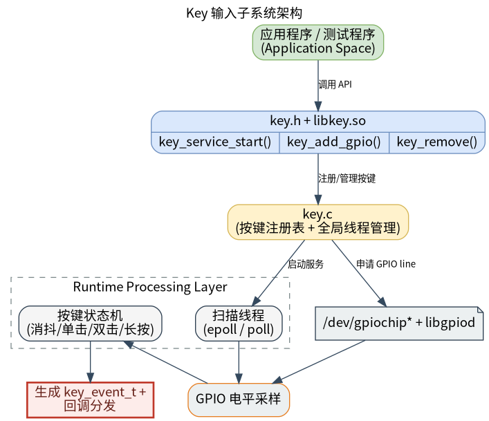
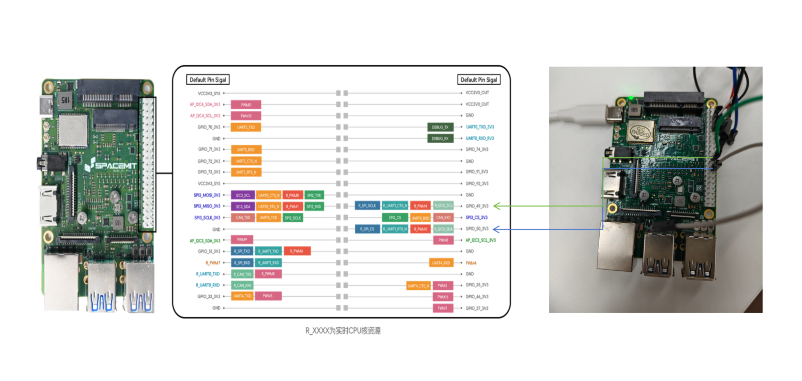
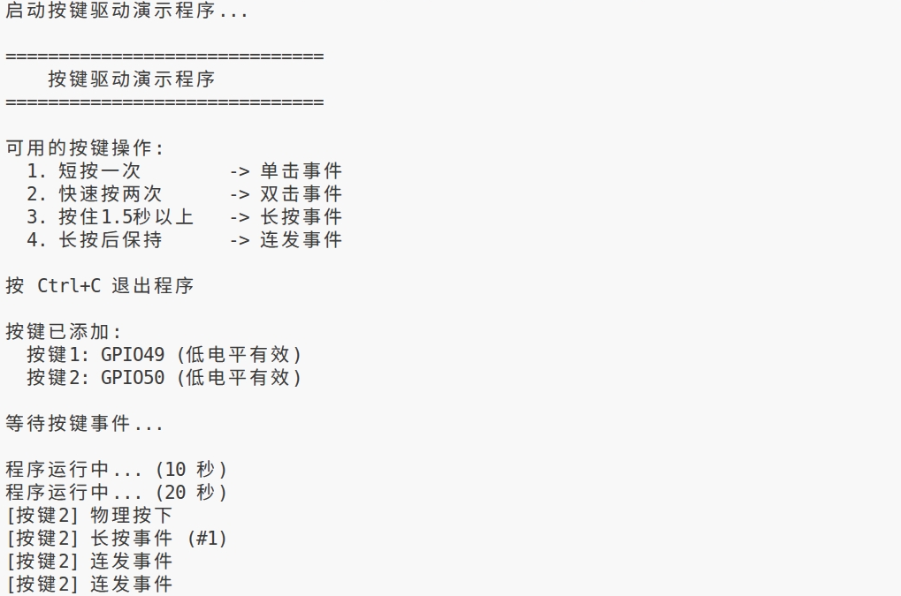

# 外设与驱动 · key

## 1. 模块概述

- 主要功能：`key` 模块位于 `components/peripherals/key/`，是面向 Linux GPIO 字符设备的用户态按键组件。模块通过后台线程周期性读取 GPIO 电平，完成去抖、事件识别与回调分发，支持按下、释放、单击、双击、长按和长按连发事件。
- 规格或特性：通过 `key.h` 和 `libkey.so` 提供 C 接口；底层依赖 `libgpiod` 访问 `/dev/gpiochip*`；按键有效电平、长按阈值和双击判定窗口可配置。
- 软件框图：见下
  
- 相关目录结构：

| 路径 | 职责 |
| --- | --- |
| `components/peripherals/key/include/key.h` | 对外公开的事件枚举、配置结构体和 API 声明 |
| `components/peripherals/key/src/key.c` | GPIO 访问、扫描、去抖和事件识别实现 |
| `components/peripherals/key/example/test_key.c` | 双按键演示程序及事件打印回调 |
| `components/peripherals/key/CMakeLists.txt` | 组件库、演示程序的构建和安装规则 |
| `components/peripherals/key/README.md` | 组件独立构建与快速开始说明 |

K1 的 `test_key.c` 演示配置需要按板级接线调整。本文以 K1 MUSE Pi Pro 的 GPIO49、GPIO50 为例；其他板型请先核对本机引脚定义和 Linux GPIO 编号。

## 2. 环境准备

### 2.1 前置条件

- 代码和基础构建环境：SDK 获取、初始化及 `lunch` 用法参考 [1.6 构建编译](../../01-快速开始/1.6-构建编译.md)。以下命令以 SDK 位于 `~/spacemit_robot` 为例。
- 运行环境：K1 MUSE Pi Pro 开发板及配套 Linux 系统。
- 硬件与连接：需要两根测试线，或两个常开瞬时按键。每个 GPIO 输入通过按键接到 GND，松开时由输入上拉保持高电平，按下时接地变为低电平。
- 依赖：构建需要 CMake、C 编译器、pkg-config 和 libgpiod 开发文件。若构建报告找不到 libgpiod，可安装：
  ~~~bash
  sudo apt update
  sudo apt install build-essential cmake pkg-config libgpiod-dev
  ~~~
- 工具与权限：运行账户需要访问 `/dev/gpiochip*`。若出现权限错误，可在有管理员权限的终端中运行演示程序，或按系统管理策略配置 GPIO 设备权限。

### 2.2 K1 MUSE Pi Pro 接线

下表中的物理针脚号指排针位置，GPIO 编号指 Linux GPIO 逻辑编号，两者不是同一套编号。针脚定义参考 [K1 MUSE Pi Pro 用户指南](https://github.com/spacemit-com/docs-product/blob/main/zh/k1_series/k1_muse_pi_pro/pi_pro_user_guide.md)。GPIO 输入使用 3.3 V 电平；不要向 GPIO 输入端接入 5 V。

| 功能 | 排针物理针脚 | Linux GPIO |
| --- | ---: | ---: |
| 按键 1 输入 | 22 | GPIO49 |
| 按键 2 输入 | 26 | GPIO50 |
| GND | 20 或 25 | GND |

接线方式：

~~~text
物理针脚 22（GPIO49） ── 常开按键/测试线 ── GND（物理针脚 20 或 25）
物理针脚 26（GPIO50） ── 常开按键/测试线 ── GND（物理针脚 20 或 25）
~~~

使用杜邦线模拟按键时，先断电接好 GPIO49、GPIO50 两根线，再开机运行程序。另用一根杜邦线接到物理针脚 20 或 25（GND），将这根 GND 线的另一端作为测试接点。两根 GPIO 线的自由端平时保持分开；测试某个按键时，只让对应 GPIO 线的自由端与 GND 测试接点短暂接触，松开即为释放。操作时只接触已确认的 GPIO 和 GND 线端，不要在排针上扫碰。也可以把常开按钮直接接在 GPIO 输入和 GND 之间。不要把 GPIO49 与 GPIO50 相互短接，也不要向 GPIO 输入端接入 5V。板载电源、复位等系统按键不是本示例的 GPIO 输入。

### 2.3 构建编译

推荐使用 SDK 的单包构建命令 `mm`。在 K1 板端执行：

~~~bash
cd ~/spacemit_robot
source build/envsetup.sh
lunch k1-muse-pipro-ai-cubpet

cd ~/spacemit_robot/components/peripherals/key
mm
~~~

`mm` 从当前组件目录构建按键组件，不需要先运行全量 `m`。构建完成后，SDK 安装产物位于：

~~~text
~/spacemit_robot/output/staging/bin/test_key
~/spacemit_robot/output/staging/lib/libkey.so
~/spacemit_robot/output/staging/include/key.h
~~~

可用以下命令检查演示程序是否安装：

~~~bash
command -v test_key
~~~

若不使用 SDK 构建系统，也可以在组件目录独立编译：

~~~bash
cd ~/spacemit_robot/components/peripherals/key
mkdir -p build
cd build
cmake ..
make -j$(nproc)
~~~

独立构建的 `test_key` 位于 `components/peripherals/key/build/test_key`，不会安装到 `output/staging`。本文第 3 节的运行命令默认使用 SDK 安装产物。

## 3. 示例使用（从 0 跑通）

### 3.1 运行自带 test_key 演示程序

K1 MUSE Pi Pro 的排针 GPIO49、GPIO50 与 K3 示例默认 GPIO 不同。运行前先按实际接线修改演示程序配置。

**步骤 1：修改 K1 按键配置**

打开示例源码：

~~~bash
cd ~/spacemit_robot
nano components/peripherals/key/example/test_key.c
~~~

找到 `key1_config` 和 `key2_config`，将其配置为与上表接线一致：

~~~c
key_config_t key1_config = {
    .gpio_num = 49,
    .active_low = 1,
    .long_press_ms = 1500,
    .double_click_ms = 300
};

key_config_t key2_config = {
    .gpio_num = 50,
    .active_low = 1,
    .long_press_ms = 2000,
    .double_click_ms = 400
};
~~~

`active_low = 1` 表示低电平有效：程序请求 GPIO 输入上拉，输入被拉低时判定为按下。`long_press_ms` 设置长按阈值；`double_click_ms` 设置双击判定窗口。K1 这组时序参数是本示例配置，不是所有按键硬件都必须采用的固定值。

**步骤 2：编译按键组件**

在 SDK 根目录加载环境、选择 K1 方案，再从组件目录执行 `mm`：

~~~bash
cd ~/spacemit_robot
source build/envsetup.sh
lunch k1-muse-pipro-ai-cubpet

cd ~/spacemit_robot/components/peripherals/key
mm
~~~

预期现象：构建成功结束，`output/staging/bin/test_key` 可用。

**步骤 3：启动演示程序**

~~~bash
test_key
~~~

如果当前终端未加载 SDK 环境，先重新执行 `source build/envsetup.sh` 和 K1 方案的 `lunch`；也可以直接运行安装路径：

~~~bash
~/spacemit_robot/output/staging/bin/test_key
~~~

预期现象：程序显示已注册的按键及有效电平，随后显示 `等待按键事件...`。如果程序报告无法打开 GPIO，请先退出程序并检查设备权限、接线和是否有其他程序占用了 GPIO49/50。

**步骤 4：分别触发两个输入并观察事件**

- **短按**：让 GPIO 线短暂接触 GND 后松开。应先看到物理按下、物理释放，随后看到单击事件。单击要等双击判定窗口结束后才会输出。
- **双击**：在双击判定窗口内快速接地、松开两次。按键 1 的窗口为 300 ms，按键 2 为 400 ms；实际操作会受扫描和去抖影响。
- **长按**：按键 1 持续接地约 1.5 秒以上；按键 2 持续接地约 2 秒以上。应看到长按事件。
- **长按连发**：长按事件后继续保持接地，应周期性看到连发事件。当前实现的连发间隔约为 200 ms。
- **结束测试**：按 `Ctrl+C`。程序应删除两个按键、停止服务并正常退出。

注意：示例帮助文字中的“按住 1.5 秒以上”是固定打印内容；实际阈值以 `key1_config`、`key2_config` 中的 `long_press_ms` 为准。因此本文配置下按键 2 的阈值是 2 秒。按键保持接地期间连续出现“连发事件”属于预期行为。

## 4. 应用开发

### 4.1 最简使用流程

以下示例注册 GPIO49，运行 10 秒后清理资源。实际应用应根据板级接线调整 GPIO 编号、有效电平和时序。

~~~c
#include <key.h>
#include <stdio.h>
#include <unistd.h>

static void key_event_callback(struct key_handle *key,
                               key_event_t event,
                               void *user_data)
{
    (void)key;
    printf("[%s] event=%d\n", (const char *)user_data, event);
}

int main(void)
{
    if (key_service_start() != 0) {
        return 1;
    }

    key_config_t cfg = {
        .gpio_num = 49,
        .active_low = 1,
        .long_press_ms = 1500,
        .double_click_ms = 300,
    };

    struct key_handle *key =
        key_add_gpio(&cfg, key_event_callback, "KEY1");
    if (key == NULL) {
        key_service_stop();
        return 1;
    }

    sleep(10);

    key_remove(key);
    key_service_stop();
    return 0;
}
~~~

### 4.2 主要 API

~~~c
int key_service_start(void);
void key_service_stop(void);

struct key_handle *key_add_gpio(const key_config_t *config,
                                key_callback_t cb,
                                void *user_data);
void key_remove(struct key_handle *key);
~~~

先调用 `key_service_start()` 启动扫描服务，再调用 `key_add_gpio()` 注册输入；退出时先调用 `key_remove()`，再调用 `key_service_stop()`。回调函数不能为 `NULL`。

### 4.3 核心数据结构

~~~c
typedef struct {
    int gpio_num;           /* Linux GPIO 逻辑编号 */
    int active_low;         /* 1：低电平有效；0：高电平有效 */
    int long_press_ms;      /* 长按阈值；0 使用默认值 1500 ms */
    int double_click_ms;    /* 双击窗口；0 使用默认值 300 ms */
} key_config_t;

typedef enum {
    KEY_EV_PRESSED,
    KEY_EV_RELEASED,
    KEY_EV_CLICK,
    KEY_EV_DOUBLE_CLICK,
    KEY_EV_LONG_PRESS,
    KEY_EV_HOLD_REPEAT
} key_event_t;

struct key_handle;
~~~

回调在模块的 GPIO 扫描线程中执行，应避免在回调里执行阻塞操作或耗时任务。长按连发间隔当前固定为约 200 ms；触发长按后，本次持续按压不再产生单击或双击事件。

参考示例源码：`components/peripherals/key/example/test_key.c`。

## 5. 调试指南

- 确认板型为 K1 MUSE Pi Pro，并按物理针脚 22/26 接线；其他 K1 板型的针脚映射可能不同。
- 确认 GND 与 GPIO 连接正确。输入接地是“按下”，自由端分开是“松开”；GPIO49 与 GPIO50 互相接触不等于接地。
- 确认 `active_low` 与电路有效电平相符。本文采用低电平有效和输入上拉；若硬件电路不同，需要同步调整配置。
- 检查 GPIO 设备节点及权限：

  ~~~bash
  ls -l /dev/gpiochip*
  ~~~

- 若程序提示 GPIO 忙，退出其他占用同一 GPIO 的进程后重试。不要让多个程序同时申请同一条 GPIO line。
- 如果能看到按下/释放但没有单击，松开后等待完整的双击窗口；若按下后持续输出连发，先将输入从 GND 断开。

## 6. 常见问题

**问：为什么物理排针编号和程序中的 GPIO 编号不同？**

答：物理针脚表示排针上的位置，`gpio_num` 是 Linux GPIO 逻辑编号。K1 MUSE Pi Pro 的物理针脚 22/26 在本文示例中分别对应 GPIO49/50，其他板型或系统配置应以对应的引脚资料为准。

**问：能否直接使用 K3 示例里的默认 GPIO？**

答：不能仅凭 K3 示例默认值推断 K1 排针的 GPIO 映射。先依据 K1 板型确认 Linux GPIO 编号，再修改 `example/test_key.c` 中的配置。共用示例源码提交板级默认值时，也要评估对其他板型示例的影响。

**问：为什么 K1 文档以 libgpiod v1 为验证环境？**

答：本流程在 K1 的 libgpiod 1.6.3 环境下验证。源码包含 libgpiod v2 分支，但该分支按每个 gpiochip 32 条线的方式计算芯片号和偏移；K1 上 GPIO49/50 位于 gpiochip0 的 line49/50，而这套计算会将它们映射到 gpiochip1 的 offset17/18，与 K1 的 GPIO 控制器拓扑不符。该 v2 路径尚未在 K1 上验证，属于源码兼容风险，不代表已复现的运行故障。若系统使用 libgpiod 2.x，应先核实 GPIO chip/line 映射并单独验证，再按实际结果调整驱动适配。
