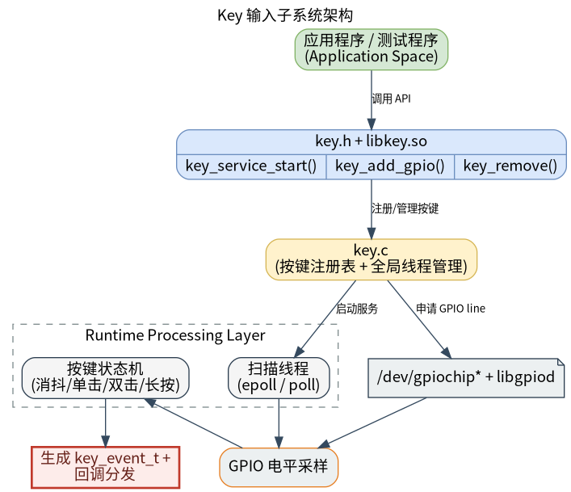
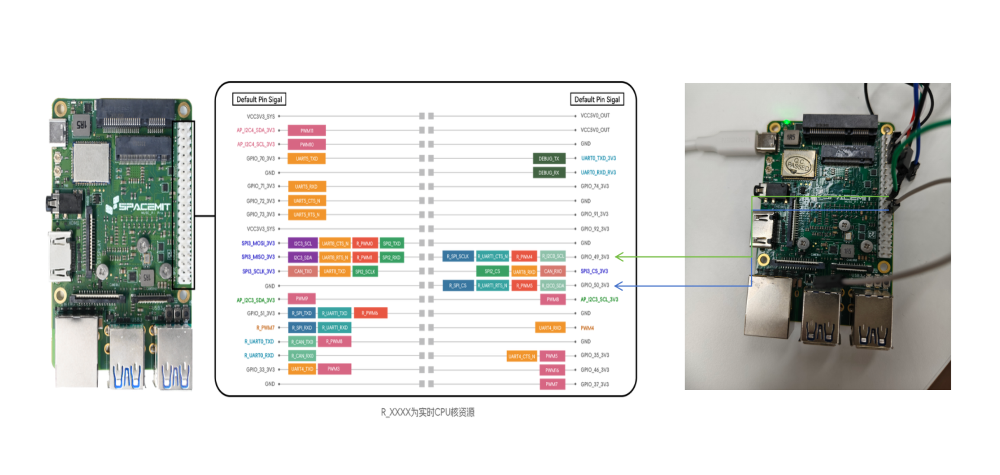

# 6.2.2 按键

## 1. 模块概述

- 主要功能：`key` 模块位于 `components/peripherals/key/`，是面向 Linux GPIO 字符设备的用户态按键组件。模块通过后台线程周期性读取 GPIO 电平，完成去抖、事件识别与回调分发，支持按下、释放、单击、双击、长按和长按连发事件。
- 规格或特性：通过 `key.h` 和 `libkey.so` 提供 C 接口；底层依赖 `libgpiod` 访问 `/dev/gpiochip*`；按键有效电平、长按阈值和双击判定窗口可配置。
- 软件框图：见下
  
- 相关目录结构：

| 路径 | 职责 |
| --- | --- |
| `components/peripherals/key/include/key.h` | 对外公开的事件枚举、配置结构体和 API 声明 |
| `components/peripherals/key/src/key.c` | GPIO 访问、扫描、去抖和事件识别实现 |
| `components/peripherals/key/example/test_key.c` | 双按键演示程序及事件打印回调 |
| `components/peripherals/key/CMakeLists.txt` | 组件库、演示程序的构建和安装规则 |
| `components/peripherals/key/README.md` | 组件独立构建与快速开始说明 |

`test_key` 演示程序通过命令行指定 GPIO 编号与有效电平（见第 3 节）。本例使用 MUSE Pi Pro 的 GPIO49、GPIO50；其他板型按引脚定义选择 GPIO。

## 2. 环境准备

### 2.1 前置条件

- 代码和基础构建环境：SDK 获取、初始化及 `lunch` 用法参考 [2.4 构建编译](../../02-快速入门/2.4-构建编译.md)。以下命令以 SDK 位于 `~/spacemit_robot` 为例。
- 硬件与连接：需要两根测试线，或两个常开瞬时按键。每个 GPIO 输入通过按键接到 GND，松开时由输入上拉保持高电平，按下时接地变为低电平。
- 依赖：构建需要 CMake、C 编译器、pkg-config 和 libgpiod 开发文件。若构建报告找不到 libgpiod，可安装：
  ~~~bash
  sudo apt update
  sudo apt install build-essential cmake pkg-config libgpiod-dev
  ~~~
- 工具与权限：运行账户需要访问 `/dev/gpiochip*`。若出现权限错误，可在有管理员权限的终端中运行演示程序，或按系统管理策略配置 GPIO 设备权限。

### 2.2 MUSE Pi Pro 接线

下表中的物理针脚号指排针位置，GPIO 编号指 Linux GPIO 逻辑编号，两者不是同一套编号。针脚定义参考 [MUSE Pi Pro 用户指南](https://github.com/spacemit-com/docs-product/blob/main/zh/k1_series/k1_muse_pi_pro/pi_pro_user_guide.md)。GPIO 输入使用 3.3 V 电平；不要向 GPIO 输入端接入 5 V。

| 功能 | 排针物理针脚 | Linux GPIO |
| --- | ---: | ---: |
| 按键 1 输入 | 22 | GPIO49 |
| 按键 2 输入 | 26 | GPIO50 |
| GND | 20 或 25 | GND |

接线方式：

~~~text
物理针脚 22（GPIO49） ── 常开按键/测试线 ── GND（物理针脚 20 或 25）
物理针脚 26（GPIO50） ── 常开按键/测试线 ── GND（物理针脚 20 或 25）
~~~



使用杜邦线模拟按键时，先断电接好 GPIO49、GPIO50 两根线，再开机运行程序。另用一根杜邦线接到物理针脚 20 或 25（GND），将这根 GND 线的另一端作为测试接点。两根 GPIO 线的自由端平时保持分开；测试某个按键时，只让对应 GPIO 线的自由端与 GND 测试接点短暂接触，松开即为释放。操作时只接触已确认的 GPIO 和 GND 线端，不要在排针上扫碰。也可以把常开按钮直接接在 GPIO 输入和 GND 之间。不要把 GPIO49 与 GPIO50 相互短接，也不要向 GPIO 输入端接入 5V。板载电源、复位等系统按键不是本示例的 GPIO 输入。

### 2.3 构建编译

编译前应用按键示例补丁：

```bash
cd ~/spacemit_robot
wget -O /tmp/key-gpio.patch \
    https://archive.spacemit.com/ros2/k1_sdk/patches/components/peripherals/key/0001-key-let-test_key-accept-GPIO-numbers-and-polarity-fr.patch && \
git -C components/peripherals/key apply /tmp/key-gpio.patch
```

使用 SDK 的单包构建命令 `mm`：

~~~bash
cd ~/spacemit_robot
source build/envsetup.sh
lunch k1-muse-pipro-ai-cubpet

cd ~/spacemit_robot/components/peripherals/key
mm
~~~

`mm` 从当前组件目录构建按键组件，不需要先运行全量 `m`。构建完成后，SDK 安装产物位于：

~~~text
~/spacemit_robot/output/staging/bin/test_key
~/spacemit_robot/output/staging/lib/libkey.so
~/spacemit_robot/output/staging/include/key.h
~~~

可用以下命令检查演示程序是否安装：

~~~bash
command -v test_key
~~~

若不使用 SDK 构建系统，也可以在组件目录独立编译：

~~~bash
cd ~/spacemit_robot/components/peripherals/key
mkdir -p build
cd build
cmake ..
make -j$(nproc)
~~~

独立构建的 `test_key` 位于 `components/peripherals/key/build/test_key`，不会安装到 `output/staging`。本文第 3 节使用 SDK 安装产物。

## 3. 示例使用

### 3.1 运行按键演示程序

`test_key` 的用法为 `test_key [gpio1 gpio2 [active_low]]`：不带参数时使用 GPIO113/114、高电平有效；`active_low` 为 `1` 时低电平有效。MUSE Pi Pro 按 2.2 节接线时，使用 GPIO49、GPIO50，接 GND 为按下。

**步骤 1：确认按键组件已编译**

按 2.3 节执行 `mm` 后，确认以下文件存在：

~~~bash
ls ~/spacemit_robot/output/staging/bin/test_key ~/spacemit_robot/output/staging/lib/libkey.so
~~~

**步骤 2：参数说明**

| 参数 | 本例取值 | 说明 |
| --- | --- | --- |
| `gpio1` | `49` | 按键 1 的 Linux GPIO 编号（物理针脚 22） |
| `gpio2` | `50` | 按键 2 的 Linux GPIO 编号（物理针脚 26） |
| `active_low` | `1` | 低电平有效：程序请求 GPIO 输入上拉，输入被拉低时判定为按下 |

按键 1 的长按阈值为 1.5 秒、双击判定窗口为 300 ms；按键 2 分别为 2 秒、400 ms，可按交互需求调整。

**步骤 3：启动演示程序**

~~~bash
cd ~/spacemit_robot
source build/envsetup.sh
lunch k1-muse-pipro-ai-cubpet
test_key 49 50 1
~~~

当前用户无权访问 `/dev/gpiochip*` 时，改用 `sudo LD_LIBRARY_PATH=~/spacemit_robot/output/staging/lib ~/spacemit_robot/output/staging/bin/test_key 49 50 1`（`sudo` 不继承 `LD_LIBRARY_PATH`，需显式指定）。

预期现象：程序显示已注册的按键及有效电平（`按键1: GPIO49 (低电平有效)`、`按键2: GPIO50 (低电平有效)`），随后显示 `等待按键事件...`。如果程序报告添加按键失败，请先退出程序并检查设备权限、接线和是否有其他程序占用了 GPIO49/50。

**步骤 4：分别触发两个输入并观察事件**

- **短按**：让 GPIO 线短暂接触 GND 后松开。应先看到物理按下、物理释放，随后看到单击事件。单击要等双击判定窗口结束后才会输出。
- **双击（GPIO50）**：在 400 ms 双击判定窗口内，将 GPIO50 快速接地、松开两次。
- **长按**：按键 1 持续接地约 1.5 秒以上；按键 2 持续接地约 2 秒以上。应看到长按事件。
- **长按连发**：长按事件后继续保持接地，应周期性看到连发事件。当前实现的连发间隔约为 200 ms。
- **结束测试**：按 `Ctrl+C`。程序应删除两个按键、停止服务并正常退出。

注意：长按阈值以 `test_key.c` 中 `key1_config`、`key2_config` 的 `long_press_ms` 为准，按键 2 的阈值是 2 秒。按键保持接地期间连续出现“连发事件”属于预期行为。

## 4. 应用开发

### 4.1 最简使用流程

以下示例注册 GPIO49，运行 10 秒后清理资源。实际应用应根据板级接线调整 GPIO 编号、有效电平和时序。

~~~c
#include <key.h>
#include <stdio.h>
#include <unistd.h>

static void key_event_callback(struct key_handle *key,
                               key_event_t event,
                               void *user_data)
{
    (void)key;
    printf("[%s] event=%d\n", (const char *)user_data, event);
}

int main(void)
{
    if (key_service_start() != 0) {
        return 1;
    }

    key_config_t cfg = {
        .gpio_num = 49,
        .active_low = 1,
        .long_press_ms = 1500,
        .double_click_ms = 300,
    };

    struct key_handle *key =
        key_add_gpio(&cfg, key_event_callback, "KEY1");
    if (key == NULL) {
        key_service_stop();
        return 1;
    }

    sleep(10);

    key_remove(key);
    key_service_stop();
    return 0;
}
~~~

### 4.2 主要 API

~~~c
int key_service_start(void);
void key_service_stop(void);

struct key_handle *key_add_gpio(const key_config_t *config,
                                key_callback_t cb,
                                void *user_data);
void key_remove(struct key_handle *key);
~~~

先调用 `key_service_start()` 启动扫描服务，再调用 `key_add_gpio()` 注册输入；退出时先调用 `key_remove()`，再调用 `key_service_stop()`。回调函数不能为 `NULL`。

### 4.3 核心数据结构

~~~c
typedef struct {
    int gpio_num;           /* Linux GPIO 逻辑编号 */
    int active_low;         /* 1：低电平有效；0：高电平有效 */
    int long_press_ms;      /* 长按阈值；0 使用默认值 1500 ms */
    int double_click_ms;    /* 双击窗口；0 使用默认值 300 ms */
} key_config_t;

typedef enum {
    KEY_EV_PRESSED,
    KEY_EV_RELEASED,
    KEY_EV_CLICK,
    KEY_EV_DOUBLE_CLICK,
    KEY_EV_LONG_PRESS,
    KEY_EV_HOLD_REPEAT
} key_event_t;

struct key_handle;
~~~

回调在模块的 GPIO 扫描线程中执行，应避免在回调里执行阻塞操作或耗时任务。长按连发间隔当前固定为约 200 ms；触发长按后，本次持续按压不再产生单击或双击事件。

参考示例源码：`components/peripherals/key/example/test_key.c`。

## 5. 调试指南

- 核对物理针脚 22/26 与 GPIO49/50 的接线；其他板型按各自引脚定义连接。
- 确认 GND 与 GPIO 连接正确。输入接地是“按下”，自由端分开是“松开”；GPIO49 与 GPIO50 互相接触不等于接地。
- 确认 `active_low` 与电路有效电平相符。本文采用低电平有效和输入上拉；若硬件电路不同，需要同步调整配置。
- 检查 GPIO 设备节点及权限：

  ~~~bash
  ls -l /dev/gpiochip*
  ~~~

- 若程序提示 GPIO 忙，退出其他占用同一 GPIO 的进程后重试。不要让多个程序同时申请同一条 GPIO line。
- 如果能看到按下/释放但没有单击，松开后等待完整的双击窗口；若按下后持续输出连发，先将输入从 GND 断开。

## 6. 常见问题

**问：为什么物理排针编号和程序中的 GPIO 编号不同？**

答：物理针脚表示排针上的位置，`gpio_num` 是 Linux GPIO 逻辑编号。MUSE Pi Pro 的物理针脚 22/26 在本文示例中分别对应 GPIO49/50，其他板型或系统配置应以对应的引脚资料为准。

**问：如何指定按键 GPIO？**

答：按接线选择 Linux GPIO 编号，通过命令行参数传入（如 `test_key 49 50 1`），或在程序中配置 `key_config_t`。`test_key` 不带参数时使用 GPIO113/114。

**问：按键组件使用哪个 libgpiod 版本？**

使用 libgpiod 1.6.3。libgpiod v2 分支按每个 gpiochip 32 条线计算芯片号和偏移，会将 GPIO49/50 映射到 gpiochip1 的 offset17/18；MUSE Pi Pro 的对应位置为 gpiochip0 的 line49/50。使用 libgpiod 2.x 前，需要按实际 GPIO 拓扑调整映射并测试按键事件。
