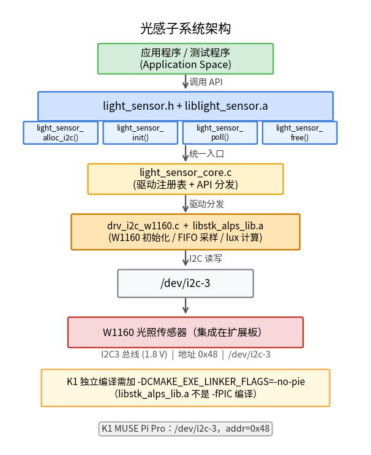

# 外设与驱动 · light_sensor

## 1. 模块概述

- 主要功能：`light_sensor` 模块位于 `components/peripherals/light_sensor`，提供基于 I2C 的光照传感器采集能力。模块通过统一的设备对象和驱动注册框架封装传感器初始化、轮询采样和资源释放流程，减少上层对具体芯片寄存器与算法库的直接依赖。当前代码已内置通用 I2C 读写适配层和 W1160 专用驱动。
- 规格或特性：对外以 `light_sensor.h` + `liblight_sensor.a` 形式提供 C 接口；当前公开接口为 `light_sensor_alloc_i2c()`、`light_sensor_init()`、`light_sensor_poll()`、`light_sensor_free()`；支持通过 `驱动名:实例名` 的字符串形式选择具体驱动，例如 `W1160:als0`；当前主测器件为 W1160，默认 I2C 地址 `0x48`；K1 MUSE Pi Pro 板级配置使用 `/dev/i2c-3`；轮询读取返回单位为 `lux` 的 `uint32_t` 值；W1160 驱动依赖随仓库提供的静态算法库 `libstk_alps_lib.a`，并使用 FIFO 数据计算环境光。
- 软件框图：见下图。



- 相关目录结构：

| 路径 | 职责 |
| --- | --- |
| `components/peripherals/light_sensor/include/light_sensor.h` | 对外公开的设备句柄和基础 API 声明 |
| `components/peripherals/light_sensor/src/light_sensor_core.c` | 设备分配、驱动注册表、驱动实例选择和统一 API 实现 |
| `components/peripherals/light_sensor/src/light_sensor_core.h` | 内部设备模型、驱动虚表和注册宏 |
| `components/peripherals/light_sensor/src/drivers/drv_i2c_generic.c` | 通用 I2C 访问驱动，提供基础 `open/ioctl/read/write` 封装 |
| `components/peripherals/light_sensor/src/drivers/drv_i2c_w1160/drv_i2c_w1160.c` | W1160 专用初始化、FIFO 读取、lux 计算和设备锁实现 |
| `components/peripherals/light_sensor/src/drivers/drv_i2c_w1160/libstk_alps_lib.a` | W1160 算法静态库 |
| `components/peripherals/light_sensor/example/test_light_sensor_i2c.c` | 自带演示程序，演示 W1160 的初始化和轮询读取 |
| `components/peripherals/light_sensor/CMakeLists.txt` | 模块构建、依赖静态库链接和测试目标定义 |

## 2. 环境准备

### 前置条件

- 运行环境：K1 MUSE Pi Pro 开发板及配套 Linux 系统（Bianbu 2.3.5，内核 6.6.63）；系统需要启用 I2C 设备节点接口；需要 `gcc`、`make`、`cmake` 或同等构建工具；组件按 C99 编译；运行时需能访问 `/dev/i2c-*`。
- 依赖与外部资源：本模块依赖 Linux I2C 字符设备接口，不需要额外第三方动态库；W1160 驱动依赖仓库内自带的 `src/drivers/drv_i2c_w1160/libstk_alps_lib.a` 静态库，默认会被 `CMakeLists.txt` 自动链接；若该静态库不在默认位置，可在构建时通过 `-DSTK_ALPS_STATIC_LIB=/path/to/libstk_alps_lib.a` 指定。
- 硬件与连接：K1 MUSE Pi Pro 配套扩展板已集成 W1160 光照传感器，通过 I2C3 总线（1.8 V 信号电平）与主芯片相连，7 位 I2C 地址为 `0x48`，对应设备节点 `/dev/i2c-3`。使用独立传感器模块时，请确认模块已正确供电、SCL/SDA 已连接到目标板对应 I2C 控制器，并确认设备节点路径和从设备地址。
- 工具与权限：排查问题时建议预装 `i2c-tools`，使用 `i2cdetect`、`i2cdump` 等工具辅助排查：

~~~bash
sudo apt install i2c-tools
~~~

### 构建编译

- **获取代码**：详见 [1.6 构建编译](../../01-快速开始/1.6-构建编译.md) 章节，使用 `repo` 工具克隆完整 SDK。以下编译测试命令均在 SDK 内执行。

- **本模块编译**：

    - **方式 1：独立编译**

      K1 的 GCC 默认生成 PIE 可执行文件，而仓库提供的 `libstk_alps_lib.a` 未以 `-fPIC` 编译，直接链接会报 `R_RISCV_HI20 ... cannot be used when making a shared object` 错误。独立编译时需通过 CMake 变量关闭可执行文件的 PIE 选项：

      ~~~bash
      cd components/peripherals/light_sensor
      cmake -S . -B build-nopie         -DBUILD_TESTS=ON         -DCMAKE_EXE_LINKER_FLAGS=-no-pie
      cmake --build build-nopie -j$(nproc)
      ~~~

      此参数仅影响最终可执行文件的链接方式，不修改 SDK 源码或算法静态库本身。

    - **方式 2：SDK 集成编译（推荐）**

      ~~~bash
      source build/envsetup.sh
      lunch k1-muse-pipro-minimal
      cd components/peripherals/light_sensor
      mm
      ~~~

- **产物名称**：`liblight_sensor.a` 输出至 `build-nopie/`；启用 `BUILD_TESTS` 时同时生成 `test_light_sensor_i2c`。SDK 编译产物安装至系统 `output/staging/{lib,bin}` 路径。

- **说明**：独立编译时必须加 `-DCMAKE_EXE_LINKER_FLAGS=-no-pie`，否则链接 `libstk_alps_lib.a` 会失败；ROS 2 节点的 `CMakeLists.txt` 已内置 `-no-pie`，构建节点时不需要额外指定。

- **ROS 2 节点编译**：SDK 同时提供 `peripherals_light_sensor_node` 节点，需在底层组件安装到 `output/staging` 之后再编译：

  ~~~bash
  source build/envsetup.sh
  lunch k1-muse-pipro-minimal
  cd ~/spacemit_robot/middleware/ros2/peripherals/light_sensor
  mm
  ~~~

  构建产物：`output/staging/lib/peripherals_light_sensor_node/light_sensor_node`；参数模板：`output/staging/share/peripherals_light_sensor_node/params/light_sensor_node.yaml`。

## 3. 示例使用（从 0 跑通）

本节为读者**按步骤复现**的主线：

### 3.1 运行 W1160 自带测试程序

**前置**：需要确认 W1160 传感器接在目标板对应 I2C 总线上，设备节点和地址可用，且当前用户可访问 `/dev/i2c-*` 与 `/var/lock/`。

**步骤 1**：确认 I2C3 总线上的设备可见。

~~~bash
i2cdetect -y -r 3
~~~

> K1 的 I2C 控制器不支持 SMBus Quick Write，`i2cdetect -y 3`（不加 `-r`）只探测部分地址范围，需使用 `-r` 选项才能扫描完整地址空间。正常情况下 `0x48` 处应显示 `48`。

**步骤 2**：在组件目录下构建测试程序。

~~~bash
cd ~/spacemit_robot/components/peripherals/light_sensor
cmake -S . -B build-nopie   -DBUILD_TESTS=ON   -DCMAKE_EXE_LINKER_FLAGS=-no-pie
cmake --build build-nopie -j$(nproc)
~~~

预期现象：构建成功后，`build-nopie/` 目录下可看到 `liblight_sensor.a` 和 `test_light_sensor_i2c`。

**步骤 3**：运行测试程序。

~~~bash
cd ~/spacemit_robot/components/peripherals/light_sensor
sudo ./build-nopie/test_light_sensor_i2c /dev/i2c-3 0x48
~~~

预期现象：程序先打印 `W1160 Light Sensor I2C Test`、`Using: dev=/dev/i2c-3 addr=0x48`，初始化成功后打印 `W1160 initialization OK, polling light values...`。

**步骤 4**：观察轮询结果。

预期现象：

- 当 FIFO 尚未攒够数据时，会看到 `No new FIFO data yet`。
- 一旦 FIFO 数据就绪，会周期性打印形如以下格式的结果：

~~~text
[0] Light value: 969 lux
[1] Light value: 972 lux
[2] Light value: 971 lux
~~~

- 测试程序总共轮询 200 次，每次间隔约 1 s。全部完成后打印 `Test complete.`。

### 3.2 ROS 2 光感节点

SDK 同时提供 `peripherals_light_sensor_node` ROS 2 节点。该节点按固定频率调用底层 `light_sensor_poll()`，以 `sensor_msgs/msg/Illuminance` 消息持续发布光照数据，适合需要多节点共享同一传感器数据流的场景。

**步骤 1：启动节点**

~~~bash
source /opt/ros/humble/setup.bash
source ~/spacemit_robot/output/staging/setup.bash

ros2 run peripherals_light_sensor_node light_sensor_node \
  --ros-args \
  --params-file ~/spacemit_robot/output/staging/share/peripherals_light_sensor_node/params/light_sensor_node.yaml \
  -p device:=/dev/i2c-3
~~~

参数文件中的 `device` 默认为 `/dev/i2c-5`，K1 MUSE Pi Pro 需要通过 `-p device:=/dev/i2c-3` 覆盖；`i2c_addr` 默认 `72`（十进制，即 `0x48`），K1 无需修改。

预期现象：节点启动后打印：

~~~text
[INFO] [1793181875.833249871] [light_sensor_node]: light_sensor_node ready: driver=W1160 name=als0 device=/dev/i2c-3 addr=0x48 topic=light_sensor/lux poll_hz=5.000
~~~

**步骤 2：查看话题数据**

新开一个终端：

~~~bash
source /opt/ros/humble/setup.bash
source ~/spacemit_robot/output/staging/setup.bash

ros2 topic echo /light_sensor/lux
~~~

预期现象：以 `poll_hz` 设定频率（默认 5 Hz）持续输出，`illuminance` 字段为当前光照度，单位 lux：

~~~text
header:
  stamp:
    sec: 1793182005
    nanosec: 343972877
  frame_id: light_sensor
illuminance: 515.0
variance: 0.0
---
~~~

**步骤 3：验证发布频率**

~~~bash
ros2 topic hz /light_sensor/lux
~~~

预期现象：实测发布频率与 `poll_hz` 一致：

~~~text
average rate: 5.001
	min: 0.200s max: 0.200s std dev: 0.00009s window: 7
average rate: 5.000
	min: 0.200s max: 0.200s std dev: 0.00009s window: 18
~~~

**步骤 4：确认话题信息**

~~~bash
ros2 topic info /light_sensor/lux
~~~

预期现象：

~~~text
Type: sensor_msgs/msg/Illuminance
Publisher count: 1
Subscription count: 0
~~~

**可配置参数**

| 参数 | 默认值 | 说明 |
| --- | --- | --- |
| `driver` | `W1160` | 底层驱动名 |
| `name` | `als0` | 设备实例名；与 `driver` 组合成 `W1160:als0` |
| `device` | `/dev/i2c-5` | I2C 设备节点，K1 需覆盖为 `/dev/i2c-3` |
| `i2c_addr` | `72` | I2C 地址（十进制），即 `0x48` |
| `frame_id` | `light_sensor` | 消息头 `frame_id` |
| `topic_name` | `light_sensor/lux` | 输出话题名 |
| `poll_hz` | `5.0` | 采样与发布频率，必须大于 0 |
| `variance` | `0.0` | 消息中的测量方差 |

该节点只发布话题，不提供 service。光照值属于连续物理量，用话题按固定频率发布更符合 ROS 2 传感器数据的惯例；若需要单次取值，用 `ros2 topic echo --once` 即可。

## 4. 应用开发

### 4.1 最简使用流程

```c
int main(void)
{
    struct light_sensor_dev *dev =
        light_sensor_alloc_i2c("W1160:als0", "/dev/i2c-3", 0x48);
    if (!dev) {
        return -1;
    }

    if (light_sensor_init(dev) < 0) {
        light_sensor_free(dev);
        return -1;
    }

    for (int i = 0; i < 10; ++i) {
        uint32_t lux = 0;
        int ret = light_sensor_poll(dev, &lux);
        if (ret == 0) {
            printf("lux=%u\n", lux);
        }
        usleep(1000000);
    }

    light_sensor_free(dev);
    return 0;
}
```

K1 MUSE Pi Pro 使用 `/dev/i2c-3`、地址 `0x48`；其他板型请先确认对应 I2C 控制器编号和从设备地址。

### 4.2 主要 API 说明

**1. 设备创建与资源管理**
```c
// 按 I2C 方式创建设备实例
struct light_sensor_dev *light_sensor_alloc_i2c(const char *name, const char *i2c_dev, uint8_t addr);
// name: 驱动名:实例名, i2c_dev: I2C 设备节点, addr: 7 位设备地址

// 初始化传感器，打开设备并完成芯片初始化
int light_sensor_init(struct light_sensor_dev *dev);

// 释放设备资源
void light_sensor_free(struct light_sensor_dev *dev);
```

**2. 数据读取**
```c
// 轮询读取当前光照值
int light_sensor_poll(struct light_sensor_dev *dev, uint32_t *light_value);
// light_value: 输出的光照值，单位 lux
```

### 4.3 核心数据结构

**传感器句柄**
```c
struct light_sensor_dev;
```

**采样输出**
```c
uint32_t light_value;  // 单位 lux
```

开发时需要注意：`light_sensor_alloc_i2c()` 的 `name` 建议显式传 `W1160:als0` 这类 `驱动名:实例名` 格式，以确保选择正确驱动；W1160 驱动首次 `poll()` 前会先完成初始化和数据准备，因此开始几次轮询可能还拿不到有效值；当 `light_sensor_poll()` 返回 `-EAGAIN` 时，表示当前样本尚未就绪，调用方应继续轮询；W1160 驱动在 `init()` 和 `poll()` 阶段会尝试使用 `/var/lock/` 锁文件串行化访问同一 I2C 设备。

**参考示例路径**
```text
components/peripherals/light_sensor/example/test_light_sensor_i2c.c
components/peripherals/light_sensor/src/drivers/drv_i2c_w1160/drv_i2c_w1160.c
```

## 5. 调试指南

- 如果初始化失败，优先检查 `/dev/i2c-*`、I2C 地址和 `/var/lock/` 权限，并用 `i2cdetect -y -r 3` 确认地址 `0x48` 可见。K1 的 I2C 控制器不支持 SMBus Quick Write，`i2cdetect` 必须加 `-r` 选项，否则结果不可靠。
- 如果程序持续打印 `No new FIFO data yet`，通常是 FIFO 样本尚未准备好，应先检查传感器供电、I2C 通讯和轮询间隔。
- 如果独立编译时出现 `R_RISCV_HI20 ... cannot be used when making a shared object` 链接错误，说明 GCC 默认生成了 PIE 可执行文件，而 `libstk_alps_lib.a` 不是 `-fPIC` 编译的；按第 2 节方式 1 增加 `-DCMAKE_EXE_LINKER_FLAGS=-no-pie` 重新配置即可。
- 如果怀疑是驱动选择问题，优先确认 `light_sensor_alloc_i2c()` 的 `name` 使用了 `W1160:als0` 这类 `驱动名:实例名` 格式。

## 6. 常见问题

- `light_sensor_alloc_i2c()` 返回 `NULL`：通常是 `name`、`i2c_dev` 参数错误，或指定驱动未注册。优先使用 `W1160:als0`。
- `light_sensor_init()` 失败：通常是设备节点、I2C 地址、权限或锁文件权限异常。必要时使用 `sudo` 并检查 `/var/lock/`。
- 独立编译链接失败，报 `R_RISCV_HI20` 或 `R_RISCV_CALL` 重定位错误：K1 GCC 默认启用 PIE，而 `libstk_alps_lib.a` 未以 `-fPIC` 编译。按第 2 节方式 1 增加 `-DCMAKE_EXE_LINKER_FLAGS=-no-pie` 重新构建。
- 读到的 `lux` 数值不稳定：先排除环境光本身变化，再检查算法库、传感器标定和 FIFO 是否已经稳定输出。
- ROS 2 节点启动后没有话题数据：确认已用 `-p device:=/dev/i2c-3` 覆盖 YAML 中的默认 `/dev/i2c-5`。用 `i2cdetect -y -r 3` 确认地址 `0x48` 在线，再用 `ros2 topic hz /light_sensor/lux` 检查是否有发布。
- ROS 2 节点报 `light_sensor_init failed`：设备节点路径不存在或无权访问。确认 `/dev/i2c-3` 存在，必要时以 `sudo` 运行。
- ROS 2 节点报 `light_sensor_alloc_i2c failed`：`driver` 参数名称错误，保持默认 `W1160`。
