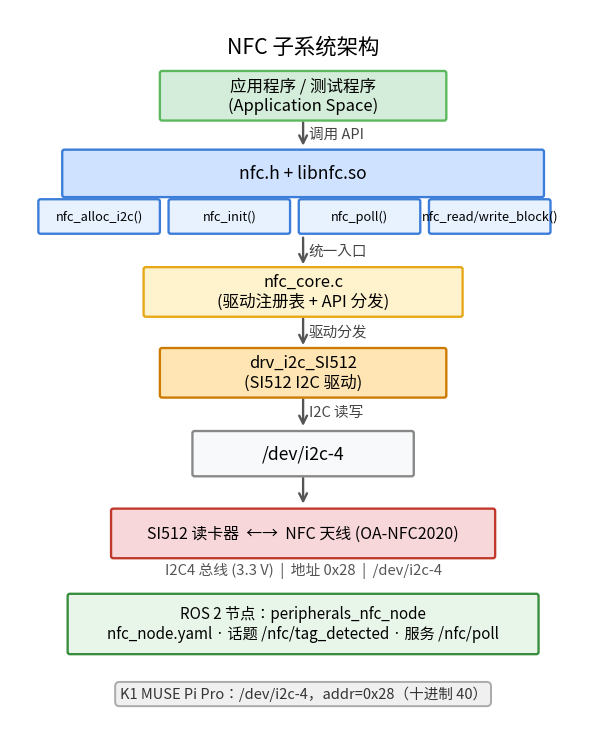

# 6.2.5 NFC

## 1. 模块概述

- 主要功能：`nfc` 模块位于 `components/peripherals/nfc`，提供面向用户态的 NFC 设备抽象层和驱动注册框架，用于初始化读卡器、轮询标签、读取 UID。组件提供基于 I2C 的 SI512 读卡器驱动，用于 Type A 标签交互。
- 规格或特性：对外以 `nfc.h` + `libnfc.so` 形式提供 C 接口；支持 `nfc_alloc_i2c()`、`nfc_alloc_spi()`、`nfc_alloc_uart()` 三类工厂接口，内置驱动为 `drv_i2c_SI512`，SPI/UART 仅提供 API 和测试框架，需要另行实现驱动；MUSE Pi Pro 板级配置使用 `/dev/i2c-4`，默认从设备地址为 `0x28`（十进制 40）；`nfc_poll()` 返回 `0` 表示检测到卡片，返回 `1` 表示超时/无卡；SI512 驱动支持 Type A 标签 UID 读取。
- 软件框图：见下图。



- 相关目录结构：

| 路径 | 职责 |
| --- | --- |
| `components/peripherals/nfc/include/nfc.h` | 对外公开的标签信息结构体、生命周期接口和工厂函数 |
| `components/peripherals/nfc/src/nfc_core.c` | 统一 API 实现、驱动注册表和 `name=驱动名:实例名` 解析逻辑 |
| `components/peripherals/nfc/src/nfc_core.h` | 内部设备对象、驱动虚表、bus 类型和注册宏 |
| `components/peripherals/nfc/src/drivers/drv_i2c_SI512/drv_i2c_SI512.c` | SI512 I2C 驱动、寄存器访问、Type A 轮询实现 |
| `components/peripherals/nfc/src/drivers/drv_i2c_SI512/drv_i2c_SI512.h` | SI512/MFRC522 风格寄存器、命令和设备常量定义 |
| `components/peripherals/nfc/example/test_nfc_spi.c` | SPI 接口测试壳，用于验证 generic SPI 驱动存在时的返回码约定 |
| `components/peripherals/nfc/example/test_nfc_uart.c` | UART 接口测试壳，用于验证 generic UART 驱动存在时的返回码约定 |
| `components/peripherals/nfc/CMakeLists.txt` | 组件构建、驱动选择和测试目标定义 |

## 2. 环境准备

### 前置条件

- 运行环境：Linux 6.6.63，具备 I2C 控制器及设备节点。构建需要 `gcc`、`make`、`cmake`；组件按 C99 构建。
- 依赖与外部资源：I2C 模式依赖内核导出的 `/dev/i2c-*` 设备节点，不额外依赖第三方动态库；`nfc` 组件仅提供 I2C + SI512 驱动，SPI/UART 接口需要另行实现驱动。
- 硬件与连接：MUSE Pi Pro 配套扩展板已集成 SI512 NFC 模块，通过 I2C4 总线（3.3 V 信号电平）与主芯片相连，7 位 I2C 地址为 `0x28`，对应设备节点 `/dev/i2c-4`，配套 `OA-NFC2020` 外置 NFC 天线。使用独立 SI512 模块时，请确认供电、SCL、SDA 正确连接，模块 I2C 地址与程序参数一致，且待测试卡片为驱动当前示例路径支持的 Type A 类卡片。

### 构建编译

- **获取代码**：详见 [2.4 构建编译](../../02-快速入门/2.4-构建编译.md) 章节，使用 `repo` 工具克隆完整 SDK。

- **本模块编译**：

    - **方式 1：独立编译**

      ~~~bash
      cd components/peripherals/nfc
      mkdir -p build && cd build
      cmake .. -DBUILD_TESTS=ON -DSROBOTIS_PERIPHERALS_NFC_ENABLED_DRIVERS="drv_i2c_SI512"
      make -j$(nproc)
      ~~~

    - **方式 2：SDK 集成编译（推荐）**

      ~~~bash
      source build/envsetup.sh
      lunch k1-muse-pipro-minimal
      cd components/peripherals/nfc
      mm -DSROBOTIS_PERIPHERALS_NFC_ENABLED_DRIVERS=drv_i2c_SI512
      ~~~

- **产物名称**：`libnfc.so` 输出至 `build/`；启用 `BUILD_TESTS` 时同时生成 `test_nfc_i2c`、`test_nfc_spi` 和 `test_nfc_uart`。SDK 编译产物安装至系统 `output/staging/{lib,bin}` 路径。

- **说明**：运行 I2C SI512 示例前，配置阶段必须显式启用 `drv_i2c_SI512`；否则调用 `nfc_alloc_i2c("SI512:...")` 会因找不到驱动返回 `NULL`。

## 3. 示例使用

### 3.1 ROS 2 NFC 节点

SDK 同时提供 ROS 2 节点 `peripherals_nfc_node`，通过 YAML 参数文件配置：

~~~bash
source /opt/ros/humble/setup.bash
source ~/spacemit_robot/output/staging/setup.bash

ros2 run peripherals_nfc_node nfc_node   --ros-args   --params-file ~/spacemit_robot/output/staging/share/peripherals_nfc_node/params/nfc_node.yaml   -p device:=/dev/i2c-4   -p i2c_addr:=40
~~~

参数文件的默认设备节点为 `/dev/i2c-5`，需通过 `-p device:=/dev/i2c-4 -p i2c_addr:=40` 指定 MUSE Pi Pro 的设备节点与地址。其中 `i2c_addr` 使用十进制值 `40`，对应十六进制 `0x28`。节点启动后可通过 `/nfc/tag_detected` 话题订阅标签事件，或通过 `/nfc/poll` 服务触发单次读卡。

## 4. 应用开发

### 4.1 最简使用流程

```c
#include <nfc.h>
#include <stdint.h>
#include <stdio.h>

static void on_tag_event(struct nfc_dev *dev, const struct nfc_tag_info *info, void *ctx)
{
    (void)dev;
    (void)ctx;
    printf("uid_len=%u type=%d\n", info ? (unsigned int)info->uid_len : 0U, info ? (int)info->type : -1);
}

int main(void)
{
    struct nfc_dev *dev = nfc_alloc_i2c("SI512:nfc0", "/dev/i2c-4", 0x28);
    if (!dev) {
        return -1;
    }

    nfc_set_callback(dev, on_tag_event, NULL);

    if (nfc_init(dev) < 0) {
        nfc_free(dev);
        return -1;
    }

    struct nfc_tag_info info = {0};
    if (nfc_poll(dev, &info, 100) == 0) {
        for (uint8_t i = 0; i < info.uid_len; ++i) {
            printf("%02X%s", info.uid[i], i + 1 == info.uid_len ? "\n" : " ");
        }
    }

    nfc_free(dev);
    return 0;
}
```

MUSE Pi Pro 使用 `/dev/i2c-4`、地址 `0x28`；其他板型请先确认对应 I2C 控制器编号和从设备地址。

### 4.2 主要 API 说明

**1. 设备创建与资源管理**
```c
// 按不同总线方式创建设备
struct nfc_dev *nfc_alloc_i2c(const char *name, const char *i2c_dev, uint8_t addr);
struct nfc_dev *nfc_alloc_spi(const char *name, const char *spi_dev, uint32_t cs_pin);
struct nfc_dev *nfc_alloc_uart(const char *name, const char *uart_dev, uint32_t baud);

// 初始化与释放
int nfc_init(struct nfc_dev *dev);
void nfc_free(struct nfc_dev *dev);
```

**2. 轮询与回调**
```c
// 注册标签事件回调
void nfc_set_callback(struct nfc_dev *dev, nfc_event_cb_t cb, void *ctx);

// 在给定超时时间内轮询标签
int nfc_poll(struct nfc_dev *dev, struct nfc_tag_info *info, uint32_t timeout_ms);
```

### 4.3 核心数据结构

**标签信息结构体**
```c
struct nfc_tag_info {
    uint8_t uid[16];
    uint8_t uid_len;
    enum nfc_tag_type type;
    int8_t  rssi_dbm;
    uint8_t ats[32];
    uint8_t ats_len;
};
```

**标签类型枚举**
```c
enum nfc_tag_type {
    NFC_TAG_UNKNOWN = 0,
    NFC_TAG_MIFARE_CLASSIC,
    NFC_TAG_MIFARE_ULTRALIGHT,
    NFC_TAG_TYPE_A,
    NFC_TAG_TYPE_B,
    NFC_TAG_FELICA,
    NFC_TAG_ISO15693,
};
```

**设备句柄与回调**
```c
struct nfc_dev;

typedef void (*nfc_event_cb_t)(struct nfc_dev *dev,
    const struct nfc_tag_info *info, void *ctx);
```

开发时需要注意：建议显式使用 `SI512:nfc0` 这类 `驱动名:实例名` 形式选择驱动；`nfc_poll()` 是同步轮询接口，常见返回值为 `0` 表示检测到标签、`1` 表示超时未检测到标签；当前 SI512 驱动会在 `/var/lock` 下对同一 I2C 设备加锁。

**参考示例路径**
```text
components/peripherals/nfc/example/test_nfc_i2c.c
components/peripherals/nfc/src/drivers/drv_i2c_SI512/drv_i2c_SI512.c
```

## 5. 调试指南

- 如果始终提示 `no tag`，优先检查 SI512 模块供电、I2C 连接、卡片类型和天线距离，再用 `i2cdetect -y -r 4` 确认地址 `0x28` 可见。该 I2C 控制器不支持 SMBus Quick Write，必须加 `-r` 选项。
- 如果程序报 `alloc i2c failed`，通常是因为当前构建结果没有编入 `drv_i2c_SI512`，或者运行时代码没有使用 `SI512:nfc0` 这类驱动名格式。
- 如果多进程访问同一 I2C 设备时偶发 `-EBUSY`，应检查 `/var/lock/` 下的锁文件和其他进程的总线占用情况。
- ROS 2 节点使用时，确认 `-p i2c_addr` 传入的是十进制值（本例为 `40`）。

## 6. 常见问题

- `alloc i2c failed`：通常是没有启用 `drv_i2c_SI512`，或运行时代码没有使用 `SI512:nfc0` 这类驱动名格式。
- `nfc_init()` 看起来成功但一直 `no tag`：先检查设备节点、地址 `0x28`、接线和卡片类型，再结合 `nfc_poll()` 返回值判断。
- 期望使用 SPI/UART 但无法分配设备：内置驱动仅支持 I2C + SI512，SPI/UART 需要另行实现驱动。
- ROS 2 节点启动后没有读卡响应：确认已用 `-p device:=/dev/i2c-4 -p i2c_addr:=40` 覆盖参数文件中的默认值，再通过 `i2cdetect -y -r 4` 核查总线通信。
