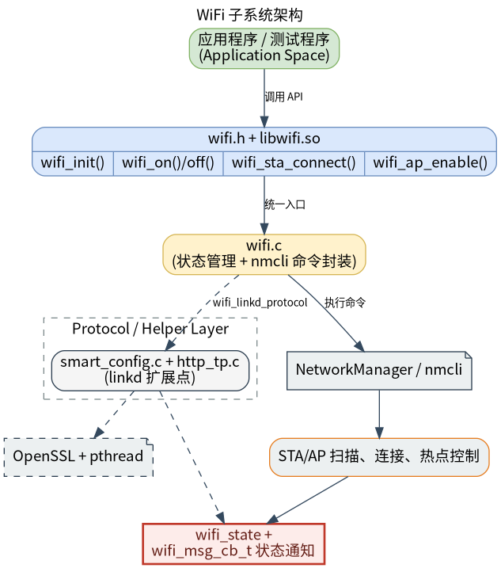

# 6.2.6 WiFi

## 1. 模块概述

- 主要功能：`wifi` 模块位于 `components/peripherals/wifi`，提供基于 NetworkManager 的 WiFi 管理封装。模块通过统一的 `wifi.h` C API 调用 `nmcli`，覆盖 STA 扫描、连接、断开、信息查询、已保存网络管理、AP 热点启停、MAC 查询/设置等功能。
- 规格或特性：对外以 `wifi.h` 和 `libwifi.so` 提供 C 接口；运行时依赖 NetworkManager 和 `nmcli`；构建时依赖 pthread 与 OpenSSL。扫描结果数量由调用方提供的数组容量决定，示例程序最多显示 32 条；已保存网络列表最多返回 `WIFI_STA_MAX_NUM`（20）条；SSID 最大长度为 32 字节，PSK 最大长度为 64 字节。
- 软件框图：



- 相关目录结构：

| 路径 | 职责 |
| --- | --- |
| `components/peripherals/wifi/include/wifi.h` | 对外公开状态码、模式、STA/AP 结构体、消息回调和 WiFi API |
| `components/peripherals/wifi/src/wifi.c` | 基于 `nmcli` 的 WiFi 初始化、STA、AP、MAC、Linkd 和状态管理实现 |
| `components/peripherals/wifi/example/test_wifi_demo.c` | 命令行演示程序，覆盖扫描、连接、AP、MAC、状态和 Linkd 流程 |
| `components/peripherals/wifi/CMakeLists.txt` | 模块构建、OpenSSL/Threads 链接和测试目标定义 |
| `components/peripherals/wifi/package.xml` | 组件版本和系统依赖说明 |

## 2. 环境准备

### 前置条件

- 运行环境：NetworkManager；`nmcli` 命令可用。
- 硬件与连接：目标板需要有被 NetworkManager 管理的 WiFi 网卡。STA 模式需要附近可连接的路由器或热点；AP 模式要求无线网卡及驱动支持 hotspot/AP 模式。设置克隆 MAC 时，硬件和驱动还必须允许修改 MAC。
- 构建依赖：CMake、C 编译器、make、pthread 和 OpenSSL 开发文件。缺少 OpenSSL 时，在 Debian/Bianbu 系统中执行：

  ```bash
  sudo apt update
  sudo apt install cmake gcc make libssl-dev network-manager
  ```

- 权限：NetworkManager 操作可能需要管理员权限或 polkit 授权。排查环境时可执行：

  ```bash
  nmcli -t -f RUNNING general
  nmcli device status
  nmcli radio wifi
  ```

### 构建编译

应用[信号强度补丁](../../02-快速入门/2.10-SDK补丁.md)，安装 `iw` 用于读取 dBm 信号值：

```bash
sudo apt-get install -y iw
cd ~/spacemit_robot
wget -O /tmp/wifi-rssi-dbm.patch \
    https://archive.spacemit.com/ros2/k1_sdk/patches/components/peripherals/wifi/wifi-rssi-dbm.patch && \
git -C components/peripherals/wifi apply --check /tmp/wifi-rssi-dbm.patch && \
git -C components/peripherals/wifi apply /tmp/wifi-rssi-dbm.patch
```

应用[消息回调补丁](../../02-快速入门/2.10-SDK补丁.md)：

```bash
cd ~/spacemit_robot
wget -O /tmp/wifi-message-callback.patch \
    https://archive.spacemit.com/ros2/k1_sdk/patches/components/peripherals/wifi/wifi-message-callback.patch && \
git -C components/peripherals/wifi apply --check /tmp/wifi-message-callback.patch && \
git -C components/peripherals/wifi apply /tmp/wifi-message-callback.patch
```

在独立构建目录中编译：

```bash
cd ~/spacemit_robot
cmake -S components/peripherals/wifi \
  -B /tmp/k1-wifi-test-build \
  -DBUILD_TESTS=ON
cmake --build /tmp/k1-wifi-test-build -j2
```

预期产物：

```text
/tmp/k1-wifi-test-build/libwifi.so
/tmp/k1-wifi-test-build/test_wifi_demo
```

运行独立构建的演示程序时，设置库搜索路径：

```bash
export WIFI_BUILD=/tmp/k1-wifi-test-build
export LD_LIBRARY_PATH="$WIFI_BUILD${LD_LIBRARY_PATH:+:$LD_LIBRARY_PATH}"
```

## 3. 示例使用

以下示例使用独立构建生成的 `test_wifi_demo`。执行前先完成 §2 的构建，并确认当前 WiFi 连接允许暂时切换到 AP 模式。SSID 和密码示例均为测试值，请不要在生产网络中使用。

### 3.1 扫描并连接 WiFi

**步骤 1**：确认 NetworkManager 和无线网卡。

```bash
nmcli -t -f RUNNING general
nmcli device status
```

预期现象：NetworkManager 状态为 `running`，并能看到类型为 `wifi` 的无线设备，例如 `wlan0`。

**步骤 2**：扫描附近 WiFi。

```bash
"$WIFI_BUILD/test_wifi_demo" scan
```

预期现象：程序打印 `Found <N> networks (showing up to 32):`，并逐行显示 `SSID`、`RSSI`、`FREQ`、`SEC` 和 `BSSID`。网络数量随现场可见热点变化。

**步骤 3**：连接 WiFi。

使用已经保存的网络时，可以省略密码：

```bash
"$WIFI_BUILD/test_wifi_demo" connect '<已保存的SSID>'
```

首次连接或需要更新密码时，执行：

```bash
"$WIFI_BUILD/test_wifi_demo" connect '<SSID>' '<临时测试密码>'
```

预期现象：连接请求成功时打印 `wifi_sta_connect: 0`。命令行参数可能出现在 shell 历史记录中，运行示例时使用临时测试凭据。

**步骤 4**：查询连接信息和状态。

```bash
"$WIFI_BUILD/test_wifi_demo" info
"$WIFI_BUILD/test_wifi_demo" state
nmcli device status
```

`info` 成功时显示当前 SSID、BSSID、MAC、频率、信号强度、加密类型、IP 和网关；`state` 用于查看组件状态，`nmcli device status` 用于确认系统层的实际连接状态。

**步骤 5**：查看和管理已保存网络。

```bash
"$WIFI_BUILD/test_wifi_demo" list
"$WIFI_BUILD/test_wifi_demo" remove '<SSID>'
```

`list` 只显示已保存网络名称，不显示密码。`remove` 会删除对应的 NetworkManager 连接配置，执行前确认不会删除当前唯一的远程管理网络。

**步骤 6**：查询 MAC 地址。

```bash
"$WIFI_BUILD/test_wifi_demo" mac wlan0
```

如果接口名称不是 `wlan0`，请替换为 `nmcli device status` 中显示的实际名称。

### 3.2 开启 AP 热点

AP 会改变无线网卡的工作模式。若当前 SSH 会话也通过该 WiFi 连接，切换模式可能中断会话。开始前应准备开发板本地终端、串口或其他带外恢复方式，并准备第二台手机或电脑作为 WiFi 客户端。

#### 普通 AP

**步骤 1**：启动临时热点。

```bash
"$WIFI_BUILD/test_wifi_demo" ap K1_WIFI_TEST 12345678 192.168.1.1 192.168.1.1
```

预期现象：程序打印 `wifi_ap_enable: 0`。第二台设备可以搜索到 SSID `K1_WIFI_TEST`，密码为 `12345678`。

**步骤 2**：查询 AP 配置。

```bash
"$WIFI_BUILD/test_wifi_demo" ap_get
```

预期现象：打印 AP 的 SSID、安全类型、信道和连接设备数量。当前示例还会打印 PSK，请勿把真实密码用于该命令，也不要将输出上传到公开日志。

**步骤 3**：关闭热点。

```bash
"$WIFI_BUILD/test_wifi_demo" ap_off
nmcli device status
```

确认热点已经关闭后，再恢复原来的 STA 连接。

## 4. 应用开发

### 4.1 最简使用流程

```c
#include "wifi.h"
#include <stdio.h>

static void on_wifi_msg(struct wifi_msg_data *msg)
{
    if (msg) {
        printf("msg_id=%d\n", msg->id);
    }
}

int main(void)
{
    struct wifi_sta_connect_param param = {0};

    if (wifi_init() != WIFI_STATUS_SUCCESS) {
        return -1;
    }

    wifi_register_msg_cb(on_wifi_msg, NULL);
    if (wifi_on(WIFI_MODE_STATION) != WIFI_STATUS_SUCCESS) {
        wifi_deinit();
        return -1;
    }

    param.ssid = "YourSSID";
    param.password = "YourPassword";
    param.sec = WIFI_SEC_WPA2_PSK;
    if (wifi_sta_connect(&param) != WIFI_STATUS_SUCCESS) {
        wifi_off(WIFI_MODE_STATION);
        wifi_deinit();
        return -1;
    }

    /* 通过回调或 wifi_get_state()/wifi_sta_get_info() 判断连接结果。 */
    wifi_off(WIFI_MODE_STATION);
    wifi_deinit();
    return 0;
}
```

编译应用时包含 `components/peripherals/wifi/include/wifi.h`，并链接 `libwifi.so`。使用 SDK 集成产物时，将 `output/staging/include` 加入头文件搜索路径，将 `output/staging/lib` 加入库搜索路径。

### 4.2 主要 API 说明

**1. 生命周期与无线开关**

```c
enum wifi_status wifi_init(void);
enum wifi_status wifi_deinit(void);
enum wifi_status wifi_on(enum wifi_mode mode);
enum wifi_status wifi_off(enum wifi_mode mode);
```

**2. STA / AP 核心操作**

```c
enum wifi_status wifi_sta_connect(struct wifi_sta_connect_param *param);
enum wifi_status wifi_sta_disconnect(void);
enum wifi_status wifi_ap_enable(struct wifi_ap_config *config);
enum wifi_status wifi_ap_disable(void);
```

**3. 扫描、状态与回调**

```c
enum wifi_status wifi_get_scan_results(struct wifi_scan_result *result,
    const char *ssid, uint32_t *bss_num, uint32_t arr_size);
enum wifi_status wifi_get_state(struct wifi_state *state);
enum wifi_status wifi_register_msg_cb(wifi_msg_cb_t msg_cb, void *arg);
```

### 4.3 核心数据结构

**STA 连接参数**

```c
struct wifi_sta_connect_param {
    const char *ssid;
    const char *password;
    uint8_t bssid[6];
    enum wifi_secure sec;
    bool fast_connect;
};
```

**扫描结果结构体**

```c
struct wifi_scan_result {
    uint8_t bssid[6];
    char ssid[WIFI_SSID_MAX_LEN + 1];
    uint32_t freq;
    int rssi;
    enum wifi_secure key_mgmt;
    bool scan_action;
};
```

**消息回调数据**

```c
struct wifi_msg_data {
    enum wifi_msg_id id;
    union {
        enum wifi_dev_status d_status;
        enum wifi_sta_event event;
        enum wifi_sta_state state;
        enum wifi_ap_event ap_event;
        enum wifi_ap_state ap_state;
    } data;
    void *private_data;
};
```

开发时需要注意：

- 所有主要 API 都要求先调用 `wifi_init()`，结束时调用 `wifi_deinit()`。
- `wifi_on()` 和 `wifi_off()` 操作的是全局 WiFi radio，可能影响系统中的其他连接。
- `wifi_sta_list_networks()` 会为 `list.nodes` 分配内存，调用方使用后必须执行 `free(list.nodes)`。
- 消息回调在相关 API 的调用线程中执行，`arg` 通过 `msg->private_data` 传入；传入 `NULL` 回调可注销，`wifi_deinit()` 清除注册。回调和其他 WiFi API 应串行调用。
- `test_wifi_demo ap_get` 会输出 PSK，调试时只使用临时网络凭据。

**参考 demo 或示例路径**

```text
components/peripherals/wifi/example/test_wifi_demo.c
components/peripherals/wifi/src/wifi.c
```

## 5. 调试指南

- 如果 `wifi_init()` 失败，执行以下命令确认 NetworkManager、无线开关和设备状态：

  ```bash
  nmcli -t -f RUNNING general
  nmcli radio wifi
  nmcli device status
  ```

- 如果扫描结果为 0，先执行 `nmcli device wifi list` 查看系统能否扫描到 AP；若系统命令也没有结果，再检查射频开关、驱动、天线和现场信号。
- 如果连接失败，确认 SSID、密码和安全类型；使用 `nmcli connection show` 检查是否存在同名旧连接。
- 如果 AP 启动失败，确认无线驱动支持 AP/hotspot 模式，并检查是否有其他热点连接占用无线网卡。
- 如果使用 SSH 连接开发板，避免从唯一的 WiFi 管理链路启动 AP；优先使用本地控制台、串口或有线带外通道。

## 6. 常见问题

- `wifi_init failed: -1`：通常是 NetworkManager 未运行，或 `nmcli` 不可用。
- `wifi_sta_connect: -1`：通常是 SSID/密码错误、AP 不可达，或底层 `nmcli` 连接失败。
- 启动热点后 SSH 断开：这是无线网卡从 STA 切换到 AP 的正常网络影响。使用本地终端或带外通道恢复 STA，不要在唯一远程 WiFi 链路上反复切换热点。
