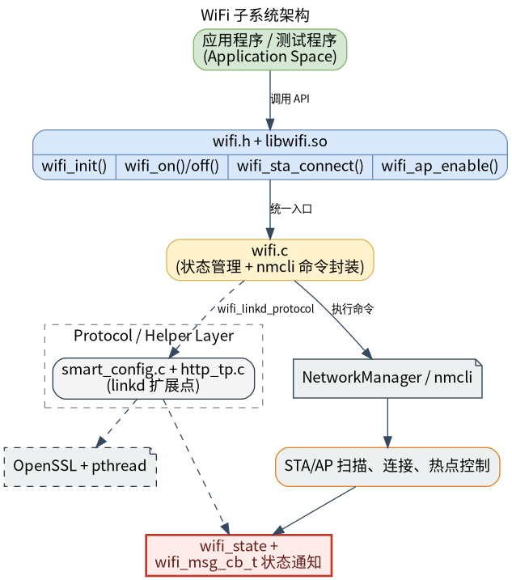

# 外设与驱动 · WiFi

## 1. 模块概述

- 主要功能：`wifi` 模块位于 `components/peripherals/wifi`，提供基于 NetworkManager 的 WiFi 管理封装。模块通过统一的 `wifi.h` C API 调用 `nmcli`，覆盖 STA 扫描、连接、断开、信息查询、已保存网络管理、AP 热点启停、MAC 查询/设置以及 SoftAP 配网等功能。
- 规格或特性：对外以 `wifi.h` 和 `libwifi.so` 提供 C 接口；运行时依赖 NetworkManager 和 `nmcli`；构建时依赖 pthread 与 OpenSSL。扫描结果数量由调用方提供的数组容量决定，示例程序最多显示 32 条；已保存网络列表最多返回 `WIFI_STA_MAX_NUM`（20）条；SSID 最大长度为 32 字节，PSK 最大长度为 64 字节；SoftAP 配网页面默认监听 8000 端口。
- 软件框图：



- 相关目录结构：

| 路径 | 职责 |
| --- | --- |
| `components/peripherals/wifi/include/wifi.h` | 对外公开状态码、模式、STA/AP 结构体、消息回调和 WiFi API |
| `components/peripherals/wifi/src/wifi.c` | 基于 `nmcli` 的 WiFi 初始化、STA、AP、MAC、Linkd 和状态管理实现 |
| `components/peripherals/wifi/src/link_protocol/smart_config.c` | SoftAP 配网 HTTP 服务、SSID/PSK 表单解析和结果回调 |
| `components/peripherals/wifi/src/link_protocol/http_tp.c` | HTTP 响应、配置页面和结果页面模板 |
| `components/peripherals/wifi/example/test_wifi_demo.c` | 命令行演示程序，覆盖扫描、连接、AP、MAC、状态和 Linkd 流程 |
| `components/peripherals/wifi/CMakeLists.txt` | 模块构建、OpenSSL/Threads 链接和测试目标定义 |
| `components/peripherals/wifi/package.xml` | 组件版本和系统依赖说明 |

K1 的演示程序位于 `example/`，与 K3 文档中使用的 `test/` 路径不同。该路径差异不需要修改源代码。

## 2. 环境准备

### 前置条件

- 运行环境：K1 开发板、Linux 系统和 NetworkManager；`nmcli` 命令可用。本文命令以 SDK 位于 `/root/spacemit_robot` 为例。
- 硬件与连接：目标板需要有被 NetworkManager 管理的 WiFi 网卡。STA 模式需要附近可连接的路由器或热点；AP 和 SoftAP 模式要求无线网卡及驱动支持 hotspot/AP 模式。设置克隆 MAC 时，硬件和驱动还必须允许修改 MAC。
- 构建依赖：CMake、C 编译器、make、pthread 和 OpenSSL 开发文件。缺少 OpenSSL 时，在 Debian/Bianbu 系统中执行：

  ```bash
  sudo apt update
  sudo apt install cmake gcc make libssl-dev network-manager
  ```

- 权限：NetworkManager 操作可能需要管理员权限或 polkit 授权。排查环境时可执行：

  ```bash
  nmcli -t -f RUNNING general
  nmcli device status
  nmcli radio wifi
  ```

### 构建编译

本节采用独立构建目录编译，避免在 SDK 源码目录留下构建产物：

```bash
cd /root/spacemit_robot
cmake -S components/peripherals/wifi \
  -B /tmp/k1-wifi-test-build \
  -DBUILD_TESTS=ON
cmake --build /tmp/k1-wifi-test-build -j2
```

预期产物：

```text
/tmp/k1-wifi-test-build/libwifi.so
/tmp/k1-wifi-test-build/test_wifi_demo
```

运行独立构建的演示程序时，设置库搜索路径：

```bash
export WIFI_BUILD=/tmp/k1-wifi-test-build
export LD_LIBRARY_PATH="$WIFI_BUILD${LD_LIBRARY_PATH:+:$LD_LIBRARY_PATH}"
```

## 3. 示例使用（从 0 跑通）

以下示例使用独立构建生成的 `test_wifi_demo`。执行前先完成 §2 的构建，并确认当前 WiFi 连接允许暂时切换到 AP 模式。SSID 和密码示例均为测试值，请不要在生产网络中使用。

### 3.1 扫描并连接 WiFi

**步骤 1**：确认 NetworkManager 和无线网卡。

```bash
nmcli -t -f RUNNING general
nmcli device status
```

预期现象：NetworkManager 状态为 `running`，并能看到类型为 `wifi` 的无线设备，例如 `wlan0`。

**步骤 2**：扫描附近 WiFi。

```bash
"$WIFI_BUILD/test_wifi_demo" scan
```

预期现象：程序打印 `Found <N> networks (showing up to 32):`，并逐行显示 `SSID`、`RSSI`、`FREQ`、`SEC` 和 `BSSID`。网络数量随现场可见热点变化。

**步骤 3**：连接 WiFi。

使用已经保存的网络时，可以省略密码：

```bash
"$WIFI_BUILD/test_wifi_demo" connect '<已保存的SSID>'
```

首次连接或需要更新密码时，执行：

```bash
"$WIFI_BUILD/test_wifi_demo" connect '<SSID>' '<临时测试密码>'
```

预期现象：连接请求成功时打印 `wifi_sta_connect: 0`。命令行参数可能出现在 shell 历史记录中，验证时应使用临时测试凭据。

**步骤 4**：查询连接信息和状态。

```bash
"$WIFI_BUILD/test_wifi_demo" info
"$WIFI_BUILD/test_wifi_demo" state
nmcli device status
```

`info` 成功时显示当前 SSID、BSSID、MAC、频率、信号强度、加密类型、IP 和网关；`state` 用于查看组件状态，`nmcli device status` 用于确认系统层的实际连接状态。

**步骤 5**：查看和管理已保存网络。

```bash
"$WIFI_BUILD/test_wifi_demo" list
"$WIFI_BUILD/test_wifi_demo" remove '<SSID>'
```

`list` 只显示已保存网络名称，不显示密码。`remove` 会删除对应的 NetworkManager 连接配置，执行前确认不会删除当前唯一的远程管理网络。

**步骤 6**：查询 MAC 地址。

```bash
"$WIFI_BUILD/test_wifi_demo" mac wlan0
```

如果接口名称不是 `wlan0`，请替换为 `nmcli device status` 中显示的实际名称。

### 3.2 开启 AP 并使用 SoftAP 配网

普通 AP 和 SoftAP 会改变无线网卡的工作模式。若当前 SSH 会话也通过该 WiFi 连接，切换模式可能中断会话。开始前应准备开发板本地终端、串口或其他带外恢复方式，并准备第二台手机或电脑作为 WiFi 客户端。配网热点只用于访问本地配置页面，不提供互联网连接；客户端连接后可能提示“无互联网”。建议使用手机或备用终端，避免让承担日常网络连接的电脑加入该热点。

#### 普通 AP

**步骤 1**：启动临时热点。

```bash
"$WIFI_BUILD/test_wifi_demo" ap K1_WIFI_TEST 12345678 192.168.1.1 192.168.1.1
```

预期现象：程序打印 `wifi_ap_enable: 0`。第二台设备可以搜索到 SSID `K1_WIFI_TEST`，密码为 `12345678`。

**步骤 2**：查询 AP 配置。

```bash
"$WIFI_BUILD/test_wifi_demo" ap_get
```

预期现象：打印 AP 的 SSID、安全类型、信道和连接设备数量。当前示例还会打印 PSK，请勿把真实密码用于该命令，也不要将输出上传到公开日志。

**步骤 3**：关闭热点。

```bash
"$WIFI_BUILD/test_wifi_demo" ap_off
nmcli device status
```

确认热点已经关闭后，再恢复原来的 STA 连接。

#### SoftAP 网页配网

该流程由示例固定创建以下临时热点：

| 项目 | 值 |
| --- | --- |
| SSID | `TEST_AP_LINK` |
| WPA2-PSK | `12345678` |
| 开发板地址 | `192.168.1.1` |
| 网页地址 | `http://192.168.1.1:8000` |
| 等待时间 | 默认最多 300 秒 |

**步骤 1**：在开发板本地终端启动配网流程。

```bash
"$WIFI_BUILD/test_wifi_demo" linkd
```

预期输出：

```text
wifi_ap_enable: 0
linkd: connect to AP and open http://192.168.1.1:8000
```

`linkd` 在当前进程内同步等待网页提交，默认等待 300 秒；客户端必须在这段时间内完成提交。若超时，程序打印 `wifi_linkd_protocol: -7`，其中 `-7` 表示 `WIFI_STATUS_TIMEOUT`。

**步骤 2**：使用第二台设备连接 `TEST_AP_LINK`。

等待开发板热点地址稳定为 `192.168.1.1` 后，在手机或电脑上连接该 SSID，确认客户端地址位于 `192.168.1.x` 网段，然后打开：

```text
http://192.168.1.1:8000
```

在网页中填写目标路由器的 SSID 和密码并提交。该页面使用未加密的 HTTP；示例回调还会把提交的 SSID 和 PSK 明文输出到板端终端。请仅使用临时测试网络凭据，不能录入生产网络密码。

**步骤 3**：确认目标网络连接结果。

提交后，示例会删除 `TEST_AP_LINK` 的保存配置并尝试调用 STA 连接接口。网页提交回调只表示表单已被处理，不等于目标路由器已经联网成功；配网流程结束后应在板端另行检查：

```bash
"$WIFI_BUILD/test_wifi_demo" state
"$WIFI_BUILD/test_wifi_demo" info
nmcli device status
```

K1 当前网页服务代码生成了 `admin/admin` 的认证字符串，但请求处理未发现强制校验该字段；因此本节不把 `admin/admin` 作为必填登录步骤。若后续版本在页面中启用认证，应以实际页面提示为准。

## 4. 应用开发

### 4.1 最简使用流程

```c
#include "wifi.h"
#include <stdio.h>

static void on_wifi_msg(struct wifi_msg_data *msg)
{
    if (msg) {
        printf("msg_id=%d\n", msg->id);
    }
}

int main(void)
{
    struct wifi_sta_connect_param param = {0};

    if (wifi_init() != WIFI_STATUS_SUCCESS) {
        return -1;
    }

    wifi_register_msg_cb(on_wifi_msg, NULL);
    if (wifi_on(WIFI_MODE_STATION) != WIFI_STATUS_SUCCESS) {
        wifi_deinit();
        return -1;
    }

    param.ssid = "YourSSID";
    param.password = "YourPassword";
    param.sec = WIFI_SEC_WPA2_PSK;
    if (wifi_sta_connect(&param) != WIFI_STATUS_SUCCESS) {
        wifi_off(WIFI_MODE_STATION);
        wifi_deinit();
        return -1;
    }

    /* 通过回调或 wifi_get_state()/wifi_sta_get_info() 判断连接结果。 */
    wifi_off(WIFI_MODE_STATION);
    wifi_deinit();
    return 0;
}
```

编译应用时包含 `components/peripherals/wifi/include/wifi.h`，并链接 `libwifi.so`。使用 SDK 集成产物时，将 `output/staging/include` 加入头文件搜索路径，将 `output/staging/lib` 加入库搜索路径。

### 4.2 主要 API 说明

**1. 生命周期与无线开关**

```c
enum wifi_status wifi_init(void);
enum wifi_status wifi_deinit(void);
enum wifi_status wifi_on(enum wifi_mode mode);
enum wifi_status wifi_off(enum wifi_mode mode);
```

**2. STA / AP 核心操作**

```c
enum wifi_status wifi_sta_connect(struct wifi_sta_connect_param *param);
enum wifi_status wifi_sta_disconnect(void);
enum wifi_status wifi_ap_enable(struct wifi_ap_config *config);
enum wifi_status wifi_ap_disable(void);
```

**3. 扫描、状态与回调**

```c
enum wifi_status wifi_get_scan_results(struct wifi_scan_result *result,
    const char *ssid, uint32_t *bss_num, uint32_t arr_size);
enum wifi_status wifi_get_state(struct wifi_state *state);
enum wifi_status wifi_register_msg_cb(wifi_msg_cb_t msg_cb, void *arg);
```

### 4.3 核心数据结构

**STA 连接参数**

```c
struct wifi_sta_connect_param {
    const char *ssid;
    const char *password;
    uint8_t bssid[6];
    enum wifi_secure sec;
    bool fast_connect;
};
```

**扫描结果结构体**

```c
struct wifi_scan_result {
    uint8_t bssid[6];
    char ssid[WIFI_SSID_MAX_LEN + 1];
    uint32_t freq;
    int rssi;
    enum wifi_secure key_mgmt;
    bool scan_action;
};
```

**消息回调数据**

```c
struct wifi_msg_data {
    enum wifi_msg_id id;
    union {
        enum wifi_dev_status d_status;
        enum wifi_sta_event event;
        enum wifi_sta_state state;
        enum wifi_ap_event ap_event;
        enum wifi_ap_state ap_state;
    } data;
    void *private_data;
};
```

开发时需要注意：

- 所有主要 API 都要求先调用 `wifi_init()`，结束时调用 `wifi_deinit()`。
- `wifi_on()` 和 `wifi_off()` 操作的是全局 WiFi radio，可能影响系统中的其他连接。
- `wifi_sta_list_networks()` 会为 `list.nodes` 分配内存，调用方使用后必须执行 `free(list.nodes)`。
- `wifi_linkd_protocol()` 当前只支持 `WIFI_LINKD_MODE_SOFTAP`；BLE 和 QRCODE 模式返回 `WIFI_STATUS_UNSUPPORTED`。
- `wifi_linkd_protocol()` 是同步等待接口，超时时间由 `second` 参数决定；示例使用 300 秒。
- 消息回调由相关 API 的执行路径触发，不应当作独立的后台订阅线程使用。
- `test_wifi_demo ap_get` 和 `linkd` 回调会输出 PSK，调试时只使用临时网络凭据。

**参考 demo 或示例路径**

```text
components/peripherals/wifi/example/test_wifi_demo.c
components/peripherals/wifi/src/wifi.c
components/peripherals/wifi/src/link_protocol/smart_config.c
```

## 5. 调试指南

- 如果 `wifi_init()` 失败，执行以下命令确认 NetworkManager、无线开关和设备状态：

  ```bash
  nmcli -t -f RUNNING general
  nmcli radio wifi
  nmcli device status
  ```

- 如果扫描结果为 0，先执行 `nmcli device wifi list` 验证系统层是否能扫描到 AP；若系统命令也没有结果，再检查射频开关、驱动、天线和现场信号。
- 如果连接失败，确认 SSID、密码和安全类型；使用 `nmcli connection show` 检查是否存在同名旧连接。
- 如果 AP 启动失败，确认无线驱动支持 AP/hotspot 模式，并检查是否有其他热点连接占用无线网卡。
- 如果 SoftAP 页面打不开，先确认第二台设备已经连接 `TEST_AP_LINK`，客户端地址属于 `192.168.1.x` 网段，再在板端检查 8000 端口：

  ```bash
  ss -ltnp | grep ':8000'
  ```

- 如果使用 SSH 连接开发板，避免从唯一的 WiFi 管理链路启动 AP/SoftAP；优先使用本地控制台、串口或有线带外通道。
- 如果 `linkd` 返回 `-7`，表示在指定等待时间内没有完成网页提交。重新启动流程，并确保客户端在 300 秒内完成连接和提交。

## 6. 常见问题

- `wifi_init failed: -1`：通常是 NetworkManager 未运行，或 `nmcli` 不可用。
- `wifi_sta_connect: -1`：通常是 SSID/密码错误、AP 不可达，或底层 `nmcli` 连接失败。
- `wifi_linkd_protocol()` 返回 `-5`：当前模式只支持 `WIFI_LINKD_MODE_SOFTAP`，BLE/QRCODE 尚未实现。
- `wifi_linkd_protocol()` 返回 `-7`：网页配网在等待时间内没有完成表单提交。
- 页面提交后没有网络：网页回调不代表目标路由器已经联网成功，应使用 `state`、`info` 和 `nmcli device status` 单独确认 STA 状态、IP 和网关。
- 启动热点后 SSH 断开：这是无线网卡从 STA 切换到 AP 的正常网络影响。使用本地终端或带外通道恢复 STA，不要在唯一远程 WiFi 链路上反复启动配网。
