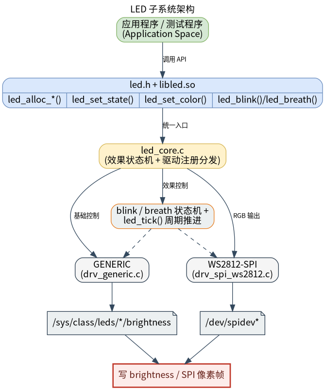

# 外设与驱动 · led

## 1. 模块概述

- 主要功能：`led` 模块位于 `components/peripherals/led`，提供统一的用户态 LED 控制接口，用于控制普通 sysfs LED 指示灯和基于 SPI 的 WS2812/SK6812 RGB 灯带。模块通过驱动注册机制屏蔽底层差异，对上层暴露开关、亮度、颜色、闪烁和呼吸等通用操作。  
- 规格或特性：对外以 `led.h` + `libled.so` 形式提供 C 接口；默认只编入 `drv_generic` sysfs LED 驱动，如需 WS2812/SK6812 需要在 CMake 中显式启用 `drv_spi_ws2812`；sysfs 驱动写 `/sys/class/leds/<name>/brightness`，当前只写 `0/1`；WS2812 驱动写 `/dev/spidevX.Y`，默认 SPI 速率 `6400000 Hz`、默认复位填充 `80` 字节、默认灯珠数量 `1`，实际编码固定为 GRB 顺序；闪烁和呼吸效果依赖业务周期调用 `led_tick()`，推荐 10 Hz 到 50 Hz。  
- 软件框图：见下图。  



- 相关目录结构：  

| 路径 | 职责 |
| --- | --- |
| `components/peripherals/led/include/led.h` | 对外公开颜色结构、闪烁参数和 LED 控制 API |
| `components/peripherals/led/src/led_core.c` | 设备分配、驱动注册表、开关/亮度/颜色映射和效果状态机 |
| `components/peripherals/led/src/led_core.h` | 内部设备对象、驱动虚表、驱动类型和注册宏 |
| `components/peripherals/led/src/drivers/drv_generic.c` | sysfs LED 驱动，控制 `/sys/class/leds/<name>/brightness` |
| `components/peripherals/led/src/drivers/drv_spi_ws2812.c` | SPI WS2812/SK6812 驱动，负责 GRB 编码和 spidev 传输 |
| `components/peripherals/led/example/test_led_generic.c` | sysfs LED 演示程序，覆盖开关、切换、闪烁和呼吸 |
| `components/peripherals/led/example/test_led_ws2812.c` | WS2812 SPI 演示程序，覆盖颜色、亮度、闪烁和呼吸 |
| `components/peripherals/led/CMakeLists.txt` | 模块构建、驱动选择和测试目标定义 |

## 2. 环境准备

### 前置条件

- 运行环境：K1 MUSE Pi Pro 开发板及配套 Linux 系统；构建需要 `gcc`、`make` 和 `cmake`。以下命令以 SDK 位于 `~/spacemit_robot` 为例。
- 硬件与连接：准备 WS2812 RGB 灯带、满足灯带要求的电源及连接线。本节使用外接灯带，不要求板载 LED。普通 sysfs LED 示例则需要实际的 LED 硬件和设备树 `gpio-leds` 配置。
- SPI 接口：需要同时启用排针对应的 SPI3 控制器、SPI 从设备和 `spidev` 驱动。先检查：

```bash
ls -l /dev/spidev*
```

本文的 MUSE Pi Pro SPI3 配置对应 `/dev/spidev3.0`。如果没有该节点，先完成相关配置，再继续本节。`mm` 只构建用户态组件，不会启用内核驱动或修改设备树；`lunch` 也不会改变排针功能。

**K1 接线说明**：针脚定义参考 [K1 MUSE Pi Pro 用户指南](https://github.com/spacemit-com/docs-product/blob/main/zh/k1_series/k1_muse_pi_pro/pi_pro_user_guide.md)。下表编号为排针物理位置。

| 灯带端 | K1 连接及要求 |
| --- | --- |
| DIN / DI | 物理针脚 19，`SPI3_MOSI_3V3`；根据灯带输入电平要求配置 3.3 V 转 5 V 电平转换 |
| GND | 物理针脚 20 或 25；灯带、电平转换器和电源必须共地 |
| VCC / 5V | 按灯带规格供电，供电能力应覆盖全部灯珠的最大负载 |

WS2812 使用单线数据输入，灯带不连接 SPI 的 SCLK、MISO 或 CS。数据线接灯带输入端 DIN，不接输出端 DOUT。接线前断电；K1 GPIO 电平为 3.3 V，不能将灯带 5 V 电源接到信号脚。若从开发板 5 V 排针供电，需核对用户指南中的 1 A 输出限制及其他外设负载；使用独立电源时，共地且不要并联两路电源输出。

SPI3 的当前引脚组占用物理针脚 19、21、23、24，其中 23、24 与普通 CAN 的对应引脚组复用。即使灯带只使用 MOSI，也不能同时启用这两组冲突的 SPI3/CAN 配置。`spi4.0` 是板载 Flash，不能作为灯带接口。

### 构建编译

- **获取代码**：详见 [1.7 构建编译](../../01-快速开始/1.7-构建编译.md)，准备完整 SDK。

- **方式 1：独立编译**

```bash
cd ~/spacemit_robot/components/peripherals/led
mkdir -p build && cd build
cmake .. -DBUILD_TESTS=ON -DSROBOTIS_PERIPHERALS_LED_ENABLED_DRIVERS="drv_generic;drv_spi_ws2812"
make -j$(nproc)
```

- **方式 2：SDK 集成编译（推荐）**

```bash
cd ~/spacemit_robot
source build/envsetup.sh
lunch k1-muse-pipro-minimal
cd ~/spacemit_robot/components/peripherals/led
mm -DBUILD_TESTS=ON -DSROBOTIS_PERIPHERALS_LED_ENABLED_DRIVERS="drv_generic;drv_spi_ws2812"
```

`mm` 构建当前组件，不需要先全量构建。这里显式启用演示程序及两个 LED 驱动，避免依赖不同 `lunch` 方案的默认驱动设置。

| 构建方式 | 库与演示程序位置 |
| --- | --- |
| 独立编译 | `components/peripherals/led/build/libled.so`、`build/test_led_generic`、`build/test_led_ws2812`，均位于组件目录下 |
| SDK 集成编译 | `output/staging/lib/libled.so`、`output/staging/bin/test_led_generic`、`output/staging/bin/test_led_ws2812`，相对于 SDK 根目录 |

组件独立 CMake 配置默认只启用 `drv_generic`，演示程序默认不构建。WS2812 需要 `drv_spi_ws2812` 和 `BUILD_TESTS=ON`；驱动列表中的分号参数应整体加引号。

## 3. 示例使用（从 0 跑通）

### 3.1 【控制 WS2812 SPI 灯带】

**前置**：已完成第 2 节的 SPI3 配置和接线，存在 `/dev/spidev3.0`。

**步骤 1**：按第 2 节任选一种方式构建，确认已启用 `drv_spi_ws2812`。

**步骤 2**：运行 WS2812 演示程序。下面以 **4 颗灯珠**为例，设备路径和数量应按实际硬件调整。

使用 SDK 集成编译产物，在有设备访问权限的终端执行：

```bash
cd ~/spacemit_robot
source build/envsetup.sh
test_led_ws2812 /dev/spidev3.0 4 grb 6400000 80
```

如果使用独立编译产物，则执行：

```bash
cd ~/spacemit_robot/components/peripherals/led
sudo ./build/test_led_ws2812 /dev/spidev3.0 4 grb 6400000 80
```

| 参数 | 含义 |
| --- | --- |
| `/dev/spidev3.0` | 本文 SPI3 配置产生的用户态设备节点 |
| `4` | 需要控制的灯珠数量，按实际灯带修改 |
| `grb` | 颜色顺序占位参数；当前驱动固定按 GRB 编码，修改该参数不会切换顺序 |
| `6400000` | 请求的 SPI 时钟频率，单位 Hz |
| `80` | 帧末复位填充的零字节数量，不是微秒数 |

请按示例完整传入五个参数。当前示例源码的默认设备路径、灯珠数与帮助信息存在差异，且部分省略参数的写法存在参数越界问题；完整参数写法可避开这些情况。

**预期现象**：终端打印 `LED WS2812 SPI Test`，程序依次演示红色亮度变化、绿色、蓝色、关闭、闪烁和呼吸，最后打印 `[7] Off` 并退出。正常运行约 22 秒；期间的等待用于展示灯光效果。应同时观察灯带数量、颜色和效果是否符合预期，不能只凭终端打印判断灯带通信成功。

如果灯带有 4 颗灯珠而数量填写为 `1`，程序仅发送第一颗灯珠的数据；后续灯珠可能保留之前的状态。需控制整条灯带时，请填写实际数量。

## 4. 应用开发

### 4.1 最简使用流程

以下保留通用 sysfs LED 示例。使用前，应将 `sys-led_1` 替换为本机 `/sys/class/leds/` 下的实际名称。标准 Linux sysfs LED 使用 `active_level = 1`：`brightness=0` 表示关闭，非零表示点亮；GPIO 的物理有效电平由内核处理。此用户态驱动的 `active_level = 0` 会额外反相，不应仅因硬件低电平有效就设置为 `0`。K1 外接 WS2812 灯带使用 `led_alloc_spi()`，完整示例见 `example/test_led_ws2812.c`；无需为了运行灯带而创建 sysfs LED。

```c
#include <stdint.h>
#include <stdbool.h>
#include <unistd.h>
#include "led.h"

static void run_ticks(struct led_dev *dev, uint32_t duration_ms, uint16_t tick_ms)
{
    uint32_t elapsed = 0;
    while (elapsed < duration_ms) {
        led_tick(dev, tick_ms);
        usleep(tick_ms * 1000U);
        elapsed += tick_ms;
    }
}

int main(void)
{
    struct led_sysfs_args {
        const char *sysfs_name;
        int active_level;
    } args = {
        .sysfs_name = "sys-led_1",
        .active_level = 1,
    };

    struct led_dev *dev = led_alloc_generic("sys-led_1", &args);
    if (!dev) {
        return -1;
    }

    led_set_state(dev, true);

    struct led_blink_param blink = {
        .period_ms = 1000,
        .on_ms = 200,
        .count = 5,
    };
    led_blink(dev, &blink);
    run_ticks(dev, 5500, 50);

    led_set_state(dev, false);
    led_free(dev);
    return 0;
}
```

### 4.2 主要 API 说明

**1. 设备创建与释放**
```c
// 创建 generic 或 SPI LED 设备
struct led_dev *led_alloc_generic(const char *name, void *args);
struct led_dev *led_alloc_spi(const char *name, void *args);

// 释放设备资源
void led_free(struct led_dev *dev);
```

**2. 基础控制**
```c
// 开关、翻转、亮度和颜色控制
void led_set_state(struct led_dev *dev, bool on);
void led_toggle(struct led_dev *dev);
void led_set_brightness(struct led_dev *dev, uint8_t brightness);
void led_set_color(struct led_dev *dev, const struct led_color *color);
```

**3. 效果控制**
```c
// 闪烁、呼吸和状态机推进
void led_blink(struct led_dev *dev, const struct led_blink_param *param);
void led_breath(struct led_dev *dev, uint16_t period_ms);
void led_tick(struct led_dev *dev, uint16_t dt_ms);
```

### 4.3 核心数据结构

**颜色结构体**
```c
struct led_color {
    uint8_t r;
    uint8_t g;
    uint8_t b;
};
```

**闪烁参数结构体**
```c
struct led_blink_param {
    uint16_t period_ms;
    uint16_t on_ms;
    uint8_t count;       // 0 表示持续闪烁
};
```

**设备句柄**
```c
struct led_dev;
```

开发时需要注意：设备名支持 `驱动名:实例名` 形式，例如 `spi-ws2812:strip0`；`led_blink()` 和 `led_breath()` 只设置效果状态，必须由业务周期调用 `led_tick()` 推进效果；generic 驱动没有真正的 RGB 颜色接口，`led_set_color()` 会退化为亮灭控制；`led_alloc_generic()` 和 `led_alloc_spi()` 的 `args` 参数是驱动私有参数，当前布局请直接参考 demo 中的本地结构定义。

**参考 demo 或示例路径**
```text
components/peripherals/led/example/test_led_generic.c
components/peripherals/led/example/test_led_ws2812.c
components/peripherals/led/src/drivers/drv_generic.c
components/peripherals/led/src/drivers/drv_spi_ws2812.c
```

## 5. 调试指南

- 如果 sysfs LED 或 WS2812 创建失败，分别检查 `/sys/class/leds/<name>/brightness` 和 `/dev/spidevX.Y` 是否存在，以及当前用户是否具有访问权限。
- 如果没有 `/dev/spidev3.0`，检查 SPI3 设备树、`spidev` 驱动和从设备绑定；具体步骤见 [SPI3 配置说明](assets/k1_spi3_spidev.md)。仅有 `spi3` 控制器或成功加载模块，并不代表已经生成用户态设备节点。
- 如果找不到 `test_led_ws2812`，确认启用了 `BUILD_TESTS=ON`，并区分独立编译与 SDK 安装路径。新终端使用 SDK 产物前需重新执行 `source ~/spacemit_robot/build/envsetup.sh`。
- 如果闪烁或呼吸效果没有变化，确认业务循环持续调用 `led_tick()`，且 `dt_ms` 非 0。
- 如果终端执行结束但灯带没有对应变化，检查供电、共地、DIN 方向、信号电平、灯珠数量及颜色顺序。需要进一步定位时，可用示波器或逻辑分析仪检查 MOSI 波形。

## 6. 常见问题

- **提示 `/dev/spidev0.0` 不存在**：设备编号来自实际 SPI 配置。本文 K1 MUSE Pi Pro 使用 `/dev/spidev3.0`，应按本机节点修改参数。
- **只有一颗灯变化**：检查灯珠数量参数。若数量正确而后续灯仍无变化，再检查灯带级联方向、数据连接和供电。
- **LED 亮灭和预期相反**：普通 sysfs LED 检查是否错误地通过 `active_level = 0` 再次反相；标准 sysfs LED 通常使用 `1`。WS2812 不使用此参数。
- **颜色顺序不对**：当前 SPI 驱动固定为 GRB，命令中的 `order` 不会改变编码。其他顺序或 RGBW 灯带需要对应的驱动支持。
- **串口终端能否运行**：串口和 SSH 均可运行。找不到设备时应检查设备节点、权限和环境变量，与使用哪种终端连接无直接关系。
- **切换 `lunch` 后是否需要重启**：`lunch` 只选择 SDK 构建配置。修改启动设备树后才需要重启使新配置生效；内核升级后，应重新核对 `spidev` 模块和 SPI3 配置。
