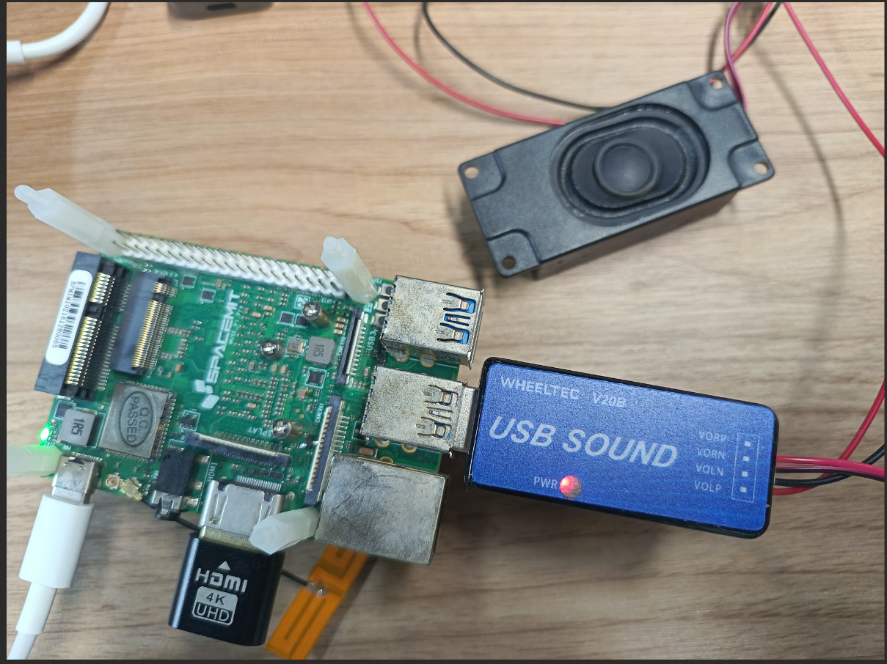
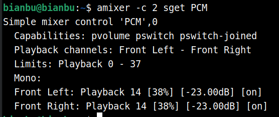
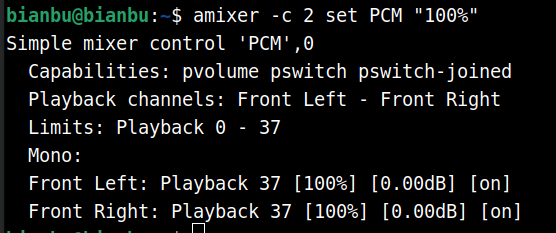

# 6.3.11 扬声器硬件调试说明

## 支持的硬件与协议

- **硬件接口**：
  - USB 扬声器
  - USB 声卡
  - HDMI 扬声器
- **协议**：
  - ALSA (Advanced Linux Sound Architecture)
  - PulseAudio（可选，主要用于开发/调试）

## 软硬件环境

- **依赖工具（开发/调试阶段常用）**：
  - `aplay` （ALSA 命令行播放工具）
  - `amixer` （命令行音量控制）

## 系统依赖

```bash
sudo apt install alsa-utils python3-pyaudio python3-scipy libfftw3-dev \
portaudio19-dev libsndfile1-dev libcurl4-openssl-dev espeak-ng
```


## 扬声器连接示意

- 将 USB 扬声器插入 **MUSE Pi Pro** 的 USB 接口
- 可以选用其他可在 linux 下工作的 USB 扬声器



## 添加到音频组

普通用户默认可能没有访问音频设备权限，需要加入 **audio** 用户组：

```bash
sudo usermod -aG audio $USER
```

执行后需要重新登录终端，才能生效。

## 确认音频设备号

列出 ALSA 播放设备：

```bash
aplay -l
```

根据设备名称找到 USB 设备，记录输出中的 `card` 和 `device` 编号。以下以 `card 2`、`device 0` 为例，对应 ALSA 设备名 `hw:2,0`；后续命令中的编号需替换为实际值。

准备一个 WAV 音频文件（以下使用 `test.wav`），通过 USB 扬声器播放：

```bash
aplay -D "plughw:2,0" test.wav
```


## 播放音量设置

查看指定声卡的音量

```text
amixer -c 2 sget PCM
```

通过 `-c` 参数指定声卡编号

终端打印：



**设置音量**

```text
amixer -c 2 set PCM "100%"
```

打印如下：


