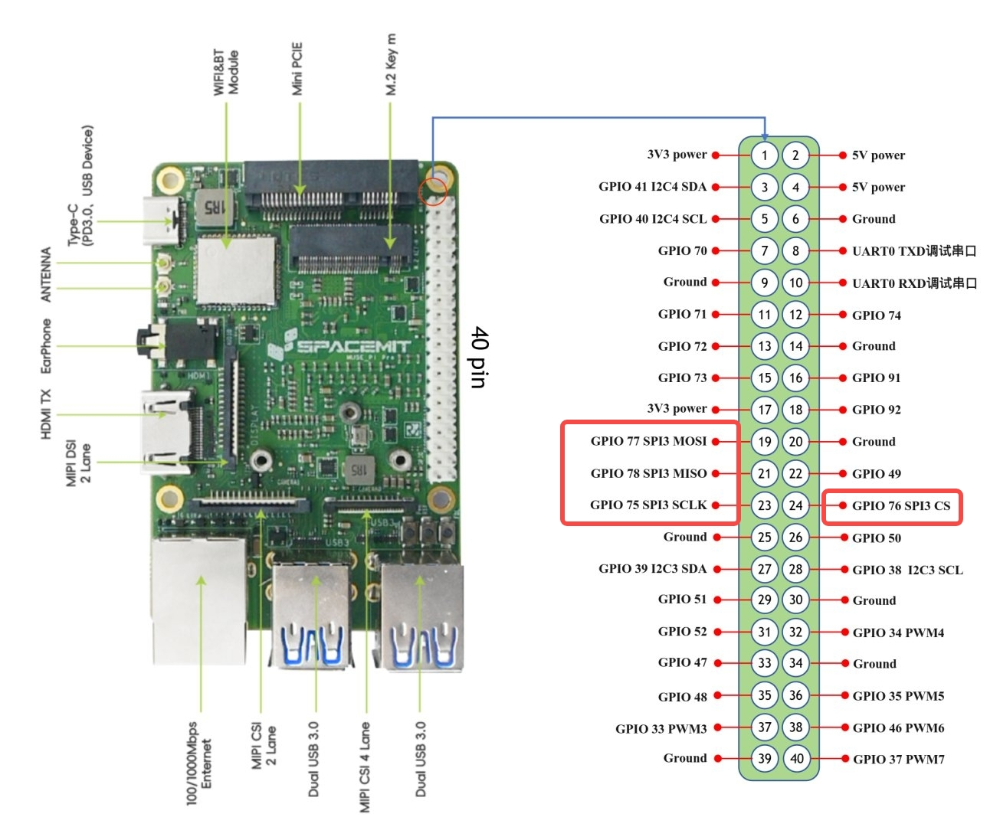

# 6.5.5 SPI-使用说明

```text
最新版本：2025/09/26
```

本文档介绍如何在开发板上配置和使用 SPI 接口。

## 模块介绍

SPI（Serial Peripheral Interface） 是一种 SoC 与外设之间的串行通信接口，仅支持单通道模式（x1 模式）。SPI 有 **主设备（Master）** 和 **从设备（Slave）** 两种模式，通常为一个主设备控制一个或多个从设备进行通信。

主设备通过拉低片选线选择一个从设备进行通信，完成数据交互。主设备负责提供时钟，并发起读写操作。

> **注:** K1 SPI 当前仅支持主设备模式。

**引脚功能：**

引脚                                 | 功能说明
-------------------------------------|-------------------------------|
SCLK (Serial Clock)                  | 时钟信号线
MISO (Master In Slave Out)           | 从主通信 (从设备 → 主设备数据)
MOSI (Master Out Slave In)           | 主从通信 (主设备 → 从设备数据)
CS/SS (Chip Select / Slave Select)   | 从设备片选信号线

## 引脚说明

请参考[《引脚定义说明》](6.5.1-引脚定义说明.md)，确认开发板支持的 SPI 引脚。

以 **MUSE-Pi-Pro** 为例，支持的 SPI 引脚如下：


## 查看设备信息

- **查看系统 SPI 总线设备和驱动信息**

   ```bash
   ls /sys/bus/spi
   ```

   输出示例：

   ```text
    spi--
       |-- devices         //SPI 总线上的设备
       |-- drivers         //SPI 总线上注册的设备驱动
       |-- drivers_autoprobe
       |-- drivers_probe
   ```

- **查看指定 SPI 总线设备的信息**

   ```bash
   ls -la /sys/bus/spi/devices/spi3.0
   ```

- **查看指定 SPI 设备的模态（设备名称）**

   ```bash
   cat /sys/bus/spi/devices/spi3.0/modalias
   ```

- **查看 SPI 设备的速度模式**

   ```bash
   cat /sys/bus/spi/devices/spi3.0/of_node/spi-max-frequency
   ```

## 启用 SPI

MUSE Pi Pro 的排针 SPI3 对应控制器 `/soc/spi@d401c000`。启用时需要准备匹配的 `spidev` 驱动、配置从设备并完成驱动绑定，步骤见 [SPI3 与 spidev 配置](../6.2-外设与驱动/assets/k1_spi3_spidev.md)。该说明以用户态灯带设备为例，包含设备树备份、部署、开机绑定和恢复方法；接入其他 SPI 器件时，应按其协议设置片选、时钟、模式及接线。

物理针脚 19、21、23、24 对应 SPI3，其中 23、24 与普通 CAN 引脚组复用。`spi4.0` 用于板载 NOR Flash，无需为使用排针 SPI3 停用它。内核模块和设备树应与运行系统匹配。

配置完成后检查设备节点：

```bash
ls -l /dev/spidev3.0
```

## 使用示例

- **连接 SPI 从设备到开发板**

   ```text
   连接方式
   主设备 (Master)         <===>         从设备 (Slave)
       SCK          -------------->          SCK
       MOSI         -------------->          MOSI (或 SDI)
       MISO         <--------------          MISO (或 SDO)
       CS0          -------------->          CS (或 nSS)
   ```

- **查看设备**

   ```bash
   ls -l /dev/spidev3.0
   ```

- **SPI 主设备示例代码**

以下程序演示同步字节传输。启动时发送 `0x9f`，交互输入按文本字节发送；实际器件的命令、长度及响应格式应按其协议调整。WS2812 灯带使用 [LED 章节](../6.2-外设与驱动/6.2.7-LED.md)的专用示例。

```c
//spi_master.c

#include <stdio.h>
#include <stdlib.h>
#include <fcntl.h>
#include <unistd.h>
#include <sys/ioctl.h>
#include <linux/spi/spidev.h>
#include <string.h>
#include <stdint.h>

#define SPI_DEV "/dev/spidev3.0"
#define BUF_SIZE 32

static uint32_t mode = SPI_MODE_0;
static uint8_t bits = 8;
static uint32_t speed = 1000000;

int spi_init()
{
    int fd = open(SPI_DEV, O_RDWR);
    if (fd < 0) {
        perror("无法打开SPI设备");
        return -1;
    }

    if (ioctl(fd, SPI_IOC_WR_MODE, &mode) < 0) {
        perror("无法设置SPI模式");
        goto error;
    }

    if (ioctl(fd, SPI_IOC_WR_BITS_PER_WORD, &bits) < 0) {
        perror("无法设置字长");
        goto error;
    }

    if (ioctl(fd, SPI_IOC_WR_MAX_SPEED_HZ, &speed) < 0) {
        perror("无法设置SPI速度");
        goto error;
    }

    return fd;

error:
    close(fd);
    return -1;
}

int spi_transfer(int fd, uint8_t *tx_buf, uint8_t *rx_buf, int len)
{
    struct spi_ioc_transfer tr =
    {
        .tx_buf = (unsigned long)tx_buf,
        .rx_buf = (unsigned long)rx_buf,
        .len = len,
        .speed_hz = speed,
        .bits_per_word = bits,
        .delay_usecs = 0,
    };

    if (ioctl(fd, SPI_IOC_MESSAGE(1), &tr) < 1) {
        perror("SPI传输失败");
        return -1;
    }

    return 0;
}

int main()
{
    int fd = spi_init();
    if (fd < 0) return 1;

    uint8_t tx_buf[BUF_SIZE] = {0};
    uint8_t rx_buf[BUF_SIZE] = {0};

    tx_buf[0] = 0x9f;
    spi_transfer(fd, tx_buf, rx_buf, strlen((char *)tx_buf) + 3);
    printf("从设备响应: %x%x%x%x\n", rx_buf[0], rx_buf[1], rx_buf[2], rx_buf[3]);


    while (1)
    {
        printf("Master> ");
        if (fgets((char *)tx_buf, BUF_SIZE, stdin) == NULL) break;


        if (strncmp((char *)tx_buf, "quit", 4) == 0) break;


        size_t transfer_len = strlen((char *)tx_buf) + 3;
        if (transfer_len > BUF_SIZE) transfer_len = BUF_SIZE;
        if (spi_transfer(fd, tx_buf, rx_buf, (int)transfer_len) == 0) {
            printf("从设备响应: %x%x%x%x\n", rx_buf[0], rx_buf[1], rx_buf[2], rx_buf[3]);
        }

        memset(tx_buf, 0, BUF_SIZE);
        memset(rx_buf, 0, BUF_SIZE);
    }

    close(fd);
    return 0;
}
```

- **在主机上交叉编译此文件**

   ```bash
   riscv64-unknown-linux-gnu-gcc -O2 -mcpu=spacemit-x60 -march=rv64gc_zba_zbb_zbc_zbs spi_master.c -o spi_master
   ```

   编译工具下载及使用方法见[交叉编译工具手册](https://www.spacemit.com/community/document/info?lang=zh&nodepath=tools/user_guide/cross_compiler_user_guide.md)

- **复制可执行文件到开发板**

   ```bash
   scp spi_master bianbu@10.0.91.35:/home/bianbu
   ```

   **说明：**

  - `scp` - SSH 远程复制命令
  - `spi_master` - 可执行文件名
  - `bianbu` - 开发板用户名
  - `10.0.91.35` - 开发板 IP 地址（可 使用 `hostname -I` 查看板子的 IP 地址）
  - `/home/bianbu` -  存储路径（自定义）

   > **注意：** 使用 `scp` 命令时，需要确保开发板和主机在同一局域网下

- **在开发板上运行该程序**

   ```bash
   sudo ./spi_master
   ```

   示例输出：

   ```text
   从设备响应: 0000
   Master> 9f
   从设备响应: 0000
   ```
