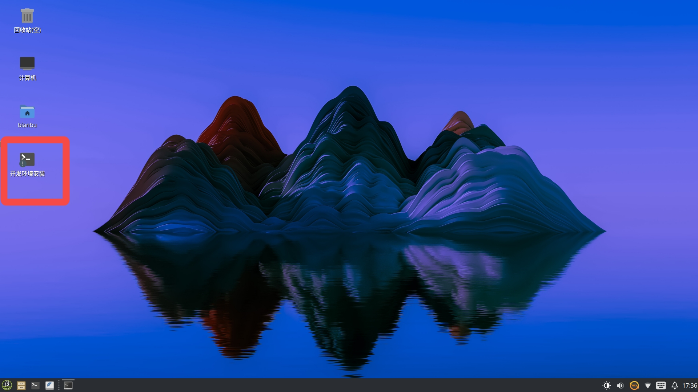
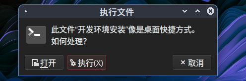
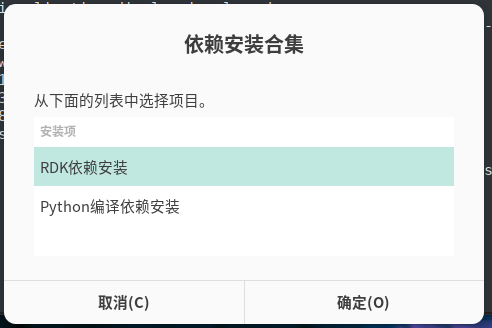

# 6.7.3 系统依赖安装

按开发任务选择依赖安装方式：

| 开发任务 | 安装入口 |
| :--- | :--- |
| 编译 Robot SDK | 按 [2.4 构建编译](../../02-快速入门/2.4-构建编译.md)准备构建环境，按组件提示安装依赖 |
| 使用 ROS 2 | 按 [6.5.1 ROS2 安装](../6.5-ROS2/6.5.1-ROS2安装.md)启用软件源并安装所需功能包 |
| 使用 RDK | 先安装 ROS 2，再按 [6.5.5 AI Robot 安装](../6.5-ROS2/6.5.5-AI-Robot安装.md)准备 `/opt/bros` 运行环境 |
| Python 开发 | 按 [6.7.4 Python 使用](6.7.4-Python-使用.md)安装虚拟环境工具和项目依赖 |
| C/C++ 开发 | 按 [6.7.5 C++ 使用指南](6.7.5-C++-使用指南.md)安装编译器、构建工具和开发库 |

## ROS2_LXQT 桌面安装工具

如果使用 ROS2_LXQT 固件，桌面的 **开发环境安装** 图标可安装 RDK、MediaEngine、ROS 2 所需依赖。该图标属于 ROS2_LXQT 的客制化内容；Bianbu 通用固件按上表安装。

1）双击 **开发环境安装** 图标：

2）选择 **执行**：

3）选择相应的依赖安装项，点击 **确认** 后，按提示输入当前用户的密码。

