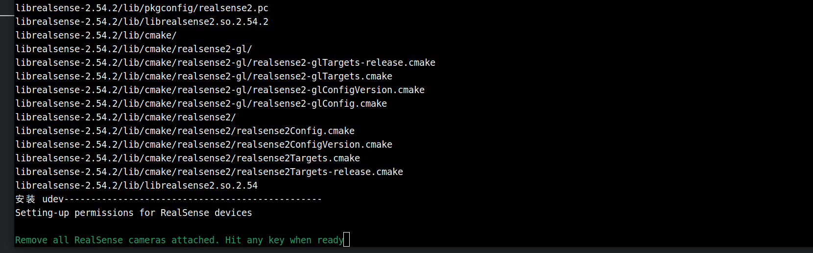
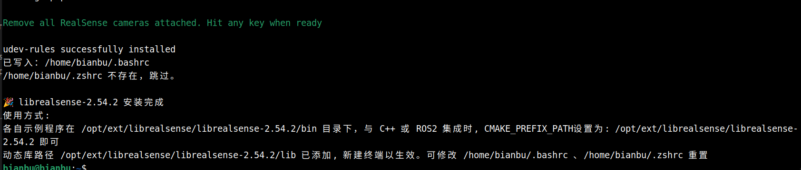
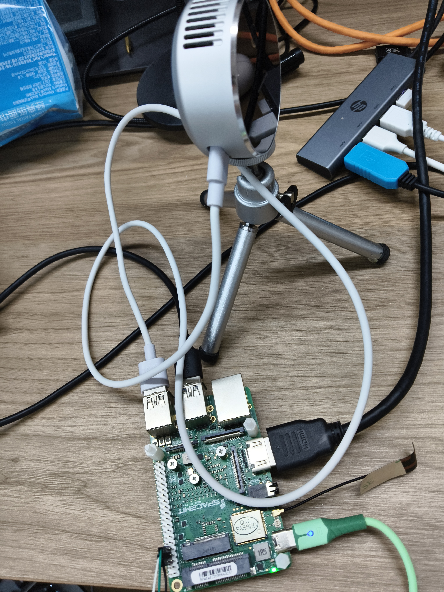
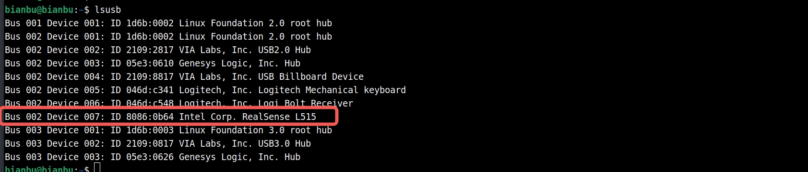
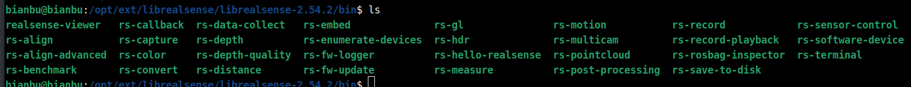
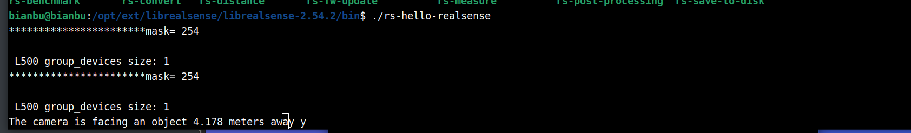
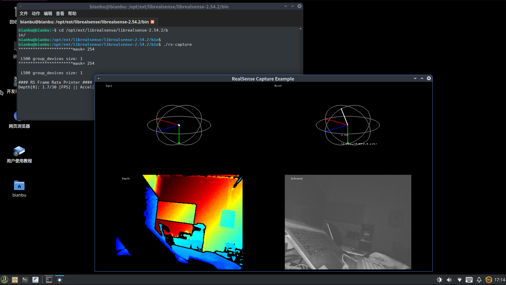

# 6.7.2 Realsense-L515-深度相机使用

inter 官方已经停止对 L515 的支持，建议使用 D4xx 系列。

使用 L515 前，安装下述内核和 librealsense 2.54.2。

## SDK 版本说明

只可使用 v2.54.2 版本 SDK

预编译 SDK 基于官方版本修改构建，官方源码发布地址：https://github.com/realsenseai/librealsense/releases

## 更换内核

**下载内核包：**

```text
wget https://archive.spacemit.com/ros2/prebuilt_libs/bianbu24/kernel_image/linux-image-6.6.63_6.6.63-20251217101945_riscv64.deb
```

**安装内核包**

```text
sudo apt update
sudo apt install ./linux-image-6.6.63_6.6.63-20251217101945_riscv64.deb
```

等待安装完成，执行：

```text
sudo reboot
```


## 下载并使用 SDK

下载前请不要连接任何 Realsense 设备到板子上。

### 获取下载脚本

```text
wget https://archive.spacemit.com/ros2/prebuilt_libs/install_scripts_common/install_librealsense.sh
```


### 指定版本下载

```text
bash install_librealsense.sh 2.54.2
```

终端输出：

```text
bianbu@bianbu:~$ bash install_librealsense.sh 2.54.2
准备安装 librealsense 2.54.2
版本说明: 高版本，支持 D4xx系列相机, 已经过测试。具体见: https://dev.realsenseai.com/docs/realsense-d400-firmware-software-updates/
当前系统 Python 版本: 3.12 (使用目录: bianbu24)
更新 apt 源并安装依赖...
[sudo] bianbu 的密码：
```

按提示输入当前用户的密码。

等待依赖安装完成，终端提示：



注意，确认当前板子没有连接 Realsense 相机后，按下回车键继续。

安装成功后，终端输出如下：



新建终端让 LD_LIBRARY_PATH 环境变量生效。

注意不要在一台机器上安装多个版本 SDK ，以免互相干扰。


### 硬件连接

安装完 SDK 后即可以接入 Realsense  L515 相机，如下：



终端输入 lsusb 查看设备:



输出中应出现对应的 RealSense 设备。

### 运行示例

进入 `/opt/ext/librealsense/librealsense-2.54.2/bin` 目录

有一些可以运行的示例程序，如下：



#### rs-hello-realsense

简单的程序，获取相机图像中心的深度值，输出如下：



#### rs-capture

含界面显示，你应该在本地执行该命令，而非 ssh 终端

显示如下：



可视化工具占用较多计算资源，适合预览相机图像。运行应用时可关闭预览窗口。
