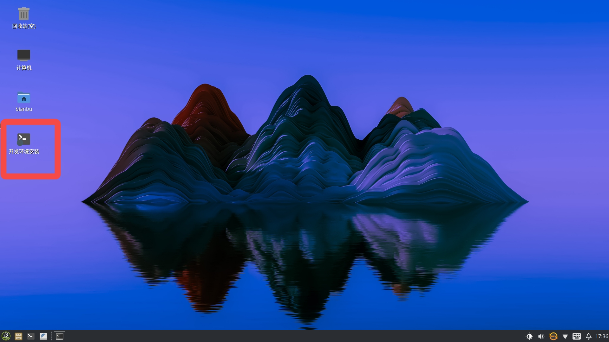
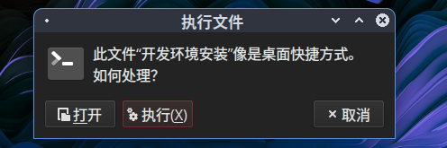
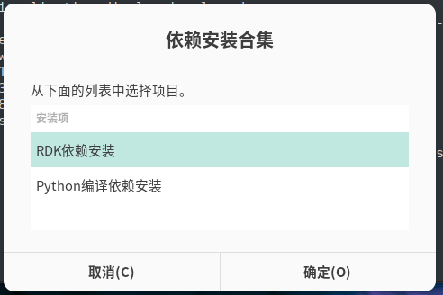

# 6.8.3 系统依赖安装

ROS2_LXQT 固件桌面提供 **开发环境安装** 图标，可一键安装 RDK、MediaEngine、ROS2 所需依赖。该图标属于 ROS2_LXQT 的客制化内容，Bianbu 通用固件没有该图标，请按 [2.2 镜像烧录](../../02-快速入门/2.2-镜像烧录.md#ros2_lxqt-与-bianbu-通用固件) 中的表格按需安装。

1）双击 **开发环境安装** 图标：

2）选择 **执行**：

3）选择相应的依赖安装项，点击 **确认** 之后会弹出密码验证框，密码为 **bianbu**。

